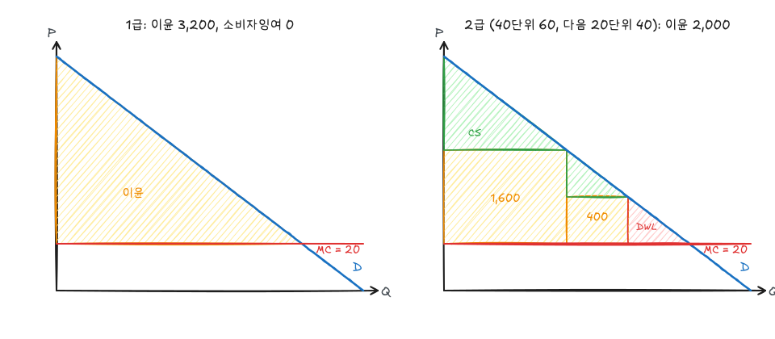
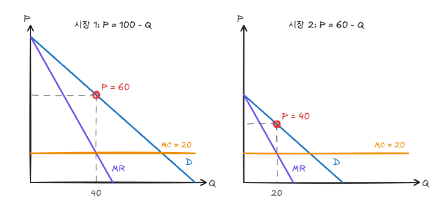
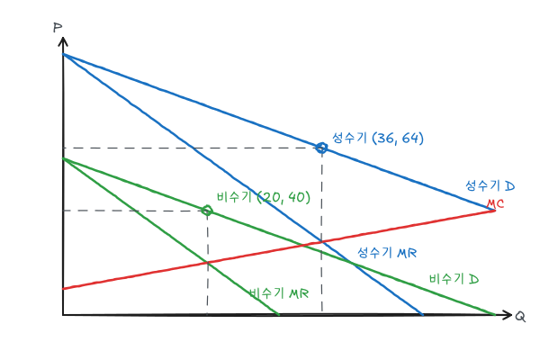
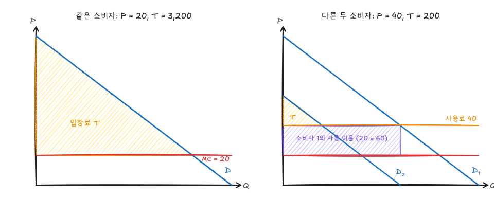
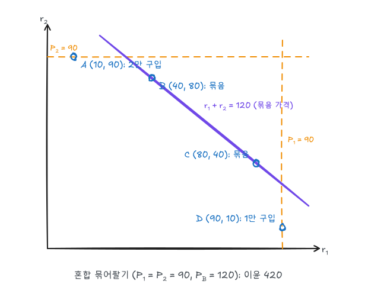

[독점](/posts/micro-monopoly-market-power)의 단일가격 전략($P = 100 - Q$, $MC = 20$)은 이윤 1,600을 남기고 소비자잉여 800과 자중손실 800을 남긴다. 이 글은 시장지배력을 가진 기업이 남은 잉여를 이윤으로 가져오는 방법을 다룬다.

## 1. 1급 가격차별 (완전 가격차별)

각 소비자에게 그의 **유보가격**(최대 지불의사)을 받는다. 추가 판매가 기존 판매가격을 낮추지 않으므로 $MR$ 곡선이 수요곡선과 같아진다.

- 생산량: $P = MC$인 $Q = 80$ (경쟁과 같음)
- 이윤: 수요곡선과 MC 사이 전체 면적 $= \frac12 \times 80 \times 80 = 3{,}200$
- 소비자잉여 0, 자중손실 0

효율적이지만 잉여가 모두 기업에 간다. 실제로는 유보가격을 정확히 알 수 없어 불완전한 1급 가격차별(의사·변호사의 소득별 요금, 자동차 딜러의 흥정, 대학의 장학금)이 나타난다.

## 2. 2급 가격차별

같은 재화의 **구매량**에 따라 다른 가격을 받는다. 수량할인, 구간별 요금(전기 요금 누진제의 역방향)이 대표적이다.

예제 수요에서 첫 40단위를 60에, 다음 20단위를 40에 판다고 하면

$$
\pi = (60 - 20)\times 40 + (40 - 20)\times 20 = 1{,}600 + 400 = 2{,}000
$$

단일가격보다 이윤이 크고 거래량도 60으로 늘어 자중손실이 줄어든다. 구간을 더 잘게 나눌수록 1급 가격차별에 가까워진다.

1급 가격차별은 수요곡선과 MC 사이의 삼각형 전체(3,200)를 이윤으로 가져간다. 2급 가격차별은 두 계단의 사각형(1,600과 400)을 가져가고, 계단 위의 초록 삼각형들(합 1,000)이 소비자에게 남으며, 60 이후의 빨간 삼각형 200이 자중손실이다. 계단 수를 늘리면 초록과 빨간 부분이 함께 줄어 1급 가격차별에 가까워진다.

## 3. 3급 가격차별

소비자를 관찰 가능한 특성(학생, 노인, 지역)으로 집단으로 나누고 집단별로 다른 가격을 받는다. 이윤극대화 조건은

$$
MR_1 = MR_2 = MC
$$

$MR_1 > MR_2$이면 시장 2에서 시장 1로 판매를 옮겨 수입을 늘릴 수 있기 때문이다. $MR_i = P_i(1 + 1/E_i)$를 대입하면

$$
\frac{P_1}{P_2} = \frac{1 + 1/E_2}{1 + 1/E_1}
$$

로, **덜 탄력적인 집단에 높은 가격**을 매긴다. 강의 예: $E_1 = -10$, $E_2 = -2$이면

$$
\frac{P_1}{P_2} = \frac{1 - 1/2}{1 - 1/10} = \frac{0.5}{0.9} = \frac59
$$

로, 탄력적인 시장 1의 가격이 시장 2의 약 56%다.

### 예제

| | 시장 1 | 시장 2 |
|---|---|---|
| 수요 | $P_1 = 100 - Q_1$ | $P_2 = 60 - Q_2$ |
| 한계수입 | $100 - 2Q_1$ | $60 - 2Q_2$ |
| $MR = 20$ | $Q_1 = 40$ | $Q_2 = 20$ |
| 가격 | $P_1 = 60$ | $P_2 = 40$ |
| 탄력성 | $-60/40 = -1.5$ | $-40/20 = -2$ |
| 이윤 | $40 \times 40 = 1{,}600$ | $20 \times 20 = 400$ |

검산: $P_1/P_2 = 60/40 = 1.5$, $(1 - 1/2)/(1 - 1/1.5) = 0.5/0.333 = 1.5$.

**단일가격과 비교**: 두 시장을 합친 수요는 $P \le 60$ 구간에서 $Q = 160 - 2P$, 즉 $P = 80 - Q/2$이다. $MR = 80 - Q = 20$에서 $Q = 60$, $P = 50$이며 이윤은 $(50 - 20) \times 60 = 1{,}800$이다. 가격차별 이윤 2,000이 더 크다.

이 예제처럼 수요가 선형이고 두 시장 모두 판매가 이루어지면 총판매량은 같다(60). 이 경우 가격차별은 총잉여를 줄인다. 반대로 단일가격에서는 아예 팔지 않던 시장이 가격차별로 열리면 총잉여가 늘 수 있다.

가격차별이 가능하려면 (1) 시장지배력, (2) 집단 구분 가능, (3) **재판매 차단**이 필요하다.

## 4. 시점 간 가격차별과 최대부하 가격설정

**시점 간 가격차별**: 수요가 비탄력적인 고객(먼저 사고 싶은 사람)에게 출시 초기 높은 가격을 받고, 시간이 지나 탄력적인 고객에게 낮은 가격을 받는다. 신작 하드커버와 문고판, 영화 개봉과 이후 스트리밍이 예다.

**최대부하 가격설정**: 수요가 몰리는 시간대에 높은 가격을 받는다. 전기요금 시간대별 요금, 성수기 항공권이 예다. 시간대별 수요가 서로 독립이고 성수기 MC가 높으므로 각 시간대에서 $MR = MC$를 따로 맞춘다. 3급 가격차별과 달리 가격 차이가 한계비용 차이(성수기에 높음)를 반영한다.

그림은 성수기 수요 $P = 100 - Q$, 비수기 수요 $P = 60 - Q$, 한계비용 $MC = 10 + Q/2$인 예시다. 시간대마다 $MR = MC$를 따로 풀면 성수기에는 36단위를 64에, 비수기에는 20단위를 40에 판다. 두 시간대의 가격 차이는 수요 차이뿐 아니라 성수기의 높은 한계비용도 반영한다. 한계비용이 다른 시간대에 같은 가격을 받으면 성수기에는 과잉 이용, 비수기에는 과소 이용이 생긴다.

## 5. 이부가격제

입장료(가입비) $T$와 사용료 $P$를 함께 받는다. 놀이공원, 통신 기본료, 회원제 창고형 할인점이 예다.

**동일한 소비자**만 있다면 사용료를 $P = MC$로 두고 입장료로 소비자잉여 전체를 받는 것이 최적이다. 예제에서 각 소비자 수요가 $P = 100 - Q$라면

$$
P = 20,\quad Q = 80,\quad T = \tfrac12 \times 80 \times 80 = 3{,}200
$$

로 1급 가격차별과 같은 이윤을 얻는다.

**수요가 다른 두 소비자**(수요 $P = 100 - Q$, $P = 60 - Q$)를 **모두 시장에 참여시킨다면** 입장료는 작은 소비자의 잉여를 넘을 수 없다. 사용료를 MC보다 약간 높이면 큰 소비자에게서 더 많은 이윤을 얻는다. 

| 사용료 $P$ | 입장료 $T$ (소비자 2 잉여) | 사용 이윤 $(P - 20)(Q_1 + Q_2)$ | 총이윤 |
|---|---|---|---|
| 20 | $\frac12(40)^2 = 800$ | 0 | 1,600 |
| 30 | $\frac12(30)^2 = 450$ | $10 \times 100 = 1{,}000$ | 1,900 |
| 40 | $\frac12(20)^2 = 200$ | $20 \times 80 = 1{,}600$ | 2,000 |
| 50 | $\frac12(10)^2 = 50$ | $30 \times 60 = 1{,}800$ | 1,900 |

입장료는 두 소비자 모두에게 받으므로 총이윤 $= 2T + (P - 20)(Q_1 + Q_2)$다. 이 예제에서는 사용료 40이 최적이며 $MC$보다 높다. 소비자가 다양할수록 최적 사용료는 MC보다 높아지고 입장료는 작아진다.

소비자가 같으면 사용료를 MC로 두어 소비를 최대로 늘린 뒤, 노란 삼각형(소비자잉여 전체)을 입장료로 받는다. 소비자가 다르면 입장료는 작은 소비자 2의 잉여(노란 삼각형 200)를 넘을 수 없다. 사용료를 40으로 올리면 이 입장료는 줄지만, 많이 쓰는 소비자 1($20 \times 60 = 1{,}200$)과 소비자 2($20 \times 20 = 400$)에게서 총 1,600의 사용 이윤을 얻는다(그림의 보라 사각형은 소비자 1의 사용 이윤). 이 둘의 맞교환에서 최적 사용료가 정해진다. 총이윤 $(60 - P)^2 + (P - 20)(160 - 2P)$를 $P$로 미분하면 $80 - 2P = 0$으로 $P = 40$이 나온다.

> **주의** 이 계산은 두 소비자를 모두 참여시킨다는 전제다. 소비자 2를 포기하고 소비자 1만 상대하면 $P = 20$, $T = 3{,}200$으로 이윤 3,200이 되어 오히려 더 크다. 소비자가 다양하면 최적 전략이 일부를 시장에서 내보내는 것일 수 있다.

## 6. 묶어팔기

두 재화를 묶어 하나의 가격에 판다. **유보가격의 음의 상관**이 있을 때 이익이다.

| 소비자 | 재화 A 유보가격 | 재화 B 유보가격 | 합계 |
|---|---|---|---|
| 1 | 12,000 | 3,000 | 15,000 |
| 2 | 10,000 | 4,000 | 14,000 |

MC = 0이라 하자.

- 따로 판매: A를 10,000에, B를 3,000에 팔면 수입 $2 \times 10{,}000 + 2 \times 3{,}000 = 26{,}000$
- 묶어 판매: 14,000에 팔면 $2 \times 14{,}000 = 28{,}000$

A를 더 원하는 사람이 B를 덜 원하므로 합계의 차이가 작아져(15,000 vs 14,000) 묶음 가격으로 더 많은 잉여를 가져올 수 있다. 유보가격이 양의 상관이면 묶어팔기 이득이 없다.

**혼합 묶어팔기**는 묶음과 개별 상품을 함께 판다. 어떤 소비자의 한 재화 유보가격이 MC보다 낮을 때 순수 묶어팔기보다 유리하다.

강의 예제: 두 가지 유보가격 $(r_1, r_2)$ 사례를 비교한다. 첫 번째(양의 한계비용)는 A(10, 90), B(50, 50), C(60, 40), D(90, 10)이고, 두 번째(한계비용 0)는 A(10, 90), B(40, 80), C(80, 40), D(90, 10)이다. 소비자는 묶음, 개별 구매, 미구매 중 잉여가 가장 큰 쪽을 고른다(잉여가 0으로 동률일 때는 구매하는 것으로 본다).

| 전략 | 한계비용 $c_1 = 20$, $c_2 = 30$ (B(50,50), C(60,40)) | 한계비용 0 (B(40,80), C(80,40)) |
|---|---|---|
| 개별 판매 | $P_1 = 50$, $P_2 = 90$: B, C, D가 1을, A가 2를 삼. $(50 - 20)\times 3 + (90 - 30) = 150$ | $P_1 = P_2 = 80$: C, D가 1을, A, B가 2를 삼. 320 |
| 순수 묶어팔기 | $P_B = 100$: 모두 구매. $(100 - 50)\times 4 = 200$ | $P_B = 100$: 400 |
| 혼합 묶어팔기 | $P_1 = P_2 = 89.95$, $P_B = 100$: D는 1만, A는 2만, B와 C는 묶음. $69.95 + 59.95 + 2 \times 50 = 229.9$ | $P_1 = P_2 = 90$, $P_B = 120$: A·D는 개별(잉여 0), B·C는 묶음(잉여 0). 420 |

두 번째 경우($MC = 0$)의 혼합 묶어팔기에서는 $P_1 = P_2 = 90$, $P_B = 120$에서 A와 D가 유보가격이 높은 재화 하나만 90에 사고(개별 잉여 0 > 묶음 잉여 −20), B와 C는 120에 묶음을 산다(묶음 잉여 0, 동률 시 구매 가정; 엄밀히 양의 잉여가 필요하면 가격을 89.95, 119.95처럼 미소하게 낮추면 된다).

각 점은 소비자의 유보가격 $(r_1, r_2)$이다. 보라 직선 $r_1 + r_2 = 120$ 선상 또는 그보다 위에 있는 소비자는 묶음을 살 의향이 있다. B와 C는 두 재화의 유보가격이 고르게 높아 묶음을 산다. A와 D는 한 재화의 유보가격만 90 이상이어서, 묶음(잉여 −20)보다 그 재화 하나를 90에 사는 쪽(잉여 0)을 고른다. 개별 가격을 묶음 가격보다 상대적으로 높게 두어 유보가격이 한쪽에 치우친 소비자를 개별 구매로 걸러 내는 것이 혼합 묶어팔기의 원리다.

첫 번째 경우 순수 묶어팔기에서는 A가 재화 1을(유보가격 10 < MC 20), D가 재화 2를(10 < 30) 함께 얻게 되어 사회적으로 손해다. 이들에게는 가치가 높은 재화만 팔게 하는 혼합 묶어팔기가 이윤도 크고(229.9 대 200) 이 손실도 없앤다. **끼워팔기**는 한 상품 구매에 다른 상품 구매를 조건으로 거는 방식이다(프린터와 전용 잉크).

## 7. 광고

광고 지출 $A$가 수요를 늘리면 이윤 $\pi = P\,Q(P, A) - C(Q) - A$를 극대화하는 조건은

$$
\frac{A}{PQ} = -\frac{E_A}{E_P}
$$

이다. $E_A$는 수요의 광고탄력성이다. **매출 대비 광고비 비율은 광고탄력성/가격탄력성(절댓값)**이다. 예를 들어 $E_A = 0.1$, $E_P = -4$이면 매출의 2.5%를 광고에 쓴다. 강의 예제에서는 연 매출 100억 원, $E_A = 2$, $E_P = -10$이므로 $A/100 = 2/10$, 광고비는 20억 원이다. 가격탄력성이 작은(차별화된) 상품, 광고탄력성이 큰 상품일수록 광고비 비중이 높다.

## 8. 비교

| 전략 | 구분 기준 | 조건 | 효율성 | 예제 |
|---|---|---|---|---|
| 1급 | 개인의 유보가격 | 유보가격 정보 | 효율적($P = MC$까지) | 이윤 3,200 |
| 2급 | 구매량 | 구간별 요금 설계 | 구간이 잘면 효율에 근접 | 60·40 두 구간 2,000 |
| 3급 | 관찰 가능한 집단 | 집단 구분, 재판매 차단 | 총판매량이 같으면 비효율 | 2,000 (단일 1,800) |
| 시점 간 | 시간(탄력성 차이) | 기다림의 비용이 다른 고객 | 일반적으로 3급과 같음 | 하드커버와 문고판 |
| 최대부하 | 시간(MC 차이) | 용량 제약 | 가격이 MC 차이를 반영 | 성수기 64, 비수기 40 |
| 이부가격 | 입장료와 사용료 | 가입 후 사용량이 따로 정해짐 | 동질적이면 효율적, 이질적이면 $P > MC$ | 3,200, 2,000 |
| 순수 묶음 | 유보가격의 합 | 유보가격의 음의 상관 | 묶음으로 낭비 소비 가능 | 28,000 대 26,000 |
| 혼합 묶음 | 묶음과 개별 가격 | 위와 같음, MC가 있을 때 유리 | 순수 묶음보다 낭비 적음 | 229.9 대 200 |

위 표에서 1·2·3급은 같은 재화를 소비자마다 다른 평균 가격에 파는 방식이다. 같은 수요에서 1급은 소비자잉여를 0으로, 2급(두 구간)은 1,000으로, 단일가격은 800으로 남긴다(2급이 800보다 큰 것은 거래량이 60으로 늘기 때문이다). 3급은 시장이 다르므로 위 수치와 직접 비교하지 않는다.

## 정리

| 전략 | 조건 | 예제 이윤 |
|---|---|---|
| 단일가격 | $MR = MC$ | 1,600 |
| 1급 가격차별 | $P = MC$까지, 유보가격 징수 | 3,200 |
| 2급 가격차별 (2구간) | 60 / 40 | 2,000 |
| 3급 가격차별 | $MR_1 = MR_2 = MC$ | 2,000 (단일가격 1,800) |
| 이부가격제 (동질적) | $P = MC$, $T = CS$ | 3,200 |
| 이부가격제 (이질적, 둘 다 참여) | $P > MC$ | 2,000 |
| 광고 | $A/PQ = -E_A/E_P$ | |
