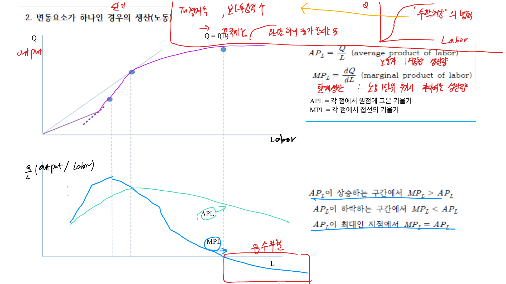

생산이론은 기업이 노동과 자본 같은 생산요소를 사용해 산출물을 만드는 관계를 설명한다. 이후 비용최소화와 이윤극대화를 이해하려면 생산함수, 한계생산물, 등량곡선, 규모수익을 먼저 정리해야 한다.

## 1. 생산함수

생산함수는 투입요소와 산출량의 관계를 나타낸다.

$$
Q = f(L, K)
$$

$L$은 노동, $K$는 자본이다. 단기에는 적어도 하나의 생산요소가 고정되어 있고, 장기에는 모든 생산요소를 조정할 수 있다.

단기에서 자본이 고정되어 있으면 생산함수는 노동만의 함수처럼 쓸 수 있다.

$$
Q = f(L, \bar K)
$$

## 2. 평균생산물과 한계생산물

노동의 평균생산물은 노동 한 단위당 산출량이다.

$$
AP_L = \frac{Q}{L}
$$

노동의 한계생산물은 노동을 한 단위 더 투입할 때 증가하는 산출량이다.

$$
MP_L = \frac{\partial Q}{\partial L}
$$

그래프에서 평균생산물은 원점과 생산함수 위의 점을 잇는 직선의 기울기이고, 한계생산물은 생산함수의 접선 기울기다.

 

 

## 3. 수확체감

한 생산요소를 고정하고 다른 생산요소만 계속 늘리면 어느 순간 한계생산물이 감소한다. 이를 한계생산물 체감의 법칙이라고 한다.

예를 들어 토지가 고정되어 있을 때 노동을 계속 투입하면 처음에는 산출량이 빠르게 늘지만, 일정 수준을 넘으면 노동자 한 명이 추가로 만들어내는 산출량은 줄어든다.

수확체감은 단기 개념이다. 장기에는 모든 생산요소를 함께 조정할 수 있으므로 규모수익을 별도로 분석한다.

## 4. 등량곡선

등량곡선은 같은 산출량을 만들어내는 노동과 자본 조합의 집합이다.

$$
f(L,K) = \bar Q
$$

무차별곡선이 같은 효용을 나타내듯, 등량곡선은 같은 생산량을 나타낸다. 원점에서 멀수록 더 높은 산출량을 의미한다.

등량곡선의 기울기는 기술적 한계대체율(MRTS)이다.

$$
MRTS_{LK} = -\frac{dK}{dL}
$$

생산함수로 표현하면

$$
MRTS_{LK} = \frac{MP_L}{MP_K}
$$

## 5. 생산요소의 대체

기술적 한계대체율은 같은 산출량을 유지하면서 노동을 한 단위 더 쓸 때 줄일 수 있는 자본의 양이다.

일반적인 생산기술에서는 노동을 많이 쓸수록 노동의 한계생산물이 낮아지고 자본의 상대적 가치가 커지므로 MRTS가 체감한다. 이 때문에 등량곡선은 원점에 대해 볼록하다.

완전대체 생산요소는 직선 등량곡선을 만들고, 완전보완 생산요소는 L자형 등량곡선을 만든다.

## 6. 규모수익

규모수익은 모든 생산요소를 같은 비율로 늘릴 때 산출량이 어떻게 변하는지를 본다.

생산함수 $Q = f(L,K)$에서 노동과 자본을 모두 $t$배 했을 때

$$
f(tL,tK)
$$

를 비교한다.

- 규모수익 증가: $f(tL,tK) > t f(L,K)$
- 규모수익 불변: $f(tL,tK) = t f(L,K)$
- 규모수익 감소: $f(tL,tK) < t f(L,K)$

규모수익은 장기 개념이고, 한계생산물 체감은 단기 개념이다. 둘을 구분해야 한다.

## 7. 생산성과 기술변화

생산성은 같은 투입으로 얼마나 많은 산출을 만드는지를 나타낸다. 노동생산성은 보통 노동시간당 산출로 측정한다.

기술진보가 발생하면 같은 노동과 자본으로 더 많은 산출을 생산할 수 있으므로 생산함수나 등량곡선이 바뀐다. 같은 산출량을 더 적은 투입으로 만들 수 있으면 비용도 낮아진다.

## 정리

생산이론의 핵심은 투입요소가 산출량으로 바뀌는 기술적 관계다. 단기에는 평균생산물, 한계생산물, 수확체감이 중요하고, 장기에는 등량곡선, MRTS, 규모수익이 중요하다. 이 내용은 다음 장의 비용최소화 문제로 바로 연결된다.
