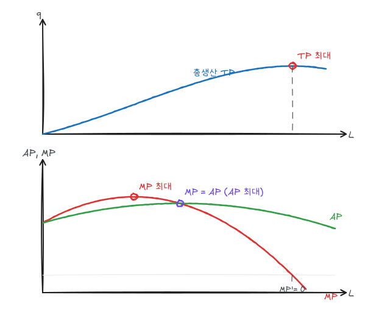
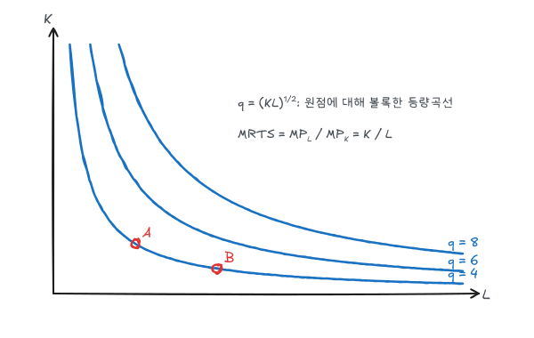

생산이론은 기업이 투입물을 산출물로 바꾸는 기술을 다룬다. 소비자 이론의 효용함수·무차별곡선·MRS가 생산이론의 생산함수·등량곡선·MRTS로 대응된다. 다만 효용은 서수적이지만 산출량은 측정 가능한 기수적 값이다.

## 1. 생산함수

$$
q = F(K, L)
$$

주어진 기술에서 자본 $K$와 노동 $L$로 생산할 수 있는 **최대** 산출량이다. 기술적으로 효율적인 생산만 나타낸다.

| 기간 | 정의 |
|---|---|
| 단기 | 적어도 하나의 투입요소(보통 자본)가 고정된 기간 |
| 장기 | 모든 투입요소를 바꿀 수 있는 기간 |

단기와 장기는 달력상의 길이가 아니라 요소 조정 가능성으로 구분한다.

## 2. 단기 생산: 가변요소가 하나

자본을 고정하고 노동만 바꿀 때

$$
AP_L = \frac{q}{L}, \qquad MP_L = \frac{\Delta q}{\Delta L} = \frac{dq}{dL}
$$

### 예제

$$
q = 30L + 3L^2 - 0.2L^3
$$

$$
MP_L = 30 + 6L - 0.6L^2, \qquad AP_L = 30 + 3L - 0.2L^2
$$

| 지점 | 조건 | $L$ | 값 |
|---|---|---|---|
| $MP_L$ 최대 | $dMP/dL = 6 - 1.2L = 0$ | 5 | $MP = 45$, TP의 변곡점 |
| $AP_L$ 최대 | $dAP/dL = 3 - 0.4L = 0$ | 7.5 | $AP = MP = 41.25$ |
| TP 최대 | $MP_L = 0$ | $5 + \sqrt{75} \approx 13.66$ | $q \approx 460$ |

### 세 곡선의 관계

- $MP > AP$이면 AP가 증가하고, $MP < AP$이면 AP가 감소한다. 따라서 **MP는 AP의 최고점을 지난다**. 평균 성적보다 높은 점수를 받으면 평균이 오르는 것과 같은 원리다.
- $MP = 0$에서 TP가 최대다.
- 그림에서 AP는 원점과 TP 위의 점을 잇는 선의 기울기, MP는 TP의 접선 기울기다. 두 기울기가 같아지는 점(원점에서 그은 선이 TP에 접하는 점)이 AP 최대점이다.

AP 최대 조건 검증: $\frac{d}{dL}\frac{q}{L} = \frac{MP\cdot L - q}{L^2} = 0 \Leftrightarrow MP = q/L = AP$.

### 수확체감의 법칙

다른 요소를 고정하고 한 요소를 계속 늘리면 결국 그 요소의 한계생산이 감소한다. 예제에서는 $L > 5$부터 MP가 줄어든다. 고정된 기계에 사람을 계속 투입하면 한 사람이 쓸 수 있는 장비가 줄어들기 때문이다.

수확체감은 **기술이 고정된** 상태의 이야기다. 기술 진보가 일어나면 TP 곡선 자체가 위로 이동하므로, 관찰된 노동생산성이 계속 오르는 것과 모순되지 않는다.

### 생산의 3단계

| 단계 | 범위 | 특징 | 합리적 생산 |
|---|---|---|---|
| 1단계 | $0 < L < 7.5$ | AP 증가 | 노동을 더 늘리는 것이 유리 |
| 2단계 | $7.5 \le L \le 13.66$ | AP 감소, $MP \ge 0$ | 합리적 생산 구간 |
| 3단계 | $L > 13.66$ | $MP < 0$ | 노동을 줄이면 산출이 증가 |

### 노동생산성

경제 전체의 노동생산성(노동자 1인당 산출 = $AP_L$)은 생활수준을 결정한다. 노동생산성을 높이는 요인은 자본 축적(1인당 자본 증가)과 기술 진보다.

## 3. 장기 생산: 가변요소가 둘

### 등량곡선

같은 산출량을 생산하는 $(L, K)$ 조합들의 곡선이다. 예제로 $q = \sqrt{KL}$을 쓰면 등량곡선은 $K = q^2/L$이다.

### 한계기술대체율

$$
MRTS_{LK} = -\frac{\Delta K}{\Delta L}\Big|_{q = \bar q} = \frac{MP_L}{MP_K}
$$

등량곡선 위에서 $MP_L\,\Delta L + MP_K\,\Delta K = 0$이므로 두 번째 등호가 성립한다. $q = \sqrt{KL}$에서

$$
MP_L = \frac12\sqrt{K/L}, \quad MP_K = \frac12\sqrt{L/K}, \quad MRTS = \frac{K}{L}
$$

q = 4인 등량곡선 위의 점 A$(L, K) = (4, 4)$에서 MRTS = 1, B$(8, 2)$에서 MRTS = 0.25다. 노동을 많이 쓸수록 노동 한 단위가 대체할 수 있는 자본이 줄어든다(**MRTS 체감**). 등량곡선이 원점에 대해 볼록한 이유다.

### 특수한 생산함수

| 형태 | 함수 | 등량곡선 | MRTS |
|---|---|---|---|
| 완전대체 | $q = aL + bK$ | 직선 | $a/b$ 일정 |
| 고정비율(레온티에프) | $q = \min(aL, bK)$ | L자 | 꺾인 점 외에는 0 또는 ∞ |
| 콥-더글러스 | $q = AL^\alpha K^\beta$ | 볼록 | $\frac{\alpha}{\beta}\frac{K}{L}$ |

## 4. 규모에 대한 수익

모든 투입요소를 같은 비율 $t$배로 늘릴 때 산출이 몇 배가 되는지다.

| 구분 | 조건 | 콥-더글러스 $AL^\alpha K^\beta$ |
|---|---|---|
| 규모수익 증가 | $F(tL, tK) > tF(L, K)$ | $\alpha + \beta > 1$ |
| 규모수익 불변 | $F(tL, tK) = tF(L, K)$ | $\alpha + \beta = 1$ |
| 규모수익 감소 | $F(tL, tK) < tF(L, K)$ | $\alpha + \beta < 1$ |

$q = \sqrt{KL}$은 $\alpha + \beta = 1$이므로 규모수익 불변이다. 그림의 등량곡선 q = 4, 6, 8을 원점에서 뻗는 선 위에서 보면 간격이 일정하다. 규모수익 증가면 산출이 커질수록 등량곡선 간격이 좁아진다.

규모수익 증가의 원인은 분업과 전문화, 대규모 설비의 효율성이고, 감소의 원인은 경영·조정의 어려움이다.

**수확체감과 규모수익은 다른 개념이다.** 수확체감은 한 요소만 늘릴 때, 규모수익은 모든 요소를 같이 늘릴 때의 이야기다. $q = \sqrt{KL}$은 노동에 대해 수확체감($MP_L$ 감소)이면서 규모수익 불변이다.

## 정리

| 개념 | 식 | 예제 |
|---|---|---|
| 평균생산 | $q/L$ | $L = 7.5$에서 최대 41.25 |
| 한계생산 | $dq/dL$ | $L = 5$에서 최대 45 |
| MP와 AP | MP가 AP 최대점 통과 | $L = 7.5$ |
| MRTS | $MP_L/MP_K$ | $\sqrt{KL}$에서 $K/L$ |
| 규모수익 | $F(tL, tK)$ vs $tF$ | $\sqrt{KL}$은 불변 |
