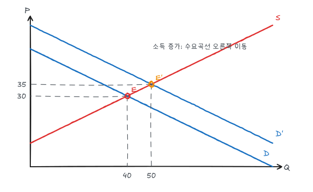
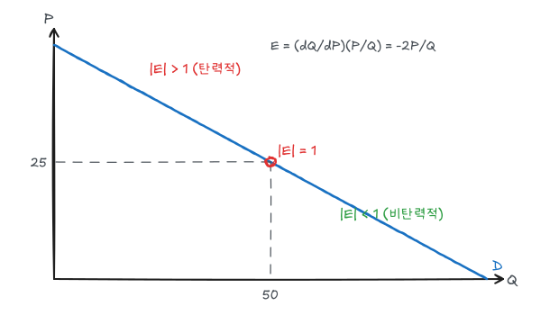

시리즈 전체 흐름은 [개요와 시리즈 지도](/posts/micro-overview)에 정리했다. 이 글은 시장 분석의 출발점인 수요와 공급을 다룬다. 예제는 모두 하나의 선형 수요·공급곡선으로 계산해 그림과 숫자가 맞도록 했다.

## 1. 수요곡선

수요곡선은 다른 조건이 일정할 때 가격과 소비자가 사려는 수량의 관계다.

$$
Q_D = Q_D(P;\ I,\ P_{\text{대체재}},\ P_{\text{보완재}},\ \text{기호},\ \dots)
$$

- 가격 $P$가 변하면 **수요곡선 위에서 이동**한다(수요량의 변화).
- 소득, 관련 재화 가격, 기호 같은 다른 변수가 변하면 **수요곡선 자체가 이동**한다(수요의 변화).
- 정상재는 소득이 늘면 수요가 증가(오른쪽 이동)하고, 열등재는 감소한다.
- 대체재 가격이 오르면 수요가 늘고, 보완재 가격이 오르면 수요가 준다.

## 2. 공급곡선

공급곡선은 가격과 생산자가 팔려는 수량의 관계다.

$$
Q_S = Q_S(P;\ \text{요소가격},\ \text{기술},\ \text{기업 수},\ \dots)
$$

가격이 오르면 공급량이 늘어 우상향한다. 임금·원자재 가격 하락이나 기술 진보는 같은 가격에서 더 많이 공급하게 하므로 공급곡선을 오른쪽으로 이동시킨다.

## 3. 시장균형

균형은 $Q_D = Q_S$가 되는 가격이다. 균형보다 가격이 높으면 초과공급이 생겨 가격이 내려가고, 낮으면 초과수요가 생겨 가격이 올라간다.

예제로 다음 두 곡선을 쓴다.

$$
\text{수요: } P = 50 - \tfrac{1}{2}Q \;\Leftrightarrow\; Q_D = 100 - 2P, \qquad
\text{공급: } P = 10 + \tfrac{1}{2}Q \;\Leftrightarrow\; Q_S = 2P - 20
$$

$100 - 2P = 2P - 20$에서 $P^* = 30$, $Q^* = 40$이다.

### 균형의 이동

소득이 늘어 모든 가격에서 수요량이 20씩 증가했다고 하자. 새 수요는 $Q_D = 120 - 2P$, 즉 $P = 60 - \tfrac12 Q$이다.

$$
120 - 2P = 2P - 20 \;\Rightarrow\; P' = 35,\quad Q' = 50
$$

수요만 이동하면 가격과 거래량이 함께 오른다. 공급만 오른쪽으로 이동하면 가격은 내리고 거래량은 는다. 두 곡선이 같이 움직이면 가격과 수량 중 하나의 방향은 이동 폭에 따라 달라진다.

| 변화 | 균형가격 | 균형거래량 |
|---|---|---|
| 수요 증가 | 상승 | 증가 |
| 수요 감소 | 하락 | 감소 |
| 공급 증가 | 하락 | 증가 |
| 공급 감소 | 상승 | 감소 |
| 수요 증가 + 공급 증가 | 불확정 | 증가 |
| 수요 증가 + 공급 감소 | 상승 | 불확정 |

## 4. 탄력성

탄력성은 한 변수가 1% 변할 때 다른 변수가 몇 % 변하는지를 나타낸다. 단위에 영향을 받지 않아 서로 다른 재화를 비교할 수 있다.

### 수요의 가격탄력성

$$
E_P = \frac{\%\Delta Q}{\%\Delta P} = \frac{\Delta Q / Q}{\Delta P / P} = \frac{\Delta Q}{\Delta P}\cdot\frac{P}{Q}
$$

| 값 | 구분 | 가격 인상 시 총수입 $PQ$ |
|---|---|---|
| $\lvert E_P \rvert > 1$ | 탄력적 | 감소 |
| $\lvert E_P \rvert = 1$ | 단위탄력적 | 불변 |
| $\lvert E_P \rvert < 1$ | 비탄력적 | 증가 |
| $E_P = 0$ | 완전비탄력적 | 수직 수요곡선 |
| $E_P = -\infty$ | 완전탄력적 | 수평 수요곡선 |

### 선형 수요곡선의 탄력성

선형 수요곡선은 기울기가 일정하지만 탄력성은 일정하지 않다. $Q = 100 - 2P$이면 $dQ/dP = -2$이므로

$$
E_P = -2 \cdot \frac{P}{Q}
$$

- 균형점 $(Q, P) = (40, 30)$: $E_P = -2 \times 30/40 = -1.5$ (탄력적)
- 중점 $(50, 25)$: $E_P = -1$ (단위탄력적)
- $P = 10,\ Q = 80$: $E_P = -0.25$ (비탄력적)

수요곡선 위쪽(가격이 높은 구간)일수록 탄력적이다. 총수입 $PQ = P(100-2P)$는 $P = 25$에서 최대(1,250)이며, 이 점이 $\lvert E_P\rvert = 1$인 점과 같다.

### 호탄력성

두 점 사이의 탄력성은 어느 점을 기준으로 하느냐에 따라 값이 달라지므로 평균을 기준으로 한다.

$$
E_P = \frac{\Delta Q}{\Delta P}\cdot\frac{\bar P}{\bar Q}
$$

$P$가 30에서 35로 오르면 $Q$는 40에서 30으로 준다. $\bar P = 32.5,\ \bar Q = 35$이므로 $E_P = (-10/5)(32.5/35) \approx -1.86$이다.

### 소득탄력성과 교차탄력성

$$
E_I = \frac{\Delta Q / Q}{\Delta I / I}, \qquad E_{Q_bP_m} = \frac{\Delta Q_b / Q_b}{\Delta P_m / P_m}
$$

| 탄력성 | 부호 | 의미 |
|---|---|---|
| 소득탄력성 $E_I$ | $> 1$ | 사치재 |
| | $0 < E_I < 1$ | 필수재 |
| | $< 0$ | 열등재 |
| 교차탄력성 | $> 0$ | 대체재 (버터와 마가린) |
| | $< 0$ | 보완재 (자동차와 휘발유) |

### 공급의 가격탄력성

$$
E_S = \frac{\Delta Q_S}{\Delta P}\cdot\frac{P}{Q_S}
$$

예제 공급곡선 $Q_S = 2P - 20$에서 균형점의 공급탄력성은 $2 \times 30/40 = 1.5$이다.

## 5. 단기 탄력성과 장기 탄력성

- **수요**: 대부분의 재화는 장기가 더 탄력적이다. 휘발유 가격이 오르면 단기에는 운전 습관만 바꿀 수 있지만 장기에는 연비 좋은 차로 바꾼다.
- **내구재 수요**: 자동차처럼 내구재는 반대로 단기가 더 탄력적이다. 가격이 오르면 교체 시기를 미루지만, 결국 낡은 차는 바꿔야 하므로 장기 수요 변화는 작다.
- **소득탄력성**: 내구재는 단기 소득탄력성이 장기보다 크다(구매 시점을 당기거나 미룸).
- **공급**: 장기가 더 탄력적이다. 생산능력을 늘리는 데 시간이 걸리기 때문이다. 고철처럼 재활용되는 재화는 단기 공급이 더 탄력적일 수 있다.

## 6. 탄력성으로 선형 곡선 구하기

실제 분석에서는 균형가격, 균형거래량, 탄력성 추정치만 아는 경우가 많다. 선형 수요 $Q = a - bP$와 공급 $Q = c + dP$를 가정하면 탄력성 공식에서 기울기를 구할 수 있다.

$$
E_D = -b\,\frac{P^*}{Q^*} \;\Rightarrow\; b = -E_D\frac{Q^*}{P^*}, \qquad
E_S = d\,\frac{P^*}{Q^*} \;\Rightarrow\; d = E_S\frac{Q^*}{P^*}
$$

절편은 균형점을 지나도록 맞춘다.

$$
a = Q^* + bP^*, \qquad c = Q^* - dP^*
$$

강의 예제: $Q^* = 7.5$(백만 단위), $P^* = 0.75$달러, $E_D = -0.8$, $E_S = 1.6$.

| | 기울기 | 절편 | 곡선 |
|---|---|---|---|
| 수요 | $b = 0.8 \times 7.5/0.75 = 8$ | $a = 7.5 + 8 \times 0.75 = 13.5$ | $Q_D = 13.5 - 8P$ |
| 공급 | $d = 1.6 \times 7.5/0.75 = 16$ | $c = 7.5 - 16 \times 0.75 = -4.5$ | $Q_S = -4.5 + 16P$ |

검산하면 $13.5 - 8(0.75) = 7.5 = -4.5 + 16(0.75)$이다.

이렇게 구한 곡선으로 충격의 효과를 계산한다. 수요가 2만큼 감소하면($Q_D = 11.5 - 8P$) $11.5 - 8P = -4.5 + 16P$에서 $P = 0.667$, $Q = 6.17$이다. 가격은 약 11% 떨어진다.

## 정리

| 개념 | 핵심 |
|---|---|
| 수요·공급 이동 | 가격 변화는 곡선 위 이동, 다른 변수 변화는 곡선 자체 이동 |
| 균형 | $Q_D = Q_S$, 예제에서 $(Q, P) = (40, 30)$ |
| 가격탄력성 | $(\Delta Q/\Delta P)(P/Q)$, 선형 수요에서 위쪽일수록 탄력적 |
| 총수입 | $\lvert E\rvert > 1$이면 가격 인상 시 감소, $\lvert E \rvert = 1$에서 최대 |
| 단기/장기 | 일반 재화와 공급은 장기가 탄력적, 내구재 수요는 단기가 탄력적 |
| 선형 곡선 적합 | $b = -E_D Q^*/P^*$, $d = E_S Q^*/P^*$, 절편은 균형점으로 맞춤 |
