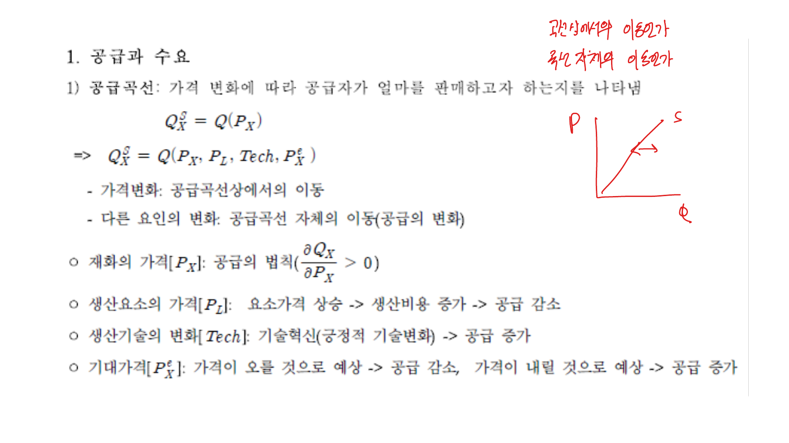
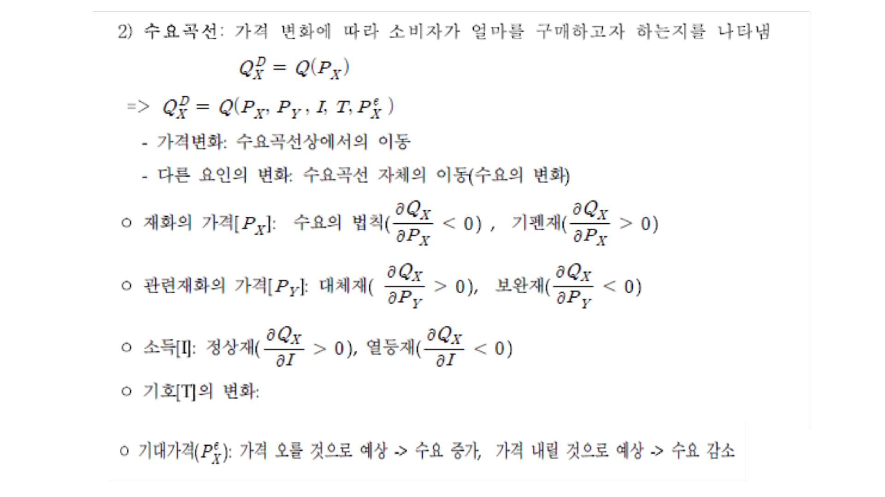
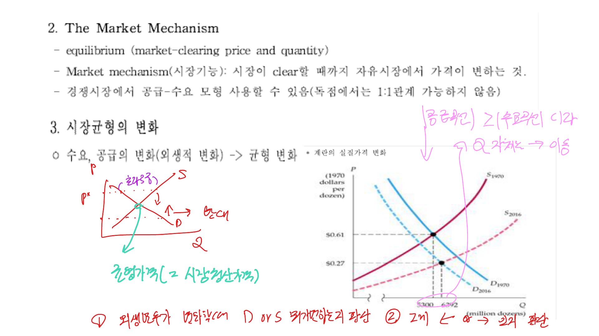
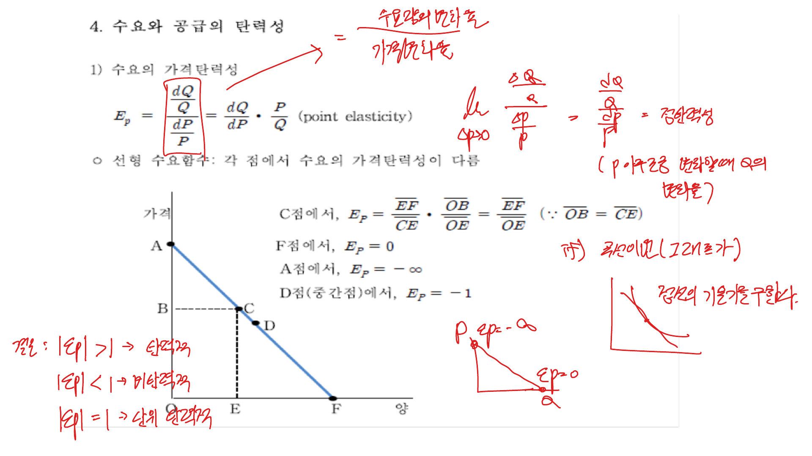
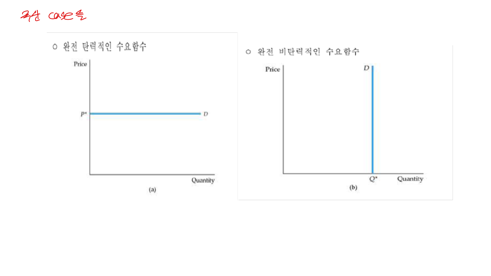
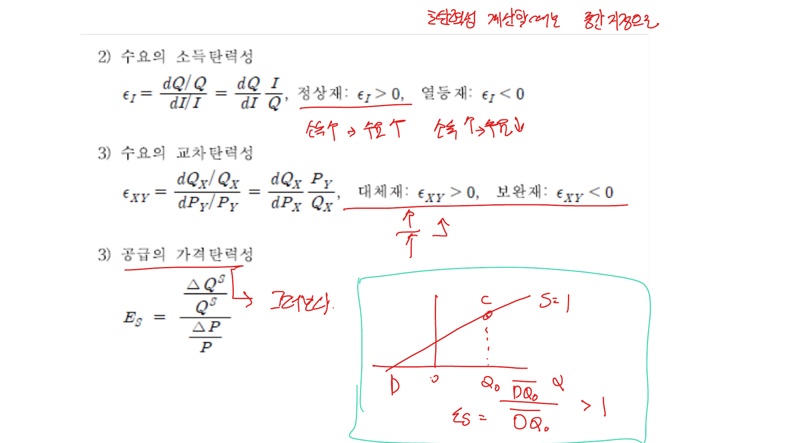
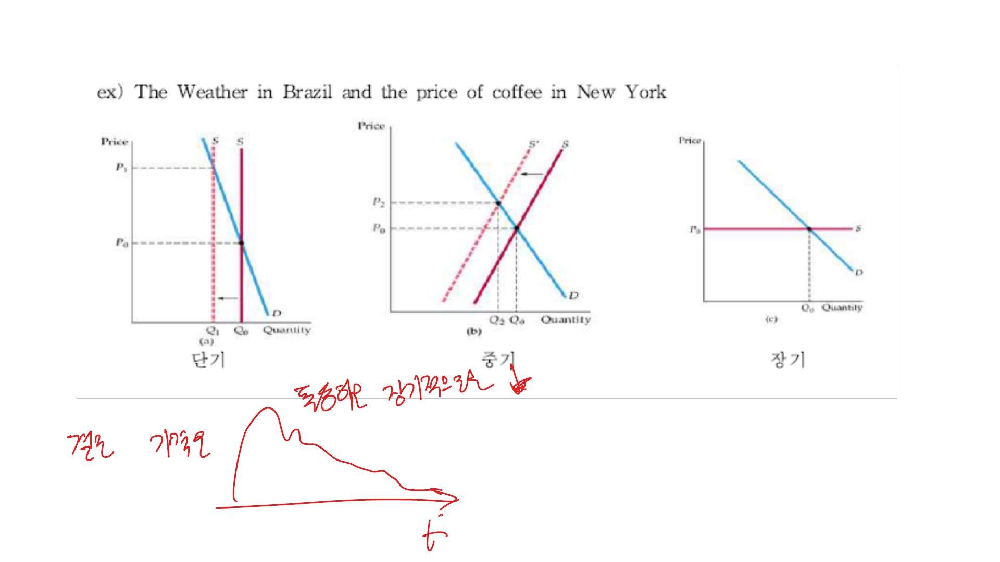
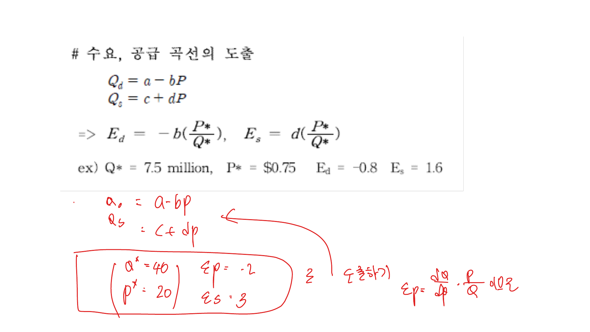
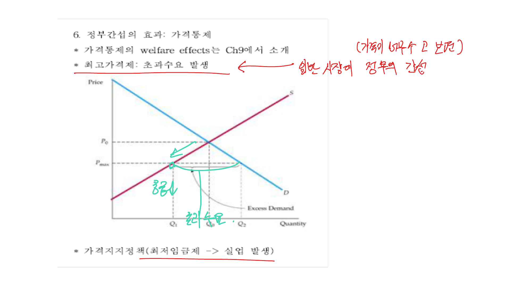

수요와 공급 모형은 가격과 거래량이 시장에서 어떻게 결정되는지를 설명하는 가장 기본적인 틀이다. 이 글에서는 공급곡선과 수요곡선의 이동, 시장균형, 탄력성, 단기와 장기 탄력성, 수요와 공급식의 도출, 가격통제의 효과를 정리한다.

## 1. 공급곡선과 수요곡선

공급곡선은 가격이 변할 때 공급자가 얼마나 판매하려 하는지를 나타낸다. 어떤 재화 $X$의 공급량은 단순히 자기 가격 $P_X$만의 함수로 볼 수도 있지만, 실제로는 생산요소 가격, 기술, 기대가격 같은 요인도 함께 영향을 준다.

$$
Q_X^S = Q(P_X)
$$

$$
Q_X^S = Q(P_X, P_L, Tech, P_X^e)
$$

여기서 $P_L$은 생산요소의 가격, $Tech$는 생산기술, $P_X^e$는 미래 가격에 대한 기대를 의미한다.

가격 변화는 같은 공급곡선 위에서의 이동으로 나타난다. 반면 생산요소 가격, 기술, 기대가격 같은 다른 요인이 변하면 공급곡선 자체가 이동한다.

- 재화의 가격 $P_X$: 공급의 법칙에 따라 $\frac{\partial Q_X}{\partial P_X} > 0$
- 생산요소 가격 $P_L$: 요소가격이 상승하면 생산비용이 증가하므로 공급 감소
- 생산기술 $Tech$: 기술혁신은 같은 비용으로 더 많이 생산할 수 있게 하므로 공급 증가
- 기대가격 $P_X^e$: 미래 가격 상승이 예상되면 현재 공급을 줄일 수 있고, 미래 가격 하락이 예상되면 현재 공급을 늘릴 수 있음

 

 

수요곡선은 가격이 변할 때 소비자가 얼마나 구매하려 하는지를 나타낸다.

$$
Q_X^D = Q(P_X)
$$

$$
Q_X^D = Q(P_X, P_Y, I, T, P_X^e)
$$

수요량도 자기 가격뿐 아니라 관련재 가격 $P_Y$, 소득 $I$, 기호 $T$, 기대가격 $P_X^e$의 영향을 받는다.

- 재화의 가격 $P_X$: 일반적인 수요의 법칙에서는 $\frac{\partial Q_X}{\partial P_X} < 0$
- 기펜재: 예외적으로 $\frac{\partial Q_X}{\partial P_X} > 0$
- 관련재 가격 $P_Y$: 대체재는 $\frac{\partial Q_X}{\partial P_Y} > 0$, 보완재는 $\frac{\partial Q_X}{\partial P_Y} < 0$
- 소득 $I$: 정상재는 $\frac{\partial Q_X}{\partial I} > 0$, 열등재는 $\frac{\partial Q_X}{\partial I} < 0$
- 기대가격 $P_X^e$: 가격 상승이 예상되면 현재 수요 증가, 가격 하락이 예상되면 현재 수요 감소

 

 

## 2. 시장기능과 시장균형

시장균형은 수요량과 공급량이 같아지는 가격과 거래량이다. 이때의 가격은 시장청산가격이고, 이때의 거래량은 시장청산량이다.

$$
Q^D(P^*) = Q^S(P^*) = Q^*
$$

시장기능은 시장이 청산될 때까지 가격이 조정되는 과정을 뜻한다. 경쟁시장에서는 수요와 공급 모형을 통해 균형을 설명할 수 있지만, 독점시장에서는 단순히 수요와 공급이 일대일로 만나 균형을 정한다고 보기 어렵다.

수요나 공급의 외생적 요인이 변하면 곡선 자체가 이동하고, 그 결과 균형가격과 균형거래량이 함께 변한다.

 

 

예를 들어 계란의 실질가격 변화는 수요와 공급이 동시에 이동한 사례로 볼 수 있다. 공급곡선이 더 크게 오른쪽으로 이동하면 가격은 하락하고 거래량은 증가한다. 대학등록금 사례에서는 수요와 공급이 모두 증가했지만, 수요 증가가 더 크게 작용하면 가격과 거래량이 모두 상승한다.

## 3. 수요의 가격탄력성

탄력성은 한 변수가 1% 변할 때 다른 변수가 몇 % 변하는지를 나타낸다. 수요의 가격탄력성은 가격 변화율에 대한 수요량 변화율이다.

$$
E_p =
\frac{dQ / Q}{dP / P}
= \frac{dQ}{dP} \cdot \frac{P}{Q}
$$

일반적인 수요곡선에서는 $\frac{dQ}{dP} < 0$이므로 가격탄력성은 음수다. 다만 해석할 때는 절댓값을 기준으로 탄력적, 비탄력적, 단위탄력적이라고 구분하는 경우가 많다.

- $|E_p| > 1$: 탄력적
- $|E_p| < 1$: 비탄력적
- $|E_p| = 1$: 단위탄력적

선형 수요함수에서는 기울기가 일정해도 점마다 탄력성이 다르다. 가격이 높은 구간에서는 $P/Q$가 커져 탄력성이 커지고, 가격이 낮은 구간에서는 탄력성이 작아진다.

 

 

극단적인 경우도 있다. 수평 수요곡선은 완전탄력적 수요이고, 수직 수요곡선은 완전비탄력적 수요다.

 

 

## 4. 소득탄력성과 교차탄력성

수요의 소득탄력성은 소득 변화율에 대한 수요량 변화율이다.

$$
\epsilon_I =
\frac{dQ / Q}{dI / I}
= \frac{dQ}{dI} \cdot \frac{I}{Q}
$$

소득탄력성이 양수이면 정상재, 음수이면 열등재다.

$$
\epsilon_I > 0 \Rightarrow \text{정상재}
$$

$$
\epsilon_I < 0 \Rightarrow \text{열등재}
$$

수요의 교차탄력성은 다른 재화의 가격 변화율에 대한 해당 재화 수요량 변화율이다.

$$
\epsilon_{XY} =
\frac{dQ_X / Q_X}{dP_Y / P_Y}
= \frac{dQ_X}{dP_Y} \cdot \frac{P_Y}{Q_X}
$$

교차탄력성이 양수이면 두 재화는 대체재이고, 음수이면 보완재다.

$$
\epsilon_{XY} > 0 \Rightarrow \text{대체재}
$$

$$
\epsilon_{XY} < 0 \Rightarrow \text{보완재}
$$

공급의 가격탄력성도 같은 방식으로 정의한다.

$$
E_S =
\frac{\Delta Q^S / Q^S}{\Delta P / P}
$$

공급곡선은 일반적으로 우상향하므로 공급탄력성은 양수다.

 

 

## 5. 단기와 장기 탄력성

탄력성은 기간에 따라 달라진다. 소비자와 생산자가 조정할 시간이 충분한지에 따라 같은 가격 변화도 서로 다른 수량 변화를 만든다.

일반적인 비내구재에서는 장기 수요의 가격탄력성이 단기보다 크다.

- 소비자의 습관은 장기적으로 변한다.
- 장기에는 대체재를 찾기 쉽다.
- 커피, 담배, 술 같은 재화는 단기보다 장기에 수요 조정이 더 크게 나타날 수 있다.

개솔린 수요도 비슷하게 볼 수 있다. 단기에는 가격이 올라도 자동차 운전거리를 바로 크게 줄이기 어렵다. 장기에는 소형차나 연료효율이 높은 차로 대체하면서 수요 감소가 더 크게 나타난다.

반대로 내구재에서는 단기 가격탄력성이 장기보다 클 수 있다. 내구재는 이미 보유한 총 스톡이 매년 생산량보다 크기 때문에, 보유하고자 하는 스톡의 작은 변화가 신규 구매량에는 큰 변화로 나타난다.

예를 들어 자동차 가격이 상승하면 단기에는 새 자동차 구매를 미루면서 신규 구매량이 크게 감소한다. 장기에는 시간이 지나며 자동차가 낡고 교체 수요가 발생하므로 수요량 변화가 상대적으로 작아진다.

수요의 소득탄력성도 비내구재와 내구재에서 다르게 나타난다. 일반적으로 비내구재는 장기 소득탄력성이 단기보다 크지만, 자동차 같은 내구재는 단기 소득탄력성이 장기보다 클 수 있다.

공급의 경우 대부분의 재화는 장기 공급탄력성이 단기보다 크다. 단기에는 생산능력 제약이 있지만, 장기에는 새 시설 설치와 고용 조정이 가능하기 때문이다.

다만 일부 재화에서는 단기 공급탄력성이 장기보다 클 수 있다. 예를 들어 재활용 가능한 내구재는 가격 상승 시 단기에는 기존 스크랩이 새로운 공급원으로 빠르게 투입될 수 있지만, 장기에는 품질 하락이나 비용 증가 때문에 공급이 줄어들 수 있다.

 

 

브라질의 이상기후로 커피 공급이 줄어드는 예시는 기간별 탄력성 차이를 보여준다. 단기에는 공급이 거의 고정되어 가격이 크게 오르고 수량은 조금 줄어든다. 중기에는 공급 조정이 일부 가능해진다. 장기에는 생산과 소비 양쪽의 조정이 누적되어 가격 효과가 완화된다.

## 6. 수요곡선과 공급곡선의 도출

선형 수요곡선과 공급곡선을 다음처럼 둔다.

$$
Q_d = a - bP
$$

$$
Q_s = c + dP
$$

균형에서는 $Q_d = Q_s$이므로

$$
a - bP^* = c + dP^*
$$

$$
P^* = \frac{a - c}{b + d}
$$

$$
Q^* = \frac{ad + bc}{b + d}
$$

가격탄력성은 각 곡선의 기울기와 균형점의 $P^*/Q^*$를 곱해 구할 수 있다.

$$
E_d = -b \left(\frac{P^*}{Q^*}\right)
$$

$$
E_s = d \left(\frac{P^*}{Q^*}\right)
$$

예를 들어 $Q^* = 7.5$ million, $P^* = 0.75$, $E_d = -0.8$, $E_s = 1.6$과 같이 균형점과 탄력성이 주어지면, 위 식을 이용해 수요와 공급의 기울기 $b, d$를 역으로 구할 수 있다. 그 다음 균형점이 수요식과 공급식을 만족하도록 절편 $a, c$를 정하면 선형 수요식과 공급식을 도출할 수 있다.

 

 

## 7. 가격통제의 효과

정부가 가격을 직접 통제하면 시장가격이 균형가격에서 벗어난다. 이때 수요량과 공급량이 달라지므로 초과수요나 초과공급이 발생한다.

최고가격제는 가격상한을 정하는 정책이다. 가격상한이 균형가격보다 낮게 설정되면, 낮은 가격에서 수요량은 증가하고 공급량은 감소한다. 따라서 초과수요가 발생한다.

$$
P_{\max} < P_0
$$

$$
Q_D(P_{\max}) > Q_S(P_{\max})
$$

이 경우 시장에서 원하는 만큼 재화를 구하지 못하는 부족 현상이 발생한다.

 

 

가격지지정책은 가격하한을 정하는 정책이다. 최저임금제는 노동시장에서의 가격지지정책으로 볼 수 있다. 임금이 균형임금보다 높게 설정되면 노동공급은 증가하고 노동수요는 감소하므로 실업이 발생한다.

## 정리

수요와 공급 분석에서 가장 중요한 구분은 곡선 위의 이동과 곡선 자체의 이동이다. 자기 가격의 변화는 같은 곡선 위의 이동이고, 소득, 관련재 가격, 기술, 생산요소 가격, 기대 같은 외생변수 변화는 곡선을 이동시킨다.

탄력성은 곡선의 기울기와 다르다. 특히 선형 수요곡선에서는 기울기가 일정해도 위치에 따라 탄력성이 달라진다. 또한 단기와 장기 중 어느 쪽 탄력성이 더 큰지는 재화의 성격에 따라 달라진다. 비내구재와 일반적인 공급에서는 장기가 더 탄력적인 경우가 많지만, 내구재 수요나 일부 재활용 가능한 공급에서는 단기가 더 탄력적일 수 있다.
