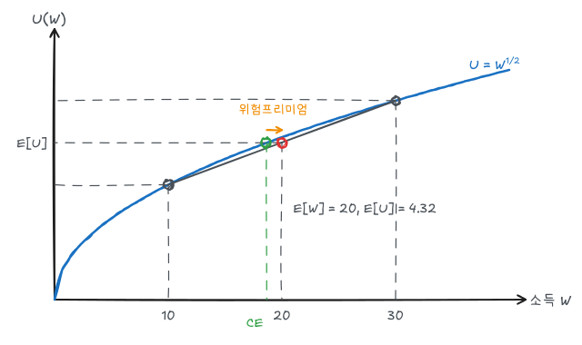

결과가 확률적으로 정해지는 선택을 다룬다. 핵심 도구는 기대효용이다. 예제는 효용함수 $U(W) = \sqrt W$, 소득이 확률 0.5로 10 또는 30인 복권을 쓴다.

## 1. 위험의 측정

결과 $X_1, \dots, X_n$이 확률 $p_1, \dots, p_n$으로 나타날 때

$$
E(X) = \sum_i p_i X_i, \qquad \sigma^2 = \sum_i p_i\,[X_i - E(X)]^2
$$

| 직업 | 결과 1 (확률) | 결과 2 (확률) | 기대소득 | 표준편차 |
|---|---|---|---|---|
| A: 성과급 | 2,000 (0.5) | 1,000 (0.5) | 1,500 | 500 |
| B: 고정급 | 1,510 (0.99) | 510 (0.01) | 1,500 | 99.5 |

기대소득은 같지만 B의 변동성이 훨씬 작다. 위험을 싫어하는 사람은 B를 고른다.

## 2. 기대효용과 위험에 대한 태도

$$
E[U] = \sum_i p_i\,U(X_i)
$$

| 태도 | 효용함수 모양 | 비교 | 예 |
|---|---|---|---|
| 위험기피 | 오목 ($U'' < 0$) | $U(E[W]) > E[U(W)]$ | $\sqrt W$, $\ln W$ |
| 위험중립 | 직선 | $U(E[W]) = E[U(W)]$ | $aW + b$ |
| 위험선호 | 볼록 ($U'' > 0$) | $U(E[W]) < E[U(W)]$ | $W^2$ |

오목한 효용함수는 소득의 한계효용이 체감한다는 뜻이다. 10을 잃을 때 줄어드는 효용이 10을 얻을 때 늘어나는 효용보다 크다.

## 3. 확실성등가와 위험프리미엄

예제 복권에서

$$
E[W] = 0.5(10) + 0.5(30) = 20
$$

$$
E[U] = 0.5\sqrt{10} + 0.5\sqrt{30} = 0.5(3.162) + 0.5(5.477) = 4.32
$$

반면 확실한 20의 효용은 $\sqrt{20} = 4.47$로 더 크다. 위험기피자다.

**확실성등가**(CE)는 복권과 같은 효용을 주는 확실한 금액이다.

$$
\sqrt{CE} = 4.32 \;\Rightarrow\; CE = 4.32^2 \approx 18.66
$$

**위험프리미엄**은 위험을 피하기 위해 포기할 의향이 있는 금액이다.

$$
RP = E[W] - CE = 20 - 18.66 = 1.34
$$

그림에서 (10, $\sqrt{10}$)과 (30, $\sqrt{30}$)을 잇는 현 위의 중점 높이가 $E[U]$이다. 같은 높이를 효용곡선 위에서 찾으면 그 가로좌표가 CE다. 효용함수가 더 오목할수록, 결과의 분산이 클수록 위험프리미엄이 커진다.

결과를 0과 40으로 넓히면(기대값은 그대로 20) $E[U] = 0.5\sqrt{40} = 3.16$, $CE = 10$, $RP = 10$으로 위험프리미엄이 크게 증가한다.

## 4. 위험을 줄이는 방법

### 분산투자

수익이 음의 상관관계를 갖는 자산에 나누어 투자하면 위험이 줄어든다. 날씨에 따라 수익이 반대로 움직이는 에어컨 판매와 난방기 판매를 반씩 하면 어느 날씨에서도 소득이 안정된다. 완전한 음의 상관이 아니어도, 상관이 1보다 작기만 하면 분산은 줄어든다.

### 보험

소득 30인 사람이 확률 0.5로 20을 잃는다고 하자. 앞 예제와 같은 복권이다(결과 10 또는 30).

- 공정한 보험료 = 기대손실 = $0.5 \times 20 = 10$. 이를 내고 완전보험에 들면 확실한 소득 20을 얻고 효용은 4.47로 증가한다.
- 최대 지불 의사 보험료 = $30 - CE = 30 - 18.66 = 11.34$. 공정 보험료보다 위험프리미엄(1.34)만큼 더 낼 의향이 있다.

이 차이가 보험회사가 운영비를 충당하고 이윤을 내는 여지다. 보험회사는 대수의 법칙으로 독립적인 위험을 많이 모아 전체 손실을 예측 가능하게 만든다.

### 정보의 가치

완전한 정보가 있을 때의 기대값과 정보가 없을 때의 기대값의 차이가 **완전정보의 가치**다.

예: 상품을 100단위 또는 50단위 주문해야 한다. 수요가 확률 0.5로 50 또는 100이다.

| 주문 | 판매 50 | 판매 100 | 기대이윤 |
|---|---|---|---|
| 50단위 | 5,000 | 5,000 | 5,000 |
| 100단위 | 1,500 | 12,000 | 6,750 |

수요를 미리 알면 매번 맞춰 주문해 기대이윤이 $0.5(5{,}000) + 0.5(12{,}000) = 8{,}500$이 된다. 완전정보의 가치는 $8{,}500 - 6{,}750 = 1{,}750$이다.

## 5. 위험자산에 대한 수요

무위험자산(수익률 $R_f$)과 위험자산(기대수익률 $R_m$, 표준편차 $\sigma_m$)에 각각 $1-b$, $b$의 비중으로 투자하면

$$
R_p = bR_m + (1-b)R_f, \qquad \sigma_p = b\,\sigma_m
$$

$b = \sigma_p/\sigma_m$을 대입하면

$$
R_p = R_f + \frac{R_m - R_f}{\sigma_m}\,\sigma_p
$$

로, 기대수익과 위험 사이의 **예산선**이 된다. 기울기 $(R_m - R_f)/\sigma_m$는 위험의 가격(샤프 비율)이다.

위험기피 투자자의 무차별곡선은 $(\sigma_p, R_p)$ 평면에서 우상향하며 볼록하다(더 큰 위험을 받아들이려면 더 높은 수익이 필요). 최적 포트폴리오는 무차별곡선과 예산선이 접하는 점이다. 위험기피 정도가 클수록 $b$가 작아진다.

## 6. 행동경제학

기대효용 이론으로 설명하기 어려운 현상도 있다.

| 현상 | 내용 |
|---|---|
| 준거점과 손실회피 | 같은 크기라도 손실을 이익보다 크게 느낀다 |
| 보유효과 | 가진 물건에 더 높은 가치를 매긴다 (WTA > WTP) |
| 틀 짜기 효과 | 같은 선택지도 표현 방식에 따라 선택이 달라진다 |
| 확률 가중 | 작은 확률을 과대평가한다 (복권, 보험 동시 구매) |
| 기준점 효과 | 처음 제시된 숫자에 판단이 끌려간다 |

## 정리

| 개념 | 식 | 예제 값 |
|---|---|---|
| 기대소득 | $\sum p_i W_i$ | 20 |
| 기대효용 | $\sum p_i U(W_i)$ | 4.32 |
| 확실성등가 | $U(CE) = E[U]$ | 18.66 |
| 위험프리미엄 | $E[W] - CE$ | 1.34 |
| 최대 보험료 | $W_0 - CE$ | 11.34 |
| 위험-수익 예산선 | $R_p = R_f + \frac{R_m - R_f}{\sigma_m}\sigma_p$ | |
