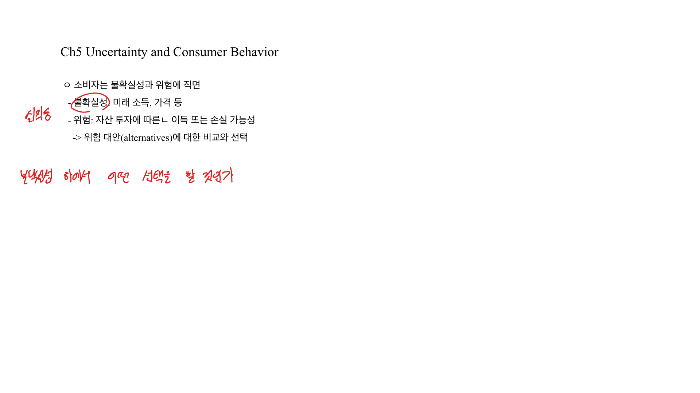

소비자는 미래 소득, 가격, 투자수익률처럼 확실하지 않은 결과를 고려해 선택한다. 불확실성하의 소비자 행동에서는 가능한 결과와 확률을 이용해 위험을 측정하고, 기대효용을 통해 위험 대안을 비교한다.

## 1. 위험과 확률

위험은 가능한 결과와 각 결과가 일어날 확률로 표현된다. 예를 들어 어떤 주식이 성공하면 4만원, 실패하면 2만원이 되고 성공확률이 25%라면, 가능한 결과는 두 개이고 각각의 확률이 붙는다.

확률은 두 방식으로 해석할 수 있다.

- 객관적 확률: 과거 빈도나 관찰된 자료에 근거한 확률
- 주관적 확률: 개인의 판단과 정보에 근거한 확률

확률을 어떻게 해석하든, 위험 대안을 비교하려면 기대값과 변동성을 계산해야 한다.

## 2. 기대값

기대값은 가능한 결과의 가중평균이다. 각 결과의 확률이 가중치가 된다.

$$
E(X) = \sum_i p_i x_i
$$

유전탐사 예시에서 성공 시 주가가 4만원, 실패 시 2만원이고 성공확률이 25%라면 기대값은 다음과 같다.

$$
E(X) = 0.25 \times 4 + 0.75 \times 2 = 2.5
$$

즉 평균적으로 기대할 수 있는 값은 2.5만원이다.

 

 

## 3. 변동성과 분산

위험은 기대값만으로 충분히 설명되지 않는다. 같은 기대값을 가진 선택지도 결과의 흩어짐이 다를 수 있다.

분산은 가능한 결과가 기대값에서 얼마나 떨어져 있는지를 측정한다.

$$
\sigma^2 = \sum_i p_i(x_i - E(X))^2
$$

표준편차는 분산의 제곱근이다.

$$
\sigma = \sqrt{\sigma^2}
$$

기대값이 같다면 표준편차가 큰 대안이 더 위험하다.

## 4. 기대효용

불확실성하에서 소비자는 기대소득 자체보다 기대효용을 기준으로 선택한다고 볼 수 있다.

$$
EU = \sum_i p_i U(x_i)
$$

위험에 대한 태도는 효용함수의 모양으로 표현된다.

- 위험회피자: 효용함수가 오목, $U''(x) < 0$
- 위험중립자: 효용함수가 선형, $U''(x) = 0$
- 위험선호자: 효용함수가 볼록, $U''(x) > 0$

위험회피자는 같은 기대값이라면 확실한 소득을 선호한다. 이는 소득이 증가할수록 한계효용이 감소하기 때문이다.

## 5. 확실성등가와 위험프리미엄

확실성등가(CE, Certainty Equivalent)는 위험한 대안과 같은 효용을 주는 확실한 금액이다.

$$
U(CE) = EU
$$

위험프리미엄은 위험한 대안을 피하기 위해 포기할 의사가 있는 금액이다.

$$
RP = E(X) - CE
$$

위험회피자는 $CE < E(X)$이므로 위험프리미엄이 양수다.

## 6. 보험

보험은 나쁜 상태에서의 손실을 줄이고 좋은 상태에서 보험료를 지불하게 만들어 소득을 평탄화한다. 위험회피자는 소득 변동을 줄이는 보험에 가치를 둔다.

공정한 보험은 보험료가 기대손실과 같은 경우다.

$$
\text{보험료} = p \times \text{손실액}
$$

위험회피자는 공정한 보험을 전부 가입하려 한다. 완전보험이 가능하면 모든 상태에서 소득이 같아져 변동성이 사라진다.

## 7. 위험분산과 포트폴리오

여러 자산을 조합하면 개별 위험 일부를 줄일 수 있다. 수익률이 완전히 같이 움직이지 않는 자산을 함께 보유하면 전체 포트폴리오의 분산이 감소한다.

포트폴리오 선택에서는 기대수익률과 위험 사이의 절충이 중요하다.

$$
E(R_p) = \sum_i w_i E(R_i)
$$

위험자산의 비중을 높이면 기대수익률이 커질 수 있지만 위험도 함께 증가한다. 위험회피 정도가 클수록 안전자산 비중이 커진다.

## 정리

불확실성하의 선택은 기대값만으로 결정되지 않는다. 기대효용, 분산, 위험회피 정도가 함께 작용한다. 위험회피자는 소득의 평탄화를 선호하므로 보험과 분산투자에 가치를 둔다.
