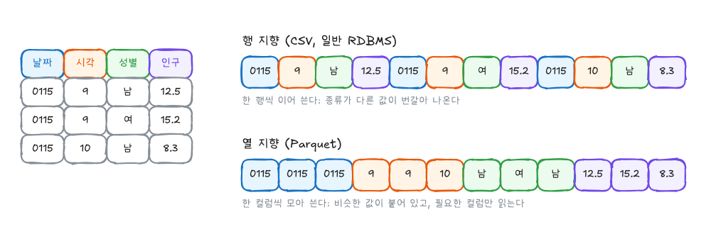
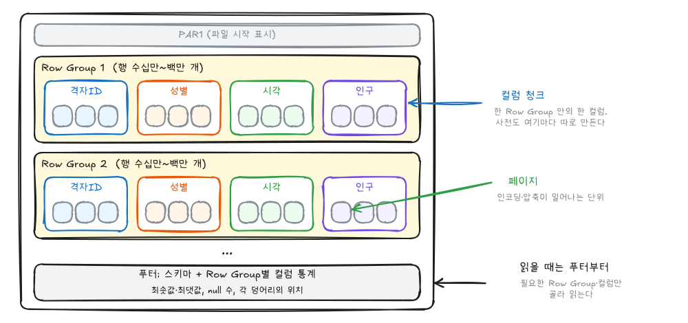
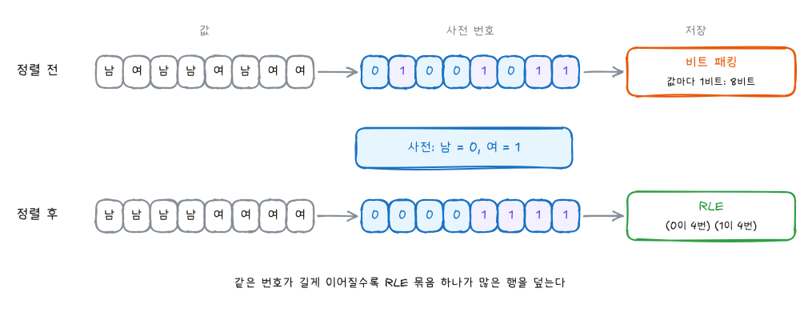
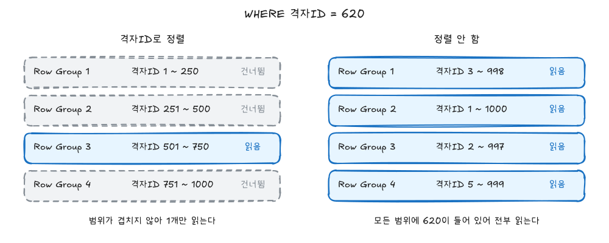
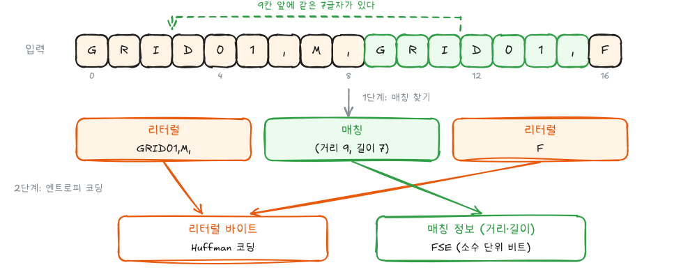
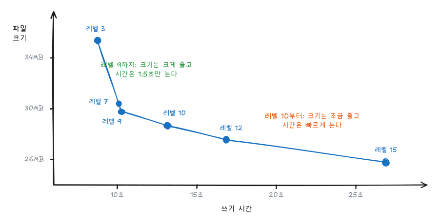

"Parquet은 열 지향이라 압축이 잘 된다"는 말은 절반만 맞다. 같은 데이터라도 **어떤 타입으로, 어떤 순서로, 어떤 압축 레벨로** 쓰느냐에 따라 파일 크기와 조회 속도가 크게 달라진다. 글은 두 부분으로 나뉜다. **1부**는 Parquet 파일 안이 어떻게 생겼는지, 데이터 구조를 이용한 인코딩으로 어떻게 줄이는지, 그리고 쓰는 쪽에서 정하는 정렬 순서·타입·Row Group 크기를 다룬다. **2부**는 Parquet이 마지막에 거는 범용 압축기 ZSTD가 어떻게 동작하는지, 압축 레벨을 올리면 무엇이 바뀌고 실제로 얼마나 차이 나는지를 다룬다.

예시로는 격자(지역 칸)별·시간대별 인구를 성별·연령대로 나눠 집계한 표를 쓴다. 하루치가 수천만 행이고, 원본은 모든 컬럼이 문자열로 들어온다고 하자.

## 1부: Parquet 파일과 인코딩

### 1. 행 지향과 열 지향



CSV나 일반적인 RDBMS는 한 행의 값을 이어서 저장한다. 날짜, 정수, 문자열, 실수가 번갈아 나오므로 이웃한 바이트끼리 닮은 점이 적고, 압축을 걸어도 줄일 여지가 크지 않다.

Parquet은 같은 컬럼의 값을 모아서 저장한다. 같은 타입, 비슷한 범위, 반복되는 값이 붙어 있으니 압축이 잘 된다. 분석 쿼리는 보통 일부 컬럼만 쓰므로, 필요한 컬럼만 디스크에서 읽을 수 있다는 것도 큰 장점이다.

### 2. 파일 구조

Parquet 파일은 모든 행을 한 컬럼씩 통째로 쓰지 않는다. 행을 일정 개수씩 묶은 **Row Group**으로 나누고, 그 안에서 컬럼별로 저장한다.



| 단위 | 뜻 | 중요한 점 |
|---|---|---|
| Row Group | 행 수십만~백만 개 묶음 | 읽을지 말지를 정하는 단위 |
| 컬럼 청크 | 한 Row Group 안의 한 컬럼 | 사전이 여기마다 따로 만들어진다 |
| 페이지 | 컬럼 청크를 다시 나눈 조각 | 인코딩과 블록 압축이 일어나는 단위 |
| 푸터 | 파일 끝의 메타데이터 | 스키마, Row Group별 컬럼의 최솟값·최댓값·null 수, 각 덩어리의 위치 |

읽는 쪽은 푸터를 먼저 읽는다. 그리고 쿼리에 필요한 컬럼과, 통계로 보아 조건에 맞는 값이 있을 수 있는 Row Group만 골라 읽는다.

압축은 페이지마다 두 단계로 일어난다. 먼저 데이터 구조를 이용한 가벼운 **인코딩**으로 줄이고(3절), 그 결과 바이트에 ZSTD 같은 범용 **블록 압축**을 한 번 더 건다(2부).

### 3. 1단계: 인코딩

| 방법 | 하는 일 | 예 |
|---|---|---|
| 사전 인코딩 | 고유값으로 사전을 만들고 값 대신 사전 번호를 저장한다 | `남 = 0`, `여 = 1` |
| 비트 패킹 | 값의 범위에 필요한 비트만 쓴다 | 번호가 0, 1뿐이면 1비트. 0~23이면 5비트 |
| RLE | 같은 값이 연달아 나오면 (값, 반복 횟수)로 저장한다 | `0, 0, 0, 0` → (0이 4번) |

Parquet에서 사전 번호 열은 RLE와 비트 패킹을 섞은 방식으로 저장된다. 같은 번호가 길게 이어지는 구간은 RLE로, 들쭉날쭉한 구간은 비트 패킹으로 쓴다. 그래서 **같은 값이 얼마나 길게 이어지는지**가 크기를 좌우한다.



그림은 8행이지만 실제로는 수백만 행이다. 정렬하지 않은 성별 컬럼은 100만 행이면 100만 비트(약 122KB)가 든다. 정렬하면 RLE 묶음 두 개, 몇 바이트로 끝난다.

### 4. 정렬

정렬은 두 가지를 한꺼번에 좋게 만든다. 같은 값을 길게 이어 붙여 **RLE를 살리고**, Row Group마다 값의 범위를 좁혀 **읽지 않아도 되는 Row Group을 늘린다**.



정렬하지 않으면 Row Group마다 거의 모든 격자가 섞여 있어서, 푸터의 최솟값·최댓값이 모두 비슷하게 넓다. 어떤 격자를 찾든 전부 읽어야 한다. 격자ID로 정렬하면 Row Group마다 맡는 범위가 갈라져서, 조건에 맞지 않는 Row Group을 통계만 보고 건너뛸 수 있다.

#### 정렬 순서 정하기

앞쪽 정렬 키일수록 긴 구간을 만들고, 뒤쪽 키는 앞 키가 같은 구간 안에서만 정렬된다. 그래서 **조회 패턴**과 **고유값 개수(카디널리티)** 를 함께 보고 순서를 정한다. 예시 데이터라면 다음 순서가 자연스럽다.

```sql
ORDER BY 격자ID, 성별, 연령대, 거주지구분, 시각
```

1. **격자ID**: 가장 자주 거는 필터다. 맨 앞에 두어 Row Group 건너뛰기를 살린다.
2. **성별, 연령대, 거주지구분**: 고유값이 적은 컬럼을 격자 안에서 차례로 정렬하면 각 격자 안에서 같은 값이 길게 이어진다.
3. **시각(0~23)**: 마지막에 둔다. 매번 0부터 23까지 돌므로 RLE는 안 되지만 5비트 비트 패킹으로 충분히 작다.

파일을 하루 단위로 나눈다면 날짜는 파일 안에서 하나뿐이라 정렬 키에 넣을 필요가 없다.

> **주의** 압축률만 보면 고유값이 가장 적은 성별을 맨 앞에 두는 편이 나을 수 있다. 하지만 그러면 격자 조회 때 건너뛸 수 있는 Row Group이 거의 없어진다. 첫 키는 압축이 아니라 조회 패턴으로 고른다.

### 5. 타입 줄이기

원본이 모두 문자열이라면 맞는 타입으로 바꾸기만 해도 크기와 쿼리 속도가 함께 좋아진다.

| 컬럼 | 원본 | 변환 | 이유 |
|---|---|---|---|
| 날짜 | `VARCHAR(8)` | `DATE` | 8자 문자열 대신 4바이트 정수(1970-01-01부터의 일수). 비교·연산이 빠르다 |
| 시각 | `VARCHAR(2)` | `UTINYINT` | 0~255 정수. 비트 패킹으로 값당 5비트 수준까지 준다 |
| 성별, 연령대 | `VARCHAR` | `VARCHAR` | 고유값이 적어 사전 인코딩이 자동으로 걸리므로 그대로 둔다 |
| 격자ID | `VARCHAR(10)` | `UINTEGER` | 숫자 문자열을 4바이트 정수로. 최댓값(약 42.9억) 안에 들어오는지 먼저 확인한다 |
| 인구 | `VARCHAR` | `DECIMAL(9,2)` | 정밀도 9자리 이하 DECIMAL은 4바이트 정수로 저장되고 부동소수점 오차가 없다 |
| 연도, 월 | `VARCHAR` | 제거 | 날짜에서 바로 계산되므로 파일에서 빼고 뷰에서 만든다 |

> **주의** 숫자 문자열을 정수로 바꾸기 전에 앞자리 `0`이 의미 있는 코드가 아닌지 확인한다. 앞자리 0이 있는 코드라면 문자열로 두고 사전 인코딩에 맡긴다.

### 6. Row Group 크기

| 크기 | 영향 |
|---|---|
| 너무 작다 (예: 1만 행) | 컬럼 청크마다 사전을 새로 만들어 사전이 차지하는 비중이 커지고, RLE 구간도 짧게 끊긴다 |
| 너무 크다 (예: 1,000만 행) | 쓰는 동안 한 Row Group을 메모리에 들고 있어야 해서 메모리가 부족하면 디스크로 넘치거나 실패한다. 건너뛰기 단위도 거칠어진다 |

DuckDB의 기본값은 122,880행이다. 파일 하나가 수천만 행이라면 수십만~100만 행 정도로 늘려 보고, 파일 크기와 메모리 사용량을 비교해 정한다.

## 2부: 블록 압축과 ZSTD 레벨


1부의 인코딩이 끝난 페이지에 범용 압축기를 한 번 더 건다. Parquet이 정하는 것은 어떤 압축기를 쓸지(Snappy, Gzip, ZSTD 등)까지이고, **압축 레벨은 Parquet이 아니라 압축기 자체의 설정**이다. 같은 ZSTD 레벨이 `.zst` 파일이나 DB 저장에도 똑같이 쓰인다. 예전에는 "속도는 Snappy, 압축률은 Gzip"으로 나눠 골랐지만, Meta의 Yann Collet이 만든 **Zstandard(ZSTD)** 는 레벨 하나로 Snappy에 가까운 속도부터 Gzip보다 높은 압축률까지 고를 수 있어 요즘 가장 많이 쓴다.

### 7. ZSTD가 압축하는 방식



**매칭.** 입력을 앞에서부터 읽으며 이미 나온 바이트열이 다시 나오는지 찾는다(LZ77 계열). 그림에서 9번째 칸부터의 `GRID01,`은 9칸 앞에 똑같이 있으므로 7글자를 다시 쓰지 않고 `(거리 9, 길이 7)`로 바꾼다. 매칭되지 않은 바이트는 **리터럴**로 남는다.

**엔트로피 코딩.** 매칭 결과를 비트로 저장할 때 자주 나오는 기호에 짧은 부호를 준다. 리터럴 바이트에는 **Huffman 코딩**을, 매칭 정보(리터럴 길이, 매칭 길이, 거리)에는 **FSE**를 쓴다. Huffman은 기호마다 정수 개의 비트를 배정하므로 최소 1비트가 든다. 등장 확률이 0.8인 기호의 정보량은 $-\log_2 0.8 \approx 0.32$비트인데 Huffman은 1비트를 써야 한다. FSE(Finite State Entropy)는 ANS(Asymmetric Numeral Systems)를 구현한 것으로 소수 단위 비트를 배정할 수 있어 이 낭비가 없고, 속도는 Huffman에 가깝다.

Gzip(DEFLATE)도 LZ77 매칭 뒤 Huffman을 쓰는 같은 구조다. ZSTD는 거슬러 볼 수 있는 거리가 훨씬 길고(Gzip은 32KB), 매칭 정보에 FSE를 쓰고, 빠르게 돌도록 설계되어 있다는 점이 다르다.

### 8. 레벨이 바꾸는 것

레벨(1~22)은 **매칭을 얼마나 열심히 찾을지** 정하는 매개변수 묶음이다. 레벨이 오르면 거슬러 보는 거리(`windowLog`), 후보를 담는 테이블(`hashLog`, `chainLog`), 비교하는 후보 수(`searchLog`)가 커지고, 매칭을 고르는 전략이 바뀐다. 전략의 경계는 입력 크기와 버전에 따라 조금 다르다.

| 레벨 | 전략 | 방식 |
|---|---|---|
| 1~3 | `fast`, `dfast` | 해시를 한 번 찾아보고 맞으면 바로 쓴다 |
| 4~12 | `greedy`, `lazy`, `lazy2` | 한두 바이트 뒤에서 더 긴 매칭이 있는지 미뤄 보고 고른다 |
| 13~15 | `btlazy2` | 이진 트리로 후보를 관리해 더 넓게 찾는다 |
| 16~19 | `btopt`, `btultra`, `btultra2` | 동적 계획법으로 비트 수가 가장 적게 나오는 매칭 조합을 고른다 |
| 20~22 | ultra | 같은 방식에 더 큰 윈도우와 테이블을 쓴다. 따로 켜야 한다 |

중요한 점은 **압축 해제는 레벨과 거의 무관하다**는 것이다. 해제기는 저장된 `(거리, 길이)`를 따라 복사할 뿐이고, 그 매칭을 얼마나 애써서 찾았는지는 상관이 없다. 레벨을 올리면 쓰는 쪽만 느려진다.

### 9. 정렬된 Parquet에서 레벨 비교

약 4,700만 행짜리 테이블 하나를 1부의 방식(4~5절)으로 정렬·타입 변환한 뒤, ZSTD 레벨만 바꿔 써 봤다. DuckDB에서는 `COMPRESSION_LEVEL`로 정한다.

```sql
COPY (
    SELECT ... FROM src
    ORDER BY 격자ID, 성별, 연령대, 거주지구분, 시각
) TO 'output.parquet'
(FORMAT parquet, COMPRESSION zstd, COMPRESSION_LEVEL 10, ROW_GROUP_SIZE 1000000);
```

| 레벨 | 쓰기 시간 | 파일 크기 | 조회 시간 |
|:---:|---:|---:|---:|
| 3 | 8.76초 | 35.35 MB | 0.18초 |
| 7 | 10.10초 | 30.39 MB | 0.20초 |
| 9 | 10.27초 | 29.75 MB | 0.18초 |
| 10 | 13.16초 | 28.66 MB | 0.18초 |
| 12 | 16.85초 | 27.56 MB | 0.18초 |
| 15 | 26.88초 | 25.77 MB | 0.25초 |



한 번의 측정이므로 숫자 자체보다 모양을 보면 된다.

- **꺾이는 지점이 있다.** 레벨 3에서 9까지는 쓰기 시간이 1.5초 늘면서 크기가 16% 준다. 9에서 10은 크기 3.7%에 2.9초, 10에서 15는 크기 10%에 시간이 2배다.
- **ZSTD가 할 일이 이미 적다.** 정렬 덕분에 사전 인코딩과 RLE가 반복의 상당 부분을 먼저 처리했다. 게다가 압축은 페이지마다 따로 하므로 매칭은 한 페이지 안에서만 찾을 수 있다. 높은 레벨의 넓은 탐색이 새로 찾아낼 것이 많지 않다.
- **조회 속도는 거의 같다.** 레벨 3부터 12까지 0.18~0.20초였다. 레벨 15의 0.25초는 한 번 측정한 값이라 오차일 수도 있다.

### 10. 레벨 고르기

| 상황 | 레벨 | 이유 |
|---|:---:|---|
| 자주 다시 쓰는 중간 산출물, 로그 | 1~3 | 쓰기 속도가 중요하다 |
| 분석용 Parquet 저장소 | 7~10 | 크기와 쓰기 시간의 균형. 위 측정에서는 9~10 사이에서 꺾였다 |
| 한 번 쓰고 오래 보관, 전송 비용이 큰 경우 | 15~19 | 쓰기 시간이 몇 배 들어도 저장·전송 비용을 줄이는 쪽이 중요할 때 |

레벨은 **쓰기 비용과 저장 비용의 교환**이다. 읽는 비용은 거의 그대로이므로, 파일을 얼마나 자주 다시 쓰는지를 기준으로 고르면 된다. 그리고 레벨보다 앞 단계가 더 크게 작용한다. 정렬과 타입을 잡아 두면 레벨을 낮춰도 크기가 크게 늘지 않는다.

## 정리

- Parquet 파일은 Row Group → 컬럼 청크 → 페이지로 나뉘고, 푸터의 통계로 필요한 덩어리만 골라 읽는다.
- 압축은 사전 인코딩·비트 패킹·RLE로 먼저 줄이고, 그 위에 ZSTD 같은 블록 압축을 건다. RLE는 같은 값이 이어져야 작동한다.
- 정렬은 RLE와 Row Group 건너뛰기를 함께 살린다. 첫 키는 조회 패턴으로, 그다음은 고유값이 적은 순으로 고른다.
- 문자열을 날짜·정수·DECIMAL로 바꾸고, Row Group 크기는 사전 효율과 메모리 사이에서 정한다.
- ZSTD는 매칭 뒤 Huffman·FSE로 저장한다. 레벨을 올리면 쓰기만 느려지고, 정렬된 Parquet에서는 7~10이면 충분했다.
