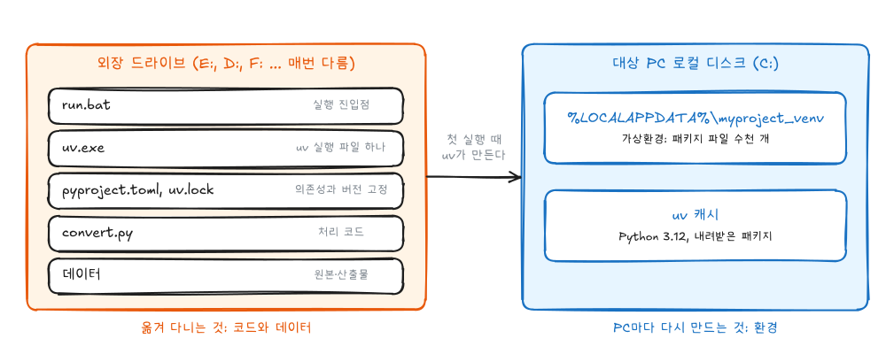
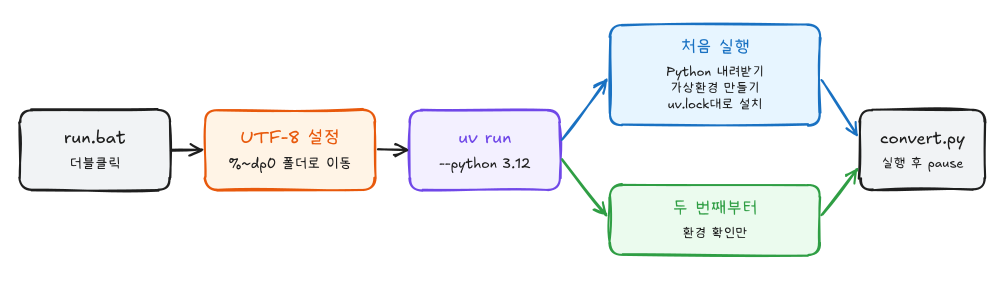

대용량 데이터와 처리 코드를 외장 SSD에 담아 다른 Windows PC에서 돌려야 할 때가 있다. 이 글은 CSV를 Parquet으로 변환하는 파이프라인을 예로 들어, 처음 꽂은 PC에서도 `run.bat`을 더블클릭하면 파이썬 설치부터 실행까지 끝나게 만드는 방법을 정리한다.

## 다른 PC에서 생기는 문제

| 문제 | 원인 |
|---|---|
| 경로가 깨진다 | 내 PC에서 `E:`였던 드라이브가 다른 PC에서는 `D:`나 `F:`가 된다 |
| 한글이 깨진다 | 한국어 Windows 콘솔과 파이썬의 기본 인코딩이 CP949다 |
| 파이썬이 없거나 버전이 다르다 | 대상 PC 환경을 통제할 수 없다 |
| 가상환경이 느리다 | 외장 드라이브는 작은 파일 수만 개를 읽고 쓰는 데 약하다 |

핵심은 **옮겨 다니는 것과 PC마다 새로 만드는 것을 나누는 것**이다. 코드, 데이터, 의존성 목록은 드라이브에 넣어 다니고, 파이썬과 가상환경은 대상 PC의 로컬 디스크에 그때그때 만든다.



## 전체 스크립트

```bat
@echo off
chcp 65001 >nul
cd /d "%~dp0"
set PYTHONUTF8=1
set PYTHONIOENCODING=utf-8
set UV_PROJECT_ENVIRONMENT=%LOCALAPPDATA%\myproject_venv
set UV=uv
if exist "%~dp0uv.exe" set UV="%~dp0uv.exe"
%UV% run --python 3.12 python convert.py --level 10 %*
pause
```

열 줄로 위 네 가지 문제를 모두 다룬다. 실행 흐름은 다음과 같다.



## 1. 드라이브 문자와 무관한 경로

```bat
cd /d "%~dp0"
```

- `%0`은 실행 중인 배치 파일 자신의 경로다. `~dp` 수정자를 붙인 `%~dp0`은 그중 드라이브(d)와 폴더(p)만 남긴 값, 즉 **배치 파일이 있는 폴더**다. 끝에 `\`가 붙어 있어서 `"%~dp0uv.exe"`처럼 바로 파일 이름을 이어 쓸 수 있다.
- `cd`는 기본적으로 같은 드라이브 안에서만 이동한다. 현재 위치가 `C:`이고 목적지가 `E:`라면 `/d`를 붙여야 드라이브까지 바뀐다.
- 경로에 공백이나 한글이 있을 수 있으므로 따옴표로 감싼다.

파이썬 코드도 같은 원칙으로 스크립트 파일 위치를 기준점으로 삼는다. 어느 폴더에서 실행했는지와 상관없이 경로가 맞는다.

```python
from pathlib import Path

HERE = Path(__file__).resolve().parent
DEF_SRC = HERE.parent / "원본데이터"
DEF_DST = HERE / "output"
```

## 2. 한글 깨짐

```bat
chcp 65001 >nul
set PYTHONUTF8=1
set PYTHONIOENCODING=utf-8
```

| 설정 | 하는 일 |
|---|---|
| `chcp 65001` | 콘솔 코드페이지를 UTF-8(65001)로 바꾼다. `>nul`은 안내 문구를 숨긴다 |
| `PYTHONUTF8=1` | 파이썬 3.7부터 있는 UTF-8 모드(PEP 540)를 켠다. 로케일과 상관없이 `open()`의 기본 인코딩과 표준 입출력이 UTF-8이 된다 |
| `PYTHONIOENCODING=utf-8` | 표준 입출력 인코딩을 명시한다. UTF-8 모드와 겹치지만 함께 두면 확실하다 |

`PYTHONUTF8`이 없으면 한국어 Windows에서 `open(path)`는 파일을 CP949로 연다. UTF-8 로그나 설정 파일을 읽을 때 `UnicodeDecodeError`가 나는 흔한 원인이다.

> **주의** 배치 파일 자체에는 한글을 넣지 않는다. `chcp`가 실행되기 전에 읽힌 줄은 깨질 수 있다. 한글 경로는 위처럼 파이썬 코드에 둔다.

## 3. uv로 파이썬과 가상환경 준비

[uv](https://docs.astral.sh/uv/)는 Rust로 만든 파이썬 패키지·프로젝트 관리자로, 실행 파일 하나로 동작한다. 파이썬 자체를 내려받아 설치하는 기능도 있어서, 대상 PC에 파이썬이 없어도 된다.

### 동봉한 `uv.exe` 우선

```bat
set UV=uv
if exist "%~dp0uv.exe" set UV="%~dp0uv.exe"
```

기본값은 PATH에 있는 `uv`이고, 배치 파일 옆에 `uv.exe`가 있으면 그것으로 덮어쓴다. 즉 동봉한 `uv.exe`가 우선이고, 없을 때만 시스템에 설치된 `uv`를 쓴다. 어느 PC에서나 같은 버전의 uv가 돌게 하려는 것이다.

### 가상환경은 로컬 디스크에

```bat
set UV_PROJECT_ENVIRONMENT=%LOCALAPPDATA%\myproject_venv
```

uv는 기본적으로 프로젝트 폴더 안에 `.venv`를 만든다. 이 변수로 위치를 `C:\Users\<사용자>\AppData\Local\myproject_venv`로 옮긴다.

| 외장 드라이브에 두면 | 이유 |
|---|---|
| 느리다 | 가상환경은 `.py`, `.pyc`, `.dll` 같은 작은 파일 수천~수만 개다. 외장 드라이브는 큰 파일을 순서대로 읽는 데는 빨라도 작은 파일을 여기저기 여는 데 약하다 |
| 깨질 수 있다 | 외장 드라이브는 exFAT·FAT32인 경우가 많다. 링크와 권한 정보를 지원하지 않아 가상환경 생성에 문제가 생길 수 있다 |
| 의미가 없다 | 가상환경은 그 PC의 파이썬 경로에 묶여 있어서 다른 PC로 옮기면 어차피 다시 만들어야 한다 |

### `uv run`이 하는 일

```bat
%UV% run --python 3.12 python convert.py --level 10 %*
pause
```

`uv run`은 실행 전에 환경을 맞춘다. 대상 PC에 Python 3.12가 없으면 uv가 관리하는 독립 실행형 파이썬을 내려받고, 가상환경을 만든 뒤 `pyproject.toml`과 `uv.lock`에 적힌 의존성을 잠금 파일의 버전 그대로 설치한다. 두 번째 실행부터는 환경이 맞는지 확인만 하고 바로 실행한다.

- `%*`는 배치 파일에 붙인 인자를 전부 넘긴다. `run.bat --months 202401 --workers 2`라고 실행하면 그 인자가 `convert.py`로 그대로 간다. 앞에 고정한 `--level 10`은 기본값 역할을 한다.
- `pause`는 작업이 끝나거나 오류가 나도 창이 바로 닫히지 않게 해서 로그를 읽을 수 있게 한다.

> **주의** 첫 실행에는 파이썬과 패키지를 내려받으므로 인터넷이 필요하다. [망분리 환경](/posts/air-gapped-analysis-environment)처럼 인터넷이 없는 곳에서는 이 방식을 그대로 쓸 수 없다.

## 옮기기 전 확인할 것

- 프로젝트 폴더에 `uv.exe`, `pyproject.toml`, `uv.lock`이 함께 있는가
- 코드에 `C:\`, `E:\` 같은 절대 경로가 남아 있지 않은가
- 대상 PC에서 첫 실행 때 인터넷에 연결되는가

## 정리

| 줄 | 해결하는 문제 |
|---|---|
| `cd /d "%~dp0"` | 드라이브 문자가 바뀌어도 프로젝트 폴더에서 실행 |
| `chcp 65001`, `PYTHONUTF8=1` | 콘솔과 파이썬의 한글 깨짐 |
| `UV_PROJECT_ENVIRONMENT=%LOCALAPPDATA%\...` | 외장 드라이브의 느린 작은 파일 읽기·쓰기 |
| `uv run --python 3.12` | 파이썬 미설치, 버전·의존성 불일치 |
