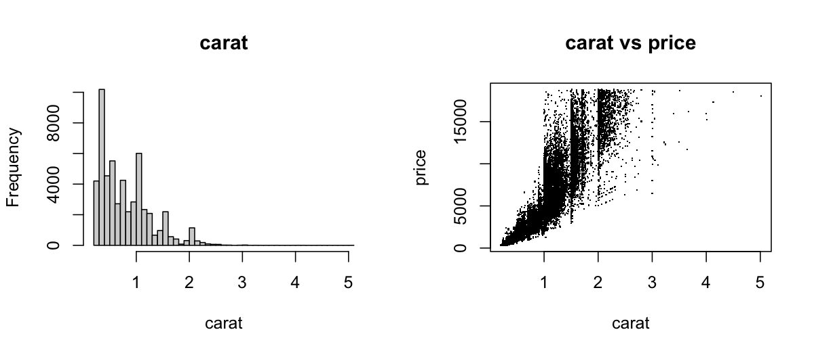

지금까지는 tidyverse로 썼지만, 남이 쓴 코드나 패키지 내부, 오래된 자료에는 base R이 많다. 패키지를 마음대로 설치할 수 없는 [망분리 환경](/posts/air-gapped-analysis-environment)에서는 base R만으로 전처리해야 할 때도 있다. R4DS(2판) A field guide to base R 장을 따라, 읽고 쓸 수 있어야 하는 base R 도구를 dplyr·purrr와 나란히 정리한다.

```r title="환경 설정"
library(tidyverse)
```

## 1. `[`로 고르기

`[`는 벡터나 데이터 프레임에서 **일부를 고른다**. 무엇으로 고르는지에 따라 다섯 가지가 있다.

```r
x <- c("one", "two", "three", "four", "five")

x[c(3, 2, 5)]          # 양의 정수: 그 위치
x[c(1, 1, 5, 5)]       # 같은 위치를 반복해도 된다
x[c(-1, -3, -5)]       # 음의 정수: 그 위치를 뺀다
x[c(TRUE, FALSE, TRUE, FALSE, TRUE)]   # 논리 벡터: TRUE인 위치

y <- c(abc = 1, def = 2, xyz = 5)
y[c("xyz", "def")]     # 문자 벡터: 이름으로
```

```text
[1] "three" "two"   "five" 
[1] "one"  "one"  "five" "five"
[1] "two"  "four"
[1] "one"   "three" "five" 
xyz def 
  5   2
```

논리 벡터로 고를 때 `NA`는 결과에 `NA`로 남는다. 아무것도 주지 않은 `x[]`는 전체를 돌려준다. 이 성질은 데이터 프레임에서 "모든 행" 또는 "모든 열"을 뜻할 때 쓴다.

데이터 프레임은 `df[행, 열]`로 쓴다.

```r
df <- tibble(
  x = c(2, 3, 1, 1, NA),
  y = letters[1:5],
  z = c(0.5, 0.2, 0.9, 0.4, 0.7)
)

df[1:2, ]                 # 1~2행, 모든 열
df[, c("x", "y")]         # 모든 행, 두 열
df[df$x > 1, ]            # 조건에 맞는 행
```

```text
# A tibble: 2 × 3
      x y         z
  <dbl> <chr> <dbl>
1     2 a       0.5
2     3 b       0.2
# A tibble: 5 × 2
      x y    
  <dbl> <chr>
1     2 a    
2     3 b    
3     1 c    
4     1 d    
5    NA e    
# A tibble: 3 × 3
      x y         z
  <dbl> <chr> <dbl>
1     2 a       0.5
2     3 b       0.2
3    NA <NA>   NA
```

`df$x > 1`에서 `x`가 `NA`인 행은 `NA`로 채워진 행이 된다. dplyr의 `filter()`는 `NA`를 버린다. base R에서 같은 결과를 얻으려면 `df[which(df$x > 1), ]`처럼 `which()`로 `TRUE`인 위치만 남긴다.

> **주의** `data.frame`에서 열 하나를 `[`로 고르면(`df[, "x"]`) 데이터 프레임이 아니라 벡터가 나온다. tibble은 항상 tibble을 돌려준다. `data.frame`에서 데이터 프레임을 유지하려면 `df[, "x", drop = FALSE]`로 쓴다.

## 2. `[[`와 `$`로 꺼내기

`[`가 일부를 **고른다면**, `[[`와 `$`는 원소 하나를 **꺼낸다**. 리스트에서 차이가 분명하다.

```r
l <- list(a = 1:3, b = "a string", c = pi, d = list(-1, -5))

str(l[1:2])     # 리스트: 고른 결과도 리스트
str(l[1])       # 원소 하나를 골라도 리스트
str(l[[1]])     # 그 원소 자체
str(l$a)        # 이름으로 꺼내기
```

```text
List of 2
 $ a: int [1:3] 1 2 3
 $ b: chr "a string"
List of 1
 $ a: int [1:3] 1 2 3
 int [1:3] 1 2 3
 int [1:3] 1 2 3
```

R4DS는 이를 후추통에 비유한다. 후추통 `l`에서 `l[1]`은 후추 봉지 하나만 든 후추통이고, `l[[1]]`은 후추 봉지 자체다. 데이터 프레임은 열의 리스트이므로 `df[["x"]]`와 `df$x`는 열 벡터를 꺼내고, `df["x"]`는 열 하나짜리 데이터 프레임을 고른다.

`$`는 이름의 앞부분만 맞아도 꺼내는 부분 일치를 한다. `data.frame`에서 `df$xy`가 `xyz` 열을 꺼낼 수 있어 실수가 숨는다. tibble은 부분 일치를 하지 않고 경고를 낸다.

## 3. dplyr 동사와 base R

dplyr 동사는 대부분 base R로도 쓸 수 있다. 같은 결과를 내는 코드를 나란히 놓는다.

```r
mtcars_t <- as_tibble(mtcars, rownames = "car")

# filter + select
mtcars_t |> filter(cyl == 4, mpg > 30) |> select(car, mpg, hp)
mtcars_t[mtcars_t$cyl == 4 & mtcars_t$mpg > 30, c("car", "mpg", "hp")]

# mutate
mtcars_t |> mutate(kpl = mpg * 0.425) |> select(car, kpl) |> head(3)
transform(mtcars_t, kpl = mpg * 0.425)[1:3, c("car", "kpl")]

# group_by + summarise
mtcars_t |> group_by(cyl) |> summarise(mpg = mean(mpg))
aggregate(mpg ~ cyl, data = mtcars_t, FUN = mean)
```

```text
# A tibble: 4 × 3
  car              mpg    hp
  <chr>          <dbl> <dbl>
1 Fiat 128        32.4    66
2 Honda Civic     30.4    52
3 Toyota Corolla  33.9    65
4 Lotus Europa    30.4   113
# A tibble: 4 × 3
  car              mpg    hp
  <chr>          <dbl> <dbl>
1 Fiat 128        32.4    66
2 Honda Civic     30.4    52
3 Toyota Corolla  33.9    65
4 Lotus Europa    30.4   113
# A tibble: 3 × 2
  car             kpl
  <chr>         <dbl>
1 Mazda RX4      8.92
2 Mazda RX4 Wag  8.92
3 Datsun 710     9.69
            car   kpl
1     Mazda RX4 8.925
2 Mazda RX4 Wag 8.925
3    Datsun 710 9.690
# A tibble: 3 × 2
    cyl   mpg
  <dbl> <dbl>
1     4  26.7
2     6  19.7
3     8  15.1
  cyl      mpg
1   4 26.66364
2   6 19.74286
3   8 15.10000
```

`transform()`과 `aggregate()`는 base R의 `mutate()`와 `summarise()`에 해당한다. `aggregate()`는 결과를 `data.frame`으로 돌려주고 그룹 열 이름을 그대로 쓴다. 여러 요약을 한 번에 하려면 `FUN`이 벡터를 돌려주게 하거나 `tapply()`, `by()`를 쓴다.

## 4. apply 계열

purrr의 `map()` 계열에 해당하는 base R 함수다.

```r
x <- list(a = 1:5, b = c(2.5, 10), c = c(-1, 0, 1))

lapply(x, mean)                                   # 항상 리스트: map()
sapply(x, mean)                                   # 단순화 시도: 결과가 벡터
sapply(x, range)                                  # 길이가 같으면 행렬로
vapply(x, mean, FUN.VALUE = numeric(1))           # 결과 형태를 지정: map_dbl()

m <- matrix(1:6, nrow = 2)
apply(m, 1, sum)                                  # 행마다
apply(m, 2, sum)                                  # 열마다
```

```text
$a
[1] 3

$b
[1] 6.25

$c
[1] 0

   a    b    c 
3.00 6.25 0.00 
     a    b  c
[1,] 1  2.5 -1
[2,] 5 10.0  1
   a    b    c 
3.00 6.25 0.00 
[1]  9 12
[1]  3  7 11
```

`sapply()`는 결과를 보고 벡터, 행렬, 리스트 중 하나로 **알아서** 단순화한다. 입력이 비어 있거나 원소마다 결과 길이가 다르면 리스트가 나와서, 함수 안에서 쓰면 뒤 코드가 깨진다.

```r
big <- function(x) x[x > 2]

sapply(list(), length)                             # 빈 입력: list()
sapply(list(1:4, 5:6), big)                        # 결과 길이가 같으면 행렬
sapply(list(1:4, 1:6), big)                        # 길이가 다르면 리스트
try(vapply(list(1:4, 1:6), big, integer(2)))       # vapply는 바로 오류
```

```text
list()
     [,1] [,2]
[1,]    3    5
[2,]    4    6
[[1]]
[1] 3 4

[[2]]
[1] 3 4 5 6
Error in vapply(list(1:4, 1:6), big, integer(2)) : 
  values must be length 2,
 but FUN(X[[2]]) result is length 4
```

`vapply()`는 결과 형태가 다르면 오류를 내므로 함수 안에서는 `vapply()`나 purrr의 `map_*()`를 쓴다. 데이터 프레임의 열마다 함수를 적용할 때는 `lapply(df, f)`가 `across()`에 해당한다. 데이터 프레임은 열의 리스트이기 때문이다.

## 5. for 반복

`for`는 반복 횟수만큼 결과를 담을 그릇을 **미리 만든 뒤** 채운다.

```r
paths <- c("a.csv", "b.csv", "c.csv")
n_rows <- vector("integer", length(paths))   # 미리 만든 그릇
for (i in seq_along(paths)) {
  n_rows[i] <- nchar(paths[i])               # 예시: 파일 이름 길이
}
n_rows
```

```text
[1] 5 5 5
```

`seq_along(paths)`는 `1:length(paths)`와 같지만, `paths`가 비어 있으면 `1:0`(즉 1, 0)이 아니라 빈 벡터를 돌려줘 반복을 건너뛴다. 결과를 `c(n_rows, 새 값)`처럼 매번 이어 붙이면 반복마다 전체를 복사해 느려진다. 결과가 데이터 프레임이면 리스트에 담은 뒤 마지막에 `do.call(rbind, 리스트)`(또는 `list_rbind()`)로 한 번에 합친다. 자세한 반복 방법은 [반복 글](/posts/r4ds-iteration)에 있다.

## 6. base 그래픽

`plot()`과 `hist()`는 빠르게 모양을 볼 때 편하다.

```r base w=8 h=3.5
par(mfrow = c(1, 2))
hist(diamonds$carat, breaks = 50, main = "carat", xlab = "carat")
plot(diamonds$carat, diamonds$price, pch = ".", main = "carat vs price", xlab = "carat", ylab = "price")
```



base 그래픽은 그림을 바로 그리고 끝나며 객체를 남기지 않는다. 그림을 고치려면 처음부터 다시 그린다. ggplot2는 그림을 객체로 만들어 층을 더하므로 범례, 패싯, 테마를 일관되게 다룰 수 있다. 탐색 중에는 base 그래픽을, 보고용 그림은 ggplot2를 쓰는 식으로 나눠 쓴다.

## 7. 비교

| 하려는 일 | tidyverse | base R |
|---|---|---|
| 행 고르기 | `filter(df, x > 1)` | `df[which(df$x > 1), ]`, `subset(df, x > 1)` |
| 열 고르기 | `select(df, x, y)` | `df[, c("x", "y")]` |
| 열 만들기 | `mutate(df, z = x + y)` | `df$z <- df$x + df$y`, `transform()` |
| 정렬 | `arrange(df, x)` | `df[order(df$x), ]` |
| 그룹 요약 | `group_by()` + `summarise()` | `aggregate()`, `tapply()` |
| 원소마다 함수 | `map()`, `map_dbl()` | `lapply()`, `vapply()` |
| 열마다 함수 | `across()` | `lapply(df, f)` |

| 비교 | 앞의 것 | 뒤의 것 |
|---|---|---|
| `[` 대 `[[` | 일부를 고름, 같은 종류의 객체를 돌려줌 | 원소 하나를 꺼냄, 원소 자체를 돌려줌 |
| `[[` 대 `$` | 변수에 든 이름도 쓸 수 있음 (`df[[col]]`) | 이름을 직접 씀, `data.frame`에서 부분 일치 |
| `sapply` 대 `vapply` | 결과 형태를 추측 | 결과 형태를 지정, 다르면 오류 |
| `data.frame` 대 tibble | `[`로 열 하나면 벡터, `$` 부분 일치 | 항상 tibble, 부분 일치 안 함 |

## 자주 하는 실수

- `df[df$x > 1, ]`에서 `NA` 행이 생기는 것을 놓친다. `which()`를 쓴다.
- `data.frame`에서 `df[, "x"]`가 벡터가 되어 다음 코드가 깨진다. `drop = FALSE`를 쓴다.
- 함수 안에서 `sapply()`를 써서 입력에 따라 결과 형태가 바뀐다. `vapply()`를 쓴다.
- `for`에서 결과를 매번 이어 붙인다. 그릇을 미리 만든다.

## 요약

| 도구 | 핵심 |
|---|---|
| `[` | 위치, 음수, 논리, 이름으로 일부를 고른다. `df[행, 열]` |
| `[[`, `$` | 원소 하나를 꺼낸다. 데이터 프레임에서는 열 벡터 |
| apply 계열 | `lapply` = `map`, `vapply` = `map_*`, `apply`는 행렬의 행·열 |
| `for` | 그릇을 미리 만들고 `seq_along()`으로 돈다 |
| base 그래픽 | 빠른 탐색용, 보고용은 ggplot2 |

## 참고자료

- [R for Data Science (2e) - A field guide to base R](https://r4ds.hadley.nz/base-r)

다음 글: [R4DS - Quarto로 분석 보고서 쓰기](/posts/r4ds-quarto)
