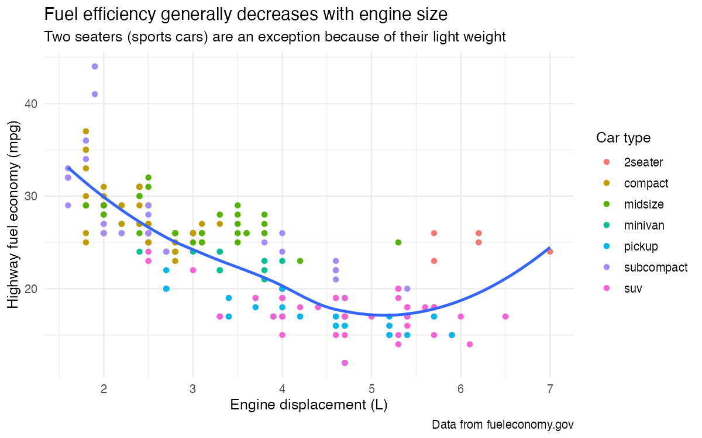
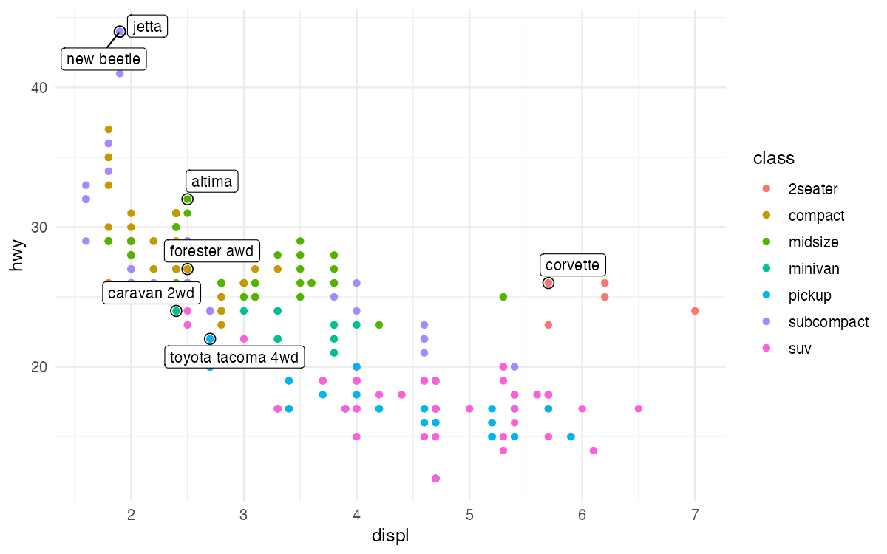
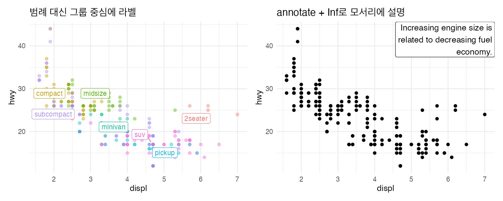
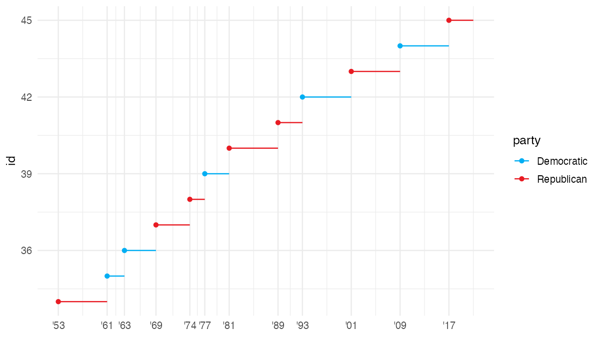
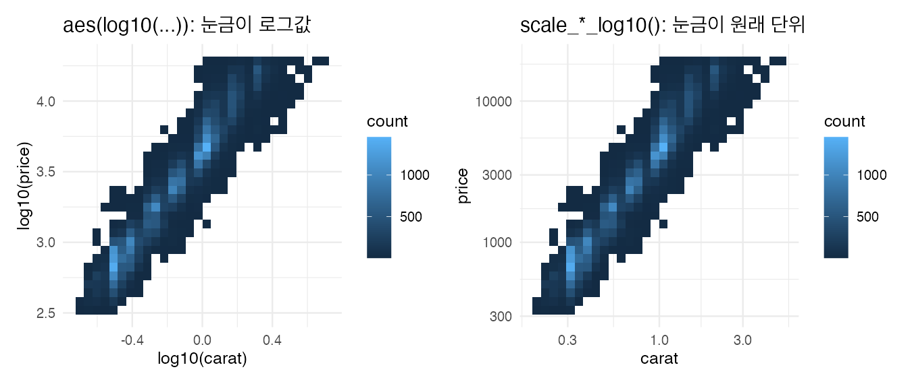
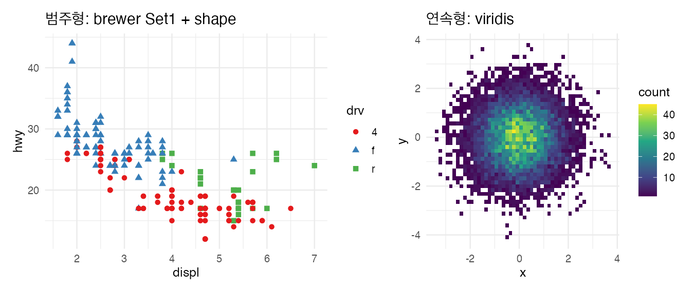
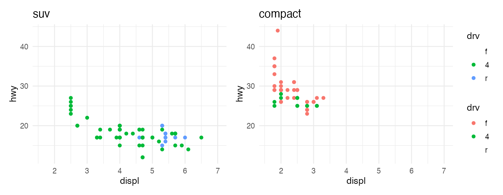
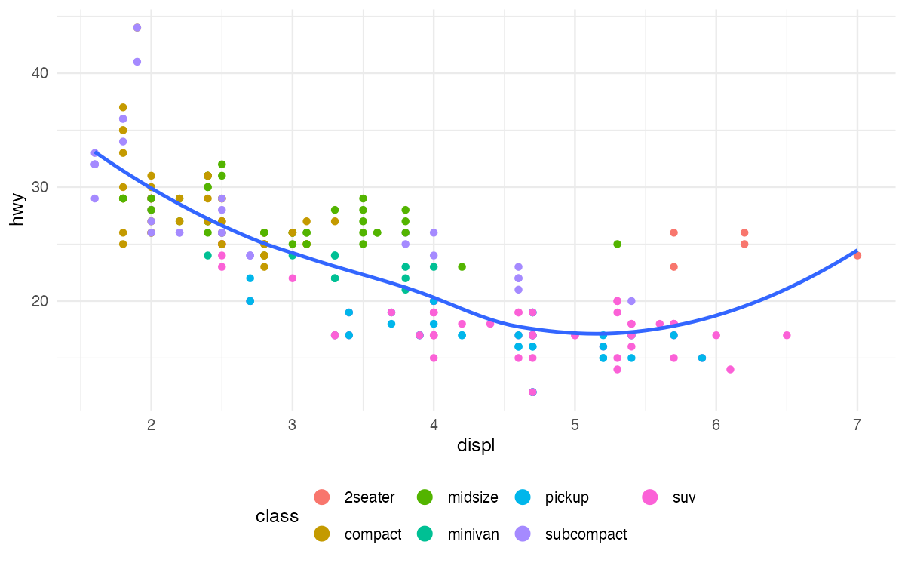
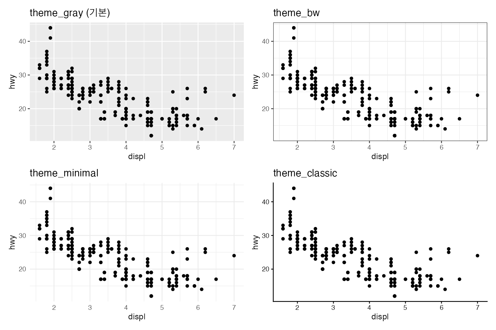

분석하면서 그리는 그래프는 나만 알아보면 되지만, 보고서나 발표에 넣을 그래프는 처음 보는 사람도 바로 읽혀야 한다. 이 글은 R4DS(2판) Communication 장을 따라 라벨, 주석, 스케일, 테마로 그래프를 다듬는 방법을 정리한다.

```r title="환경 설정"
library(tidyverse)
library(ggrepel)     # 겹치지 않는 라벨
library(patchwork)

theme_set(theme_minimal(base_size = 12))
```

## 1. 라벨: 제목은 결론으로

```r w=8 h=5
ggplot(mpg, aes(x = displ, y = hwy)) +
  geom_point(aes(color = class)) +
  geom_smooth(se = FALSE) +
  labs(
    x = "Engine displacement (L)",
    y = "Highway fuel economy (mpg)",
    color = "Car type",
    title = "Fuel efficiency generally decreases with engine size",
    subtitle = "Two seaters (sports cars) are an exception because of their light weight",
    caption = "Data from fueleconomy.gov"
  )
```



| 인자 | 쓰는 내용 |
|---|---|
| `title` | 변수 이름이 아니라 **그래프의 결론** |
| `subtitle` | 결론을 보충하는 설명, 예외 |
| `caption` | 데이터 출처 |
| `x`, `y` | 변수 설명 + **단위** |
| `color`, `fill`, `size` | 범례 제목 |

수식이 필요하면 `labs(x = quote(sum(x[i]^2, i == 1, n)))`처럼 `quote()`를 쓴다. 문법은 `?plotmath`에 있다.

## 2. 주석: 그래프 안에 직접 쓰기

### 특정 점에 이름 붙이기

차종별로 고속도로 연비가 가장 좋은 차에 모델명을 붙인다.

```r w=8 h=5
best_in_class <- mpg |>
  slice_max(hwy, n = 1, by = class, with_ties = FALSE)

ggplot(mpg, aes(x = displ, y = hwy)) +
  geom_point(aes(color = class)) +
  geom_point(data = best_in_class, size = 3, shape = 1) +
  geom_label_repel(data = best_in_class, aes(label = model), size = 3.5)
```



`geom_text()`, `geom_label()`은 라벨이 서로 겹치기 쉽다. ggrepel의 `geom_text_repel()`, `geom_label_repel()`은 겹치지 않게 자동으로 배치한다. 빈 원(`shape = 1`)을 겹쳐 그려 라벨 붙은 점을 강조했다.

### 범례 대신 직접 라벨, 모서리 설명

```r w=10 h=4
class_center <- mpg |>
  summarise(displ = median(displ), hwy = median(hwy), .by = class)

p1 <- ggplot(mpg, aes(x = displ, y = hwy, color = class)) +
  geom_point(alpha = 0.4) +
  geom_label_repel(data = class_center, aes(label = class), size = 3.5) +
  theme(legend.position = "none") +
  ggtitle("범례 대신 그룹 중심에 라벨")

p2 <- ggplot(mpg, aes(x = displ, y = hwy)) +
  geom_point() +
  annotate(
    geom = "label", x = Inf, y = Inf, hjust = "right", vjust = "top",
    label = str_wrap("Increasing engine size is related to decreasing fuel economy.", width = 30)
  ) +
  ggtitle("annotate + Inf로 모서리에 설명")

p1 + p2
```



- 범례를 오가며 색을 맞춰 보는 것보다 그룹 위에 이름이 있는 쪽이 빨리 읽힌다. 그룹이 많지 않을 때 쓴다.
- `x = Inf, y = Inf`는 데이터 범위와 상관없이 항상 패널의 오른쪽 위 끝이다. `hjust`, `vjust`로 글자가 안쪽으로 들어오게 맞춘다.
- 텍스트 하나를 넣을 때는 데이터 프레임을 만들 필요 없이 `annotate()`가 간단하다. 긴 문장은 `str_wrap()`으로 줄을 바꾼다.

| 주석 도구 | 용도 |
|---|---|
| `geom_text`, `geom_label` | 데이터의 여러 점에 라벨 |
| `geom_text_repel`, `geom_label_repel` | 라벨이 겹칠 때 |
| `annotate("text" / "label" / "rect" / "segment")` | 한두 개의 설명, 영역 강조, 화살표 |
| `geom_hline`, `geom_vline` | 기준선 (평균, 0 등) |

## 3. 스케일: 축과 범례의 규칙

이름 규칙은 `scale_` + `시각 속성` + `_` + `종류`다. 예를 들어 `scale_x_continuous`, `scale_color_manual`, `scale_fill_viridis_c`가 있다.

### 눈금, 날짜 축, 색 직접 지정

```r w=8 h=4.5
presidential |>
  mutate(id = 33 + row_number()) |>
  ggplot(aes(x = start, y = id, color = party)) +
  geom_point() +
  geom_segment(aes(xend = end, yend = id)) +
  scale_x_date(name = NULL, breaks = presidential$start, date_labels = "'%y") +
  scale_color_manual(values = c(Republican = "#E81B23", Democratic = "#00AEF3"))
```



- `breaks`: 눈금 위치, `labels`: 눈금 글자(`NULL`이면 숨김), `name`: 축 이름(`NULL`이면 숨김)
- `date_labels`: 날짜 형식(`%Y`, `%y`, `%b` 등)
- `scale_color_manual(values = )`: 정당, 브랜드처럼 정해진 색을 범주에 직접 연결

### 로그 축: 데이터 변환 대신 스케일 변환

```r w=9 h=3.8
p1 <- ggplot(diamonds, aes(x = log10(carat), y = log10(price))) +
  geom_bin_2d() + ggtitle("aes(log10(...)): 눈금이 로그값")
p2 <- ggplot(diamonds, aes(x = carat, y = price)) +
  geom_bin_2d() + scale_x_log10() + scale_y_log10() + ggtitle("scale_*_log10(): 눈금이 원래 단위")
p1 + p2
```



모양은 같지만 오른쪽은 축 눈금이 캐럿과 달러 단위로 남아 바로 읽힌다.

### 색 팔레트

```r w=9 h=3.8
p1 <- ggplot(mpg, aes(x = displ, y = hwy)) +
  geom_point(aes(color = drv, shape = drv), size = 2) +
  scale_color_brewer(palette = "Set1") + ggtitle("범주형: brewer Set1 + shape")
df <- tibble(x = rnorm(10000), y = rnorm(10000))
p2 <- ggplot(df, aes(x, y)) +
  geom_bin_2d(bins = 50) + scale_fill_viridis_c() + coord_fixed() + ggtitle("연속형: viridis")
p1 + p2
```



| 상황 | 함수 |
|---|---|
| 범주형 | `scale_color_brewer(palette = "Set1" / "Dark2")`, `scale_color_viridis_d()` |
| 순서형, 연속형 | `scale_fill_distiller(palette = "Blues")`, `scale_fill_viridis_c()` |
| 양수·음수가 있는 값 (0 중심) | `scale_fill_gradient2(low, mid, high, midpoint = 0)` |
| 의미가 정해진 색 | `scale_color_manual(values = )` |

색과 모양을 같은 변수에 함께 매핑하면 흑백 인쇄나 색각 이상 환경에서도 구분된다. viridis는 밝기가 단조롭게 변해서 흑백에서도 순서가 읽힌다.

### 여러 그래프의 스케일 맞추기

따로 그린 그래프는 축 범위와 색 대응이 제각각이라 나란히 놓으면 오해하기 쉽다. 스케일 객체를 만들어 같이 더한다.

```r w=9 h=3.5
x_scale <- scale_x_continuous(limits = range(mpg$displ))
y_scale <- scale_y_continuous(limits = range(mpg$hwy))
col_scale <- scale_color_discrete(limits = unique(mpg$drv))

p_suv <- ggplot(filter(mpg, class == "suv"), aes(x = displ, y = hwy, color = drv)) +
  geom_point() + x_scale + y_scale + col_scale + ggtitle("suv")
p_compact <- ggplot(filter(mpg, class == "compact"), aes(x = displ, y = hwy, color = drv)) +
  geom_point() + x_scale + y_scale + col_scale + ggtitle("compact")
p_suv + p_compact + plot_layout(guides = "collect")
```



한 데이터 안에서 그룹을 비교하는 것이라면 `facet_wrap(~ class)`가 스케일을 자동으로 맞춰 주므로 더 간단하다.

## 4. 범례와 테마

### 범례 위치와 모양

```r w=8 h=5
ggplot(mpg, aes(x = displ, y = hwy)) +
  geom_point(aes(color = class)) +
  geom_smooth(se = FALSE) +
  theme(legend.position = "bottom") +
  guides(color = guide_legend(nrow = 2, override.aes = list(size = 4)))
```



- `legend.position`: `"right"`(기본), `"bottom"`, `"top"`, `"left"`, `"none"`
- `guide_legend(nrow =)`: 범례 줄 수, `override.aes`: 범례의 점 크기 등을 그래프와 다르게

### 내장 테마 비교

```r w=9 h=6
p <- ggplot(mpg, aes(x = displ, y = hwy)) + geom_point()
(p + theme_gray() + ggtitle("theme_gray (기본)")) +
  (p + theme_bw() + ggtitle("theme_bw")) +
  (p + theme_minimal() + ggtitle("theme_minimal")) +
  (p + theme_classic() + ggtitle("theme_classic"))
```



| 테마 | 용도 |
|---|---|
| `theme_gray()` | 기본값, 회색 배경 |
| `theme_bw()` | 흰 배경과 테두리, 인쇄용 |
| `theme_minimal()` | 축선과 배경 최소화, 웹·발표용 |
| `theme_classic()` | 격자 없이 축선만, 논문 스타일 |
| `theme_void()` | 모두 제거, 지도나 다이어그램용 |

`theme_set(theme_minimal())`로 세션 전체의 기본 테마를 바꿀 수 있다. 세부 요소는 `theme(legend.position =, axis.text.x = element_text(angle = 45), panel.grid.minor = element_blank())`처럼 바꾼다.

## 5. 저장

```r norun
p <- ggplot(mpg, aes(x = displ, y = hwy)) + geom_point()
ggsave("plot.png", p, width = 7, height = 4.5, dpi = 300)
```

- 크기 단위는 인치가 기본이다(`units = "cm"`로 바꿀 수 있다).
- 그래프를 지정하지 않으면 마지막으로 그린 그래프를 저장한다.
- 같은 크기로 저장해야 글자 크기가 그래프마다 일정하다.

## 요약

| 하고 싶은 것 | 코드 |
|---|---|
| 제목, 축 이름, 출처 | `labs(title =, subtitle =, x =, y =, color =, caption =)` |
| 겹치지 않는 라벨 | `ggrepel::geom_label_repel(data =, aes(label =))` |
| 설명 한 줄 | `annotate("label", x = Inf, y = Inf, hjust = "right", vjust = "top", label =)` |
| 기준선 | `geom_hline(yintercept = 0)` |
| 눈금 | `scale_x_continuous(breaks =, labels =)` |
| 날짜 축 | `scale_x_date(date_breaks =, date_labels =)` |
| 로그 축 | `scale_x_log10()` |
| 색 | `scale_color_manual()`, `scale_color_brewer()`, `scale_fill_viridis_c()` |
| 여러 그래프 스케일 통일 | 스케일 객체를 만들어 각 그래프에 `+` |
| 범례 | `theme(legend.position = "bottom")`, `guides(color = guide_legend(nrow = 2))` |
| 테마 | `theme_minimal()`, `theme_set()` |
| 저장 | `ggsave("plot.png", width =, height =, dpi =)` |

## 참고자료

- *R for Data Science* (2nd ed.): [11 Communication](https://r4ds.hadley.nz/communication.html)
- [ggrepel](https://ggrepel.slowkow.com/), [ggplot2 공식 문서](https://ggplot2.tidyverse.org/)

다음 글: [R4DS - dplyr로 데이터 변환하기](/posts/r4ds-dplyr)
