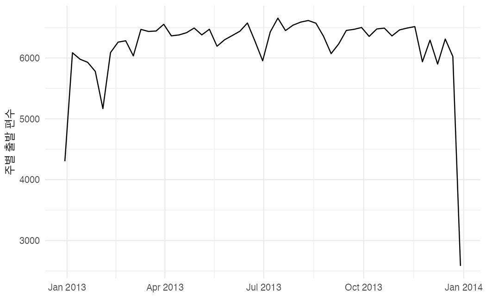
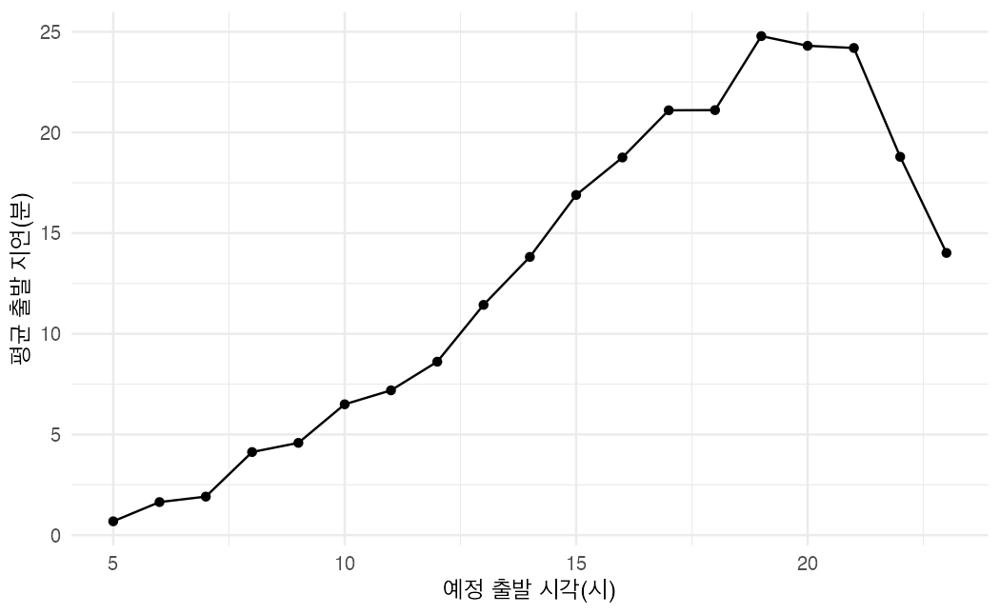

날짜와 시간은 달력, 윤년, 일광절약시간, 시간대 때문에 숫자나 문자열처럼 다룰 수 없다. R4DS(2판) Dates and times 장을 따라 lubridate로 날짜를 만들고, 구성요소를 꺼내고, 시간 간격을 계산하는 방법을 정리한다. 분석 단계에서 시간 순서가 중요해지는 경우는 [시계열 분석 시리즈](/posts/ts-01-intro)로 이어진다.

```r title="환경 설정"
library(tidyverse)
library(nycflights13)

theme_set(theme_minimal(base_size = 12))
Sys.setlocale("LC_TIME", "C")   # 월·요일 이름을 영어로 표시
```

## 1. 날짜와 시간 만들기

R에는 세 가지 타입이 있다. 날짜(`<date>`), 날짜와 시각(`<dttm>`, POSIXct), 시각만 있는 `hms`다. 날짜만 있으면 `date`를 쓰는 것이 단순하다.

```r
today()
now()
```

실행한 날짜와 시각이 나온다.

### 1.1 문자열에서 파싱

연·월·일의 **순서**만 함수 이름으로 알려 주면 된다. 구분자는 알아서 처리한다.

```r
ymd("2024-03-09")
mdy("March 9th, 2024")
dmy("09-Mar-2024")
ymd_hms("2024-03-09 13:45:30")
ymd("2024-13-45")   # 불가능한 날짜는 NA와 경고
```

```text
[1] "2024-03-09"
[1] "2024-03-09"
[1] "2024-03-09"
[1] "2024-03-09 13:45:30 UTC"
[1] NA
```

### 1.2 구성요소에서 만들기

`flights`는 연, 월, 일, 시각이 열마다 따로 있다. `make_date()`와 `make_datetime()`으로 합친다. 출발 시각은 `hhmm` 형식의 정수이므로 `%/%`와 `%%`로 시와 분을 나눈다.

```r
make_datetime_hhmm <- function(year, month, day, hhmm) {
  make_datetime(year, month, day, hhmm %/% 100, hhmm %% 100)
}

flights_dt <- flights |>
  filter(!is.na(dep_time), !is.na(sched_dep_time)) |>
  mutate(
    dep_time = make_datetime_hhmm(year, month, day, dep_time),
    sched_dep_time = make_datetime_hhmm(year, month, day, sched_dep_time)
  ) |>
  select(origin, dest, dep_time, sched_dep_time, dep_delay)

flights_dt |> head(3)
```

```text
# A tibble: 3 × 5
  origin dest  dep_time            sched_dep_time      dep_delay
  <chr>  <chr> <dttm>              <dttm>                  <dbl>
1 EWR    IAH   2013-01-01 05:17:00 2013-01-01 05:15:00         2
2 LGA    IAH   2013-01-01 05:33:00 2013-01-01 05:29:00         4
3 JFK    MIA   2013-01-01 05:42:00 2013-01-01 05:40:00         2
```

## 2. 구성요소 꺼내기와 고치기

`year()`, `month()`, `mday()`(월의 일), `yday()`(연의 일), `wday()`(요일), `hour()`, `minute()`가 날짜에서 각 요소를 꺼낸다. `month()`와 `wday()`는 `label = TRUE`를 주면 이름이 있는 순서형 factor를 돌려준다.

```r
d <- ymd_hms("2024-03-09 13:45:30")
c(year(d), month(d), mday(d), yday(d), wday(d), hour(d))
month(d, label = TRUE)
wday(d, label = TRUE, abbr = FALSE)
```

```text
[1] 2024    3    9   69    7   13
[1] Mar
12 Levels: Jan < Feb < Mar < Apr < May < Jun < Jul < Aug < Sep < ... < Dec
[1] Saturday
7 Levels: Sunday < Monday < Tuesday < Wednesday < Thursday < ... < Saturday
```

`wday()`의 기본값은 일요일이 1이다. 월요일부터 시작하려면 `week_start = 1`을 준다.

### 2.1 반올림

날짜를 `floor_date()`로 내림, `round_date()`로 반올림, `ceiling_date()`로 올림하면 시간 단위(`"week"`, `"month"` 등)로 묶을 수 있다. 시간 단위로 묶은 뒤 `count()`를 쓰면 시간 흐름에 따른 개수를 한눈에 본다.

```r
d <- ymd_hms("2024-03-09 13:45:30")
floor_date(d, "month")
round_date(d, "month")
ceiling_date(d, "month")
floor_date(d, "week")   # 기본은 일요일 시작
```

```text
[1] "2024-03-01 UTC"
[1] "2024-03-01 UTC"
[1] "2024-04-01 UTC"
[1] "2024-03-03 UTC"
```

주별 출발 편수를 그린다.

```r
flights_dt |>
  count(week = floor_date(dep_time, "week")) |>
  ggplot(aes(x = week, y = n)) +
  geom_line() +
  labs(x = NULL, y = "주별 출발 편수")
```



첫 주(2012-12-30 시작, 4,303편)와 마지막 주(2013-12-29 시작, 2,583편)는 일부 요일만 포함해서 편수가 적다. 이를 제외하면 2월 첫 주(2013-02-03 시작)가 5,167편으로 가장 낮고, 나머지 대부분의 주는 6,000편 안팎이다.

### 2.2 구성요소 고치기

`year(d) <- 2025`처럼 구성요소에 값을 할당하거나 `update(d, year = 2025, hour = 0)`으로 일부만 바꾼다. 원본을 건드리지 않고 새 값을 얻는다.

```r
update(ymd("2024-03-09"), year = 2025, month = 1, mday = 1)
```

```text
[1] "2025-01-01"
```

## 3. 시간 간격: duration, period, interval

두 날짜의 뺄셈은 `difftime`을 돌려주는데, 단위가 상황에 따라 바뀌어 다루기 어렵다. lubridate는 세 가지 간격 객체를 제공한다.

| 객체 | 만드는 함수 | 의미 | 일광절약시간·윤년 |
|---|---|---|---|
| duration | `dseconds()`, `ddays()`, `dyears()` | **초 단위의 고정된 길이** (1일 = 86,400초) | 반영하지 않는다 |
| period | `seconds()`, `days()`, `months()`, `years()` | **달력 단위** (1일 = "같은 시각의 다음 날") | 반영한다 |
| interval | `start %--% end` | 시작과 끝이 정해진 **실제 구간** | 반영한다 |

일광절약시간(DST)이 시작되는 2024-03-10 전날 오후 1시에 하루를 더해 보면 차이가 보인다.

```r
x <- ymd_hms("2024-03-09 13:00:00", tz = "America/New_York")
x + ddays(1)   # 86,400초 뒤
x + days(1)    # 달력으로 다음 날 같은 시각
```

```text
[1] "2024-03-10 14:00:00 EDT"
[1] "2024-03-10 13:00:00 EDT"
```

윤년도 같다.

```r
ymd("2024-01-01") + dyears(1)   # 365.25일(31,557,600초) 뒤
ymd("2024-01-01") + years(1)    # 달력으로 1년 뒤
```

```text
[1] "2024-12-31 06:00:00 UTC"
[1] "2025-01-01"
```

interval은 두 시점 사이 길이를 원하는 단위로 바꿀 때 쓴다. 나눗셈으로 단위를 정한다.

```r
span <- ymd("2024-01-01") %--% ymd("2025-01-01")
span / days(1)
span / months(1)
as.period(span)
```

```text
[1] 366
[1] 12
[1] "1y 0m 0d 0H 0M 0S"
```

2024년은 윤년이므로 같은 구간이 366일이면서 정확히 12개월(1년)이다. `days(1)`, `months(1)`을 나누는 단위로 고르면 같은 interval을 서로 다른 단위로 읽는다.

`dseconds(1)`처럼 duration끼리는 더하고 곱할 수 있지만, period와 duration을 섞는 일은 되도록 피한다. 어느 쪽 의미인지 코드에서 드러나야 한다.

> **주의** 나이처럼 "생일부터 지금까지 몇 년"을 구할 때는 `dyears()`로 나누지 말고 interval을 `years(1)`로 나눠 정수 부분을 취한다(`(birth %--% today()) %/% years(1)`). 윤년 때문에 duration으로는 하루씩 어긋난다.

## 4. 시간대

시간대는 같은 순간을 다른 시계로 읽는 방법이다. R은 `"America/New_York"` 같은 IANA 이름을 쓰며, 지정하지 않으면 UTC다. 같은 순간이라면 시간대를 바꿔도 값(초)은 그대로이고 표시만 달라진다.

```r
x <- ymd_hms("2024-03-09 13:00:00", tz = "America/New_York")
with_tz(x, "Asia/Seoul")       # 같은 순간, 다른 표시
force_tz(x, "Asia/Seoul")      # 시각 표시는 그대로, 다른 순간
x == with_tz(x, "Asia/Seoul")
```

```text
[1] "2024-03-10 03:00:00 KST"
[1] "2024-03-09 13:00:00 KST"
[1] TRUE
```

세 줄은 각각 서울 시계로 3월 10일 03시, 시각 표시는 그대로이지만 다른 순간인 3월 9일 13시, 그리고 `with_tz()`는 같은 순간이라는 확인이다.

`with_tz()`는 같은 순간을 다른 시계로 보고, `force_tz()`는 표시된 시계를 그대로 두고 시간대 정보만 바꿔서 다른 순간으로 만든다. 시간대가 잘못 붙은 자료를 고칠 때 `force_tz()`를 쓴다.

`flights`의 출발·도착 시각은 각 공항의 현지 시각이지만 시간대 열이 없다. 비행 시간을 구할 때는 `nycflights13::airports`의 `tzone`으로 시간대를 맞춰야 한다.

## 5. 비교

| 비교 | 차이 | 고르는 기준 |
|---|---|---|
| `dyears(1)` 와 `years(1)` | 365.25일 고정 길이 / 달력상 1년 | 물리적 경과 시간이면 duration, 달력 날짜 이동이면 period |
| `ddays(1)` 와 `days(1)` | 86,400초 / 같은 시각의 다음 날 (DST 때 다름) | 마찬가지 |
| `floor_date()` 와 `round_date()` | 항상 내림 / 가장 가까운 단위로 | 시간 구간으로 묶을 때는 `floor_date()` |
| `with_tz()` 와 `force_tz()` | 순간 유지, 표시만 변경 / 표시 유지, 순간 변경 | 표시를 바꾸려면 `with_tz()`, 잘못 붙은 시간대를 바로잡으려면 `force_tz()` |

## 6. 예시와 사용: 시간대별 출발 지연

하루 중 언제 지연이 커지는지 살펴본다. 예정 출발 시각의 시(`hour`)별 평균 출발 지연을 구한다.

```r
by_hour <- flights_dt |>
  mutate(hour = hour(sched_dep_time)) |>
  summarise(mean_delay = mean(dep_delay), n = n(), .by = hour) |>
  arrange(hour)

by_hour
```

```text
# A tibble: 19 × 3
    hour mean_delay     n
   <int>      <dbl> <int>
 1     5      0.688  1944
 2     6      1.64  25526
 3     7      1.91  22532
 4     8      4.13  26800
 5     9      4.58  19985
 6    10      6.50  16418
 7    11      7.19  15737
 8    12      8.61  17793
 9    13     11.4   19527
10    14     13.8   21140
11    15     16.9   23218
12    16     18.8   22162
13    17     21.1   23766
14    18     21.1   21157
15    19     24.8   20580
16    20     24.3   16103
17    21     24.2   10524
18    22     18.8    2561
19    23     14.0    1048
```

```r
ggplot(by_hour, aes(x = hour, y = mean_delay)) +
  geom_line() +
  geom_point() +
  labs(x = "예정 출발 시각(시)", y = "평균 출발 지연(분)")
```



평균 지연은 오전 5시 0.69분에서 시작해 하루 동안 늘어나 19시 24.8분에서 가장 크고, 이후 줄어든다. 앞 비행의 지연이 뒤로 이어지기 때문이라고 해석할 수 있지만, 이 자료만으로 원인을 확인한 것은 아니다([앞 글](/posts/r4ds-logical-numbers)에서 직전 지연과 다음 지연의 연관을 보았다).

요일별로도 비교한다.

```r
flights_dt |>
  mutate(wday = wday(sched_dep_time, label = TRUE, week_start = 1)) |>
  summarise(mean_delay = mean(dep_delay), .by = wday) |>
  arrange(wday)
```

```text
# A tibble: 7 × 2
  wday  mean_delay
  <ord>      <dbl>
1 Mon        14.8 
2 Tue        10.6 
3 Wed        11.8 
4 Thu        16.1 
5 Fri        14.7 
6 Sat         7.65
7 Sun        11.6 
```

요일별 평균 지연은 목요일 16.1분이 가장 크고 토요일 7.65분이 가장 작다.

## 자주 하는 실수

| 증상 | 원인과 해결 |
|---|---|
| 날짜가 `NA` | 형식과 함수가 맞지 않다. `ymd`, `mdy`, `dmy` 중 자료 순서에 맞는 것을 쓴다 |
| `x + years(1)`이 `NA` | 2월 29일에 1년을 더하면 없는 날짜가 된다. 필요하면 `%m+%` 등을 쓴다 |
| 요일 번호가 예상과 다름 | 기본은 일요일이 1이다. `week_start = 1` 또는 `label = TRUE` |
| 시각이 9시간 어긋남 | 시간대를 지정하지 않으면 UTC다. `tz =` 또는 `with_tz()` |
| `difftime` 단위가 바뀜 | 간격이 크면 일, 작으면 분으로 단위가 달라진다. `units = "days"` 또는 interval로 나눈다 |

## 요약

| 하고 싶은 것 | 코드 |
|---|---|
| 문자열 → 날짜 | `ymd()`, `mdy()`, `dmy()`, `ymd_hms()` |
| 열 여러 개 → 날짜 | `make_date()`, `make_datetime()` |
| 구성요소 | `year()`, `month()`, `wday(label = TRUE)`, `hour()` |
| 시간 단위로 묶기 | `floor_date()`, `round_date()`, `ceiling_date()` |
| 고정 길이 / 달력 길이 | `ddays()` / `days()` |
| 두 시점 사이의 길이 | `start %--% end` 후 나눗셈 |
| 시간대 | `with_tz()`, `force_tz()` |

## 참고자료

- *R for Data Science* (2nd ed.): [17 Dates and times](https://r4ds.hadley.nz/datetimes.html)
- [lubridate 공식 문서](https://lubridate.tidyverse.org/)

다음 글: [R4DS - join으로 테이블 합치기](/posts/r4ds-joins)
