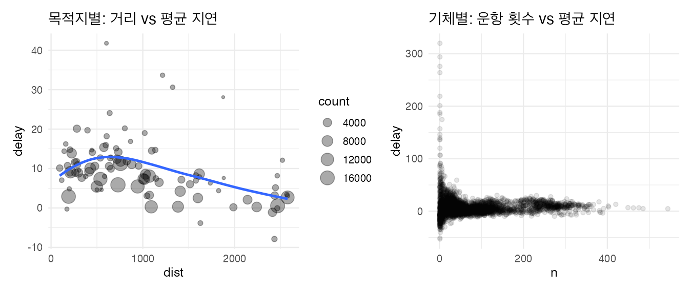

R4DS(2판) Data transformation 장을 실습하며 정리했다. dplyr 함수는 **행**, **열**, **그룹** 중 무엇을 다루는지로 나누면 기억하기 쉽다. 데이터는 2013년 뉴욕 출발 항공편 33만여 건인 `nycflights13::flights`를 쓴다.

```r title="환경 설정"
library(tidyverse)
library(nycflights13)
library(patchwork)

theme_set(theme_minimal(base_size = 12))
```

```r
flights |> glimpse()
```

## 함수 지도

| 대상 | 함수 | 하는 일 |
|---|---|---|
| 행 | `filter()` | 조건에 맞는 행만 남김 |
| 행 | `arrange()` | 정렬 (`desc()`로 내림차순) |
| 행 | `distinct()` | 중복 제거 |
| 열 | `mutate()` | 새 열 추가, 기존 열 변경 |
| 열 | `select()` | 열 고르기 |
| 열 | `rename()` | 열 이름 바꾸기 |
| 열 | `relocate()` | 열 순서 바꾸기 |
| 그룹 | `summarise(.by =)` | 그룹별 요약 |
| 그룹 | `slice_max()`, `slice_min()`, `slice_head()`, `slice_sample()` | 그룹별로 행 몇 개 뽑기 |
| 그룹 | `count()` | 그룹별 개수 |

모든 함수가 **첫 인자로 데이터 프레임을 받고, 데이터 프레임을 돌려준다**. 그래서 파이프 `|>`로 이어 붙일 수 있다. 원본은 바뀌지 않으므로 결과를 쓰려면 `<-`로 저장한다.

## 1. 행 다루기

### filter: 조건으로 거르기

```r
# 1월 1일 항공편
flights |> filter(month == 1, day == 1)

# 11월 또는 12월
flights |> filter(month %in% c(11, 12))

# 출발·도착 모두 2시간 넘게 늦지 않은 항공편
flights |> filter(!(arr_delay > 120 | dep_delay > 120))
```

| 연산자 | 뜻 |
|---|---|
| `,` 또는 `&` | 그리고 |
| `\|` | 또는 |
| `!` | 아님 |
| `%in%` | 여러 값 중 하나 |
| `between(x, a, b)` | a 이상 b 이하 |
| `near(x, y)` | 실수 비교 (`==` 대신) |

### arrange, distinct

```r
# 도착 지연이 큰 순서로
flights |> arrange(desc(arr_delay))

# 출발지-도착지 조합의 종류와 개수
flights |> distinct(origin, dest)
flights |> count(origin, dest, sort = TRUE)
```

`arrange()`에서 `NA`는 오름차순이든 내림차순이든 항상 맨 뒤로 간다.

## 2. 열 다루기

### mutate: 새 열 만들기

```r
flights |>
  mutate(
    gain = dep_delay - arr_delay,          # 비행 중 만회한 시간
    speed = distance / air_time * 60,      # mph
    .before = 1                            # 새 열을 맨 앞에
  )
```

- `.before`, `.after`: 새 열의 위치. 기본값은 맨 뒤라서 안 보이기 쉽다.
- `.keep = "used"`: 계산에 쓴 열과 새 열만 남긴다(예전 `transmute()` 역할).

mutate 안에서 자주 쓰는 함수다.

| 종류 | 함수 |
|---|---|
| 산술 | `+ - * /`, `%/%`(몫), `%%`(나머지), `log`, `log2`, `log10` |
| 이전·다음 값 | `lag(x)`, `lead(x)` |
| 누적 | `cumsum`, `cummean`, `cummax` |
| 순위 | `min_rank(x)`, `row_number(x)`, `dense_rank(x)`, `percent_rank(x)` |
| 조건 | `if_else(cond, a, b)`, `case_when(cond1 ~ a, cond2 ~ b, .default = c)` |

```r
flights |>
  mutate(
    hour = dep_time %/% 100,
    minute = dep_time %% 100,
    delay_level = case_when(
      is.na(arr_delay)  ~ "cancelled",
      arr_delay <= 0    ~ "on time",
      arr_delay <= 60   ~ "late",
      .default          = "very late"
    ),
    .keep = "used"
  )
```

### select, rename, relocate

```r
flights |> select(year, month, day)
flights |> select(year:arr_delay)                 # 범위
flights |> select(!year:day)                       # 제외
flights |> select(starts_with("dep"), ends_with("delay"), contains("time"))
flights |> select(where(is.character))            # 조건으로
flights |> rename(tail_num = tailnum)              # 새 이름 = 옛 이름
flights |> relocate(time_hour, air_time)           # 맨 앞으로
```

## 3. 그룹별 요약

### summarise와 .by

```r
flights |>
  summarise(
    avg_delay = mean(dep_delay, na.rm = TRUE),
    n = n(),
    .by = month
  )
```

`.by`는 그 함수 한 번에만 그룹을 적용한다. 예전 방식 `group_by() |> summarise()`는 결과에 그룹이 남아(`summarise`는 마지막 그룹 변수 하나만 벗긴다) 다음 계산에 영향을 주기 쉬웠다. 그룹을 유지하며 여러 단계를 거칠 때만 `group_by()`를 쓰고 끝에 `ungroup()`한다.

### 사례: 거리와 지연의 관계

```r w=9 h=3.8
by_dest <- flights |>
  summarise(
    count = n(),
    dist = mean(distance, na.rm = TRUE),
    delay = mean(arr_delay, na.rm = TRUE),
    .by = dest
  ) |>
  filter(count > 20, dest != "HNL")

by_plane <- flights |>
  filter(!is.na(arr_delay)) |>
  summarise(delay = mean(arr_delay), n = n(), .by = tailnum)

p1 <- ggplot(by_dest, aes(x = dist, y = delay)) +
  geom_point(aes(size = count), alpha = 1/3) +
  geom_smooth(se = FALSE) +
  ggtitle("목적지별: 거리 vs 평균 지연")
p2 <- ggplot(by_plane, aes(x = n, y = delay)) +
  geom_point(alpha = 1/10) +
  ggtitle("기체별: 운항 횟수 vs 평균 지연")
p1 + p2
```



- 왼쪽: 약 750마일까지는 거리가 멀수록 지연이 늘다가 그 뒤로는 줄어든다. 호놀룰루(HNL)는 거리가 극단적으로 멀어 뺐다.
- 오른쪽: 운항 횟수가 적은 기체일수록 평균 지연이 극단적으로 흩어진다. **표본이 작으면 평균의 변동이 크다**는 전형적인 모양이다. 그룹 평균을 비교할 때는 항상 `n()`을 함께 보고, 개수가 적은 그룹은 걸러야 한다.

### 그룹 안에서 행 뽑기와 순위

```r
# 목적지별로 도착 지연이 가장 큰 항공편 1개
flights |> slice_max(arr_delay, n = 1, by = dest) |> relocate(dest, arr_delay)

# 날짜별 첫 출발과 마지막 출발
flights |>
  filter(!is.na(dep_time)) |>
  summarise(first = min(dep_time), last = max(dep_time), .by = c(year, month, day))

# 날짜별로 1시간 넘게 늦은 비율
flights |>
  filter(!is.na(arr_delay)) |>
  summarise(prop_late = mean(arr_delay > 60), .by = c(month, day))
```

`mean(조건)`은 TRUE를 1, FALSE를 0으로 계산하므로 **비율**이 된다. `sum(조건)`은 개수다.

### count

```r
flights |> count(dest, sort = TRUE)                  # 개수
flights |> count(tailnum, wt = distance)             # 개수 대신 거리 합계
flights |> summarise(carriers = n_distinct(carrier), .by = dest) |> arrange(desc(carriers))
```

## 자주 하는 실수

| 증상 | 원인과 해결 |
|---|---|
| `filter(month == 11 \| 12)`가 전체를 반환 | `month == 11 \| 12`는 `(month == 11) \| 12`로 해석되고 12는 TRUE다. `month %in% c(11, 12)` |
| `sqrt(2)^2 == 2`가 FALSE | 부동소수점 오차. `near()`로 비교 |
| 평균이 `NA` | `NA`가 하나라도 있으면 결과가 `NA`. `na.rm = TRUE`, 또는 먼저 `filter(!is.na(x))` |
| `x == NA`로 걸러지지 않음 | `NA`와의 비교는 항상 `NA`. `is.na(x)` |
| 요약 후 결과가 이상하게 그룹별로 계산됨 | `group_by()`가 남아 있다. `.by`를 쓰거나 `ungroup()` |
| 평균이 극단적인 그룹이 맨 위에 | 개수가 적은 그룹이다. `n()`을 함께 보고 거른다 |
| 결과가 저장되지 않음 | dplyr은 원본을 바꾸지 않는다. `df <- df \|> mutate(...)` |

## 요약

| 하고 싶은 것 | 코드 |
|---|---|
| 조건으로 행 거르기 | `filter(x > 0, g %in% c("a", "b"))` |
| 정렬 | `arrange(desc(x))` |
| 중복 제거 | `distinct(a, b)` |
| 새 열 | `mutate(new = ..., .before = 1)` |
| 조건별 값 | `case_when(cond ~ val, .default = )` |
| 열 고르기 | `select(a:c, starts_with("x"), where(is.numeric))` |
| 그룹 요약 | `summarise(m = mean(x, na.rm = TRUE), n = n(), .by = g)` |
| 그룹별 상위 n개 | `slice_max(x, n = 3, by = g)` |
| 개수, 비율 | `count(g)`, `mean(조건)` |
| 이전 값과 차이 | `x - lag(x)` |

## 참고자료

- *R for Data Science* (2nd ed.): [3 Data transformation](https://r4ds.hadley.nz/data-transform.html), [12 Logical vectors](https://r4ds.hadley.nz/logicals.html), [13 Numbers](https://r4ds.hadley.nz/numbers.html)
- [dplyr 공식 문서](https://dplyr.tidyverse.org/)

다음 글: [R4DS - join으로 테이블 합치기](/posts/r4ds-joins)
