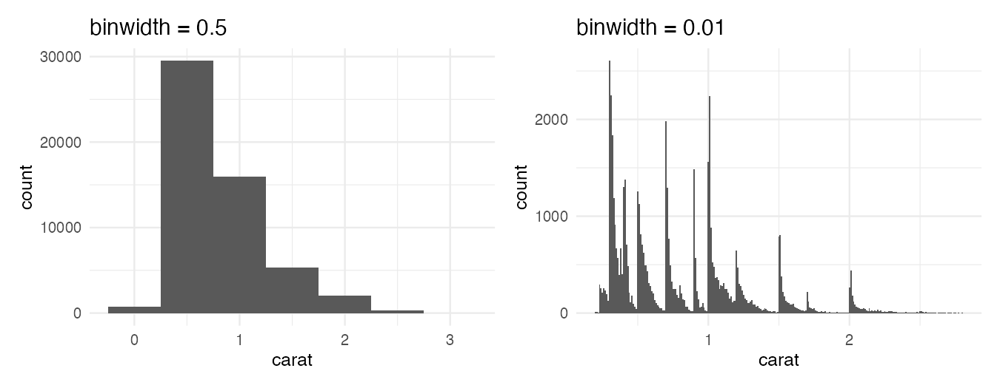
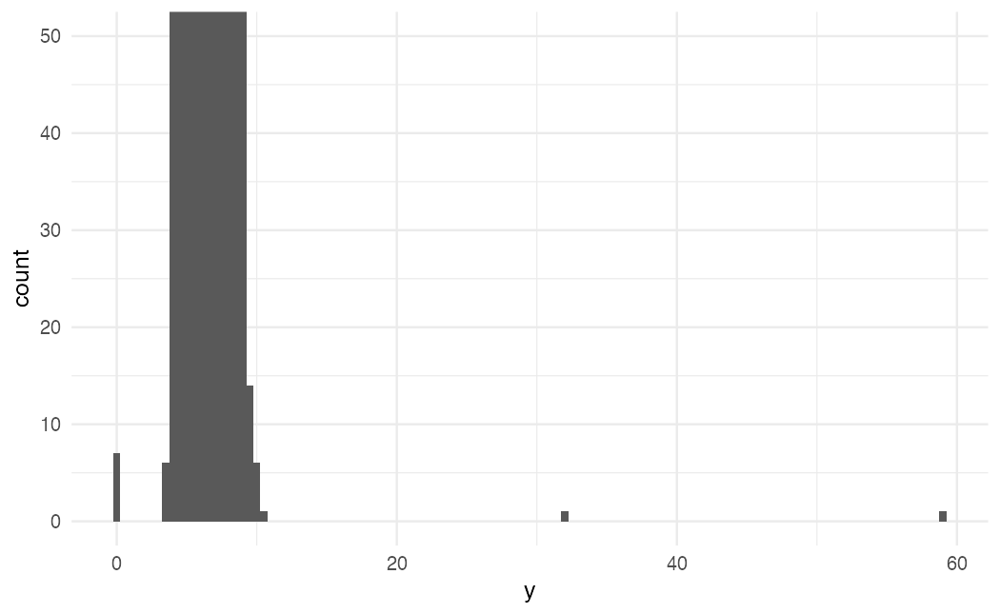
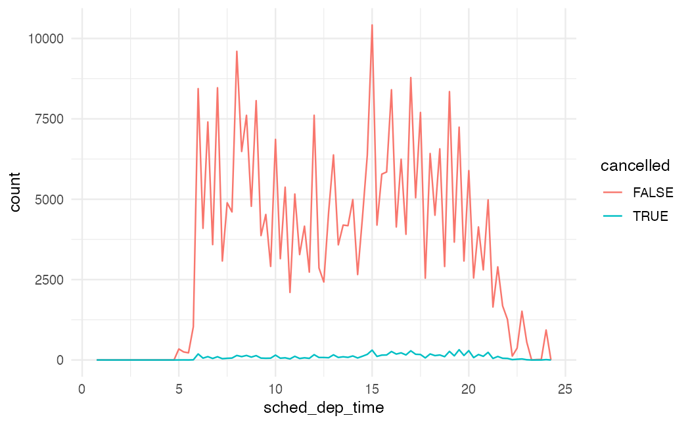
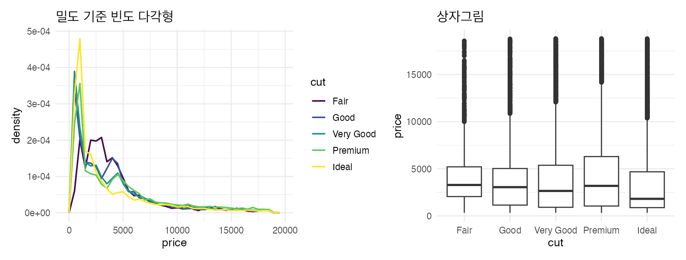
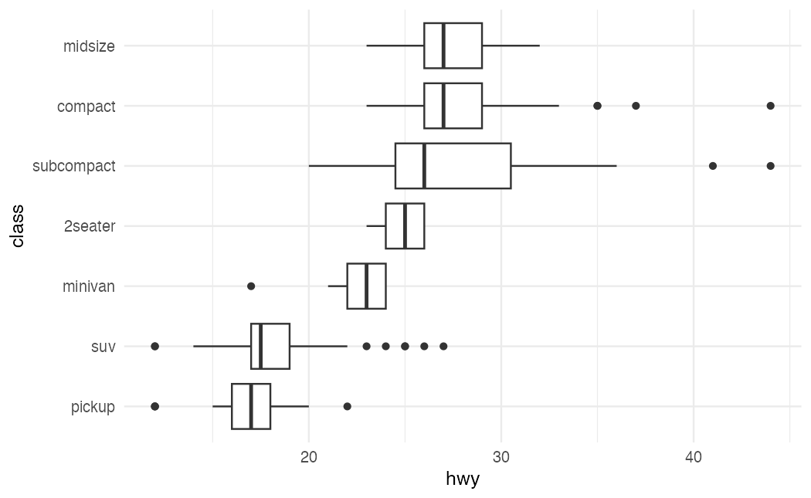
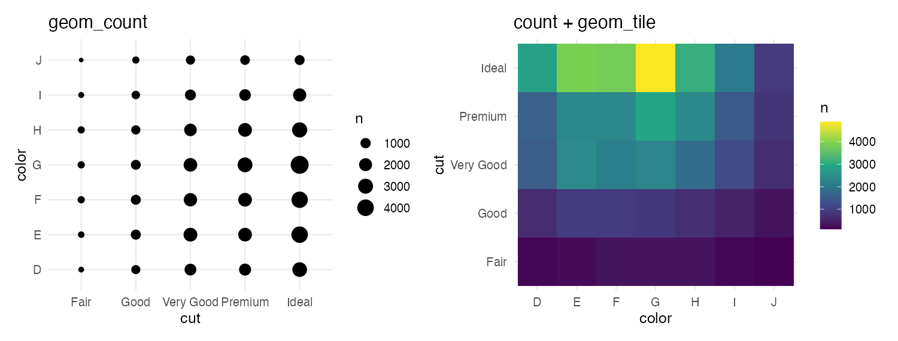
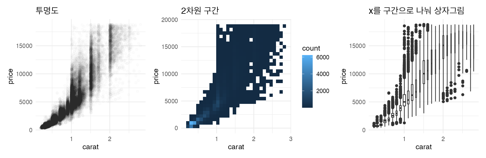

EDA는 정해진 절차가 아니라 **질문 → 시각화·변환 → 새 질문**을 반복하는 과정이다. R4DS(2판) Exploratory data analysis 장을 따라, 한 변수 안의 변동과 두 변수 사이의 공변동을 보는 방법을 정리한다.

```r title="환경 설정"
library(tidyverse)
library(nycflights13)
library(patchwork)

theme_set(theme_minimal(base_size = 12))
```

## EDA에서 던지는 두 질문

1. 변수 안에서 어떤 **변동**이 있나? (분포, 이상값, 결측)
2. 변수들 사이에 어떤 **공변동**이 있나? (함께 움직이는 패턴)

| 볼 것 | 변수 | 그래프 | 요약 |
|---|---|---|---|
| 분포 | 범주형 | `geom_bar` | `count()` |
| 분포 | 연속형 | `geom_histogram`, `geom_freqpoly` | `summary()`, 분위수 |
| 관계 | 범주 × 연속 | `geom_boxplot`, 밀도 기준 `geom_freqpoly` | 그룹별 `summarise` |
| 관계 | 범주 × 범주 | `geom_count`, `geom_tile` | `count(a, b)` |
| 관계 | 연속 × 연속 | `geom_point(alpha)`, `geom_bin_2d`, 구간 상자그림 | 상관계수 |

## 1. 변동: 한 변수의 분포

### 구간 폭에 따라 보이는 것이 다르다

```r w=9 h=3.5
smaller <- diamonds |> filter(carat < 3)
p1 <- ggplot(smaller, aes(x = carat)) + geom_histogram(binwidth = 0.5) + ggtitle("binwidth = 0.5")
p2 <- ggplot(smaller, aes(x = carat)) + geom_histogram(binwidth = 0.01) + ggtitle("binwidth = 0.01")
p1 + p2
```



넓은 구간에서는 단순히 작은 캐럿이 많다는 것만 보이지만, 좁히면 0.3, 0.5, 1, 1.5, 2캐럿 같은 **딱 떨어지는 값에 몰리고** 그 바로 위가 끊기는 패턴이 드러난다. 여기서 새 질문이 생긴다: 왜 정수·반 캐럿에 몰릴까(판매 기준), 왜 그 바로 아래보다 바로 위가 많을까?

질문 거리를 찾는 관점은 이렇다.

- 가장 흔한 값과 드문 값은? 그 이유는?
- 기대와 다른 패턴이 있나?
- 비슷한 값끼리 묶이는 군집이 있나?

### 이상값: 축을 확대해서 찾는다

```r
ggplot(diamonds, aes(x = y)) +
  geom_histogram(binwidth = 0.5) +
  coord_cartesian(ylim = c(0, 50))
```



막대가 너무 낮아 원래 그래프에서는 보이지 않던 0, 30, 60 근처 값이 `coord_cartesian(ylim =)`으로 드러난다.

```r
diamonds |>
  filter(y < 3 | y > 20) |>
  select(price, x, y, z) |>
  arrange(y)
```

너비가 0mm인 다이아몬드는 있을 수 없고, 32mm, 59mm짜리가 이 가격일 리도 없다. 입력 오류로 판단할 수 있다.

### 이상값을 어떻게 처리할까

| 방법 | 코드 | 판단 |
|---|---|---|
| 행 삭제 | `filter(between(y, 3, 20))` | 한 열이 이상하다고 다른 열의 정상 값까지 버린다. 권하지 않음 |
| **NA로 바꾸기** | `mutate(y = if_else(y < 3 \| y > 20, NA, y))` | 권장. ggplot은 NA를 빼고 그리며 경고로 알려준다 |
| 그대로 두기 | | 실제 값일 수 있으면. 이상값 포함·제외 결과를 둘 다 보고한다 |

### 결측 자체가 정보일 때

```r
flights |>
  mutate(
    cancelled = is.na(dep_time),
    sched_hour = sched_dep_time %/% 100,
    sched_min = sched_dep_time %% 100,
    sched_dep_time = sched_hour + sched_min / 60
  ) |>
  ggplot(aes(x = sched_dep_time)) +
  geom_freqpoly(aes(color = cancelled), binwidth = 1/4)
```



출발 시각이 없는 항공편은 취소된 것이다. 다만 취소 편은 수가 훨씬 적어 개수로는 비교가 어렵다. 이럴 때 다음 절의 **밀도 기준** 비교를 쓴다.

## 2. 공변동: 두 변수의 관계

### 범주 × 연속: 개수가 아니라 분포로 비교

```r w=10 h=3.8
p1 <- ggplot(diamonds, aes(x = price, y = after_stat(density))) +
  geom_freqpoly(aes(color = cut), binwidth = 500, linewidth = 0.75) +
  ggtitle("밀도 기준 빈도 다각형")
p2 <- ggplot(diamonds, aes(x = cut, y = price)) +
  geom_boxplot() +
  ggtitle("상자그림")
p1 + p2
```



그룹 크기가 다르면 개수 기준 그래프는 큰 그룹만 크게 보인다. `y = after_stat(density)`로 넓이를 1로 맞추거나 상자그림을 쓴다. 놀랍게도 **최고 등급(Ideal)의 가격 중앙값이 가장 낮다**. 이 이유는 아래 연속 × 연속에서, 그리고 [모델링 글](/posts/r4ds-modeling)의 잔차 분석에서 풀린다.

순서가 없는 범주는 값 기준으로 정렬하면 패턴이 잘 보인다.

```r
ggplot(mpg, aes(x = hwy, y = fct_reorder(class, hwy, median))) +
  geom_boxplot() +
  labs(y = "class")
```



### 범주 × 범주: 조합별 개수

```r w=10 h=3.8
p1 <- ggplot(diamonds, aes(x = cut, y = color)) +
  geom_count() + ggtitle("geom_count")
p2 <- diamonds |>
  count(color, cut) |>
  ggplot(aes(x = color, y = cut)) +
  geom_tile(aes(fill = n)) + scale_fill_viridis_c() + ggtitle("count + geom_tile")
p1 + p2
```



점 크기보다 색(tile)이 조합이 많을 때 더 읽기 쉽다. 조합 수 자체가 필요하면 `count(color, cut)`을 표로 본다.

### 연속 × 연속: 점이 많으면 묶어서

```r w=11 h=3.6
p1 <- ggplot(smaller, aes(x = carat, y = price)) +
  geom_point(alpha = 1/100) + ggtitle("투명도")
p2 <- ggplot(smaller, aes(x = carat, y = price)) +
  geom_bin_2d() + ggtitle("2차원 구간")
p3 <- ggplot(smaller, aes(x = carat, y = price)) +
  geom_boxplot(aes(group = cut_width(carat, 0.1)), varwidth = TRUE, orientation = "x") + ggtitle("x를 구간으로 나눠 상자그림")
p1 + p2 + p3
```



5만 개 점은 그냥 찍으면 검은 덩어리가 된다. 투명도, 2차원 구간, 구간별 상자그림 중 고른다. 캐럿이 커질수록 가격이 가파르게 오르는데, **낮은 등급 다이아몬드는 평균적으로 캐럿이 크다**. 그래서 앞의 "Ideal이 가장 싸다"는 결과는 크기 차이 때문일 수 있다. 크기 효과를 빼고 등급만의 효과를 보려면 모델이 필요하다.

## 자주 하는 실수

| 증상 | 원인과 해결 |
|---|---|
| 히스토그램 모양을 보고 결론 | binwidth 하나만 봤다. 여러 값으로 그려 본다 |
| 이상값이 안 보임 | 막대가 너무 낮다. `coord_cartesian(ylim =)`으로 확대 |
| 이상값 행을 통째로 삭제 | 다른 열의 정상 값까지 사라진다. 해당 값만 `NA`로 |
| 그룹 비교에서 큰 그룹만 두드러짐 | 개수 기준이라서. `after_stat(density)`나 상자그림 |
| 두 변수 관계를 그대로 인과로 해석 | 제3의 변수(예: 크기)가 섞여 있을 수 있다 |

## 요약

| 질문 | 코드 |
|---|---|
| 분포 모양은? | `geom_histogram(binwidth = )`를 여러 폭으로 |
| 드문 값은? | `coord_cartesian(ylim = c(0, 50))`, `filter()`로 확인 |
| 이상값 처리 | `mutate(x = if_else(조건, NA, x))` |
| 결측 패턴 | `is.na(x)`로 그룹을 만들어 비교 |
| 그룹별 분포 비교 | `geom_freqpoly(aes(y = after_stat(density)))`, `geom_boxplot()` |
| 범주 정렬 | `fct_reorder(g, x, median)` |
| 두 범주 조합 | `count(a, b)` + `geom_tile(aes(fill = n))` |
| 큰 산점도 | `alpha`, `geom_bin_2d()`, `cut_width()` 상자그림 |

## 참고자료

- *R for Data Science* (2nd ed.): [10 Exploratory data analysis](https://r4ds.hadley.nz/EDA.html)

다음 글: [R4DS - 문자열과 정규표현식](/posts/r4ds-string)
