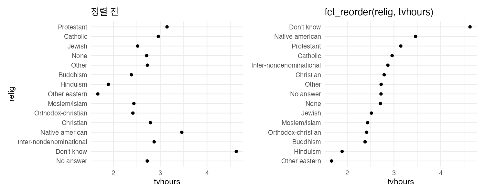
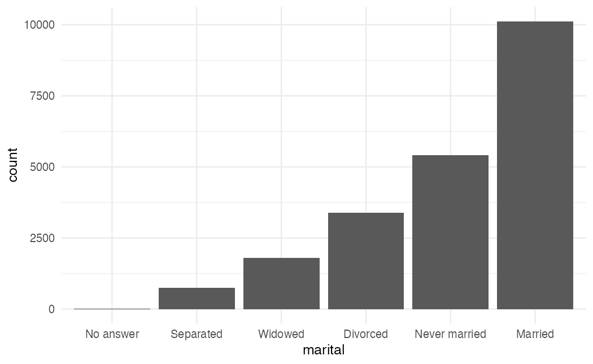
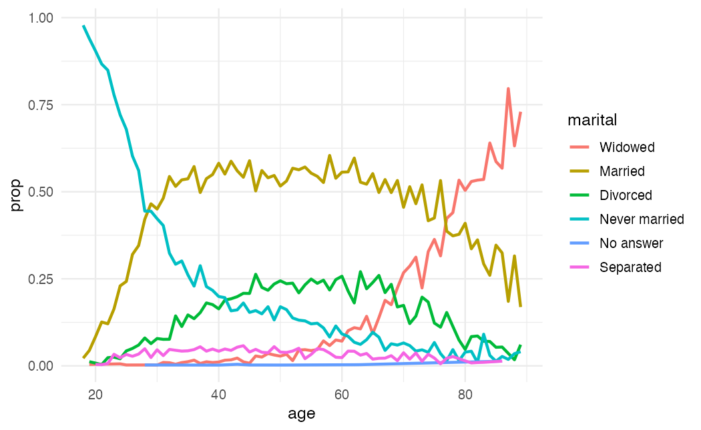

factor는 가질 수 있는 값(수준, level)이 정해진 범주형 변수다. 문자열과 달리 **순서**를 가질 수 있어서, 그래프의 범주 순서나 모델의 기준 범주를 정할 때 쓴다. R4DS(2판) Factors 장을 따라 forcats 사용법을 정리한다. 데이터는 미국 종합사회조사 일부인 `forcats::gss_cat`을 쓴다.

```r title="환경 설정"
library(tidyverse)
library(patchwork)

theme_set(theme_minimal(base_size = 12))
```

## 1. 기초

```r
x <- c("Dec", "Apr", "Jan", "Mar")
month_levels <- month.abb

sort(x)                                   # 문자열은 알파벳순: "Apr" "Dec" "Jan" "Mar"
y <- factor(x, levels = month_levels)
sort(y)                                   # 수준 순서대로: Jan Mar Apr Dec
levels(y)

factor(c("Jan", "Jam"), levels = month_levels)   # 오타는 조용히 NA가 된다
try(fct(c("Jan", "Jam"), levels = month_levels))  # forcats::fct()는 에러로 알려준다
```

- `levels`를 생략하면 알파벳순으로 정해진다. 데이터에 나온 순서를 쓰려면 `fct_inorder()`.
- 순서가 의미 있는 범주(설문 응답 "매우 불만 < 불만 < 보통")는 `ordered()`나 `factor(..., ordered = TRUE)`로 만든다.
- `count()`나 그래프는 데이터에 없는 수준도 수준으로 남는다. 빈 수준을 지우려면 `fct_drop()`.

## 2. 순서 바꾸기

그래프의 범주 순서는 factor 수준 순서를 따른다. 순서만 바꿔도 그래프가 훨씬 잘 읽힌다.

| 함수 | 기준 | 주 용도 |
|---|---|---|
| `fct_infreq(f)` | 빈도 내림차순 | 막대그래프 |
| `fct_rev(f)` | 현재 순서를 뒤집기 | `fct_infreq`와 함께 |
| `fct_reorder(f, x, median)` | 다른 변수의 요약값 | 점 그래프, 상자그림 |
| `fct_reorder2(f, x, y)` | 가장 큰 x에서의 y값 | 선 그래프 (범례 순서를 선 끝과 맞춤) |
| `fct_relevel(f, "a")` | 지정한 수준을 앞으로 | 기준 범주, "기타"를 맨 뒤로 |
| `fct_inorder(f)` | 데이터에 처음 나온 순서 | 이미 정렬된 데이터 |

### 다른 변수 기준으로 정렬

종교별 하루 평균 TV 시청 시간을 비교한다.

```r w=10 h=4
relig_summary <- gss_cat |>
  summarise(tvhours = mean(tvhours, na.rm = TRUE), n = n(), .by = relig)

p1 <- ggplot(relig_summary, aes(x = tvhours, y = relig)) +
  geom_point() + ggtitle("정렬 전")
p2 <- ggplot(relig_summary, aes(x = tvhours, y = fct_reorder(relig, tvhours))) +
  geom_point() + labs(y = NULL) + ggtitle("fct_reorder(relig, tvhours)")
p1 + p2
```



정렬하면 "Don't know" 응답자가 가장 많이 보고, Hinduism과 Other eastern이 가장 적게 본다는 것이 바로 보인다. 다만 `n`이 작은 범주가 섞여 있으니 해석 전에 개수를 확인해야 한다.

`fct_reorder()`는 순서가 원래 없는 범주에만 쓴다. 소득 구간처럼 이미 순서가 있는 범주를 값으로 재정렬하면 오히려 읽기 어렵다.

### 빈도순 막대

```r
gss_cat |>
  mutate(marital = marital |> fct_infreq() |> fct_rev()) |>
  ggplot(aes(x = marital)) +
  geom_bar()
```



### 선 그래프의 범례 순서

```r
by_age <- gss_cat |>
  filter(!is.na(age)) |>
  count(age, marital) |>
  mutate(prop = n / sum(n), .by = age)

ggplot(by_age, aes(x = age, y = prop, color = fct_reorder2(marital, age, prop))) +
  geom_line(linewidth = 1) +
  labs(color = "marital")
```



`fct_reorder2()`는 x가 가장 클 때의 y값 순서로 정렬해서, 오른쪽 끝의 선 위치와 범례 순서가 같아진다.

## 3. 수준 바꾸기

### 이름 바꾸기와 묶기

```r
gss_cat |> count(partyid)

gss_cat |>
  mutate(partyid = fct_recode(partyid,
    "Republican, strong"    = "Strong republican",
    "Republican, weak"      = "Not str republican",
    "Independent, near rep" = "Ind,near rep",
    "Independent, near dem" = "Ind,near dem",
    "Democrat, weak"        = "Not str democrat",
    "Democrat, strong"      = "Strong democrat",
    "Other"                 = "No answer",
    "Other"                 = "Don't know",
    "Other"                 = "Other party"
  )) |>
  count(partyid)
```

새 이름 = 옛 이름 순서로 쓴다. 여러 수준을 같은 이름으로 바꾸면 하나로 묶인다. 묶는 것이 주목적이면 `fct_collapse()`가 짧다.

```r
gss_cat |>
  mutate(partyid = fct_collapse(partyid,
    "other" = c("No answer", "Don't know", "Other party"),
    "rep"   = c("Strong republican", "Not str republican"),
    "ind"   = c("Ind,near rep", "Independent", "Ind,near dem"),
    "dem"   = c("Not str democrat", "Strong democrat")
  )) |>
  count(partyid)
```

### 드문 범주를 "Other"로

```r
gss_cat |>
  mutate(relig = fct_lump_n(relig, n = 10)) |>
  count(relig, sort = TRUE)
```

| 함수 | 남기는 기준 |
|---|---|
| `fct_lump_n(f, n)` | 상위 n개 |
| `fct_lump_prop(f, prop)` | 비율이 prop 이상인 범주 |
| `fct_lump_min(f, min)` | 개수가 min 이상인 범주 |
| `fct_lump_lowfreq(f)` | "Other"가 가장 작은 범주보다 작게 유지되도록 |

## 자주 하는 실수

| 증상 | 원인과 해결 |
|---|---|
| 그래프 범주가 알파벳순 | 문자열이거나 수준이 알파벳순. `fct_infreq`, `fct_reorder`, `fct_relevel` |
| 값이 조용히 NA로 바뀜 | `factor()`에 없는 수준. `fct()`를 쓰면 에러로 알려준다 |
| 그래프에 빈 범주가 남음 | 걸러낸 뒤에도 수준이 남아 있다. `fct_drop()` |
| `as.numeric(f)`가 이상한 숫자 | 값이 아니라 수준 번호가 나온다. 숫자 문자열이면 `as.numeric(as.character(f))` |
| 모델의 기준 범주가 원하는 것이 아님 | 첫 번째 수준이 기준이다. `fct_relevel(f, "기준")` |

## 요약

| 하고 싶은 것 | 코드 |
|---|---|
| 순서 지정해 만들기 | `factor(x, levels = )`, `fct(x, levels = )` |
| 빈도순 | `fct_infreq()`, 뒤집기 `fct_rev()` |
| 다른 값 기준 정렬 | `fct_reorder(f, x, median)` |
| 선 그래프 범례 정렬 | `fct_reorder2(f, x, y)` |
| 특정 수준을 앞으로 | `fct_relevel(f, "a")` |
| 이름 바꾸기 | `fct_recode(f, new = "old")` |
| 여러 수준 묶기 | `fct_collapse(f, new = c("a", "b"))` |
| 드문 범주 묶기 | `fct_lump_n(f, n = 10)` |

## 참고자료

- *R for Data Science* (2nd ed.): [16 Factors](https://r4ds.hadley.nz/factors.html)
- [forcats 공식 문서](https://forcats.tidyverse.org/)

다음 글: [R4DS - 반복: across와 map](/posts/r4ds-iteration)
