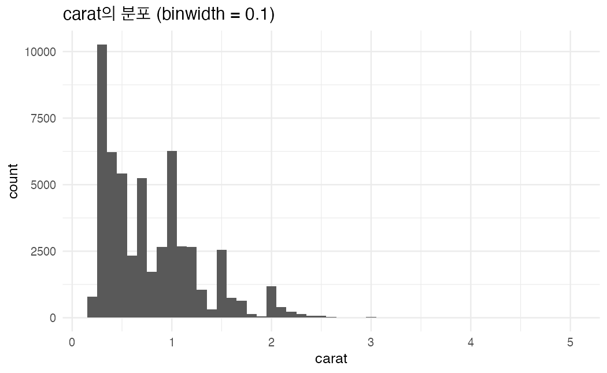
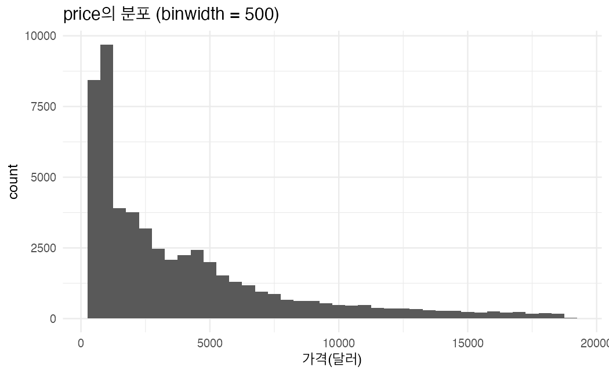

같은 코드를 세 번 복사했다면 함수로 만들 때다. 함수는 코드를 짧게 하고, 이름을 붙여 의도를 드러내며, 고칠 곳을 한 군데로 모은다. R4DS(2판) Functions 장을 따라, 무엇을 입력받아 무엇을 돌려주는가에 따라 함수를 **벡터 함수, 데이터프레임 함수, 그래프 함수**로 나누어 정리한다. 열 이름을 인자로 넘기는 방법(`{{ }}`)이 핵심이다. 자료는 `ggplot2::diamonds`와 `nycflights13::flights`다.

```r title="환경 설정"
library(tidyverse)
library(nycflights13)

theme_set(theme_minimal(base_size = 12))
```

## 1. 벡터 함수

벡터를 받아 같은 길이 또는 길이 1의 벡터를 돌려주는 함수다. `mutate()`와 `filter()` 안에서 쓴다. 함수를 만드는 순서는 (1) 되풀이되는 코드를 찾고, (2) 바뀌는 부분을 인자로 뽑고, (3) 알맞은 이름을 붙이는 것이다.

```r
rescale01 <- function(x) {
  rng <- range(x, na.rm = TRUE, finite = TRUE)
  (x - rng[1]) / (rng[2] - rng[1])
}

rescale01(c(-10, 0, 10))
rescale01(c(1, 2, 3, NA, 5))
```

```text
[1] 0.0 0.5 1.0
[1] 0.00 0.25 0.50   NA 1.00
```

`rescale01()`은 값을 0~1로 맞춘다. 함수는 마지막으로 계산된 값을 돌려준다. 필요하면 `return()`을 쓰지만 보통은 쓰지 않는다. 안에서만 쓰는 `rng` 같은 변수는 함수 밖에 남지 않는다.

```r
flights |>
  mutate(dep_delay01 = rescale01(dep_delay), .keep = "used") |>
  summarise(min = min(dep_delay01, na.rm = TRUE), max = max(dep_delay01, na.rm = TRUE))
```

```text
# A tibble: 1 × 2
    min   max
  <dbl> <dbl>
1     0     1
```

비슷한 모양의 함수를 몇 개 더 만든다. 인자에 기본값을 주면 생략할 수 있다.

```r
z_score <- function(x) (x - mean(x, na.rm = TRUE)) / sd(x, na.rm = TRUE)

clamp <- function(x, min, max) pmax(min, pmin(x, max))

first_upper <- function(x) {
  str_sub(x, 1, 1) <- str_to_upper(str_sub(x, 1, 1))
  x
}

clamp(c(-5, 3, 12), 0, 10)
first_upper("hello")
```

```text
[1]  0  3 10
[1] "Hello"
```

요약 함수는 길이 1을 돌려주므로 `summarise()` 안에서 쓴다.

```r
mean_ci <- function(x, conf = 0.95) {
  se <- sd(x) / sqrt(length(x))
  alpha <- 1 - conf
  mean(x) + se * qnorm(c(alpha / 2, 1 - alpha / 2))
}

mean_ci(c(10, 12, 9, 11, 13))
```

```text
[1]  9.614096 12.385904
```

이 표본(평균 11)의 95% 구간은 약 9.61~12.39이다.

`mean_ci()`의 결과는 하한과 상한 두 값이다. 이 식은 정규분포를 쓴 근사이므로 표본이 작으면 t분포를 쓰는 `t.test()`의 신뢰구간과 다르다.

## 2. 데이터프레임 함수

데이터프레임을 첫 인자로 받고 데이터프레임을 돌려주는 함수다. 파이프(`|>`) 중간에 끼워 넣을 수 있다. 열 이름을 인자로 넘길 때 아래와 같은 문제가 생긴다.

```r
grouped_mean_bad <- function(df, group_var, mean_var) {
  df |>
    group_by(group_var) |>
    summarise(mean(mean_var))
}

tryCatch(diamonds |> grouped_mean_bad(cut, carat), error = \(e) conditionMessage(e))
```

```text
[1] "Must group by variables found in `.data`.\n✖ Column `group_var` is not found."
```

`group_by(group_var)`는 `group_var`라는 이름의 열을 찾는다. 인자에 담긴 `cut`을 열 이름으로 쓰려면 **임브레이스(embrace) `{{ }}`** 로 감싼다.

```r
grouped_mean <- function(df, group_var, mean_var) {
  df |>
    group_by({{ group_var }}) |>
    summarise(mean = mean({{ mean_var }}))
}

diamonds |> grouped_mean(cut, carat)
```

```text
# A tibble: 5 × 2
  cut        mean
  <ord>     <dbl>
1 Fair      1.05 
2 Good      0.849
3 Very Good 0.806
4 Premium   0.892
5 Ideal     0.703
```

`{{ var }}`는 "`var`에 넘어온 열 이름을 여기에 넣어라"는 뜻이다. 열 이름을 인자로 받는 모든 tidyverse 함수(`filter`, `mutate`, `count`, `summarise` 등)에서 같은 방식이다.

### 2.1 예시: 요약과 개수

```r
summary6 <- function(data, var) {
  data |>
    summarise(
      min = min({{ var }}, na.rm = TRUE),
      mean = mean({{ var }}, na.rm = TRUE),
      median = median({{ var }}, na.rm = TRUE),
      max = max({{ var }}, na.rm = TRUE),
      n = n(),
      n_miss = sum(is.na({{ var }})),
      .groups = "drop"
    )
}

diamonds |> summary6(carat)
diamonds |> group_by(cut) |> summary6(carat)
```

```text
# A tibble: 1 × 6
    min  mean median   max     n n_miss
  <dbl> <dbl>  <dbl> <dbl> <int>  <int>
1   0.2 0.798    0.7  5.01 53940      0
# A tibble: 5 × 7
  cut         min  mean median   max     n n_miss
  <ord>     <dbl> <dbl>  <dbl> <dbl> <int>  <int>
1 Fair       0.22 1.05    1     5.01  1610      0
2 Good       0.23 0.849   0.82  3.01  4906      0
3 Very Good  0.2  0.806   0.71  4    12082      0
4 Premium    0.2  0.892   0.86  4.01 13791      0
5 Ideal      0.2  0.703   0.54  3.5  21551      0
```

`group_by()`한 데이터를 넘기면 같은 함수가 `cut`별로 계산된다. 평균 `carat`은 Fair가 1.05로 가장 크고 Ideal이 0.703으로 가장 작다. 절단 등급이 좋을수록 작은 다이아몬드가 많다.

```r
count_prop <- function(df, var, sort = FALSE) {
  df |>
    count({{ var }}, sort = sort) |>
    mutate(prop = n / sum(n))
}

diamonds |> count_prop(clarity)
```

```text
# A tibble: 8 × 3
  clarity     n   prop
  <ord>   <int>  <dbl>
1 I1        741 0.0137
2 SI2      9194 0.170 
3 SI1     13065 0.242 
4 VS2     12258 0.227 
5 VS1      8171 0.151 
6 VVS2     5066 0.0939
7 VVS1     3655 0.0678
8 IF       1790 0.0332
```

함수 안에서 `group_by()`를 쓰지 않아도 호출 쪽에서 `group_by()`한 뒤 넘기면 그룹별로 계산된다. 함수가 그룹을 만들고 풀어 주는 일은 함수 이름에 드러내는 것이 좋다.

### 2.2 데이터 마스킹과 tidy-select

임브레이스를 쓰는 인자라도 안에서 쓰는 방식은 두 가지다. 어느 쪽인지는 인자를 넘기는 함수의 문서에 적혀 있다.

```r
unique_where <- function(df, condition, var) {
  df |>
    filter({{ condition }}) |>
    distinct({{ var }}) |>
    arrange({{ var }})
}

flights |> unique_where(month == 12, dest) |> head(4)
```

```text
# A tibble: 4 × 1
  dest 
  <chr>
1 ABQ  
2 ALB  
3 ATL  
4 AUS  
```

`condition`은 `filter()`에 들어가므로 열을 변수처럼 쓰는 **데이터 마스킹** 인자다(`month == 12`).

```r
summarize_means <- function(df, summarize_vars = everything()) {
  df |>
    summarise(
      n = n(),
      across({{ summarize_vars }}, \(x) mean(x, na.rm = TRUE))
    )
}

diamonds |> group_by(cut) |> summarize_means(c(carat, x:z))
```

```text
# A tibble: 5 × 6
  cut           n carat     x     y     z
  <ord>     <int> <dbl> <dbl> <dbl> <dbl>
1 Fair       1610 1.05   6.25  6.18  3.98
2 Good       4906 0.849  5.84  5.85  3.64
3 Very Good 12082 0.806  5.74  5.77  3.56
4 Premium   13791 0.892  5.97  5.94  3.65
5 Ideal     21551 0.703  5.51  5.52  3.40
```

`across()`의 첫 인자는 열을 **고르는** 자리라서 `c(carat, x:z)`, `starts_with("a")`, `where(is.numeric)` 같은 tidy-select 식이 들어간다.

데이터 마스킹 함수(`group_by`, `count`)에 tidy-select식(`c(a, b)`)을 넘기려면 `pick()`으로 감싼다.

```r
count_missing <- function(df, group_vars, x_var) {
  df |>
    group_by(pick({{ group_vars }})) |>
    summarise(
      n_miss = sum(is.na({{ x_var }})),
      .groups = "drop"
    )
}

flights |> count_missing(c(year, month, day), dep_time) |> head(3)
```

```text
# A tibble: 3 × 4
   year month   day n_miss
  <int> <int> <int>  <int>
1  2013     1     1      4
2  2013     1     2      8
3  2013     1     3     10
```

## 3. 그래프 함수

데이터프레임을 받아 그래프를 돌려주는 함수다. `aes()`는 데이터 마스킹이므로 `{{ }}`를 쓴다. 제목에 변수 이름을 넣고 싶으면 `rlang::englue()`로 `{{ }}` 안의 열 이름을 문자열로 만든다.

```r
histogram <- function(df, var, binwidth = NULL) {
  label <- if (is.null(binwidth)) {
    rlang::englue("{{ var }}의 분포")
  } else {
    rlang::englue("{{ var }}의 분포 (binwidth = {binwidth})")
  }

  df |>
    ggplot(aes(x = {{ var }})) +
    geom_histogram(binwidth = binwidth) +
    labs(title = label)
}

diamonds |> histogram(carat, 0.1)
```



함수가 그래프를 돌려주므로 `|>`로 앞에서 걸러낸 자료를 넘기고, 뒤에 `+`로 다른 층을 더할 수 있다.

```r
diamonds |>
  filter(carat < 3) |>
  histogram(price, 500) +
  labs(x = "가격(달러)")
```



## 4. 스타일

| 항목 | 규칙 |
|---|---|
| 이름 | 동사로 하고(`compute_`, `count_`), 인자는 명사로 한다. 소문자와 `_`(snake_case)로 쓴다 |
| 일관성 | 같은 함수군은 이름 앞이나 뒤를 맞춘다(`str_`, `fct_`) |
| 공백 | 연산자와 쉼표 뒤에 공백, 함수 호출의 괄호 안에는 공백 없음 |
| 줄바꿈 | 함수 정의는 `{`로 열고 한 줄에 하나씩, 인자가 길면 한 줄에 하나 |
| 주석 | **무엇**이 아니라 **왜**를 적는다. 긴 코드는 `# 제목 ----`로 나눈다 |

## 5. 비교

| 종류 | 입력 → 출력 | 쓰는 곳 | 예 |
|---|---|---|---|
| 벡터 함수 | 벡터 → 벡터(또는 길이 1) | `mutate()`, `filter()`, `summarise()` 안 | `rescale01()`, `mean_ci()` |
| 데이터프레임 함수 | 데이터프레임 → 데이터프레임 | 파이프 중간 | `grouped_mean()`, `summary6()` |
| 그래프 함수 | 데이터프레임 → ggplot | 파이프 끝, `+`로 이어 붙임 | `histogram()` |

| 비교 | 차이 | 고르는 기준 |
|---|---|---|
| 데이터 마스킹 | 열을 변수처럼 쓴다(`filter`, `mutate`, `group_by`, `count`, `aes`) | 열의 **값**으로 계산하는 인자 |
| tidy-select | 열을 **고른다**(`select`, `across`, `pivot_longer`) | 열의 **이름**을 고르는 인자 |
| `{{ var }}` 와 `pick({{ var }})` | 열 하나를 넘김 / 여러 열을 데이터 마스킹 함수에 넘김 | `group_by(pick({{ vars }}))`처럼 열 여러 개를 받을 때는 `pick()` |

## 자주 하는 실수

| 증상 | 원인과 해결 |
|---|---|
| "column `group_var` is not found" | 인자를 `{{ }}`로 감싸지 않았다 |
| 함수 안에서만 맞고 호출하면 틀림 | 인자 이름이 열 이름과 겹친다. 인자는 `var`, `group_var`처럼 구별되는 이름으로 한다 |
| 같은 코드를 세 번 이상 복사 | 함수로 만든다 |
| `across()`에 `{{ }}`를 안 씀 | 열을 고르는 인자도 `{{ }}`로 감싼다 |
| 함수 결과가 이상한 열 이름 | `summarise(mean = ...)`처럼 이름을 직접 준다 |

## 요약

| 하고 싶은 것 | 코드 |
|---|---|
| 벡터 함수 | `f <- function(x) { ... }` |
| 인자 기본값 | `function(x, na.rm = TRUE)` |
| 열 이름을 인자로 | `{{ var }}` |
| 열 여러 개를 데이터 마스킹 함수에 | `pick({{ vars }})` |
| 그래프 제목에 변수 이름 | `rlang::englue("{{ var }}")` |

## 참고자료

- *R for Data Science* (2nd ed.): [25 Functions](https://r4ds.hadley.nz/functions.html)
- [tidyverse 스타일 가이드](https://style.tidyverse.org/)

다음 글: [R4DS - 반복: across와 map](/posts/r4ds-iteration)
