R for Data Science(2판)의 시각화 장을 실습하며 정리했다. ggplot2의 레이어 문법을 순서대로 익히고, 마지막에 라벨, 주석, 스케일, 테마로 그래프를 다듬는다. 데이터는 ggplot2에 들어 있는 `mpg`, `diamonds`, `presidential`을 쓴다.

```r title="환경 설정"
library(tidyverse)
library(ggrepel)   # 라벨 겹침 방지
# map_data()는 maps 패키지가 설치되어 있으면 알아서 불러온다 (library(maps)는 purrr::map을 가리므로 생략)

theme_set(theme_minimal(base_size = 12))
```

## 레이어 문법 한눈에 보기

ggplot2 그래프는 레이어를 `+`로 쌓아 만든다. 아래 템플릿에서 필요한 부분만 골라 쓰면 된다.

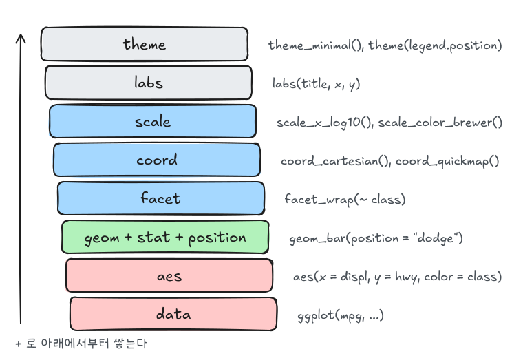

```r norun
ggplot(data = <DATA>, mapping = aes(<MAPPINGS>)) +
  <GEOM_FUNCTION>(mapping = aes(<MAPPINGS>), stat = <STAT>, position = <POSITION>) +
  <COORDINATE_FUNCTION> +
  <FACET_FUNCTION> +
  <SCALE_FUNCTION> +
  <THEME_FUNCTION>
```

| 레이어 | 하는 일 | 자주 쓰는 함수 |
|---|---|---|
| aes | 변수를 위치, 색, 크기, 모양에 연결 | `aes(x, y, color, fill, size, shape, alpha)` |
| geom | 데이터를 그릴 도형 | `geom_point`, `geom_line`, `geom_bar`, `geom_col`, `geom_histogram`, `geom_boxplot`, `geom_smooth` |
| facet | 범주별로 작은 그래프 여러 개 | `facet_wrap(~ x)`, `facet_grid(rows ~ cols)` |
| stat | 그리기 전 통계 변환 | `after_stat(prop)`, `stat_summary` |
| position | 겹치는 도형 배치 | `"stack"`, `"fill"`, `"dodge"`, `"jitter"` |
| coord | 좌표계 | `coord_cartesian`, `coord_quickmap`, `coord_polar` |
| scale | 값 → 시각 속성 변환 규칙, 축과 범례 | `scale_x_log10`, `scale_color_brewer`, `scale_fill_viridis_c` |
| labs / theme | 제목, 축 이름, 전체 스타일 | `labs`, `theme_bw`, `theme(legend.position)` |

## 1. aes: 변수를 시각 속성에 연결하기

### 색으로 그룹 구분하기

```r
ggplot(mpg, aes(x = displ, y = hwy, color = class)) +
  geom_point()
```

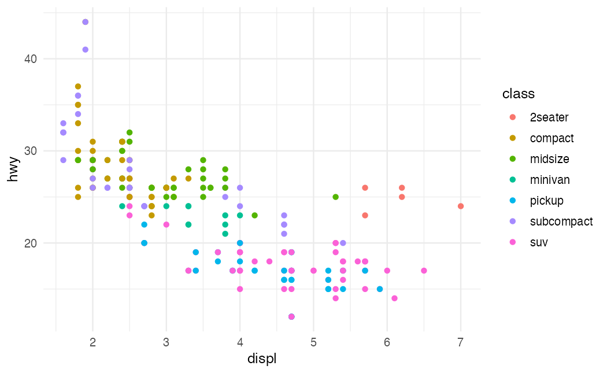

2seater(스포츠카)만 배기량이 큰데도 연비가 높은 예외 그룹이라는 것이 색으로 드러난다.

### 크기, 모양, 투명도

연속형 변수는 `size`, 범주가 적은 변수는 `shape`에 매핑하는 것이 읽기 쉽다.

```r
ggplot(mpg, aes(x = displ, y = hwy, size = cty, shape = drv)) +
  geom_point(alpha = 0.6)
```

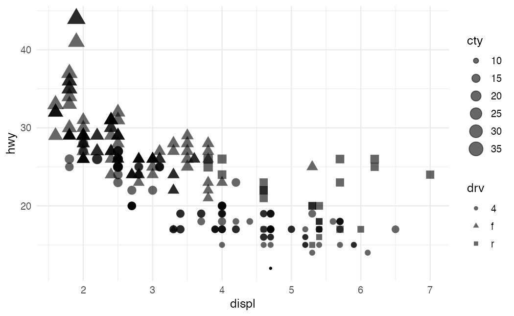

| 매핑 | 어울리는 변수 | 주의 |
|---|---|---|
| `color` | 범주형, 연속형 모두 | 범주가 많으면 구분이 어렵다 |
| `size` | 연속형 | 범주형에 쓰면 경고가 난다 |
| `shape` | 범주 6개 이하 | 7번째 범주부터는 그려지지 않는다 |
| `alpha` | 연속형, 또는 고정값으로 겹침 완화 | 범주형에 쓰면 경고가 난다 |

### aes 안과 밖의 차이

```r
ggplot(mpg, aes(x = displ, y = hwy)) +
  geom_point(color = "steelblue")
```

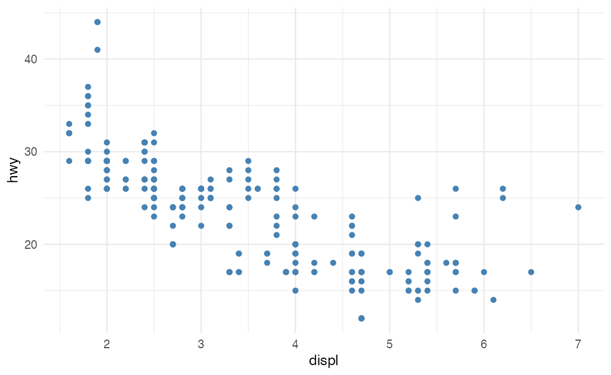

`aes()` 안에 쓰면 **변수에 따라 달라지는 값**, 밖에 쓰면 **모든 점에 같은 고정값**이다. `aes(color = "blue")`라고 쓰면 "blue"라는 범주 하나로 취급되어 빨간 점과 범례가 생기는 실수가 흔하다.

## 2. geom: 무엇으로 그릴지

### 점과 추세선을 함께

전역 `aes()`는 모든 레이어에 적용되고, 레이어 안의 `aes()`는 그 레이어에만 적용된다.

```r
ggplot(mpg, aes(x = displ, y = hwy)) +
  geom_point(aes(color = class)) +
  geom_smooth()
```

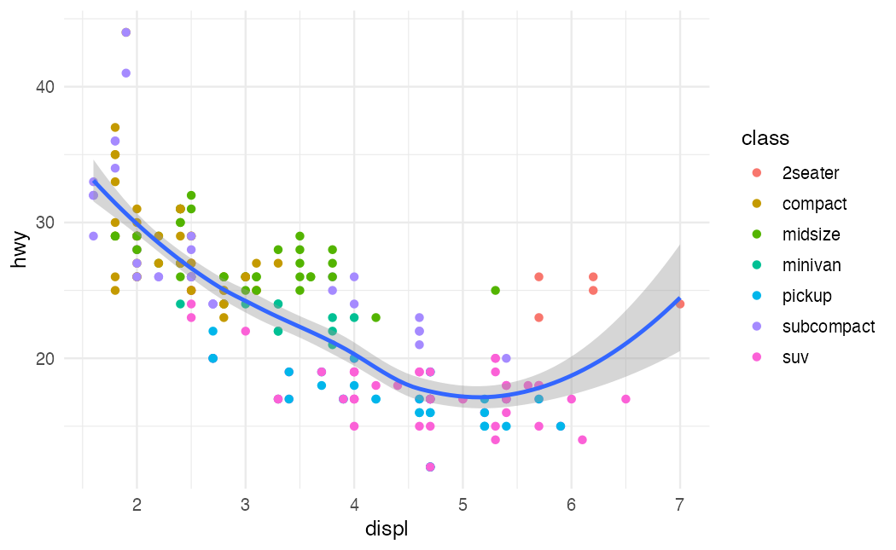

점은 차종별로 색이 다르지만 추세선은 전체 데이터로 하나만 그려진다. 회색 띠는 신뢰구간이다.

### 그룹별 추세선

```r
ggplot(mpg, aes(x = displ, y = hwy, color = drv)) +
  geom_point() +
  geom_smooth(aes(linetype = drv), se = FALSE)
```

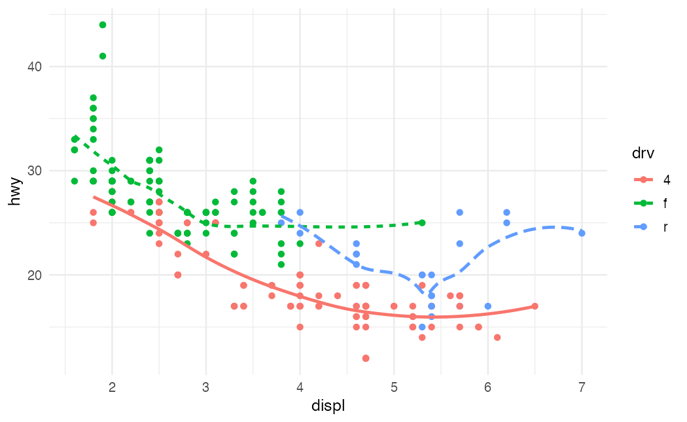

### 특정 그룹만 강조하기

레이어마다 `data`를 따로 줄 수 있다.

```r
ggplot(mpg, aes(x = displ, y = hwy)) +
  geom_point(aes(color = class)) +
  geom_smooth(data = filter(mpg, class == "subcompact"), se = FALSE)
```

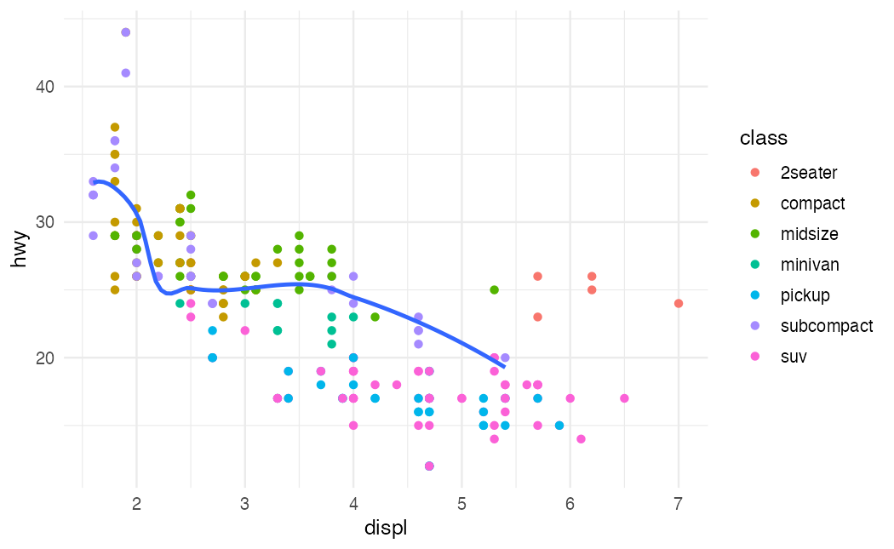

### 분포 보기: 히스토그램과 상자그림

```r
ggplot(diamonds, aes(x = carat)) +
  geom_histogram(binwidth = 0.1)
```

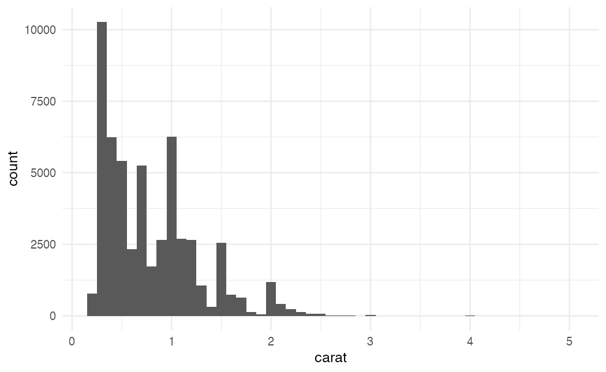

`binwidth`에 따라 모양이 크게 달라지므로 여러 값으로 그려 보는 것이 좋다.

```r
ggplot(mpg, aes(x = hwy, y = class)) +
  geom_boxplot()
```


범주 이름이 길면 범주를 `y`에 두면 된다. 예전처럼 `coord_flip()`으로 축을 뒤집을 필요가 없다.

## 3. facet: 범주별로 나눠 그리기

### 변수 하나로 나누기

```r
ggplot(mpg, aes(x = displ, y = hwy)) +
  geom_point() +
  facet_wrap(~ class, nrow = 2)
```

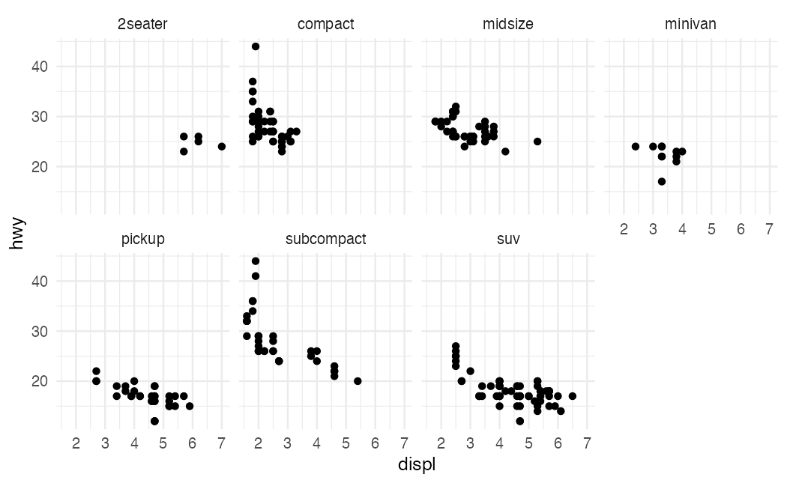

### 변수 두 개로 격자 만들기

```r
ggplot(mpg, aes(x = displ, y = hwy)) +
  geom_point() +
  facet_grid(drv ~ cyl)
```

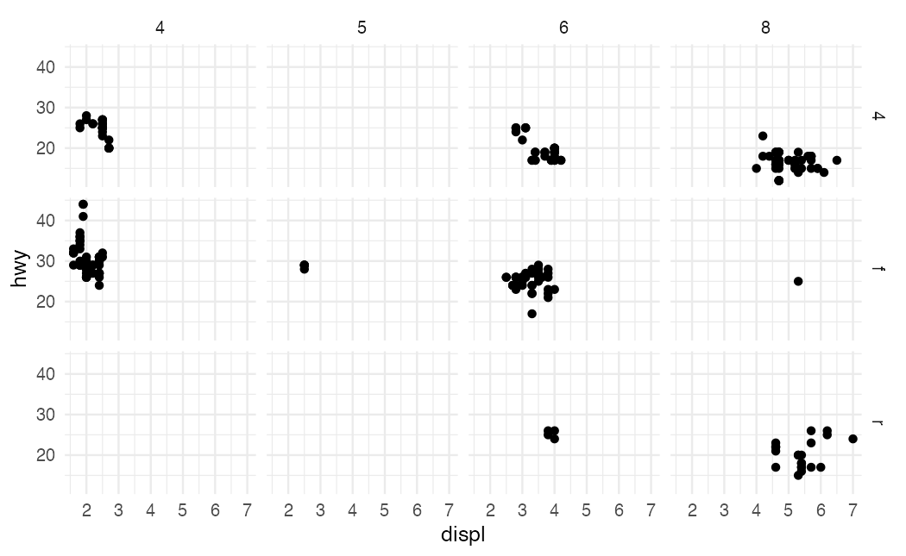

행 방향만 나누려면 `facet_grid(drv ~ .)`, 열 방향만 나누려면 `facet_grid(. ~ cyl)`처럼 `.`을 쓴다. 각 패널의 축 범위를 따로 잡으려면 `scales = "free"`를 준다.

## 4. stat: 그리기 전의 계산

### 개수 대신 이미 계산된 값 그리기

`geom_bar()`는 행 개수를 세어 막대 높이로 쓴다. 이미 집계된 값을 그릴 때는 `geom_col()`을 쓴다.

```r
cut_counts <- tribble(
  ~cut,        ~freq,
  "Fair",       1610,
  "Good",       4906,
  "Very Good", 12082,
  "Premium",   13791,
  "Ideal",     21551
)

ggplot(cut_counts, aes(x = fct_inorder(cut), y = freq)) +
  geom_col() +
  labs(x = "cut")
```

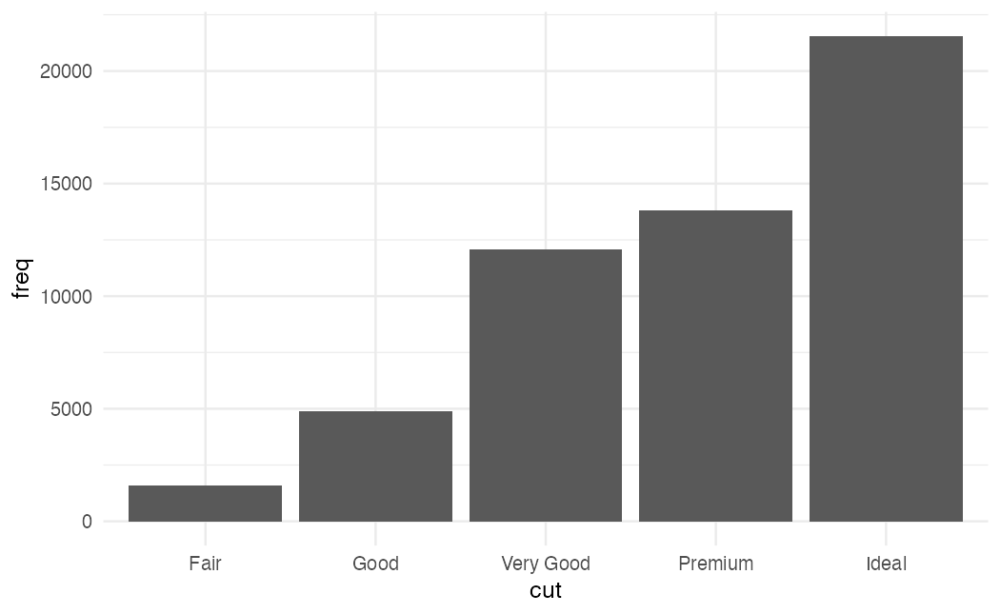

`fct_inorder()`로 입력한 순서를 유지했다. 문자형 그대로 두면 알파벳순으로 정렬된다.

### 개수 대신 비율

```r
ggplot(diamonds, aes(x = cut, y = after_stat(prop), group = 1)) +
  geom_bar()
```

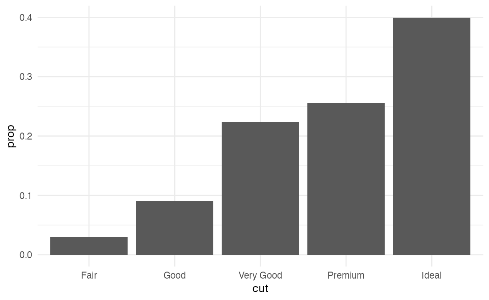

`group = 1`이 없으면 막대마다 따로 비율을 계산해 모두 1이 된다.

### 요약 통계 그리기

```r
ggplot(diamonds, aes(x = cut, y = depth)) +
  stat_summary(fun.min = min, fun.max = max, fun = median)
```

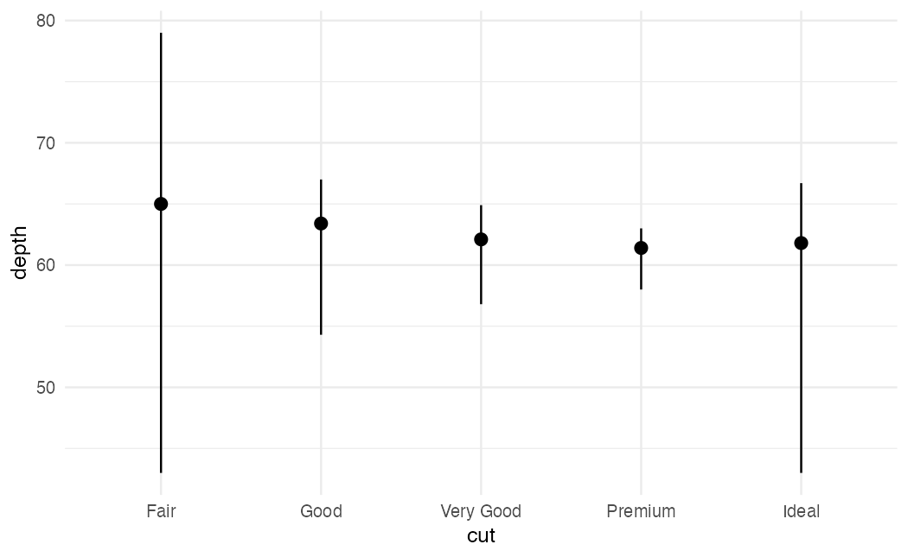

## 5. position: 겹치는 도형 배치

### 막대: stack, fill, dodge

```r
ggplot(diamonds, aes(x = cut, fill = clarity)) +
  geom_bar()
```

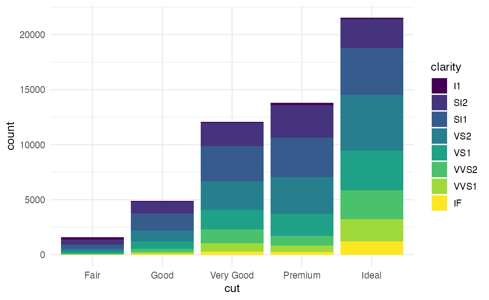

```r
ggplot(diamonds, aes(x = cut, fill = clarity)) +
  geom_bar(position = "fill")
```

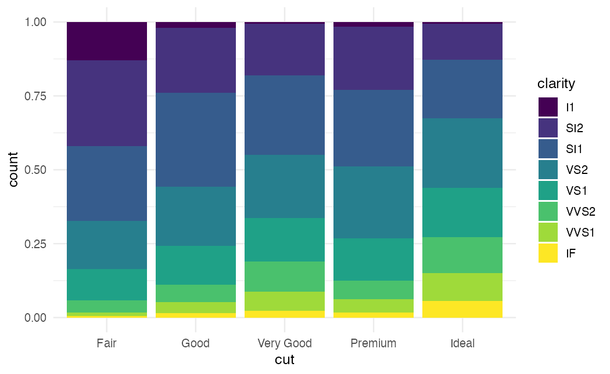

```r
ggplot(diamonds, aes(x = cut, fill = clarity)) +
  geom_bar(position = "dodge")
```

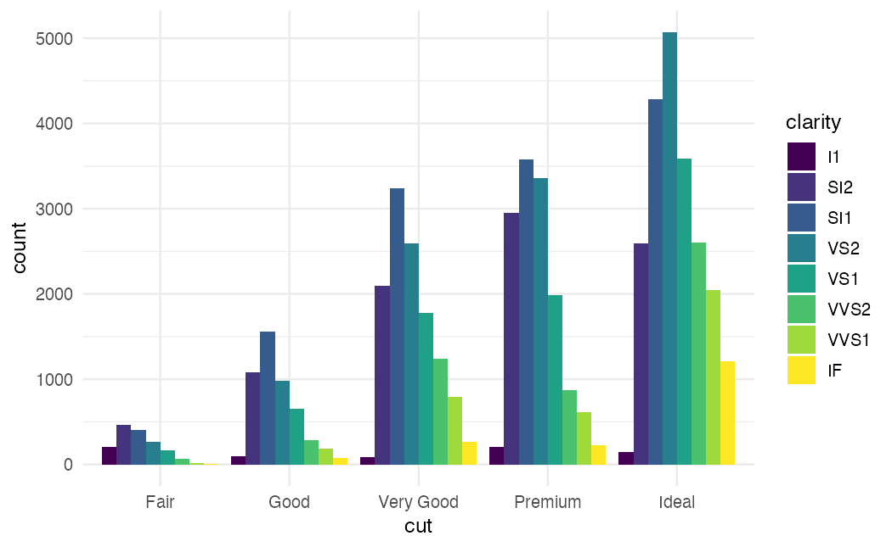

| position | 언제 쓰나 |
|---|---|
| `"stack"` (기본) | 전체 크기와 구성을 함께 볼 때 |
| `"fill"` | 그룹 안의 **비율**을 비교할 때 (높이가 모두 1) |
| `"dodge"` | 하위 그룹의 **절댓값**을 직접 비교할 때 |
| `"identity"` | 겹친 그대로. 막대보다는 투명도와 함께 쓰는 선·영역에 |

`color`는 테두리, `fill`은 내부 색이다. 막대에는 보통 `fill`을 쓴다.

### 점: jitter

`hwy`와 `displ`은 반올림된 값이라 점이 겹쳐 실제보다 적어 보인다.

```r
ggplot(mpg, aes(x = displ, y = hwy)) +
  geom_jitter(width = 0.1, height = 0.5)
```

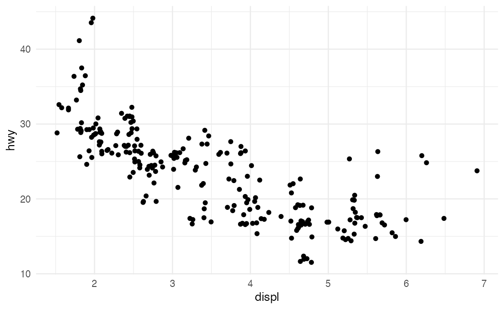

`geom_jitter()`는 `geom_point(position = "jitter")`의 줄임이다.

## 6. coord: 좌표계

### 지도 비율 맞추기

```r
nz <- map_data("nz")

ggplot(nz, aes(x = long, y = lat, group = group)) +
  geom_polygon(fill = "white", color = "black") +
  coord_quickmap()
```

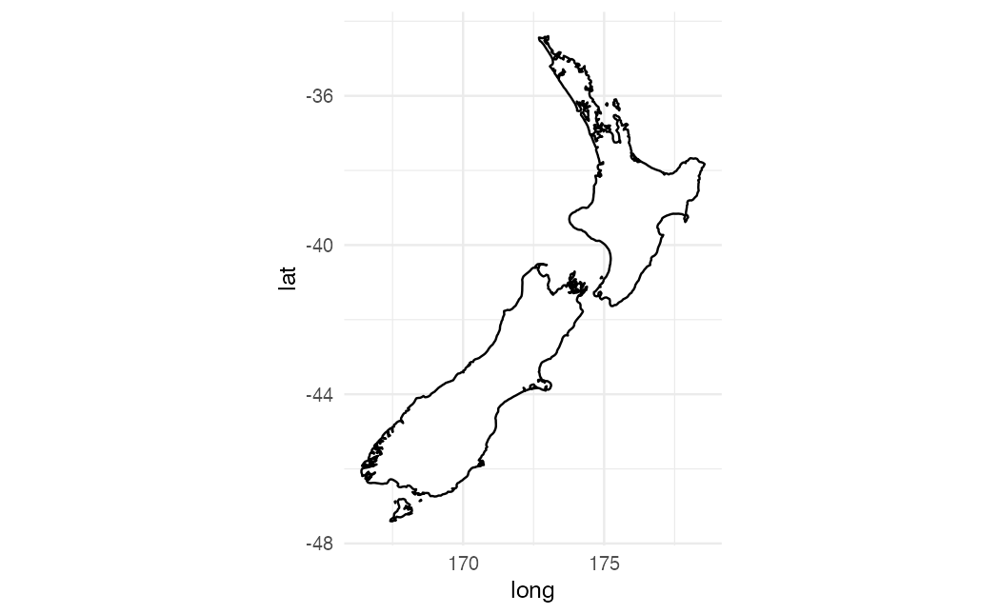

`coord_quickmap()`이 없으면 위도에 따른 경도 간격 차이가 반영되지 않아 지도가 옆으로 늘어난다.

### 막대를 원으로

```r
bar <- ggplot(diamonds, aes(x = clarity, fill = clarity)) +
  geom_bar(show.legend = FALSE, width = 1) +
  theme(aspect.ratio = 1) +
  labs(x = NULL, y = NULL)

bar + coord_polar()
```

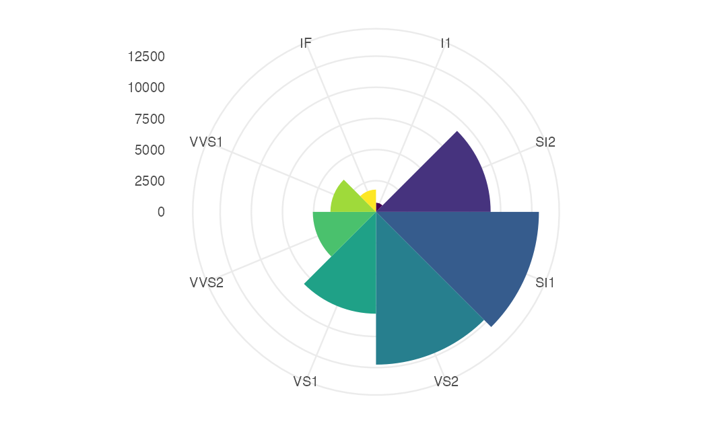

### 확대할 때는 coord_cartesian

```r
ggplot(mpg, aes(x = displ, y = hwy)) +
  geom_point(aes(color = class)) +
  geom_smooth() +
  coord_cartesian(xlim = c(5, 7), ylim = c(10, 30))
```

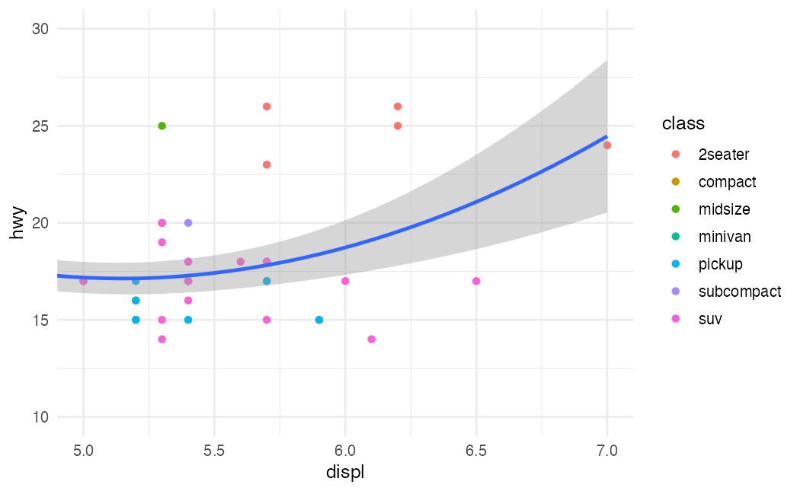

`filter()`나 `scale_x_continuous(limits = )`로 범위를 자르면 **잘린 데이터로** 추세선을 다시 계산한다. `coord_cartesian()`은 전체 데이터로 계산한 뒤 화면만 확대하므로 추세선이 그대로다.

## 7. 라벨과 주석

### 제목과 축 이름

```r
ggplot(mpg, aes(x = displ, y = hwy)) +
  geom_point(aes(color = class)) +
  geom_smooth(se = FALSE) +
  labs(
    x = "Engine displacement (L)",
    y = "Highway fuel economy (mpg)",
    color = "Car type",
    title = "Fuel efficiency generally decreases with engine size",
    subtitle = "Two seaters (sports cars) are an exception because of their light weight",
    caption = "Data from fueleconomy.gov"
  )
```

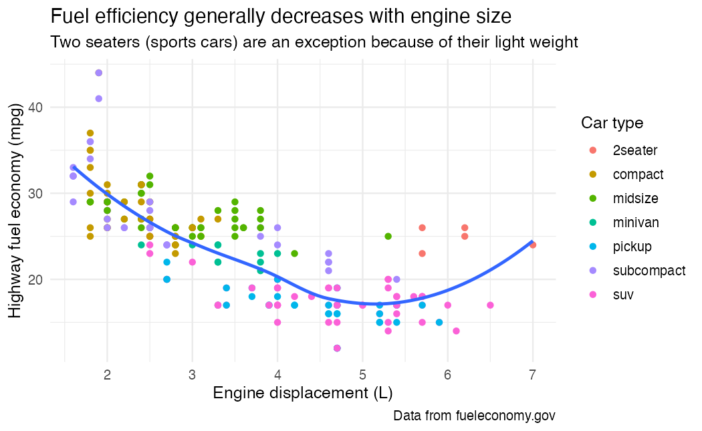

축 이름에는 단위를 넣고, 제목에는 변수 이름 대신 **그래프의 결론**을 쓴다.

### 점에 이름 붙이기

차종별로 고속도로 연비가 가장 좋은 차에 모델명을 붙인다.

```r
best_in_class <- mpg |>
  slice_max(hwy, n = 1, by = class, with_ties = FALSE)

ggplot(mpg, aes(x = displ, y = hwy)) +
  geom_point(aes(color = class)) +
  geom_point(data = best_in_class, size = 3, shape = 1) +
  geom_label_repel(data = best_in_class, aes(label = model))
```

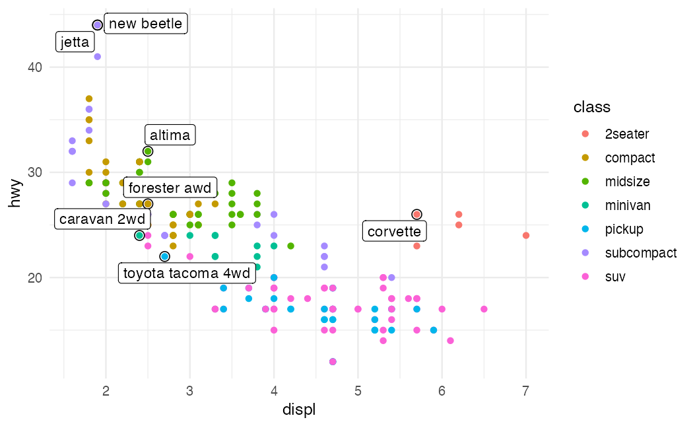

`geom_text()`, `geom_label()`은 라벨이 겹치기 쉽다. ggrepel의 `geom_label_repel()`은 겹치지 않게 자동 배치한다.

### 범례 대신 직접 라벨

```r
class_center <- mpg |>
  summarise(displ = median(displ), hwy = median(hwy), .by = class)

ggplot(mpg, aes(x = displ, y = hwy, color = class)) +
  geom_point(alpha = 0.5) +
  geom_label_repel(data = class_center, aes(label = class), size = 4) +
  theme(legend.position = "none")
```

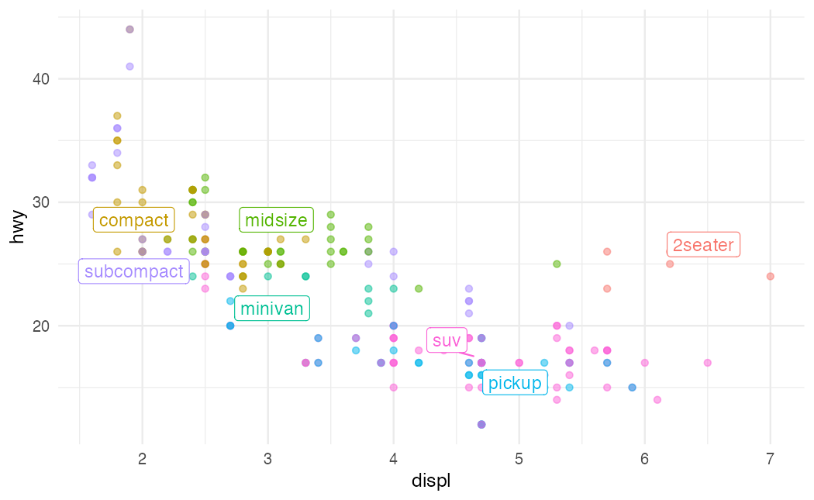

### 그래프 모서리에 설명 넣기

`Inf`를 좌표로 쓰면 데이터 범위와 상관없이 항상 패널 끝에 붙는다.

```r
ggplot(mpg, aes(x = displ, y = hwy)) +
  geom_point() +
  annotate(
    geom = "label", x = Inf, y = Inf, hjust = "right", vjust = "top",
    label = str_wrap("Increasing engine size is related to decreasing fuel economy.", width = 35)
  )
```

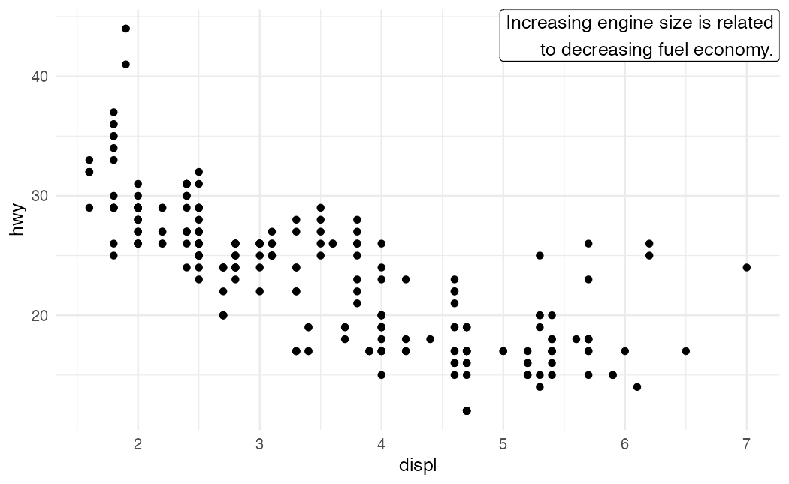

데이터 프레임을 따로 만들지 않아도 되는 `annotate()`가 텍스트 하나를 넣을 때는 더 간단하다. 긴 문장은 `str_wrap()`으로 줄을 바꾼다.

## 8. scale: 축, 범례, 색

이름 규칙은 `scale_` + `시각 속성` + `_` + `종류`다. 예를 들어 `scale_x_continuous`, `scale_color_manual`, `scale_fill_viridis_c`가 있다.

### 눈금과 날짜 축

```r
presidential |>
  mutate(id = 33 + row_number()) |>
  ggplot(aes(x = start, y = id, color = party)) +
  geom_point() +
  geom_segment(aes(xend = end, yend = id)) +
  scale_x_date(name = NULL, breaks = presidential$start, date_labels = "'%y") +
  scale_color_manual(values = c(Republican = "#E81B23", Democratic = "#00AEF3"))
```

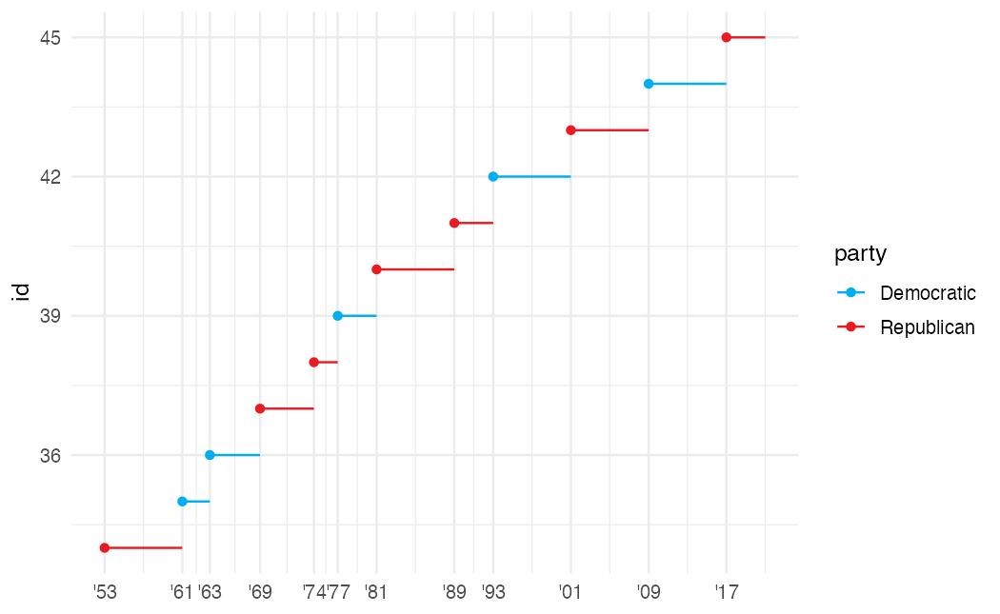

- `breaks`: 눈금 위치, `labels`: 눈금 글자(`NULL`이면 숨김)
- `scale_color_manual(values = )`: 범주에 의미 있는 색을 직접 지정

### 로그 축

```r
ggplot(diamonds, aes(x = carat, y = price)) +
  geom_bin_2d() +
  scale_x_log10() +
  scale_y_log10()
```

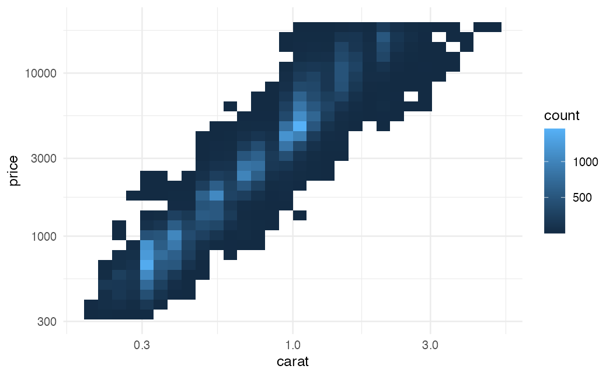

`aes(log10(carat), log10(price))`로 데이터를 직접 바꾸면 축 눈금이 로그값으로 찍혀 읽기 어렵다. 스케일을 바꾸면 눈금은 원래 단위로 남는다.

### 색 팔레트

```r
ggplot(mpg, aes(x = displ, y = hwy)) +
  geom_point(aes(color = drv, shape = drv), size = 2) +
  scale_color_brewer(palette = "Set1")
```

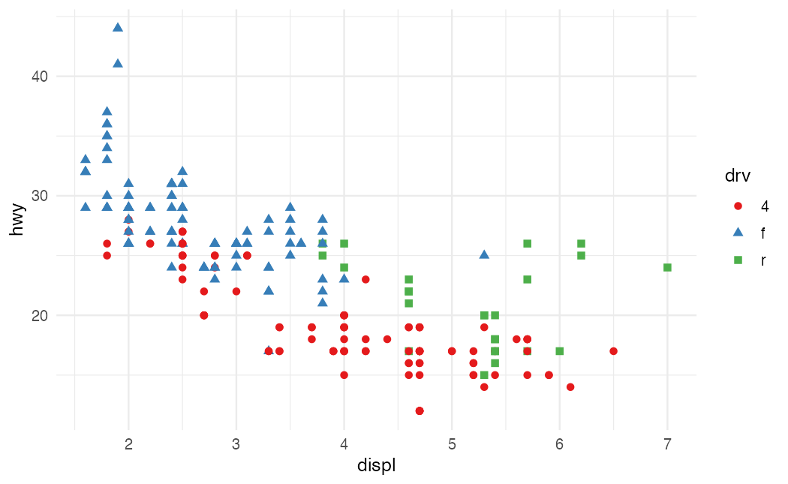

색과 모양을 같은 변수에 함께 매핑하면 흑백이나 색각 이상 환경에서도 구분된다.

```r
df <- tibble(x = rnorm(10000), y = rnorm(10000))

ggplot(df, aes(x, y)) +
  geom_bin_2d(bins = 60) +
  scale_fill_viridis_c() +
  coord_fixed()
```

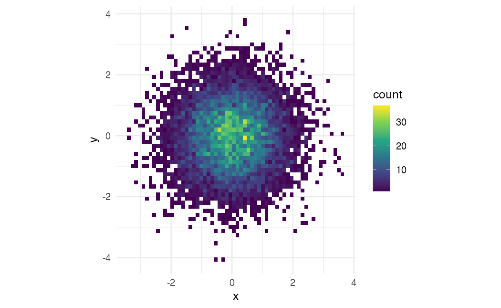

| 팔레트 | 함수 | 용도 |
|---|---|---|
| ColorBrewer | `scale_color_brewer`, `scale_fill_distiller` | 범주형(Set1, Dark2), 순서형·연속형(Blues) |
| viridis | `scale_color_viridis_d/c`, `scale_fill_viridis_d/c` | 색각 이상 친화, 흑백 인쇄에서도 밝기로 구분 |
| 직접 지정 | `scale_color_manual(values = )` | 정당, 브랜드처럼 정해진 색 |

### 여러 그래프의 스케일 맞추기

따로 그린 그래프를 비교할 때는 축 범위와 색 대응을 맞춰야 한다.

```r
x_scale <- scale_x_continuous(limits = range(mpg$displ))
y_scale <- scale_y_continuous(limits = range(mpg$hwy))
col_scale <- scale_color_discrete(limits = unique(mpg$drv))

ggplot(filter(mpg, class == "suv"), aes(x = displ, y = hwy, color = drv)) +
  geom_point() +
  x_scale + y_scale + col_scale
```

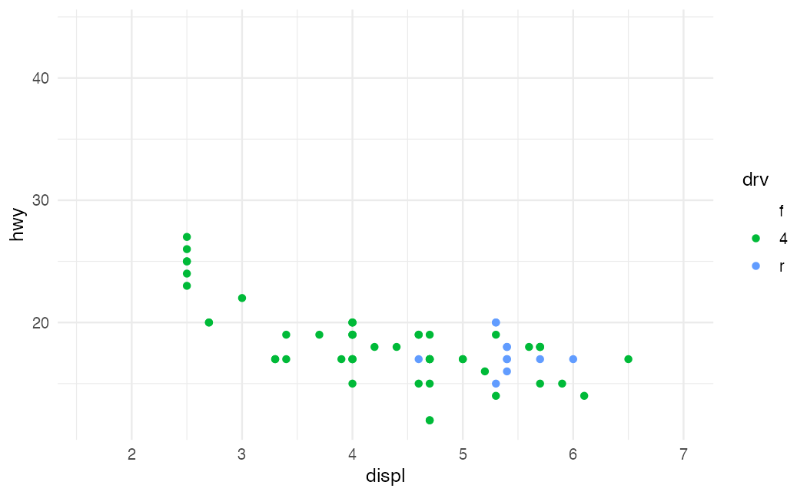

같은 스케일 객체를 compact 그래프에도 더하면 두 그래프를 나란히 놓고 바로 비교할 수 있다. 한 데이터 안의 비교라면 `facet_wrap()`이 더 간단하다.

## 9. theme과 저장

### 범례 위치와 모양

```r
ggplot(mpg, aes(x = displ, y = hwy)) +
  geom_point(aes(color = class)) +
  geom_smooth(se = FALSE) +
  theme(legend.position = "bottom") +
  guides(color = guide_legend(nrow = 2, override.aes = list(size = 4)))
```

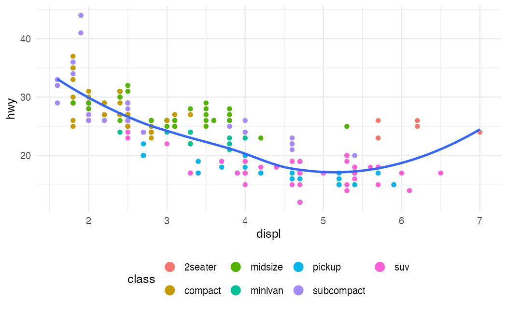

### 내장 테마

| 테마 | 특징 |
|---|---|
| `theme_gray()` | 기본값, 회색 배경 |
| `theme_bw()` | 흰 배경과 테두리, 인쇄용 |
| `theme_minimal()` | 축선과 배경 최소화, 웹·발표용 |
| `theme_classic()` | 격자 없이 축선만, 논문 스타일 |
| `theme_void()` | 모두 제거, 지도나 다이어그램용 |

`theme_set(theme_minimal())`로 세션 전체의 기본 테마를 바꿀 수 있다.

### 파일로 저장

```r norun
p <- ggplot(mpg, aes(x = displ, y = hwy)) + geom_point()
ggsave("plot.png", p, width = 7, height = 4.5, dpi = 300)
```

크기 단위는 인치가 기본이다. `ggsave()`에 그래프를 지정하지 않으면 마지막으로 그린 그래프를 저장한다.

## 자주 하는 실수

| 증상 | 원인과 해결 |
|---|---|
| `+`로 이었는데 다음 레이어가 무시됨 | `+`는 **줄 끝**에 둬야 한다. 줄 앞에 두면 앞 줄에서 코드가 끝난 것으로 본다 |
| 점이 빨갛고 "blue"라는 범례가 생김 | 고정 색을 `aes()` 안에 넣었다. `geom_point(color = "blue")`처럼 밖에 둔다 |
| `%>%`로 레이어를 연결해 에러 | 레이어는 `+`, 데이터 처리는 파이프 `\|>` |
| 비율 막대가 모두 1 | `after_stat(prop)`에는 `group = 1`이 필요하다 |
| 확대했더니 추세선이 바뀜 | `limits`나 `filter()`는 데이터를 자른다. 화면만 확대하려면 `coord_cartesian()` |
| 범주 순서가 알파벳순 | factor로 바꿔 순서를 지정한다 (`fct_inorder`, `fct_reorder`, `fct_infreq`) |
| shape 범례에서 한 범주가 사라짐 | shape는 6개까지만 자동 지정된다 |

## 요약

| 하고 싶은 것 | 코드 |
|---|---|
| 기본 산점도 | `ggplot(df, aes(x, y)) + geom_point()` |
| 그룹을 색으로 | `aes(color = g)`, 막대는 `aes(fill = g)` |
| 모든 점 같은 색 | `geom_point(color = "steelblue")` |
| 추세선 | `geom_smooth()`, 직선은 `method = "lm"`, 띠 제거는 `se = FALSE` |
| 분포 | `geom_histogram(binwidth = )`, `geom_boxplot()`, `geom_density()` |
| 범주별 작은 그래프 | `facet_wrap(~ g)`, `facet_grid(r ~ c)` |
| 집계된 값의 막대 | `geom_col()` |
| 비율 막대 | `geom_bar(position = "fill")`, 하나의 비율은 `after_stat(prop), group = 1` |
| 겹친 점 | `geom_jitter()`, `alpha = 0.3` |
| 확대 | `coord_cartesian(xlim =, ylim =)` |
| 로그 축 | `scale_x_log10()` |
| 색 지정 | `scale_color_manual(values = )`, `scale_color_brewer()`, `scale_fill_viridis_c()` |
| 제목, 축 이름 | `labs(title =, x =, y =, color =)` |
| 겹치지 않는 라벨 | `ggrepel::geom_label_repel()` |
| 범례 위치 | `theme(legend.position = "bottom")` |
| 저장 | `ggsave("plot.png", width =, height =, dpi =)` |

## 참고자료

- Hadley Wickham, Mine Çetinkaya-Rundel, Garrett Grolemund, *R for Data Science* (2nd ed.): [1 Data visualization](https://r4ds.hadley.nz/data-visualize.html), [9 Layers](https://r4ds.hadley.nz/layers.html), [11 Communication](https://r4ds.hadley.nz/communication.html)
- [ggplot2 공식 문서](https://ggplot2.tidyverse.org/)

다음 글: [R4DS - dplyr로 데이터 변환하기](/posts/r4ds-dplyr)
