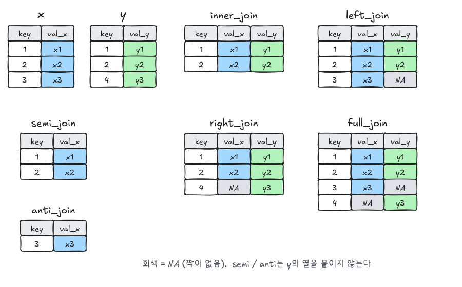

실제 데이터는 여러 테이블에 나뉘어 있다. R4DS(2판) Joins 장을 따라 키의 개념, join 종류와 선택 기준, 키가 중복될 때의 동작을 정리한다. SQL의 JOIN과 같은 개념이다.

```r title="환경 설정"
library(tidyverse)
library(nycflights13)
```

## 1. 키

nycflights13은 다섯 테이블이 키로 연결되어 있다.

| 테이블 | 내용 | 기본키 |
|---|---|---|
| `flights` | 항공편 | (사실상 없음) |
| `airlines` | 항공사 | `carrier` |
| `airports` | 공항 | `faa` |
| `planes` | 기체 | `tailnum` |
| `weather` | 공항별 시간별 날씨 | `origin`, `time_hour` |

- **기본키**: 행 하나를 유일하게 식별하는 열(들)
- **외래키**: 다른 테이블의 기본키를 가리키는 열. `flights$carrier`는 `airlines$carrier`를 가리킨다.

### 기본키 확인하기

```r
# 결과가 0행이면 유일하다
planes |> count(tailnum) |> filter(n > 1)
weather |> count(time_hour, origin) |> filter(n > 1)

# 기본키 열에 NA가 없는지도 확인
planes |> filter(is.na(tailnum))
```

```r
# flights는 날짜 + 편명으로도 유일하지 않다
flights |> count(year, month, day, flight) |> filter(n > 1)
```

이럴 때는 `mutate(id = row_number())`로 **대리키**를 만들어 쓴다.

## 2. join 종류



| 종류 | 함수 | 결과 |
|---|---|---|
| mutating | `left_join(x, y)` | x의 모든 행 + y의 열. 짝이 없으면 NA. **가장 많이 쓴다** |
| mutating | `inner_join(x, y)` | 양쪽에 짝이 있는 행만 |
| mutating | `right_join(x, y)` | y의 모든 행 |
| mutating | `full_join(x, y)` | 양쪽 모든 행 |
| filtering | `semi_join(x, y)` | y에 짝이 **있는** x의 행. 열은 추가하지 않음 |
| filtering | `anti_join(x, y)` | y에 짝이 **없는** x의 행 |

```r
x <- tribble(~key, ~val_x, 1, "x1", 2, "x2", 3, "x3")
y <- tribble(~key, ~val_y, 1, "y1", 2, "y2", 4, "y3")

x |> left_join(y, join_by(key))
x |> inner_join(y, join_by(key))
x |> full_join(y, join_by(key))
x |> semi_join(y, join_by(key))
x |> anti_join(y, join_by(key))
```

## 3. join_by로 키 지정하기

```r
flights2 <- flights |> select(year, time_hour, origin, dest, tailnum, carrier)

# 항공사 이름 붙이기
flights2 |> left_join(airlines, join_by(carrier))

# 열 이름이 다르면 ==
flights2 |> left_join(airports, join_by(dest == faa))

# 키가 여러 열
flights2 |> left_join(weather |> select(origin, time_hour, temp, wind_speed), join_by(origin, time_hour))
```

- `join_by()`를 생략하면 **이름이 같은 모든 열**을 키로 쓰고 어떤 열을 썼는지 메시지를 띄운다. 의도하지 않은 열(예: `flights`와 `planes`의 `year`, 각각 운항 연도와 제작 연도)이 키가 될 수 있으니 직접 지정하는 습관이 좋다.
- 예전 문법 `by = c("dest" = "faa")`는 `join_by(dest == faa)`와 같다.
- 부등호 조건(`join_by(x >= start, x <= end)`)도 가능하다(범위 join).

## 4. filtering join 활용

```r
# 가장 많이 가는 목적지 10곳의 항공편만
top_dest <- flights |> count(dest, sort = TRUE) |> head(10)
flights |> semi_join(top_dest, join_by(dest))

# planes 테이블에 없는 기체: 데이터 누락 점검
flights |>
  anti_join(planes, join_by(tailnum)) |>
  count(tailnum, sort = TRUE)
```

`semi_join`은 `filter(dest %in% top_dest$dest)`와 같지만 키가 여러 열일 때도 그대로 쓸 수 있다. `anti_join`은 **join 전에 짝이 안 맞는 행을 찾는** 점검용으로 특히 유용하다.

## 5. 키가 중복될 때

```r
x <- tribble(~key, ~val_x, 1, "x1", 2, "x2", 2, "x3", 1, "x4")
y <- tribble(~key, ~val_y, 1, "y1", 2, "y2")
left_join(x, y, join_by(key))
```

| 관계 | 결과 |
|---|---|
| x 중복, y 유일 (다대일) | 흔한 경우. y의 값이 x의 각 행에 복사된다 |
| x와 y 모두 중복 (다대다) | 짝의 모든 조합이 만들어져 **행이 불어난다**. dplyr이 경고를 띄운다 |

예상과 행 수가 다르면 키가 유일하지 않은 것이다. `relationship = "many-to-one"`처럼 기대하는 관계를 적어 두면 어긋날 때 에러로 알려준다.

## 6. 집합 연산

열 구성이 같은 두 테이블을 **행 전체**로 비교한다.

```r
df1 <- tribble(~x, ~y, 1, 1, 2, 1)
df2 <- tribble(~x, ~y, 1, 1, 1, 2)

intersect(df1, df2)   # 양쪽에 있는 행
union(df1, df2)       # 합치고 중복 제거
setdiff(df1, df2)     # df1에만 있는 행
```

## 자주 하는 실수

| 증상 | 원인과 해결 |
|---|---|
| join 후 행 수가 늘어남 | 키가 중복된다. `count(key) \|> filter(n > 1)`로 확인 |
| 값이 모두 NA | 키 열의 타입이나 값 형식이 다르다(문자 vs 숫자, 공백, 대소문자) |
| 엉뚱한 열이 키로 쓰임 | `join_by()`를 생략했다. 키를 직접 지정 |
| 같은 이름 열에 `.x`, `.y`가 붙음 | 키가 아닌 열 이름이 겹친다. 필요 없는 열을 먼저 `select`하거나 `suffix =` 지정 |

## 요약

| 하고 싶은 것 | 코드 |
|---|---|
| 정보 붙이기 (행 유지) | `left_join(x, y, join_by(key))` |
| 양쪽에 다 있는 것만 | `inner_join()` |
| 짝이 있는 행만 거르기 | `semi_join()` |
| 짝이 없는 행 찾기 | `anti_join()` |
| 이름이 다른 키 | `join_by(a == b)` |
| 여러 열 키 | `join_by(a, b)` |
| 키 유일성 확인 | `count(key) \|> filter(n > 1)` |
| 관계 강제 | `relationship = "many-to-one"` |

## 참고자료

- *R for Data Science* (2nd ed.): [19 Joins](https://r4ds.hadley.nz/joins.html)
- [dplyr: Mutating joins](https://dplyr.tidyverse.org/reference/mutate-joins.html)

다음 글: [R4DS - 데이터 불러오기와 tidy data](/posts/r4ds-tibble-tidydata)
