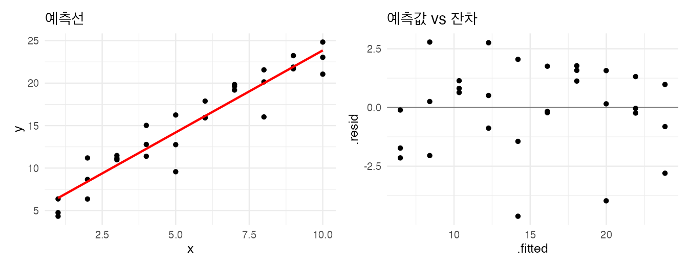
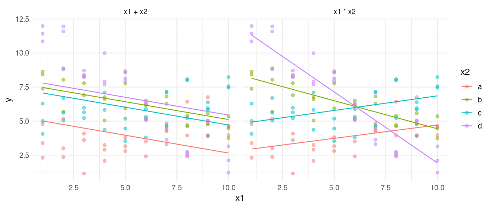
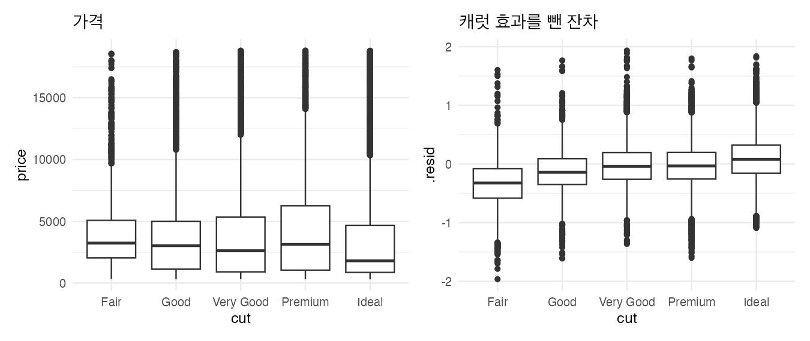
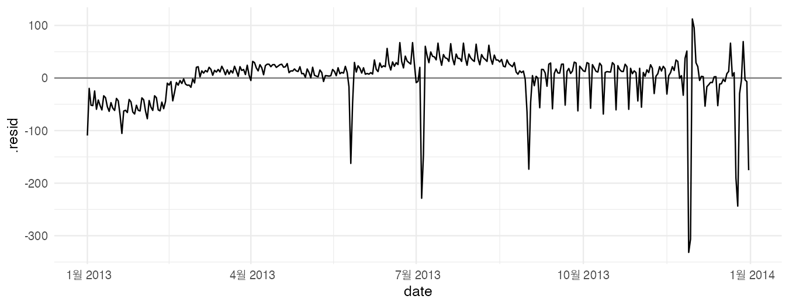
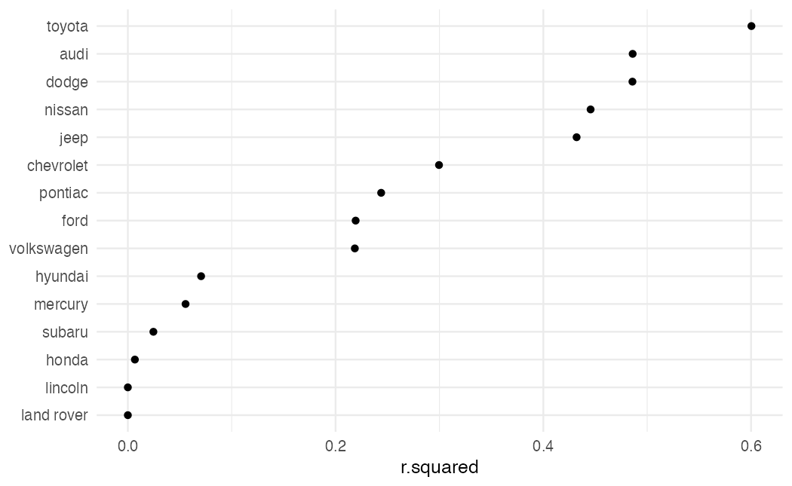
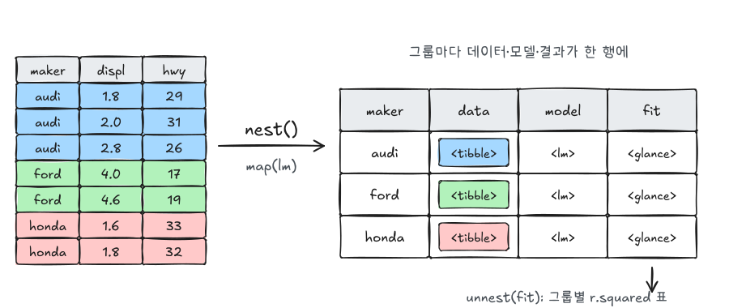

R4DS 1판의 Model 파트(모델 기초, 모델 만들기, 여러 모델)를 실습했던 내용을 현재 방식으로 옮겨 정리했다. 2판에서는 이 파트가 빠졌는데, 지면이 부족해 모델링을 제대로 다룰 수 없고 더 좋은 자료(tidymodels, *Tidy Modeling with R*)가 있기 때문이라고 한다. 1판에서 쓰던 modelr 패키지는 지금 거의 쓰지 않으므로 기본 `lm()`과 broom으로 바꿨다. 여기서 모델은 예측보다 **데이터의 패턴을 이해하는 도구**로 쓴다.

```r title="환경 설정"
library(tidyverse)
library(broom)        # tidyverse와 함께 설치되지만 따로 불러와야 한다
library(nycflights13)
library(patchwork)

theme_set(theme_minimal(base_size = 12))
```

## 1. 모델이란: 데이터에 가장 가까운 선 찾기

```r
set.seed(1)
sim1 <- tibble(x = rep(1:10, each = 3), y = 4 + 2 * x + rnorm(30, sd = 2))
```

모델 `y = a1 + a2 * x`의 "가까움"을 잔차 제곱합의 제곱근(RMSE)으로 정의하고, 이를 최소로 하는 `a1`, `a2`를 수치 최적화로 직접 찾아본다.

```r
measure_distance <- function(a, data) {
  pred <- a[1] + a[2] * data$x
  sqrt(mean((data$y - pred)^2))
}

best <- optim(c(0, 0), measure_distance, data = sim1)
best$par                         # 직접 찾은 절편과 기울기

coef(lm(y ~ x, data = sim1))     # lm의 최소제곱해
```

두 결과가 (최적화 오차 범위에서) 같다. `lm()`은 이 문제를 반복 탐색 없이 정규방정식으로 바로 푼다. 원리는 [선형대수 - 정규직교기저와 최소제곱법](/posts/la-orthonormal)의 최소제곱해와 같다.

## 2. lm과 broom

### 적합하고 결과를 tibble로

```r
mod <- lm(y ~ x, data = sim1)

tidy(mod)      # 계수: estimate, std.error, statistic, p.value
glance(mod)    # 모델 하나당 한 행: r.squared, AIC, ...
augment(mod)   # 관측마다: .fitted(예측), .resid(잔차), ...
```

| broom 함수 | 결과 | 쓰임 |
|---|---|---|
| `tidy()` | 계수 한 줄씩 | 계수 비교, 신뢰구간(`conf.int = TRUE`) |
| `glance()` | 모델 한 줄 | 여러 모델 적합도 비교 |
| `augment()` | 데이터 한 줄씩 + 예측·잔차 | 잔차 진단, 예측 그래프. `newdata =`로 새 데이터 예측 |

`summary(mod)`도 같은 정보를 주지만 출력용이라 다시 계산에 쓰기 어렵다. broom은 결과를 데이터 프레임으로 줘서 dplyr, ggplot2로 바로 이어진다.

### 예측과 잔차 보기

```r w=9 h=3.5
aug <- augment(mod)

p1 <- ggplot(aug, aes(x = x)) +
  geom_point(aes(y = y)) +
  geom_line(aes(y = .fitted), color = "red", linewidth = 1) +
  ggtitle("예측선")
p2 <- ggplot(aug, aes(x = .fitted, y = .resid)) +
  geom_hline(yintercept = 0, color = "grey50") +
  geom_point() +
  ggtitle("예측값 vs 잔차")
p1 + p2
```



잔차 그래프에 패턴 없이 0 주위로 고르게 흩어져 있으면, 모델이 데이터의 구조를 다 잡았다는 뜻이다. 곡선이나 깔때기 모양이 남아 있으면 모델이 놓친 것이 있다.

## 3. 범주형 변수

```r
mod_drv <- lm(hwy ~ drv, data = mpg)
tidy(mod_drv)

# 예측값 = 그룹 평균
mpg |> summarise(mean_hwy = mean(hwy), .by = drv)

# R이 내부에서 만드는 더미 변수
model.matrix(hwy ~ drv, data = mpg) |> head()
```

범주형 변수는 첫 번째 수준(여기서는 `4`)을 기준으로 나머지 수준마다 0/1 더미 변수가 만들어진다. 계수는 **기준 범주와의 평균 차이**다. 기준을 바꾸려면 `fct_relevel(drv, "f")`.

## 4. 교호작용

연속형 `x1`과 범주형 `x2`가 있을 때, 기울기가 그룹마다 같은지 다른지에 따라 모델이 달라진다.

```r w=9 h=3.8
set.seed(2)
sim3 <- expand_grid(x1 = 1:10, x2 = c("a", "b", "c", "d"), rep = 1:3) |>
  mutate(
    slope = c(a = 0.2, b = -0.5, c = 0.3, d = -1)[x2],
    y = 3 + slope * x1 + c(a = 0, b = 6, c = 1, d = 9)[x2] + rnorm(n(), sd = 1)
  )

mod_add <- lm(y ~ x1 + x2, data = sim3)   # 기울기 공통, 절편만 그룹별
mod_int <- lm(y ~ x1 * x2, data = sim3)   # 기울기도 그룹별

grid <- expand_grid(x1 = 1:10, x2 = c("a", "b", "c", "d"))
preds <- bind_rows(
  "x1 + x2" = augment(mod_add, newdata = grid),
  "x1 * x2" = augment(mod_int, newdata = grid),
  .id = "model"
) |>
  mutate(model = fct_inorder(model))   # 패널 순서를 입력 순서대로

ggplot(sim3, aes(x = x1, y = y, color = x2)) +
  geom_point(alpha = 0.5) +
  geom_line(data = preds, aes(y = .fitted)) +
  facet_wrap(~ model)
```



```r
bind_rows("x1 + x2" = glance(mod_add), "x1 * x2" = glance(mod_int), .id = "model") |>
  select(model, r.squared, AIC)
```

왼쪽은 그룹마다 기울기가 같다고 강제해서 데이터의 기울기 차이를 놓친다. 잔차를 그룹별로 그려 보면 패턴이 남고, 교호작용 모델은 AIC도 더 낮다.

## 5. formula 문법

| formula | 뜻 |
|---|---|
| `y ~ x` | `y = a0 + a1 x` |
| `y ~ x1 + x2` | 두 변수의 효과를 더함 |
| `y ~ x1:x2` | 교호작용 항만 |
| `y ~ x1 * x2` | `x1 + x2 + x1:x2` |
| `y ~ x - 1` 또는 `y ~ 0 + x` | 절편 없음 |
| `y ~ I(x^2) + x` | 제곱항. `I()` 없이 `x^2`라고 쓰면 교호작용 문법으로 해석된다 |
| `y ~ poly(x, 2)` | 직교다항식 (다중공선성이 작다) |
| `y ~ splines::ns(x, df = 3)` | 자연 스플라인 (양 끝에서 선형이라 외삽이 덜 튄다) |
| `log(y) ~ log(x)` | 변환 |
| `y ~ .` | 나머지 모든 열 |

```r
model.matrix(y ~ I(x^2) + x, data = tibble(x = 1:3, y = 0))
model.matrix(y ~ poly(x, 2), data = tibble(x = 1:3, y = 0))
```

결측이 있는 행은 `lm()`이 조용히 뺀다. `nobs(mod)`로 실제 사용한 행 수를 확인한다.

## 6. 잔차로 패턴 찾기

모델이 잡은 패턴을 빼고 남은 것(잔차)을 보면 다음 질문이 보인다.

### 사례 1: 품질이 낮은 다이아몬드가 왜 비싼가

[EDA 글](/posts/r4ds-eda)에서 cut 등급이 가장 좋은(Ideal) 다이아몬드의 가격 중앙값이 가장 낮았다. 캐럿(크기) 효과를 먼저 빼 본다.

```r w=9 h=3.8
diamonds2 <- diamonds |>
  filter(carat <= 2.5) |>
  mutate(lprice = log2(price), lcarat = log2(carat))

mod_diamond <- lm(lprice ~ lcarat, data = diamonds2)
diamonds2 <- augment(mod_diamond, data = diamonds2)

p1 <- ggplot(diamonds2, aes(x = cut, y = price)) + geom_boxplot() + ggtitle("가격")
p2 <- ggplot(diamonds2, aes(x = cut, y = .resid)) + geom_boxplot() + ggtitle("캐럿 효과를 뺀 잔차")
p1 + p2
```



로그 가격과 로그 캐럿은 거의 직선 관계라서 단순 회귀로 크기 효과를 잘 뺄 수 있다. 크기 효과를 빼고 나면 **등급이 좋을수록 잔차(같은 크기 대비 가격)가 높다**. 낮은 등급의 가격이 높아 보였던 이유는 낮은 등급 다이아몬드가 평균적으로 더 크기 때문이다. 로그2를 썼으므로 잔차 1은 가격이 2배라는 뜻이다.

### 사례 2: 요일 효과를 뺀 일별 항공편 수

```r w=9 h=3.5
daily <- flights |>
  mutate(date = make_date(year, month, day)) |>
  count(date) |>
  mutate(wday = wday(date, label = TRUE))

mod_wday <- lm(n ~ wday, data = daily)
daily <- augment(mod_wday, data = daily)

ggplot(daily, aes(x = date, y = .resid)) +
  geom_hline(yintercept = 0, color = "grey50") +
  geom_line()
```



```r
daily |> slice_min(.resid, n = 6) |> select(date, n, wday, .resid)
```

요일 패턴(주말에 적음)을 빼고 나니 남은 큰 음의 잔차가 추수감사절과 그다음 날, 크리스마스와 이브, 독립기념일, 연말 같은 **공휴일**로 드러난다. 여름에 잔차가 높은 것도 보이는데, 이는 계절(방학) 효과다. 다음 모델은 공휴일 변수나 학기 변수(`wday * term`)를 넣는 식으로 발전시킨다. 이상값에 덜 민감한 추정이 필요하면 `MASS::rlm()`을 쓴다.

## 7. 그룹별 모델 여러 개: nest + map + broom

제조사마다 배기량과 연비의 관계가 얼마나 선형적인지 비교한다. 데이터 프레임을 그룹별로 **리스트 열**에 담고(`nest`), 각각 모델을 적합해(`map`), 결과를 펼친다(`unnest`).

```r
by_maker <- mpg |>
  nest(data = -manufacturer) |>
  mutate(
    model = map(data, \(df) lm(hwy ~ displ, data = df)),
    fit = map(model, glance)
  )
by_maker
```

```r
by_maker |>
  unnest(fit) |>
  ggplot(aes(x = r.squared, y = fct_reorder(manufacturer, r.squared))) +
  geom_point() +
  labs(y = NULL)
```





- `nest()`: 그룹마다 나머지 열을 작은 데이터 프레임으로 묶어 한 칸에 넣는다.
- `map()`: 리스트 열의 각 원소에 함수를 적용한다([반복 글](/posts/r4ds-iteration)).
- `unnest()`: broom 결과(데이터 프레임)를 다시 펼친다. `tidy`를 펼치면 계수, `augment`를 펼치면 잔차를 그룹별로 볼 수 있다.

데이터와 모델, 결과가 한 표에 함께 있어서 그룹이 많아도 관리가 쉽다. 결정계수가 낮은 제조사는 모델 개수(행 수)가 적거나 배기량 범위가 좁은 경우가 많으니 `map_int(data, nrow)`로 함께 확인한다.

## 더 나아가기

| 하고 싶은 것 | 도구 |
|---|---|
| 일반화선형모델 (로지스틱, 포아송) | `glm(family = binomial)`, broom도 그대로 쓸 수 있다 |
| 학습·평가 분리, 교차검증, 여러 알고리즘 비교 | tidymodels (rsample, parsnip, recipes, tune, yardstick) |
| 혼합효과 모형 | lme4 + broom.mixed |

## 자주 하는 실수

| 증상 | 원인과 해결 |
|---|---|
| `y ~ x^2`가 제곱항이 안 됨 | formula 안에서 `^`는 교호작용. `I(x^2)` 또는 `poly(x, 2)` |
| 범주 계수의 해석이 헷갈림 | 기준 범주와의 차이다. `fct_relevel`로 기준 지정 |
| 데이터 행 수보다 예측이 적음 | NA가 있는 행이 빠졌다. `nobs()`로 확인 |
| 결정계수만 보고 모델 판단 | 잔차 그래프로 남은 패턴을 반드시 확인 |
| 로그 변환한 값으로 해석 | 계수·잔차를 원래 단위(배수)로 되돌려 설명 |

## 요약

| 하고 싶은 것 | 코드 |
|---|---|
| 회귀 적합 | `mod <- lm(y ~ x1 + x2, data = df)` |
| 계수 표 | `tidy(mod, conf.int = TRUE)` |
| 적합도 | `glance(mod)` |
| 예측·잔차 | `augment(mod)`, 새 데이터는 `augment(mod, newdata = grid)` |
| 예측용 격자 | `expand_grid(x1 = 1:10, x2 = c("a", "b"))` |
| 교호작용 | `y ~ x1 * x2` |
| 곡선 | `poly(x, 2)`, `splines::ns(x, 3)` |
| 패턴 제거 후 보기 | `augment()`의 `.resid`를 그래프로 |
| 그룹별 모델 | `nest(data = -g) \|> mutate(model = map(data, \(d) lm(...)), fit = map(model, glance)) \|> unnest(fit)` |

## 참고자료

- Hadley Wickham, Garrett Grolemund, *R for Data Science* (1st ed.): Model 파트 (Model basics, Model building, Many models)
- *R for Data Science* (2nd ed.): [Preface to the second edition](https://r4ds.hadley.nz/preface-2e.html) (모델링 파트가 빠진 이유)
- Max Kuhn, Julia Silge, [*Tidy Modeling with R*](https://www.tmwr.org/), [broom 공식 문서](https://broom.tidymodels.org/)
