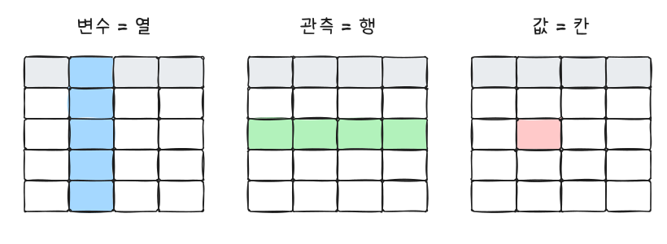
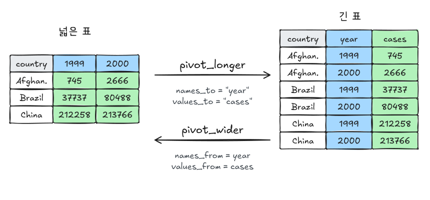

분석은 데이터를 불러와서 분석하기 좋은 모양으로 바꾸는 데서 시작한다. R4DS(2판) Data import, Data tidying, Missing values 장을 따라 tibble과 readr, 그리고 tidyr로 데이터를 정돈하는 방법을 정리한다.

```r title="환경 설정"
library(tidyverse)
```

## 1. tibble

tibble은 tidyverse의 데이터 프레임이다. `data.frame`과 거의 같지만 몇 가지가 더 안전하다.

```r
tibble(
  x = 1:5,
  y = 1,          # 길이 1은 자동으로 반복
  z = x^2 + y     # 방금 만든 열을 바로 사용
)

# 행 단위로 적기: 작은 예제 데이터를 만들 때 편하다
tribble(
  ~x,  ~y, ~z,
  "a",  2, 3.6,
  "b",  1, 8.5
)
```

| | `data.frame` | `tibble` |
|---|---|---|
| 출력 | 전체 출력 | 처음 10행, 화면 너비만큼. 열 타입 표시 |
| 열 이름 일부로 접근 (`df$x`가 `xyz`를 찾음) | 허용 | 경고 후 `NULL` |
| `df[, 1]` | 벡터로 바뀜 | 항상 tibble |
| 문자열 | (예전 R) factor로 자동 변환 | 그대로 문자열 |

- 더 많이 보기: `print(n = 20, width = Inf)`, 또는 `glimpse()`
- 열 하나 꺼내기: `df$x`, `df[["x"]]`, 파이프에서는 `df |> pull(x)`
- 공백이나 숫자로 된 열 이름은 백틱으로 감싼다: `` df$`1999` ``

## 2. read_csv로 불러오기

```r
# 파일 대신 문자열로 예제 (I()로 감싸면 파일 경로가 아니라 내용으로 읽는다)
csv <- I("student_id,full_name,favourite_food,age
1,Sunil Huffmann,Strawberry yoghurt,4
2,Barclay Lynn,French fries,5
3,Jayendra Lyne,N/A,7
4,Leon Rossini,Anchovies,
5,Chidiebere Okafor,Pizza,five")

students <- read_csv(csv, na = c("N/A", ""))
students
```

`age`에 `"five"`가 섞여 있어 문자형으로 읽혔다. 이런 경우가 흔해서 **열 타입을 직접 지정**하는 습관이 좋다.

```r
read_csv(
  csv,
  na = c("N/A", ""),
  col_types = cols(student_id = col_integer(), age = col_integer(), .default = col_character())
)
```

타입이 맞지 않는 값은 `NA`가 되고 경고가 나며, `problems()`로 어느 행인지 확인할 수 있다.

| 인자 | 용도 |
|---|---|
| `skip = n` | 위쪽 메타정보 n줄 건너뛰기 |
| `comment = "#"` | 주석 줄 무시 |
| `col_names = FALSE` 또는 이름 벡터 | 헤더가 없을 때 |
| `na = c("", "NA", "N/A")` | 결측으로 볼 값 |
| `col_types = cols(...)` | 열 타입 지정 |
| `locale = locale(encoding = "CP949")` | 한글 Windows 파일 등 인코딩 |

여러 파일을 한 번에 읽을 때는 `read_csv(c("a.csv", "b.csv"), id = "file")`처럼 경로 벡터를 넘긴다. 엑셀은 readxl의 `read_excel()`을 쓴다.

## 3. parse_* : 문자열을 타입으로

`read_csv`가 내부에서 쓰는 함수들이다. 이미 불러온 문자열 열을 바꿀 때 `mutate()` 안에서 쓴다.

```r
parse_integer(c("123", "345", "abc", "123.45"))   # 실패한 값은 NA + 경고

parse_number("$123,456.78")      # 숫자만 뽑기: 123456.78
parse_number("20%")              # 20
parse_double("1,23", locale = locale(decimal_mark = ","))   # 유럽식 소수점

parse_date("01/02/15", "%m/%d/%y")   # 2015-01-02
parse_date("01/02/15", "%d/%m/%y")   # 2015-02-01
parse_datetime("2010-10-01T2010")
```

| 함수 | 용도 |
|---|---|
| `parse_number()` | 통화, 퍼센트, 천 단위 구분 기호가 섞인 숫자 |
| `parse_integer()`, `parse_double()` | 엄격한 숫자 변환 |
| `parse_date(x, format)` | 날짜. `%Y %m %d %y %b` 등 |
| `parse_factor(x, levels)` | 정해진 수준 밖의 값을 경고로 알려줌 |

## 4. tidy data



1. 각 **변수**는 하나의 열
2. 각 **관측**은 하나의 행
3. 각 **값**은 하나의 칸

tidyverse 함수는 모두 이 모양을 전제로 한다. 같은 정보라도 모양에 따라 계산이 쉽거나 어렵다.

```r
table1   # tidy: country, year, cases, population
table2   # cases와 population이 type 열의 값으로 들어가 있음
table3   # rate 열에 "cases/population"이 한 칸에 들어 있음
table4a  # 연도가 열 이름(1999, 2000)
```

`table1`에서는 인구 1만 명당 발생률을 바로 계산할 수 있다.

```r
table1 |> mutate(rate = cases / population * 10000)
```

## 5. pivot: 넓은 표 ↔ 긴 표



### pivot_longer: 열 이름에 값이 들어 있을 때

```r
table4a |>
  pivot_longer(
    cols = c(`1999`, `2000`),
    names_to = "year",
    values_to = "cases"
  )
```

열 이름(1999, 2000)은 사실 `year` 변수의 값이다. 이 값들을 한 열로 내리고, 칸의 숫자를 `cases` 열로 모은다.

열 이름 하나에 여러 변수가 붙어 있으면 `names_sep`로 쪼갠다. 세계보건기구 결핵 데이터 `who2`의 열 이름은 `sp_m_014`처럼 진단방법_성별_연령대다.

```r
who2 |>
  pivot_longer(
    cols = !(country:year),
    names_to = c("diagnosis", "gender", "age"),
    names_sep = "_",
    values_to = "count",
    values_drop_na = TRUE
  )
```

### pivot_wider: 한 관측이 여러 행에 흩어져 있을 때

```r
table2 |>
  pivot_wider(names_from = type, values_from = count)
```

| 상황 | 함수 | 핵심 인자 |
|---|---|---|
| 열 이름이 값이다 (넓은 표) | `pivot_longer` | `cols`, `names_to`, `values_to` |
| 열 이름에 변수 여러 개 | `pivot_longer` | `names_to = c(...)`, `names_sep` 또는 `names_pattern` |
| 변수 이름이 값으로 들어가 있다 (긴 표) | `pivot_wider` | `names_from`, `values_from` |

분석과 시각화에는 긴 표가, 사람이 보는 보고용 표에는 넓은 표가 편한 경우가 많다.

## 6. 열 나누기와 합치기

```r
# "745/19987071"을 두 열로
table3 |>
  separate_wider_delim(rate, delim = "/", names = c("cases", "population")) |>
  mutate(across(c(cases, population), as.integer))

# 두 열을 하나로
table5 |>
  unite(year_full, century, year, sep = "")
```

| 함수 | 용도 |
|---|---|
| `separate_wider_delim(col, delim, names)` | 구분자로 나누기 |
| `separate_wider_position(col, widths)` | 글자 수로 나누기 |
| `separate_wider_regex(col, patterns)` | 정규표현식으로 나누기 |
| `separate_longer_delim(col, delim)` | 나눈 값을 **행**으로 펼치기 (`"a,b,c"` → 3행) |
| `unite(new, a, b, sep)` | 합치기 |

예전 `separate()`는 더 이상 개발되지 않는다. 나눈 결과는 문자형이라 숫자로 바꿔 줘야 한다.

## 7. 결측값

결측은 **명시적**(칸에 `NA`)일 수도, **암묵적**(행 자체가 없음)일 수도 있다.

```r
stocks <- tibble(
  year   = c(2020, 2020, 2020, 2020, 2021, 2021, 2021),
  qtr    = c(   1,    2,    3,    4,    2,    3,    4),
  price  = c(1.88, 0.59, 0.35,   NA, 0.92, 0.17, 2.66)
)

# 2020년 4분기: 명시적 NA. 2021년 1분기: 행이 없음(암묵적)
stocks |> complete(year, qtr)                                   # 암묵적 → 명시적
stocks |> pivot_wider(names_from = qtr, values_from = price)    # 넓히면 드러난다
```

```r
treatment <- tribble(
  ~person,           ~treatment, ~response,
  "Derrick Whitmore", 1,         7,
  NA,                 2,         10,
  NA,                 3,         NA,
  "Katherine Burke",  1,         4
)
treatment |> fill(everything())                      # 위 값으로 채우기 (보고서식 표)
treatment |> mutate(response = coalesce(response, 0))   # 특정 값으로 채우기
```

| 상황 | 함수 |
|---|---|
| 없는 조합을 NA 행으로 만들기 | `complete(a, b)` |
| 바로 위 값으로 채우기 | `fill(col)` (`.direction = "up"`도 가능) |
| NA를 특정 값으로 | `coalesce(x, 0)`, `replace_na(list(x = 0))` |
| 특정 값을 NA로 (예: -99) | `na_if(x, -99)` |
| NA 행 제거 | `drop_na(col)`, pivot에서는 `values_drop_na = TRUE` |

## 자주 하는 실수

| 증상 | 원인과 해결 |
|---|---|
| 숫자 열이 문자형으로 읽힘 | 숫자가 아닌 값(`"five"`, `"-"`, `"$1"`)이 섞여 있다. `col_types`로 지정하고 `problems()` 확인 |
| 한글이 깨짐 | 인코딩. `locale = locale(encoding = "CP949")` |
| 숫자 열 이름 `1999`를 못 찾음 | 백틱 `` `1999` `` |
| pivot_wider 후 값이 리스트 | 같은 칸에 들어갈 값이 여러 개다(중복). `values_fn = sum` 등으로 집계하거나 중복을 먼저 확인 |
| separate 후 숫자 계산이 안 됨 | 나눈 결과는 문자형. `as.integer()`, `parse_number()` |

## 요약

| 하고 싶은 것 | 코드 |
|---|---|
| 작은 표 만들기 | `tribble(~a, ~b, 1, "x")` |
| CSV 읽기 | `read_csv(path, na =, col_types = cols(...))` |
| 지저분한 숫자 | `parse_number()` |
| 넓은 표 → 긴 표 | `pivot_longer(cols, names_to, values_to)` |
| 긴 표 → 넓은 표 | `pivot_wider(names_from, values_from)` |
| 한 칸을 여러 열로 | `separate_wider_delim(col, delim, names)` |
| 여러 열을 한 칸으로 | `unite(new, a, b, sep)` |
| 빠진 조합 채우기 | `complete()`, `fill()`, `coalesce()` |

## 참고자료

- *R for Data Science* (2nd ed.): [5 Data tidying](https://r4ds.hadley.nz/data-tidy.html), [7 Data import](https://r4ds.hadley.nz/data-import.html), [18 Missing values](https://r4ds.hadley.nz/missing-values.html)
- Hadley Wickham, [Tidy Data](https://www.jstatsoft.org/article/view/v059i10), *Journal of Statistical Software* 59(10), 2014

다음 글: [R4DS - 탐색적 데이터 분석(EDA)](/posts/r4ds-eda)
