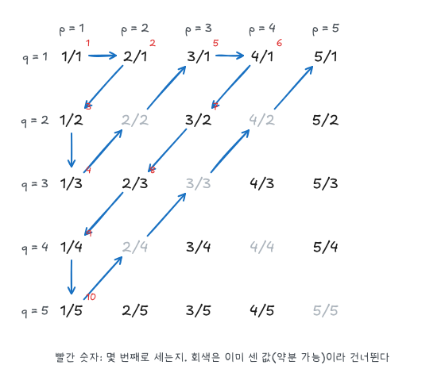
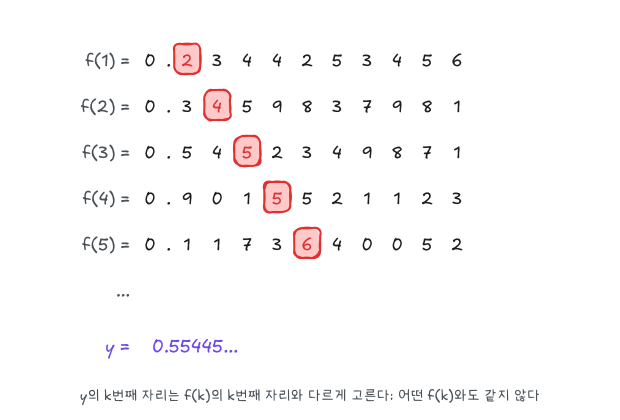

확률과정론 시리즈의 첫 글이다. 학부 확률론에서는 "사건의 확률"을 당연하게 썼지만, 표본공간이 실수 구간처럼 연속이면 모든 부분집합에 확률을 모순 없이 주는 일이 불가능하다. 이 글은 그 이유를 살펴보고, 문제를 해결하는 데 필요한 두 가지 도구인 **카디널리티**와 **르벡측도**를 정리한다. 확률을 줄 수 있는 집합만 모은 시그마필드와 확률변수의 엄밀한 정의는 [다음 글](/posts/sp-02-sigma-field-random-variable)에서 다룬다.

## 시리즈 구성

| 파트 | 글 | 핵심 질문 |
|---|---|---|
| 측도론 | 1. 왜 측도론이 필요한가 (이 글) | 모든 집합에 확률을 줄 수 있는가 |
| | [2. 시그마필드와 확률변수](/posts/sp-02-sigma-field-random-variable) | 확률과 확률변수를 어떻게 엄밀하게 정의하는가 |
| 마코프체인 | [3. 확률과정과 두 가지 평균](/posts/sp-03-stochastic-process) | 시간평균과 앙상블평균은 언제 같은가 |
| | [4. 마코프체인과 정상분포](/posts/sp-04-markov-chain-stationary) | 전이행렬을 반복해서 곱하면 어디로 가는가 |
| | [5. 기약성, 비주기성, 에르고딕](/posts/sp-05-irreducible-aperiodic-ergodic) | 언제 극한분포가 유일하게 존재하는가 |
| | [6. 정상분포, 극한분포, 경험분포](/posts/sp-06-limit-distributions) | 세 분포는 각각 무엇이고 언제 일치하는가 |
| | [7. 재귀와 일시, 무한 상태공간](/posts/sp-07-recurrence) | 상태공간이 무한이면 무엇이 달라지는가 |
| MCMC | [8. 난수 생성에서 MCMC로](/posts/sp-08-mcmc-intro) | 분포를 모를 때 어떻게 표본을 뽑는가 |
| | [9. 메트로폴리스-헤이스팅스와 깁스 샘플링](/posts/sp-09-metropolis-gibbs) | 다차원 사후분포에서 표본을 뽑는 방법 |
| 강화학습 | [10. 밴딧 문제](/posts/sp-10-rl-bandit) | 탐색과 활용을 어떻게 나누는가 |
| | [11. 격자 세계와 Q-러닝](/posts/sp-11-rl-gridworld) | 상태가 있는 환경에서 가치를 어떻게 학습하는가 |
| | [12. 심층 Q-러닝과 LunarLander](/posts/sp-12-rl-lunarlander) | 상태가 연속이면 Q 함수를 어떻게 근사하는가 |

## 1. 모든 부분집합에 확률을 줄 수 있는가

### 유한 표본공간: 문제없음

동전 하나를 던지면 $\Omega = \{H, T\}$이고 부분집합은 $\emptyset$, $\{H\}$, $\{T\}$, $\Omega$ 네 개뿐이다. 각각에 $0$, $\tfrac12$, $\tfrac12$, $1$을 주면 확률의 공리(비음수, 전체 확률 1, 서로소 사건의 가산가법성)와 그로부터 나오는 성질($A \subset B \Rightarrow P(A) \le P(B)$ 등)을 어떤 순서로 적용해도 모순이 없다.

### 연속 표본공간: 바늘 하나짜리 시계

바늘 하나짜리 시계를 돌려 멈춘 각도를 기록하면 $\Omega = [0, 2\pi)$다. 자연스러운 확률은 구간의 길이에 비례하는 것이다.

$$
P(A) = \frac{m(A)}{m(\Omega)} = \frac{m(A)}{2\pi}, \qquad m(A) = A\text{의 길이}
$$

$P([0, \pi)) = \tfrac12$처럼 구간에는 문제가 없다. 그러나 이 정의를 $\Omega$의 **모든** 부분집합으로 넓히려고 하면 다음 질문들에 차례로 답해야 한다.

| 질문 | 자연스러운 답 | 생기는 문제 |
|---|---|---|
| 한 점 $\{0\}$의 확률은? | 점의 길이는 0이므로 0 | 매일 일어나는 사건인데 확률이 0이다. "확률 0"과 "불가능"은 다른 개념이 된다 |
| 구간은 점들의 합집합인데, 0을 아무리 더해도 0 아닌가? | 무한히 모으면 길이가 생긴다고 약속한다 | 어떤 무한에서 길이가 생기는지 정해야 한다 |
| $[0, \pi)$의 유리수만 모은 집합의 길이는? | 무한히 많은 점이니 길이가 있다고 하면, 0보다 크고 $\pi$보다 작은 어떤 $a$ | 아래의 평행이동 논법으로 모순 |

마지막 질문이 결정적이다. 유리수 집합 $\mathbb{Q}_0 = [0, \pi) \cap \mathbb{Q}$의 길이를 $a > 0$이라 하자. 이 집합을 $\sqrt2/i$ ($i = 1, 2, \dots$)만큼 평행이동한 집합을 $\mathbb{Q}_{\sqrt2/i} = \mathbb{Q}_0 + \sqrt2/i$라 하자. $\pi + \sqrt2 < 2\pi$이므로 이 집합들은 모두 $[0, 2\pi)$ 안에 있고, 서로 무리수만큼 옮겼으므로 겹치지 않으며, 평행이동은 길이를 바꾸지 않으므로 모두 길이가 $a$다. 이런 집합을 $k$개 모으면 서로소 사건의 가법성에 의해

$$
P\Big(\bigcup_{i=1}^{k} \mathbb{Q}_{\sqrt2/i}\Big) = k \cdot \frac{a}{2\pi} \le 1
$$

이어야 하는데, $k$는 얼마든지 키울 수 있으므로 $a = 0$일 수밖에 없다. 그러면 "무한히 모으면 길이가 생긴다"는 앞의 약속과 충돌한다. 직관만으로 길이를 정하면 이렇게 막다른 곳에 이른다. 해결의 실마리는 무한에도 크기가 다른 두 종류가 있다는 사실이다.

## 2. 무한의 크기: 카디널리티

### 전단사로 크기를 비교한다

유한집합의 크기는 원소의 개수다. 이 개념을 무한집합으로 넓히는 도구가 함수다. $f: X \to Y$에 대해

| 종류 | 정의 | 크기에 대해 말해 주는 것 |
|---|---|---|
| 단사 | $x_1 \ne x_2 \Rightarrow f(x_1) \ne f(x_2)$ | 단사가 존재하면 $\lvert X\rvert \le \lvert Y\rvert$ |
| 전사 | $\forall y \in Y\ \exists x \in X: f(x) = y$ | 전사가 존재하면 $\lvert X\rvert \ge \lvert Y\rvert$ |
| 전단사 | 단사이면서 전사 | 전단사가 존재하면 $\lvert X\rvert = \lvert Y\rvert$ |

두 집합 사이에 전단사가 있으면 **카디널리티**(cardinality)가 같다고 정의한다. 유한집합에서는 개수와 같은 뜻이지만, 무한집합에서는 직관과 다른 결과가 나온다.

### 가산집합: 자연수와 같은 크기

자연수 집합의 카디널리티를 $\aleph_0$(알레프 제로)라 한다. $f(n) = 2n$은 자연수에서 짝수로 가는 전단사이므로 짝수의 카디널리티도 $\aleph_0$다. 짝수는 자연수의 진부분집합인데도 크기가 같다. 자기 자신과 크기가 같은 진부분집합을 가진다는 것을 무한집합의 정의(데데킨트 무한)로 쓰기도 한다. 정수도 $0, 1, -1, 2, -2, \dots$ 순으로 세면 자연수와 전단사이므로 $\lvert\mathbb{Z}\rvert = \aleph_0$다.

양의 유리수는 분자 $p$와 분모 $q$를 격자에 늘어놓고 대각선을 따라 세면 모두 셀 수 있다. 이때 $2/2$, $2/4$처럼 약분되는 분수는 이미 센 수이므로 건너뛴다.

이 순서가 자연수에서 양의 유리수로 가는 전단사이므로 $\lvert\mathbb{Q}^+\rvert = \aleph_0$이고, 음의 유리수와 0을 붙여도 마찬가지다. 즉 **유리수는 자연수만큼 있다.** 직관적으로는 유리수가 수직선을 빽빽하게 채우지만, 크기로는 자연수와 같다. 이렇게 자연수와 전단사가 존재하는 무한집합, 그리고 유한집합을 **가산집합**(셀 수 있는 집합)이라 한다.

### 비가산집합: 칸토어의 대각선 논법

실수는 다르다. $[0, 1]$로 가는 전사 $f: \mathbb{N} \to [0, 1]$가 있다고 가정하면, $[0,1]$의 모든 수를 $f(1), f(2), \dots$로 나열할 수 있어야 한다.

$y$의 소수 $k$번째 자리를 $f(k)$의 소수 $k$번째 자리와 다르게 고르면(이때 $0.0999\cdots = 0.1$ 같은 이중 표현을 피하려고 0과 9는 쓰지 않는다), $y$는 $[0, 1]$의 실수이면서 어떤 $f(k)$와도 최소 한 자리가 다르다. 나열이 모든 실수를 포함한다는 가정에 모순이므로 그런 전사는 없고, $\lvert\mathbb{R}\rvert > \aleph_0$이다. 실수의 카디널리티를 $2^{\aleph_0}$로 쓴다.

무리수도 비가산이다. 무리수가 가산이라면 $\mathbb{R} = \mathbb{Q} \cup \mathbb{Q}^c$가 두 가산집합의 합집합이 되어 가산이어야 하는데, 이는 방금 보인 사실과 모순이다. 따라서 **실수의 대부분은 무리수**이고, 유리수는 크기로 보면 극히 일부다.

## 3. 르벡측도

1절의 모순은 "점을 무한히 모으면 길이가 생긴다"는 약속을 무한의 종류에 따라 나누면 해결된다. **르벡측도**는 길이를 다음과 같이 정한다.

- 한 점의 길이는 0이다.
- 가산 개의 점을 모은 집합(유리수 집합 등)의 길이는 0이다. 서로소인 가산 개의 집합의 길이는 각 길이의 합이고, 0을 가산 번 더하면 0이기 때문이다.
- 구간 $[a, b]$의 길이는 $b - a$다. 구간은 비가산 개의 점으로 이루어져 있으므로 위의 덧셈 규칙이 적용되지 않는다.

이 규칙으로 1절의 질문에 다시 답하면, 시계 바늘이 유리수 각도에 멈출 확률은 0이고 무리수 각도에 멈출 확률은 1이다. 평행이동 논법에서 $a = 0$이 나온 것은 모순이 아니라 올바른 답이었다.

| 집합 ($\mathbb{R}$의 부분집합) | 카디널리티 | 분류 | 르벡측도 |
|---|---|---|---|
| $\{1, 2, 3\}$ | 3 | 가산 (유한) | 0 |
| $\mathbb{N}$, $\mathbb{Z}$, $\mathbb{Q}$ | $\aleph_0$ | 가산 | 0 |
| $[0, 1] \cap \mathbb{Q}$ | $\aleph_0$ | 가산 | 0 |
| $[0, 1] \cap \mathbb{Q}^c$ | $2^{\aleph_0}$ | 비가산 | 1 |
| $[0, 1]$, $[0, 1] \cup \mathbb{Q}$ | $2^{\aleph_0}$ | 비가산 | 1 |
| $[0, \infty)$ | $2^{\aleph_0}$ | 비가산 | $\infty$ |
| 칸토어 집합 | $2^{\aleph_0}$ | 비가산 | 0 |
| 비탈리 집합 | $2^{\aleph_0}$ | 비가산 | 정의할 수 없음 |

표에서 두 가지를 읽을 수 있다. 첫째, 가산집합의 측도는 항상 0이지만 측도가 0이라고 가산집합인 것은 아니다. 칸토어 집합은 비가산인데도 측도가 0이다. 카디널리티와 측도는 서로 다른 크기 개념이다. 둘째, 르벡측도로도 길이를 줄 수 없는 집합이 있다. 비탈리 집합은 선택공리를 이용해 만드는 집합으로, 어떤 값을 길이로 주어도 평행이동 불변성과 가산가법성이 동시에 성립하지 않는다.

따라서 연속 표본공간에서 **모든 부분집합에 확률을 주는 것은 포기**해야 한다. 대신 길이(확률)를 모순 없이 줄 수 있는 집합들만 모아 그 위에서만 확률을 정의한다. 그 집합의 모임이 다음 글의 시그마필드다.

## 정리

| 개념 | 내용 |
|---|---|
| 문제 | 연속 표본공간에서는 모든 부분집합에 모순 없이 확률을 줄 수 없다 |
| 카디널리티 | 전단사가 존재하면 크기가 같다. $\lvert\mathbb{N}\rvert = \lvert\mathbb{Z}\rvert = \lvert\mathbb{Q}\rvert = \aleph_0 < \lvert\mathbb{R}\rvert$ |
| 가산 vs 비가산 | 자연수와 전단사가 있으면 가산. 대각선 논법으로 실수는 비가산 |
| 르벡측도 | 가산집합의 길이는 0, 구간의 길이는 끝점의 차 |
| 확률 0 | 불가능과 다르다. 유리수 각도에 멈출 확률은 0이지만 일어날 수 있다 |
| 잴 수 없는 집합 | 비탈리 집합. 그래서 확률은 잴 수 있는 집합에만 정의한다 |

## 참고자료

- 최규빈, 「확률과정론」 강의노트 (2023), <https://guebin.github.io/SP2023/>
- Durrett, R., *Probability: Theory and Examples*, 5th ed.
