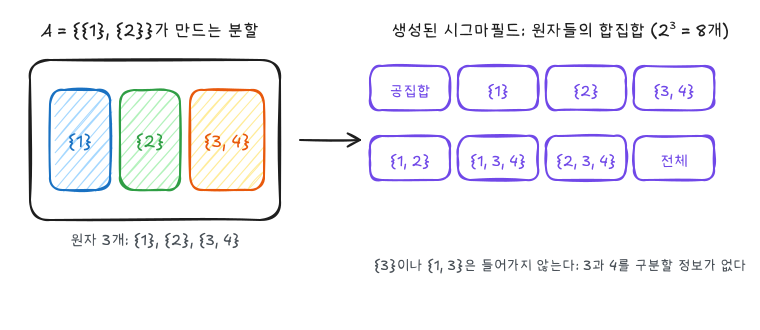
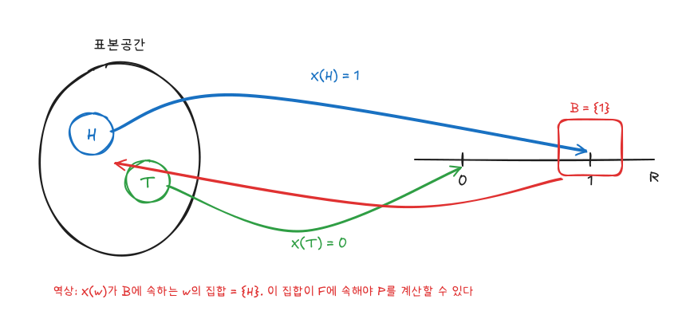

[앞 글](/posts/sp-01-measure-motivation)에서 연속 표본공간의 모든 부분집합에 확률을 주는 일은 포기해야 한다는 결론을 얻었다. 그렇다면 확률을 줄 집합은 어떤 집합들이어야 하는가. 이 글은 그 집합의 모임인 **시그마필드**를 직관적인 조건에서 출발해 공리로 정리하고, 그 위에 **확률측도**와 **확률변수**를 정의한다.

## 1. 잴 수 있는 집합의 모임이 갖춰야 할 조건

표본공간 $\Omega$의 부분집합 중 확률을 줄 집합들의 모임을 ${\cal F}$라 하자(집합들의 집합을 collection이라 한다). ${\cal F}$를 아무렇게나 고르면 확률의 기본 성질과 충돌한다. 동전과 주사위 예제로 어떤 모임이 문제가 되는지 비교한다.

| $\Omega$ | ${\cal F}$ | 합리적인가 | 이유 |
|---|---|---|---|
| $\{H, T\}$ | $\{\emptyset, \{H\}, \{T\}, \Omega\}$ | O | 모든 부분집합 |
| $\{H, T\}$ | $\{\emptyset, \{H\}, \Omega\}$ | X | 앞면의 확률을 알면 뒷면은 $1 - P(\{H\})$로 정해지는데 $\{T\}$가 없다 (여집합) |
| $\{H, T\}$ | $\{\{H\}, \{T\}, \Omega\}$ | X | $\Omega$의 여집합인 $\emptyset$이 없다 |
| $\{1, \dots, 6\}$ | $\{\emptyset, \{6\}, \{1, \dots, 5\}, \Omega\}$ | O | 6이 나오는지에만 관심이 있는 사람의 모임 |
| $\{1, \dots, 6\}$ | $\{\emptyset, \{1, 3, 5\}, \{2, 4, 6\}, \Omega\}$ | O | 홀짝만 구분 |
| $\{1, \dots, 6\}$ | $\{\emptyset, \Omega\}$ | O | 아무것도 구분하지 않음 (자명한 시그마필드) |
| $\{1, 2, 3, 4\}$ | $\{\emptyset, \{1\}, \{2\}, \{2, 3, 4\}, \{1, 3, 4\}, \Omega\}$ | X | $\{1\}$, $\{2\}$를 잴 수 있으면 서로소인 합 $\{1, 2\}$도, 차 $\{2, 3, 4\} - \{2\}$도 잴 수 있어야 한다 |

같은 $\Omega$라도 무엇을 구분하려 하느냐에 따라 ${\cal F}$는 여러 가지가 될 수 있다. ${\cal F}$는 "어떤 사건까지 구별할 수 있는가"라는 **정보의 양**을 나타낸다.

이 예들에서 다음 조건들을 얻는다. 길이 쪽의 직관(두 구간의 길이를 재면 교집합의 길이도 잴 수 있다)과 확률의 가산가법성을 더하면 목록이 길어진다.

| 번호 | 조건 | 출처 |
|---|---|---|
| 1 | $\Omega, \emptyset \in {\cal F}$ | 전체 확률 1, 공집합 확률 0 |
| 2 | $A \in {\cal F} \Rightarrow A^c \in {\cal F}$ | $P(A^c) = 1 - P(A)$ |
| 3 | 서로소인 $A, B \in {\cal F} \Rightarrow A \cup B \in {\cal F}$ | 가법성 |
| 4 | $A \subset B$, $A, B \in {\cal F} \Rightarrow B - A \in {\cal F}$ | $P(B - A) = P(B) - P(A)$ |
| 5 | $A, B \in {\cal F} \Rightarrow A \cap B \in {\cal F}$ | 두 구간의 공통부분의 길이 |
| 6 | $A, B \in {\cal F} \Rightarrow A \cup B \in {\cal F}$ | $P(A \cup B) = P(A) + P(B) - P(A \cap B)$ |
| 7 | 서로소인 $B_1, B_2, \dots \in {\cal F} \Rightarrow \bigcup_i B_i \in {\cal F}$ | 가산가법성 (확률의 공리) |
| 8 | $A_1, A_2, \dots \in {\cal F} \Rightarrow \bigcup_i A_i \in {\cal F}$ | 가산 합집합 |

### 공리로 줄이기

이 조건들은 서로 겹친다. 어떤 조건이 다른 조건들로부터 나오는지 따지면 다음과 같다.

- 1의 $\emptyset$은 $\Omega$와 2(여집합)에서 나온다.
- 8(가산 합집합)은 3, 6, 7을 모두 포함한다.
- 5(교집합)는 2와 8에서 드모르간 법칙 $A \cap B = (A^c \cup B^c)^c$로 나온다.
- 4(차집합)는 $B - A = B \cap A^c$이므로 2와 5에서 나온다.

결국 세 조건만 남는다.

**정의 (시그마필드).** $\Omega$의 부분집합들의 모임 ${\cal F} \subset 2^\Omega$가 다음을 만족하면 시그마필드라 한다.

1. $\Omega \in {\cal F}$
2. $A \in {\cal F} \Rightarrow A^c \in {\cal F}$ (여집합에 닫힘)
3. $A_1, A_2, \dots \in {\cal F} \Rightarrow \bigcup_{i=1}^{\infty} A_i \in {\cal F}$ (가산 합집합에 닫힘)

$\Omega$와 시그마필드의 쌍 $(\Omega, {\cal F})$를 **가측공간**(measurable space)이라 한다. 시그마필드는 $\Omega$ 없이 단독으로 정의되지 않으므로 항상 쌍으로 쓰는 것이 정확하다.

3번에서 "가산"이 핵심이다. 유한 합집합에만 닫혀 있으면 확률의 가산가법성을 쓸 수 없고, 비가산 합집합까지 요구하면 한 점의 합집합으로 모든 부분집합을 만들 수 있어 앞 글의 문제로 되돌아간다. 가산과 비가산의 경계가 바로 [앞 글](/posts/sp-01-measure-motivation)의 카디널리티가 필요했던 이유다.

## 2. 생성된 시그마필드

관심 있는 집합 몇 개만 정해 두면, 그 집합들을 포함하면서 시그마필드의 조건을 만족하는 가장 작은 모임이 정해진다. 집합의 모임 ${\cal A}$에 대해 이를 $\sigma({\cal A})$로 쓰고 ${\cal A}$가 **생성한 시그마필드**라 한다.

$\Omega = \{1, 2, 3, 4\}$에서 $P(\{1\})$과 $P(\{2\})$에만 관심이 있다고 하자. 조건을 하나씩 적용하면 여집합 $\{2, 3, 4\}$, $\{1, 3, 4\}$, 합집합 $\{1, 2\}$, 그 여집합 $\{3, 4\}$가 차례로 들어온다. 유한한 경우에는 더 간단한 방법이 있다. ${\cal A}$의 집합들이 $\Omega$를 가장 잘게 나누는 조각(원자)을 찾고, 원자들의 모든 합집합을 모으면 된다.

원자가 $\{1\}$, $\{2\}$, $\{3, 4\}$ 세 개이므로 $\sigma({\cal A})$는 $2^3 = 8$개의 집합으로 이루어진다. $\{3\}$은 들어가지 않는다. 주어진 정보로는 3과 4를 구별할 수 없기 때문이다. ${\cal A} = \{\{1\}, \{1, 2\}\}$로 바꿔도 원자는 $\{1\}$, $\{2\} = \{1, 2\} - \{1\}$, $\{3, 4\}$로 같으므로 같은 시그마필드가 생성된다.

실수에서 모든 구간 $[a, b)$가 생성하는 시그마필드를 **보렐 시그마필드** ${\cal R}$이라 하고, 그 원소를 보렐 집합이라 한다. 한 점 $\{\pi\}$는 $\bigcap_n [\pi, \pi + \tfrac1n)$으로 구간의 가산 교집합이므로 보렐 집합이고, 유리수 집합은 한 점의 가산 합집합이므로 역시 보렐 집합이다. 실제로 쓰는 거의 모든 집합이 보렐 집합이지만, 비탈리 집합은 아니다.

## 3. 측도와 확률측도

시그마필드가 정해지면 그 위에서 크기를 재는 함수를 정의할 수 있다.

| 개념 | 정의역과 치역 | 조건 |
|---|---|---|
| 측도 $\mu$ | ${\cal F} \to [0, \infty]$ | $\mu(\emptyset) = 0$, 서로소인 $A_i$에 대해 $\mu(\bigcup A_i) = \sum \mu(A_i)$ |
| 확률측도 $P$ | ${\cal F} \to [0, 1]$ | 측도의 조건 + $P(\Omega) = 1$ |

확률은 전체의 크기가 1인 측도일 뿐이다. 길이(르벡측도), 개수(셈측도), 확률이 모두 같은 틀 안에 있다. $(\Omega, {\cal F}, P)$를 **확률공간**이라 한다.

기억할 것은 하나다. **확률은 함수이고, 정의역은 시그마필드다.** 입력은 언제나 집합이다. 그래서 다음 표현들은 엄밀히 구분된다.

| 표현 | 옳은가 | 이유 |
|---|---|---|
| $P(\{H\}) = \tfrac12$ | O | 입력이 집합(사건) |
| $P(H) = \tfrac12$ | X | $H$는 결과(outcome)이지 집합이 아니다 |
| $P(\{H, T\}) = 1$ | O | |
| 독립인 사건 $A$, $B$($P(A) > 0$)에 대해 $P(B \mid A) = P(B)$ | O | 사건 $A$, $B$는 이미 집합이다 |

## 4. 확률변수는 가측함수다

### 정의

표본공간의 원소는 숫자가 아닌 경우가 많다(앞면, 뒷면). 이를 숫자로 바꾸는 함수가 확률변수다. 동전 예제에서 $X(H) = 1$, $X(T) = 0$이다. 그런데 $P(X = 1)$이라고 쓸 때 $P$의 입력은 집합이어야 하므로, 이 표현은 다음의 줄임말이다.

$$
P(X = 1) = P\big(\{\omega \in \Omega : X(\omega) = 1\}\big) = P(\{H\})
$$

괄호 안의 집합은 1의 **역상** $X^{-1}(\{1\})$이다. 이 역상이 ${\cal F}$에 속하지 않으면 확률을 계산할 수 없다.

그래서 확률변수는 그냥 함수가 아니라 다음 조건을 만족하는 함수로 정의한다.

**정의 (확률변수).** 가측공간 $(\Omega, {\cal F})$와 $(\mathbb{R}, {\cal R})$에 대해, 함수 $X: \Omega \to \mathbb{R}$가

$$
X^{-1}(B) = \{\omega : X(\omega) \in B\} \in {\cal F} \quad \text{for all } B \in {\cal R}
$$

를 만족하면 확률변수라 한다. 이런 함수를 **가측함수**라 하고 $X: (\Omega, {\cal F}) \to (\mathbb{R}, {\cal R})$로 쓴다.

조건이 "모든 $B \subset \mathbb{R}$"가 아니라 "모든 보렐 집합 $B$"인 이유가 있다. 바늘 하나짜리 시계에서 $X(\omega) = \omega$라 하면, 비탈리 집합 $V$의 역상은 $V$ 자신이므로 $P(X \in V)$를 정의할 수 없다. 잴 수 없는 집합은 처음부터 질문 대상에서 빼야 하므로, 치역 쪽에도 가측공간 $(\mathbb{R}, {\cal R})$이 필요하다.

### 확률변수에 대한 흔한 오해

| 오해 | 실제 |
|---|---|
| 확률변수는 값이 무작위로 바뀌는 변수다 | 확률변수는 함수다. 입력 $\omega$가 정해지면 출력 $X(\omega)$는 고정된다 |
| 그럼 무작위성은 어디서 오는가 | 어떤 $\omega$가 실현될지가 무작위다. 무작위성은 $X$가 아니라 $P$에 있다 |
| $X = 1$ (확률 1/2), $X = 0$ (확률 1/2)은 변수처럼 보인다 | 정확히는 $X(\omega) = 1$ ($\omega \in \{H\}$), $0$ ($\omega \in \{T\}$)이고 $P(\{H\}) = P(\{T\}) = \tfrac12$라는 뜻이다 |
| 확률변수와 확률은 직접 관련이 있다 | 정의 자체는 확률과 무관하다(가측성만 요구). 역상이 $P$의 정의역에 들어간다는 점으로 간접적으로 연결된다 |

"$X$를 확률변수라 하자"라는 한 문장에는 다음이 모두 압축되어 있다. 잴 수 있는 집합의 모임 ${\cal F}$가 정해져 있고, 그 위에 확률 $P$가 정의되어 있으며, $X$의 역상이 항상 ${\cal F}$ 안에 있어서 $P(X \in B)$를 언제나 계산할 수 있다는 것이다. 다음 글부터 확률변수의 수열인 확률과정을 다룬다.

## 정리

| 개념 | 정의 | 직관 |
|---|---|---|
| 시그마필드 ${\cal F}$ | 전체집합 포함, 여집합과 가산 합집합에 닫힘 | 확률을 줄 수 있는 사건들, 구별할 수 있는 정보 |
| 생성된 시그마필드 $\sigma({\cal A})$ | ${\cal A}$를 포함하는 가장 작은 시그마필드 | 유한이면 원자들의 모든 합집합 |
| 보렐 시그마필드 ${\cal R}$ | 실수의 구간들이 생성 | 한 점, 유리수 집합, 구간 모두 포함 |
| 확률측도 $P$ | ${\cal F} \to [0, 1]$, 가산가법, $P(\Omega) = 1$ | 입력은 항상 집합 |
| 확률변수 $X$ | 모든 보렐 집합의 역상이 ${\cal F}$에 속하는 함수 | $P(X \in B) = P(X^{-1}(B))$가 항상 정의됨 |

## 참고자료

- 최규빈, 「확률과정론」 강의노트 (2023), <https://guebin.github.io/SP2023/>
- Durrett, R., *Probability: Theory and Examples*, 5th ed.
