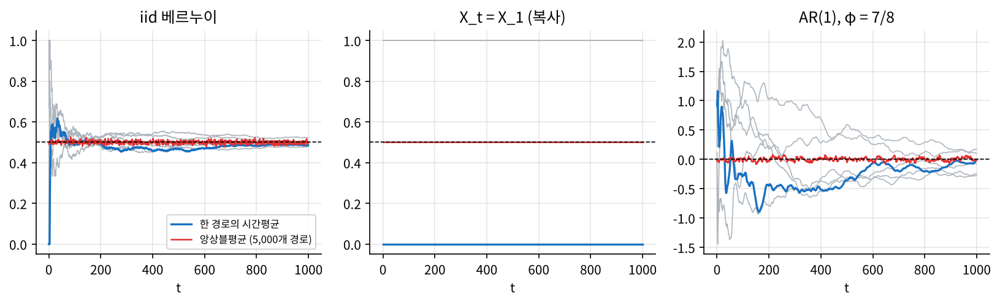
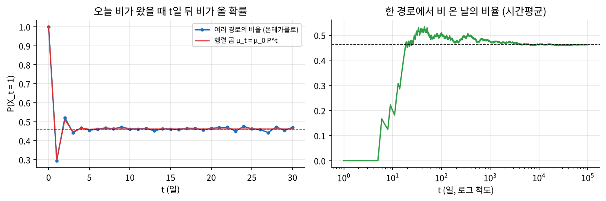

[앞 글](/posts/sp-02-sigma-field-random-variable)에서 확률변수를 가측함수로 정의했다. 이 글은 확률변수를 시간 순서로 늘어놓은 **확률과정**을 다룬다. 핵심 질문은 하나다. 우리가 관측하는 것은 대개 시간에 따라 이어지는 **하나의 경로**인데, 그 하나의 경로로 확률적 성질(기댓값, 확률)을 알아낼 수 있는가. 답은 확률과정의 의존 구조에 따라 달라지며, 이 질문이 마코프체인을 공부하는 동기가 된다.

## 1. 확률벡터와 확률과정

확률변수를 여러 개 묶으면 확률벡터가 된다.

$$
\boldsymbol{X}: (\Omega, {\cal F}) \to (\mathbb{R}^d, {\cal R}^d), \qquad
\boldsymbol{X}(\omega) = \big(X_1(\omega), \dots, X_d(\omega)\big)
$$

동전을 두 번 던지면 $\Omega = \{HH, HT, TH, TT\}$이고 $\boldsymbol X(HH) = (1, 1)$, $\boldsymbol X(HT) = (1, 0)$ 같은 식이다. 확률벡터의 기댓값은 성분별 기댓값의 벡터다.

$$
E(\boldsymbol X) = \big(E(X_1), \dots, E(X_d)\big)
$$

첨자를 시간 $t$로 바꾸어 $X_1, X_2, \dots, X_T$로 쓰면 **확률과정**이다. 여기서 중요한 점은 동전을 1,000번 던져 얻은 0과 1의 수열 전체가 **하나의 $\omega$에 대응하는 하나의 실현값** $\boldsymbol X(\omega)$라는 것이다. 표본이 1,000개인 것이 아니라 길이 1,000인 표본이 하나다.

## 2. 두 가지 평균

확률과정에는 평균을 내는 방향이 두 가지 있다.

| 이름 | 식 | 평균을 내는 방향 | 필요한 자료 |
|---|---|---|---|
| 앙상블평균 | $E(X_t)$ | 한 시점에서 가능한 모든 경로($\omega$)에 걸쳐 | 같은 과정을 여러 번 반복한 경로들 |
| 시간평균 | $\frac1T\sum_{t=1}^{T} X_t$ | 한 경로를 따라 시간에 걸쳐 | 하나의 긴 경로 |

$E(X_{1000})$의 정의는 1,000번째 시점의 값을 모든 가능한 경로에 걸쳐 평균한 것이다. 그러므로 원칙적으로는 같은 실험을 여러 번 반복해 1,000번째 값들을 평균해야 한다. 한 경로의 시간평균으로 이를 대신할 수 있는지는 확률과정의 성질에 달려 있다. 세 가지 확률과정으로 비교한다.

- **iid 베르누이**: $X_t \overset{iid}{\sim} \text{Ber}(0.5)$
- **복사 과정**: $X_1 \sim \text{Ber}(0.5)$, $X_t = X_{t-1}$ ($t \ge 2$). 첫 값을 계속 반복한다.
- **AR(1)**: $X_1 = \epsilon_1$, $X_t = \tfrac78 X_{t-1} + \epsilon_t$, $\epsilon_t \overset{iid}{\sim} N(0, 1)$

```python
import numpy as np
rng = np.random.default_rng(2023)
T, N = 1000, 5000

def gen_iid():   return rng.binomial(1, 0.5, T).astype(float)
def gen_const(): return np.repeat(float(rng.binomial(1, 0.5)), T)
def gen_ar():
    e = rng.standard_normal(T); x = np.zeros(T); x[0] = e[0]
    for t in range(1, T):
        x[t] = 7 / 8 * x[t - 1] + e[t]
    return x

for gen in (gen_iid, gen_const, gen_ar):
    S = np.stack([gen() for _ in range(N)])     # 행: 경로(ω), 열: 시간(t)
    time_avg = S[0].mean()                      # 경로 하나의 시간평균
    ens_avg = S[:, -1].mean()                   # 마지막 시점의 앙상블평균
    spread = np.std([S[i].mean() for i in range(200)])   # 경로마다 시간평균이 얼마나 다른가
    print(round(time_avg, 3), round(ens_avg, 3), round(spread, 3))
```



| 과정 | 참값 $E(X_T)$ | 한 경로의 시간평균 | 앙상블평균 (5,000개 경로) | 경로마다 시간평균의 표준편차 |
|---|---|---|---|---|
| iid 베르누이 | 0.5 | 0.486 | 0.493 | 0.017 |
| 복사 과정 | 0.5 | 0.000 | 0.501 | 0.499 |
| AR(1) | 0 | −0.013 | −0.015 | 0.240 |

세 과정 모두 앙상블평균은 참값에 가깝다. 차이는 시간평균에서 난다.

- **iid**에서는 한 경로의 시간평균도 참값에 수렴한다. 한 경로를 1,000개의 독립 표본으로 쪼개 쓸 수 있기 때문이며, 이것이 대수의 법칙이다.
- **복사 과정**에서는 시간평균이 경로마다 0 아니면 1이다. 첫 동전이 결정되면 그 뒤로 새로운 정보가 들어오지 않으므로 아무리 오래 관측해도 0.5를 알 수 없다. 시간평균의 표준편차가 0.499로 전혀 줄지 않는다.
- **AR(1)**은 이웃한 값끼리 상관이 0.875로 강해 iid가 아닌데도 시간평균이 0으로 수렴한다. 다만 수렴이 느려서 $T = 1000$에서도 경로마다 시간평균의 표준편차가 0.24로 iid의 열 배가 넘는다. 상관이 시간이 지나면서 약해지기 때문에 멀리 떨어진 값들은 거의 독립처럼 행동한다.

현실의 자료는 대부분 "하나의 경로만 관측할 수 있고 iid가 아닌" 경우다. 주가나 날씨는 다시 반복해 관측할 수 없다. AR(1)처럼 **독립은 아니지만 시간평균으로 앙상블평균을 알 수 있는** 확률과정이 어떤 것인지가 이후 글들의 주제다. 시간평균과 앙상블평균이 같아지는 성질을 **에르고딕성**이라 하며, [5편](/posts/sp-05-irreducible-aperiodic-ergodic)에서 마코프체인에 대해 정확히 다룬다.

## 3. 날씨 예측: 같은 문제를 네 가지로 풀기

다음 규칙을 따르는 날씨를 생각한다.

| 어제 \ 오늘 | 맑음 (0) | 비 (1) |
|---|---|---|
| 맑음 (0) | 0.4 | 0.6 |
| 비 (1) | 0.7 | 0.3 |

오늘 비가 왔다면, 아주 먼 미래의 어느 날 비가 올 확률은 얼마인가. 같은 질문을 네 가지 방법으로 푼다.

### 풀이 1. 몬테카를로: 미래를 여러 번 살아 보기

규칙대로 날씨 경로를 여러 개 만들고, 정해진 날짜에 비가 온 경로의 비율을 센다. 앙상블평균을 그대로 계산하는 방법이다.

```python
def path(x0, n):
    x = [x0]
    for t in range(n):
        p_rain = 0.3 if x[-1] == 1 else 0.6
        x.append(int(rng.random() < p_rain))
    return np.array(x)

paths = np.stack([path(1, 30) for _ in range(4000)])
paths[:, -1].mean()            # 30일 뒤 비가 온 경로의 비율
```

### 풀이 2. 행렬 거듭제곱

$X_t$의 분포를 행벡터 $\boldsymbol\mu_t = \big(P(X_t = 0), P(X_t = 1)\big)$로 쓰면, 전체확률의 법칙에 의해

$$
P(X_t = 0) = 0.4\,P(X_{t-1} = 0) + 0.7\,P(X_{t-1} = 1), \qquad
P(X_t = 1) = 0.6\,P(X_{t-1} = 0) + 0.3\,P(X_{t-1} = 1)
$$

이고, 행렬로 쓰면

$$
\boldsymbol\mu_t = \boldsymbol\mu_{t-1}\mathbf P, \qquad
\mathbf P = \begin{pmatrix} 0.4 & 0.6 \\ 0.7 & 0.3 \end{pmatrix}, \qquad
\boldsymbol\mu_t = \boldsymbol\mu_0 \mathbf P^t
$$

이다. 오늘 비가 왔으므로 $\boldsymbol\mu_0 = (0, 1)$이다.

```python
P = np.array([[0.4, 0.6], [0.7, 0.3]])
np.array([0, 1]) @ np.linalg.matrix_power(P, 30)     # [0.538, 0.462]
```

$\mathbf P^t$를 계산해 보면 $t$가 커질수록 두 행이 같은 벡터 $(0.538, 0.462)$로 수렴한다. 출발 상태가 무엇이든 먼 미래의 분포는 같다는 뜻이다.

### 풀이 3. 정상방정식

먼 미래에 비가 올 확률이 $p$로 수렴한다면, 그 전날도 $p$여야 한다. 따라서

$$
p = 0.6(1 - p) + 0.3p \quad\Rightarrow\quad p = \frac{0.6}{1.3} = 0.4615
$$

계산 없이 한 줄로 답이 나온다.

### 풀이 4. 하나의 긴 경로의 시간평균

경로 하나를 아주 길게 만들고 비 온 날의 비율을 센다.

```python
long = path(1, 100_000)
long[1:].mean()
```



| 풀이 | 계산하는 것 | 결과 | 장점 | 한계 |
|---|---|---|---|---|
| 몬테카를로 | 여러 경로의 같은 시점 값 평균 (앙상블평균) | 0.470 | 규칙만 알면 어떤 과정에도 적용 | 경로 4,000개를 만들어도 오차 ±0.008 |
| 행렬 거듭제곱 | $\boldsymbol\mu_0 \mathbf P^t$ | 0.4615 | 정확, 모든 시점의 분포를 줌 | 상태공간이 크면 행렬이 커짐 |
| 정상방정식 | $p = 0.6(1 - p) + 0.3p$ | 0.4615 | 가장 간단 | 수렴한다는 사실을 따로 보여야 함 |
| 시간평균 | 한 경로에서 비 온 날의 비율 | 0.462 | 경로 하나로 충분 | 시간평균과 앙상블평균이 같다는 보장이 필요 |

네 방법이 모두 같은 값 0.4615에 이른다. 그런데 이 일치는 당연하지 않다. 풀이 3은 극한이 존재한다고 미리 가정했고, 풀이 4는 2절의 복사 과정처럼 시간평균이 앙상블평균과 다를 수도 있다. 날씨 모형에서 이 가정들이 성립하는 이유는 오늘의 날씨가 **어제의 날씨에만** 의존하고, 어느 상태에서든 다른 상태로 갈 수 있기 때문이다. 이런 확률과정이 **마코프체인**이고, 행렬 $\mathbf P$가 전이행렬, 0.4615가 정상분포다. [다음 글](/posts/sp-04-markov-chain-stationary)에서 이 개념들을 정의한다.

## 정리

| 개념 | 내용 |
|---|---|
| 확률과정 | 시간 순서로 늘어놓은 확률변수열. 관측한 경로 전체가 하나의 실현값 |
| 앙상블평균 $E(X_t)$ | 한 시점에서 모든 경로에 걸친 평균 |
| 시간평균 $\frac1T\sum X_t$ | 한 경로를 따라 시간에 걸친 평균 |
| iid | 시간평균이 앙상블평균에 수렴 (대수의 법칙) |
| 복사 과정 | 시간평균이 수렴하지 않음 (새 정보가 들어오지 않음) |
| AR(1) | 독립이 아니어도 수렴하지만 느림 |
| 날씨 모형 | 네 가지 풀이가 모두 0.4615. 마코프체인의 정상분포 |

## 참고자료

- 최규빈, 「확률과정론」 강의노트 (2023), <https://guebin.github.io/SP2023/>
