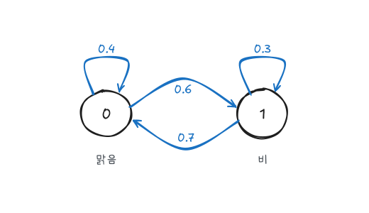
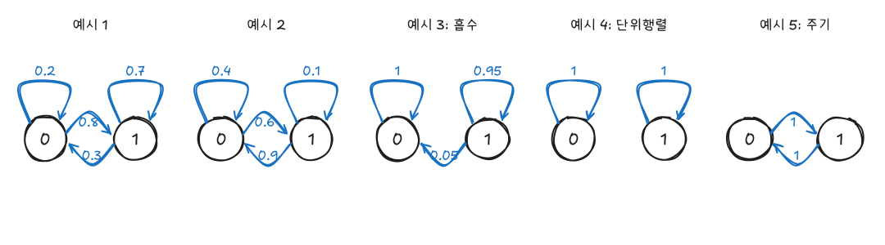
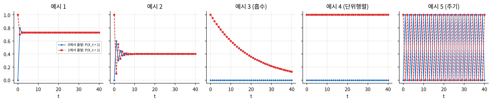

[앞 글](/posts/sp-03-stochastic-process)의 날씨 문제에서 네 가지 풀이가 모두 0.4615로 모였다. 이 글은 그 결과가 우연이 아니라 **마코프체인의 정상분포**라는 구조에서 나온다는 것을 정리한다. 그리고 전이행렬을 조금만 바꾸어도 "수렴한다", "출발점을 잊는다", "정상분포가 하나뿐이다"라는 성질이 하나씩 깨진다는 것을 다섯 개의 예시로 비교한다.

## 1. 마코프 성질과 전이행렬

이산 상태공간 $E$에서 값을 갖는 확률과정 $\{X_t\}$가 다음을 만족하면 **마코프체인**이다.

$$
P(X_{t+1} = j \mid X_t = i, X_{t-1} = i_{t-1}, \dots, X_0 = i_0) = P(X_{t+1} = j \mid X_t = i)
$$

내일의 분포는 오늘의 상태만으로 결정되고, 어떤 경로로 오늘에 도착했는지는 상관없다는 뜻이다. 여기에 전이확률이 시점 $t$에 의존하지 않는다는 조건을 더하면 **시간동질 마코프체인**(homogeneous Markov chain, HMC)이다.

$$
p_{ij} = P(X_{t+1} = j \mid X_t = i) \quad (\text{모든 } t\text{에서 동일})
$$

$p_{ij}$를 $(i,j)$ 원소로 갖는 행렬 $\mathbf P$가 **전이행렬**이다. 각 행은 "상태 $i$에서 다음에 어디로 가는가"의 분포이므로 원소가 모두 0 이상이고 **행의 합이 1**이다.

앞 글의 날씨 모형을 그림으로 그리면 다음과 같다. 원은 상태, 화살표는 한 단계 전이, 숫자는 전이확률이다.



$$
\mathbf P = \begin{pmatrix} 0.4 & 0.6 \\ 0.7 & 0.3 \end{pmatrix}
$$

### 분포의 시간 발전

시점 $t$의 분포를 행벡터 $\boldsymbol\mu_t^\top = \big(P(X_t = 0), P(X_t = 1)\big)$로 쓰면, 전확률 공식이 곧 행렬곱이다.

$$
\boldsymbol\mu_{t+1}^\top = \boldsymbol\mu_t^\top \mathbf P, \qquad \boldsymbol\mu_t^\top = \boldsymbol\mu_0^\top \mathbf P^t
$$

$\mathbf P^t$의 $(i,j)$ 원소는 "$i$에서 출발해 $t$단계 뒤 $j$에 있을 확률"이다. 따라서 $\mathbf P^t$의 **$i$번째 행 = $i$에서 출발했을 때의 $t$시점 분포**다.

> 여기서 "분포"는 측도론의 언어로는 $\mu = P \circ X^{-1}$, 즉 $\mathbb R$의 보렐집합 $B$에 $P(X \in B)$를 대응시키는 확률측도다. 분포함수 $F(x) = \mu\big((-\infty, x]\big)$는 이 측도를 반직선에서만 읽은 것이다. 상태공간이 유한하면 분포는 확률벡터 하나로 충분하다.

## 2. 정상분포

분포가 한 단계 이동해도 변하지 않으면 **정상분포**(stationary distribution)라고 한다.

$$
\boldsymbol\pi^\top \mathbf P = \boldsymbol\pi^\top, \qquad \pi_i \ge 0, \quad \sum_i \pi_i = 1
$$

$X_0 \sim \boldsymbol\pi$로 출발시키면 모든 $t$에서 $X_t \sim \boldsymbol\pi$이고, 결합분포까지 시간 이동에 불변이 되어 확률과정 전체가 **정상과정**이 된다.

### 구하는 세 가지 방법

| 방법 | 계산 | 장점 | 한계 |
|---|---|---|---|
| 연립방정식 | $\boldsymbol\pi^\top \mathbf P = \boldsymbol\pi^\top$과 $\sum\pi_i = 1$을 풂 | 정확한 분수 해 | 상태가 많으면 손으로 불가능 |
| 고유벡터 | $\mathbf P^\top$의 고유값 1에 대응하는 고유벡터를 합이 1이 되도록 정규화 | 상태 수와 무관, 수치적으로 안정 | 고유값 1의 고유공간이 2차원 이상이면 해가 하나로 정해지지 않음 |
| 거듭제곱 | $\mathbf P^t$를 크게 해서 행을 읽음 | 직관적 | 수렴하지 않는 체인(주기)에서는 실패 |

2×2라면 연립방정식을 공식으로 정리해 둘 수 있다. $\mathbf P = \begin{pmatrix} 1-a & a \\ b & 1-b \end{pmatrix}$이면 $\pi_0 a = \pi_1 b$(0→1 흐름 $\pi_0 a$ = 1→0 흐름 $\pi_1 b$)이므로

$$
\boldsymbol\pi = \left(\frac{b}{a+b}, \ \frac{a}{a+b}\right), \qquad a + b > 0
$$

날씨 모형은 $a = 0.6$, $b = 0.7$이므로 $\boldsymbol\pi = (7/13, 6/13) = (0.538, 0.462)$이다. 앞 글의 0.4615가 바로 $\pi_1$이다.

```python
import numpy as np

P = np.array([[0.4, 0.6], [0.7, 0.3]])

# 고유벡터 방법: P^T v = v
val, vec = np.linalg.eig(P.T)
v = vec[:, np.isclose(val, 1)].real.ravel()
v / v.sum()                              # [0.538, 0.462]

# 거듭제곱 방법
np.linalg.matrix_power(P, 50)            # 두 행 모두 [0.538, 0.462]
```

$\mathbf P^\top$를 쓰는 이유는 정상분포가 **왼쪽** 고유벡터($\boldsymbol\pi^\top\mathbf P = \boldsymbol\pi^\top$)이기 때문이다. 양변을 전치하면 $\mathbf P^\top \boldsymbol\pi = \boldsymbol\pi$가 되어 보통의 고유벡터 문제가 된다.

## 3. 다섯 개의 2×2 체인 비교

날씨 모형은 모든 것이 잘 되는 경우다. 전이행렬을 바꾸어 어떤 성질이 언제 깨지는지 보자.



| | $\mathbf P$ | $a$, $b$ | 공식의 $\boldsymbol\pi$ | $\mathbf P^\top$의 고유값 |
|---|---|---|---|---|
| 예시 1 | $\begin{pmatrix}0.2&0.8\\0.3&0.7\end{pmatrix}$ | 0.8, 0.3 | $(3/11,\ 8/11)$ | $1,\ -0.1$ |
| 예시 2 | $\begin{pmatrix}0.4&0.6\\0.9&0.1\end{pmatrix}$ | 0.6, 0.9 | $(0.6,\ 0.4)$ | $1,\ -0.5$ |
| 예시 3 (흡수) | $\begin{pmatrix}1&0\\0.05&0.95\end{pmatrix}$ | 0, 0.05 | $(1,\ 0)$ | $1,\ 0.95$ |
| 예시 4 (단위행렬) | $\begin{pmatrix}1&0\\0&1\end{pmatrix}$ | 0, 0 | 공식 불가 | $1,\ 1$ |
| 예시 5 (주기) | $\begin{pmatrix}0&1\\1&0\end{pmatrix}$ | 1, 1 | $(1/2,\ 1/2)$ | $1,\ -1$ |

각 체인에서 0에서 출발한 경우와 1에서 출발한 경우의 $P(X_t = 1)$, 즉 $\mathbf P^t$의 두 번째 열을 그리면 다음과 같다.



```python
for P in mats:
    Pt = [np.linalg.matrix_power(P, t) for t in range(41)]
    from0 = [M[0, 1] for M in Pt]    # 0에서 출발
    from1 = [M[1, 1] for M in Pt]    # 1에서 출발
```

그림에서 읽히는 것을 정리한다.

- **예시 1, 2**: 두 선이 금방 하나로 모인다. 출발점을 잊고 정상분포로 수렴한다. 예시 2는 두 번째 고유값이 $-0.5$라서 진동하며 수렴하고, 예시 1은 $-0.1$이라 거의 즉시 수렴한다. 수렴 속도는 **절댓값이 두 번째로 큰 고유값의 절댓값** $|\lambda_2|$가 정한다.
- **예시 3 (흡수)**: 상태 0에 한번 들어가면 나오지 못한다. 1에서 출발해도 결국 0으로 빨려 들어가므로 수렴은 하지만, 두 번째 고유값이 0.95라 매우 느리다($0.95^{40} \approx 0.13$). 정상분포는 $(1, 0)$ 하나뿐이다.
- **예시 4 (단위행렬)**: 움직이지 않으므로 $\mathbf P^t = \mathbf I$. 수렴은 하지만(값이 변하지 않으니) 두 행이 다르다. 즉 극한이 **출발점에 의존**한다. 그리고 모든 확률벡터가 $\boldsymbol\pi^\top \mathbf I = \boldsymbol\pi^\top$을 만족하므로 정상분포가 무수히 많다. 고유값 1이 중복되어 고유벡터 방법도 하나를 고르지 못한다.
- **예시 5 (주기)**: 0과 1을 번갈아 오가므로 $\mathbf P^t$가 $\mathbf I$와 $\mathbf P$ 사이를 영원히 왕복한다. 수렴하지 않는다. 그런데 정상분포 $(1/2, 1/2)$은 존재하고 유일하다. 처음부터 반반이면 한 단계 뒤에도 반반이기 때문이다. 고유값 $-1$이 진동의 원인이다.

### 비교표

| | 특징 1: $\mathbf P^t$ 수렴 | 특징 2: 극한의 행이 동일 | 특징 3: 정상분포 | 특징 4: $X_0\sim\boldsymbol\pi$이면 정상과정 |
|---|---|---|---|---|
| 예시 1 | O | O | 존재, 유일 | O |
| 예시 2 | O | O | 존재, 유일 | O |
| 예시 3 (흡수) | O (느림) | O | 존재, 유일 | O |
| 예시 4 (단위행렬) | O | X | 존재, 유일하지 않음 | O |
| 예시 5 (주기) | X | 해당 없음 | 존재, 유일 | O |

이 표에서 눈여겨볼 점이 세 가지 있다.

1. **특징 3과 특징 1은 별개다.** 예시 5는 정상분포가 유일한데도 $\mathbf P^t$가 수렴하지 않는다. "정상분포가 있다"는 것은 "그 분포로 수렴한다"는 것을 보장하지 않는다.
2. **특징 4는 항상 O다.** 정상분포가 하나라도 있으면 그것으로 출발시켜 정상과정을 만들 수 있다. 문제는 정상분포가 존재하느냐가 아니라 유일하냐, 그리고 그리로 수렴하느냐다.
3. **깨지는 이유가 다르다.** 예시 4는 상태끼리 **서로 오갈 수 없어서**(기약이 아님) 유일성이 깨지고, 예시 5는 **정해진 박자로만 돌아와서**(주기성) 수렴이 깨진다. 다음 글의 기약성과 비주기성이 정확히 이 두 문제를 걸러내는 조건이다.

## 4. 존재 정리

> **정리.** 상태공간이 유한한 HMC는 정상분포를 적어도 하나 갖는다.

직관적인 이유는 이렇다. $\mathbf P$의 행 합이 1이므로 $\mathbf P\mathbf 1 = \mathbf 1$, 즉 1은 $\mathbf P$의 고유값이다. $\mathbf P$와 $\mathbf P^\top$는 고유값이 같으므로 $\mathbf P^\top \boldsymbol v = \boldsymbol v$인 $\boldsymbol v \ne \boldsymbol 0$이 있다. 남은 일은 원소가 모두 0 이상인 $\boldsymbol v$를 고를 수 있음을 보이는 것인데, 이는 페론-프로베니우스 정리 또는 체사로 평균 $\frac1T\sum_{t=1}^T \boldsymbol\mu_0^\top \mathbf P^t$의 수렴 부분열 논증으로 보인다. 체사로 평균을 쓰면 예시 5처럼 진동하는 경우에도 평균은 $(1/2, 1/2)$로 수렴하므로, 존재는 주기성과 무관하게 성립한다.

상태공간이 무한하면 이 정리가 성립하지 않는다. 정수 위에서 한 칸씩 오른쪽으로만 가는 체인은 확률질량이 무한히 멀리 흘러가 버려 정상분포가 없다. 이 문제는 [6편](/posts/sp-06-limit-distributions)과 재귀성을 다루는 [7편](/posts/sp-07-recurrence)에서 다시 등장한다.

## 정리

| 개념 | 요약 |
|---|---|
| 마코프 성질 | 내일의 분포는 오늘의 상태만으로 결정 |
| 전이행렬 | $p_{ij}$를 모은 행렬, 행 합 1. $\mathbf P^t$의 $i$행은 $i$에서 출발한 $t$시점 분포 |
| 정상분포 | $\boldsymbol\pi^\top \mathbf P = \boldsymbol\pi^\top$. $\mathbf P^\top$의 고유값 1 고유벡터 |
| 2×2 공식 | $\boldsymbol\pi = \big(b/(a+b),\ a/(a+b)\big)$ |
| 수렴 속도 | 절댓값이 두 번째로 큰 고유값의 절댓값 $|\lambda_2|$ |
| 흡수 상태 | 수렴은 하지만 느릴 수 있음 |
| 분리된 닫힌 클래스가 둘 이상 | 정상분포가 유일하지 않음, 극한이 출발점에 의존 (예시 4) |
| 주기 | 정상분포는 유일해도 $\mathbf P^t$가 수렴하지 않음 |
| 존재 정리 | 유한 상태 HMC는 정상분포를 항상 하나 이상 가짐 |

## 참고자료

- 최규빈, 「확률과정론」 강의노트 (2023), <https://guebin.github.io/SP2023/>
- Durrett, R. (2019). *Probability: Theory and Examples* (5th ed.), Chapter 5. Cambridge University Press.
