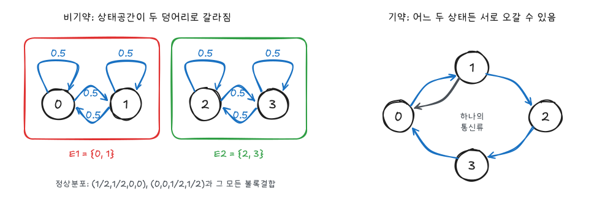
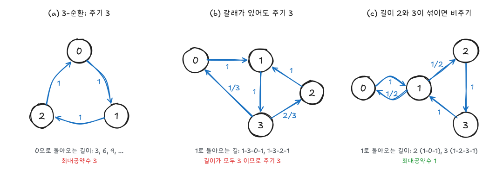
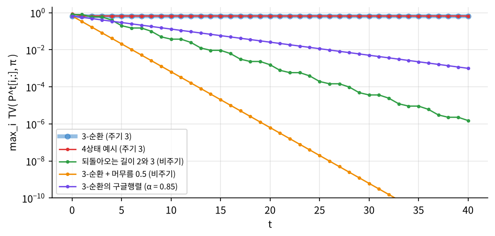
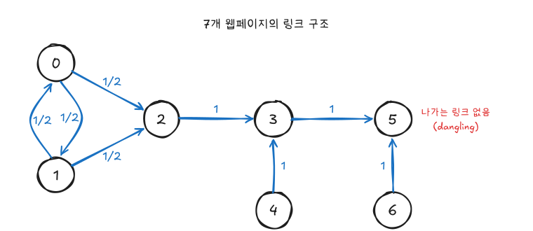
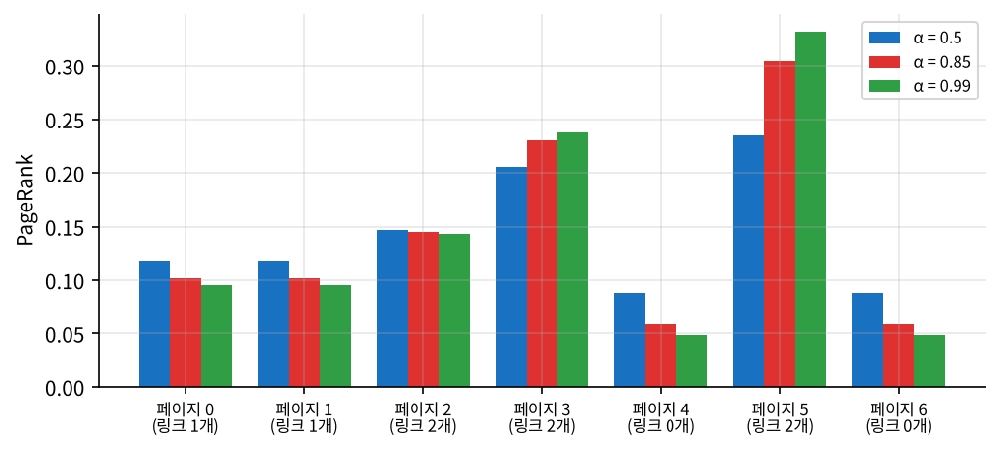

[앞 글](/posts/sp-04-markov-chain-stationary)의 다섯 예시에서 두 가지 실패를 보았다. 단위행렬 체인은 상태끼리 오갈 수 없어서 정상분포가 여러 개였고, 0과 1을 번갈아 오가는 체인은 정상분포가 하나인데도 $\mathbf P^t$가 수렴하지 않았다. 이 글은 첫 번째 실패를 막는 조건(**기약성**)과 두 번째 실패를 막는 조건(**비주기성**)을 정의하고, 둘을 합치면 어떤 초기분포에서 출발하든 하나의 정상분포로 수렴한다는 **에르고딕 정리**를 정리한다. 마지막으로 이 정리를 그대로 공학에 옮긴 예로 구글의 페이지랭크를 다룬다.

## 1. 기약성: 정상분포의 유일성

### 도달가능과 상호도달

상태 $i$에서 출발해 **언젠가** $j$에 있을 확률이 양수이면 $j$는 $i$에서 **도달가능**(accessible)하다고 하고 $i \to j$로 쓴다.

$$
i \to j \quad\Longleftrightarrow\quad \exists\, t \in \{0, 1, 2, \dots\}: \ p_{ij}^{(t)} > 0
$$

여기서 $p_{ij}^{(t)}$는 $\mathbf P^t$의 $(i,j)$ 원소이고, $\mathbf P^0 = \mathbf I$로 두어 $i \to i$는 항상 성립하게 한다. "언젠가"를 행렬 거듭제곱의 원소로 바꾸어 쓴 것이 이 정의의 요점이다. 특정 시점에 반드시 $j$에 있어야 한다는 뜻이 아니라, 어떤 시점에서 $j$에 있을 **가능성**이 0이 아니라는 뜻이다.

$i \to j$이고 $j \to i$이면 **상호도달**(communicate)한다고 하고 $i \leftrightarrow j$로 쓴다.

### 동치관계와 통신류

$\leftrightarrow$는 다음 세 성질을 만족한다.

| 성질 | 내용 | 이유 |
|---|---|---|
| 반사 | $i \leftrightarrow i$ | $\mathbf P^0 = \mathbf I$ |
| 대칭 | $i \leftrightarrow j \Rightarrow j \leftrightarrow i$ | 정의가 대칭 |
| 추이 | $i \leftrightarrow j,\ j \leftrightarrow k \Rightarrow i \leftrightarrow k$ | $p_{ik}^{(s+t)} \ge p_{ij}^{(s)}\,p_{jk}^{(t)} > 0$ |

이 세 성질은 등호 $=$가 원래 갖는 성질이다. 그래서 세 성질을 만족하는 관계를 **동치관계**라고 부르고, "어떤 의미에서 같다"로 읽는다. 동치관계가 있으면 집합을 "같은 것끼리" 겹치지 않게 나눌 수 있다. 정수를 "3으로 나눈 나머지가 같다"로 나누면 세 덩어리가 되는 것과 같은 원리다.

따라서 상태공간은 $\leftrightarrow$를 기준으로 서로소인 덩어리들로 나뉜다.

$$
E = E_1 \uplus E_2 \uplus \cdots
$$

각 $E_k$를 **통신류**(communication class)라고 한다. 통신류가 **하나뿐**이면, 즉 어느 두 상태든 서로 오갈 수 있으면 체인을 **기약**(irreducible)이라고 한다.



왼쪽 체인의 전이행렬은 블록대각이다.

$$
\mathbf P = \begin{pmatrix} 0.5 & 0.5 & 0 & 0 \\ 0.5 & 0.5 & 0 & 0 \\ 0 & 0 & 0.5 & 0.5 \\ 0 & 0 & 0.5 & 0.5 \end{pmatrix}
$$

두 블록이 각자 정상분포 $(1/2, 1/2)$를 가지므로 $(1/2, 1/2, 0, 0)$, $(0, 0, 1/2, 1/2)$가 모두 정상분포이고, 그 볼록결합 $(1/4, 1/4, 1/4, 1/4)$, $(1/6, 1/6, 1/3, 1/3)$ 등도 전부 정상분포다. 덩어리 사이에 질량이 오가지 않으니 각 덩어리에 질량을 얼마나 배분할지를 체인이 정해주지 못하는 것이다. 앞 글의 단위행렬 체인은 덩어리가 $\{0\}$, $\{1\}$ 두 개인 극단적인 경우다.

> **정리.** 유한 상태 HMC가 기약이면 정상분포가 **유일**하게 존재하고, 모든 상태에서 $\pi_i > 0$이다.

### 비기약이지만 정상분포가 유일한 경우

기약성은 유일성의 충분조건이지 필요조건이 아니다. 앞 글의 흡수 체인 $\begin{pmatrix}1&0\\0.05&0.95\end{pmatrix}$은 통신류가 $\{0\}$, $\{1\}$ 두 개라 비기약인데 정상분포는 $(1, 0)$ 하나뿐이었다. 차이는 **닫힌**(closed) 통신류의 개수다. $\{1\}$은 빠져나갈 수 있는 열린 덩어리라 장기적으로 질량이 남지 않고, 질량이 머무를 수 있는 닫힌 덩어리는 $\{0\}$ 하나뿐이다. 블록대각 예시는 닫힌 덩어리가 두 개라서 유일성이 깨졌다.

| 체인 | 통신류 | 닫힌 통신류 | 정상분포 |
|---|---|---|---|
| 날씨 모형 | $\{0,1\}$ | 1개 | 유일, 모두 양수 |
| 흡수 체인 | $\{0\}$, $\{1\}$ | 1개 ($\{0\}$) | 유일, 열린 덩어리에는 0 |
| 블록대각 | $\{0,1\}$, $\{2,3\}$ | 2개 | 무수히 많음 |
| 단위행렬 | $\{0\}$, $\{1\}$ | 2개 | 무수히 많음 |

## 2. 비주기성: 수렴

### 주기의 정의

상태 $i$에서 출발해 $i$로 돌아올 수 있는 단계 수들의 최대공약수를 **주기**라고 한다.

$$
d(i) = \gcd\{\, t \ge 1 : p_{ii}^{(t)} > 0 \,\}
$$

$d(i) = 1$이면 상태 $i$는 **비주기**(aperiodic)다. 주기가 $d > 1$이면 체인은 $d$단계의 박자에 맞추어서만 $i$로 돌아올 수 있고, 그 박자가 끝까지 지워지지 않아 $\mathbf P^t$가 진동한다.



| 체인 | 1로(또는 0으로) 돌아오는 길이 | 주기 | 정상분포 | $\mathbf P^t$ 수렴 |
|---|---|---|---|---|
| (a) 3-순환 | 3, 6, 9, ... | 3 | $(1/3, 1/3, 1/3)$ | X |
| (b) 갈래 있는 4상태 | 1-3-0-1, 1-3-2-1 모두 3 | 3 | $(1, 3, 2, 3)/9$ | X |
| (c) 길이 2와 3이 섞임 | 2, 3, 4, 5, ... | 1 | $(0.2, 0.4, 0.2, 0.2)$ | O |

(b)는 갈림길이 있어 무작위성이 있는데도 주기가 3이다. 두 갈래의 **길이가 같기** 때문이다. 반면 (c)는 길이 2짜리 순환과 길이 3짜리 순환이 함께 있어서, $\gcd(2, 3) = 1$이 되고 박자가 깨진다. 무작위성이 있느냐가 아니라 **되돌아오는 길이들이 공통 박자를 갖느냐**가 기준이다.

두 가지 실용적인 사실이 있다.

- **기약 체인에서는 모든 상태의 주기가 같다.** 그래서 상태 하나만 확인하면 체인 전체의 주기를 안다.
- **자기 자신으로 가는 화살표가 하나라도 있으면 비주기다.** $p_{ii} > 0$이면 길이 1의 순환이 있어 최대공약수가 1이 되기 때문이다.

### 주기를 깨는 두 가지 처방

두 번째 사실을 이용하면 주기 체인을 비주기로 바꿀 수 있다.

| 처방 | 변형 | 효과 |
|---|---|---|
| 게으른 체인 | $\tilde{\mathbf P} = \tfrac12 \mathbf P + \tfrac12 \mathbf I$ | 모든 상태에 자기 루프 추가. 정상분포 불변 |
| 무작위 점프 | $\tilde{\mathbf P} = \alpha \mathbf P + (1-\alpha)\tfrac1N \mathbf J$ | 모든 상태 사이에 작은 확률의 화살표 추가. 기약성까지 보장 |

$\mathbf J$는 모든 원소가 1인 행렬이다. 게으른 체인은 $\boldsymbol\pi^\top(\tfrac12\mathbf P + \tfrac12\mathbf I) = \tfrac12\boldsymbol\pi^\top + \tfrac12\boldsymbol\pi^\top$이므로 정상분포를 바꾸지 않는다. 무작위 점프는 정상분포를 조금 바꾸지만, 모든 원소가 양수가 되므로 기약성과 비주기성이 동시에 보장된다. 이것이 뒤에서 볼 페이지랭크의 핵심 장치다.

## 3. 에르고딕 정리

> **정리.** 유한 상태 HMC가 기약이고 비주기이면, $\mathbf P^t$는 모든 행이 $\boldsymbol\pi^\top$인 행렬로 수렴한다. 따라서 임의의 초기분포 $\boldsymbol\mu$에 대하여
> $$\lim_{t \to \infty} \boldsymbol\mu^\top \mathbf P^t = \boldsymbol\pi^\top.$$

이 성질을 갖는 체인을 **에르고딕**(ergodic)하다고 한다. 앞 글의 비교표 언어로 쓰면 기약성은 "특징 3: 정상분포의 유일성", 비주기성은 "특징 1: 수렴"을 담당하고, 둘이 합쳐져 "특징 2: 극한의 행이 동일", 즉 **출발점을 잊는다**가 된다.

| 조건 | 빠지면 생기는 일 | 앞 글의 예시 |
|---|---|---|
| 유한 상태 | 질량이 무한히 멀리 흘러가 정상분포가 없을 수 있음 | (재귀성 글에서 다룸) |
| 기약 | 정상분포가 여럿, 극한이 출발점에 의존 | 단위행렬 |
| 비주기 | 정상분포는 유일하지만 $\mathbf P^t$가 진동 | 0과 1을 번갈아 오가는 체인 |

### 수렴 속도 비교

수렴 여부만이 아니라 **얼마나 빨리** 수렴하는지 비교하기 위해, 출발점별 분포와 정상분포 사이의 총변동거리(total variation distance)를 출발점에 대해 최대로 잡아 그린다.

$$
d(t) = \max_i \ \frac12 \sum_j \big| p_{ij}^{(t)} - \pi_j \big|
$$



```python
def tv(P, T=40):
    w, v = np.linalg.eig(P.T)
    pi = v[:, np.argmin(abs(w - 1))].real; pi /= pi.sum()
    return [max(0.5 * abs(np.linalg.matrix_power(P, t)[i] - pi).sum()
                for i in range(len(P))) for t in range(T + 1)]

C3 = np.array([[0, 1, 0], [0, 0, 1], [1, 0, 0]], float)
lazy   = 0.5 * C3 + 0.5 * np.eye(3)           # 게으른 체인
google = 0.85 * C3 + 0.15 / 3                 # 무작위 점프
```

| 체인 | 주기 | 두 번째로 큰 $\lvert\lambda\rvert$ | $d(40)$ |
|---|---|---|---|
| 3-순환 | 3 | 1 | 0.67 (줄지 않음) |
| 갈래 있는 4상태 | 3 | 1 | 0.67 (줄지 않음) |
| 길이 2와 3이 섞인 체인 | 1 | 0.707 | 약 $10^{-6}$ |
| 3-순환 + 머무름 0.5 | 1 | 0.5 | 약 $10^{-12}$ |
| 3-순환의 구글행렬 ($\alpha = 0.85$) | 1 | 0.85 | 약 $10^{-3}$ |

주기 체인은 $|\lambda| = 1$인 고유값이 1 말고도 더 있어서(3-순환은 1의 세제곱근 세 개) 거리가 전혀 줄지 않는다. 비주기로 바꾸면 그 고유값들이 단위원 안쪽으로 들어오고, 두 번째로 큰 $|\lambda|$가 직선의 기울기(로그 축)를 정한다. 같은 3-순환이라도 머무름 확률을 넣은 게으른 체인($|\lambda_2| = 0.5$)이 무작위 점프 버전($|\lambda_2| = 0.85$)보다 훨씬 빨리 수렴한다. 처방의 강도가 곧 수렴 속도다.

## 4. 응용: 구글 페이지랭크

### 문제

검색 결과를 정렬하려면 웹페이지의 "중요도"를 숫자로 매겨야 한다. 초기 구글의 아이디어는 **링크를 많이 받는 페이지가 중요하다**는 것이었다. 그런데 단순히 들어오는 링크 수를 세면 다음 그래프에서 페이지 2, 3, 5가 모두 2개로 동점이다.



직관적으로는 동점이 아니다. 페이지 3과 5는 확률 1짜리 링크를 받지만 페이지 2는 확률 1/2짜리를 받는다. 또 페이지 3을 방문한 사람은 모두 페이지 5로 가므로 5가 3보다 중요해 보인다. 이 "중요도가 중요도를 낳는" 재귀 구조를 풀어주는 것이 정상분포다.

### 무작위 서퍼

링크를 무작위로 클릭하며 웹을 떠도는 가상의 사용자를 생각한다. 이 사용자의 이동은 링크 구조를 전이행렬로 갖는 마코프체인이고, **오랜 시간 뒤 각 페이지에 있을 확률**, 즉 정상분포를 페이지랭크로 쓴다. 이렇게 하면 앞의 직관이 그대로 반영된다. 중요한 페이지에서 오는 링크는 그 페이지의 확률 질량을 실어 오기 때문이다.

그런데 그대로는 에르고딕 정리를 쓸 수 없다.

| 문제 | 원인 | 처방 |
|---|---|---|
| 전이행렬이 안 됨 | 페이지 5는 나가는 링크가 없어 행 합이 0 | 그 행을 $1/N$로 채움 (아무 페이지로 이동) |
| 기약이 아님 | 페이지 4, 6으로는 아무도 들어오지 않음 | 무작위 점프 |
| 수렴 보장 없음 | 주기가 있을 수 있음 | 무작위 점프 |

무작위 점프를 넣은 행렬을 **구글행렬**이라고 한다.

$$
\mathbf G = \alpha\,\mathbf P + (1-\alpha)\,\frac1N\mathbf J, \qquad 0 < \alpha < 1
$$

"확률 $\alpha$로 링크를 따라가고, $1-\alpha$로 주소창에 아무 페이지나 입력한다"는 해석이다. $\mathbf G$는 모든 원소가 양수이므로 기약이고 비주기다. 에르고딕 정리에 의해 페이지랭크가 유일하게 정해지고, 거듭제곱으로 반드시 구해진다.

```python
P = np.zeros((7, 7))
for i, j, p in [(0,1,.5), (0,2,.5), (1,0,.5), (1,2,.5),
                (2,3,1), (3,5,1), (4,3,1), (6,5,1)]:
    P[i, j] = p
P[5] = 1 / 7                                   # dangling 처리

G = 0.85 * P + 0.15 / 7
np.linalg.matrix_power(G, 100)[0].round(3)
# [0.102, 0.102, 0.145, 0.231, 0.058, 0.304, 0.058]
```

### 감쇠계수 $\alpha$ 비교



| | $\alpha = 0.5$ | $\alpha = 0.85$ | $\alpha = 0.99$ |
|---|---|---|---|
| 페이지 5 | 0.235 | 0.304 | 0.331 |
| 페이지 3 | 0.206 | 0.231 | 0.238 |
| 페이지 2 | 0.147 | 0.145 | 0.143 |
| 페이지 4, 6 | 0.088 | 0.058 | 0.048 |
| $\lvert\lambda_2(\mathbf G)\rvert$ | 0.25 | 0.43 | 0.50 |

- **순위는 세 경우 모두 5 > 3 > 2 > 0 = 1 > 4 = 6으로 같다.** 들어오는 링크 수가 같은 2, 3, 5가 정상분포로는 확실히 구분된다.
- $\alpha$가 클수록 링크 구조를 더 믿으므로 격차가 벌어진다. 링크를 받지 못하는 4, 6은 무작위 점프와 막다른 페이지(5번)의 균등 재분배로만 유입되므로 $\pi_4 = \pi_6 = (1-\alpha)/N + \alpha\pi_5/N$이 되어, $\alpha$가 커질수록 값이 줄어들지만 0으로 수렴하지는 않는다.
- $\alpha$가 1에 가까울수록 원래 링크 구조에 충실하지만 무작위 점프가 약해져 수렴이 느려진다. $|\lambda_2(\mathbf G)| \le \alpha$라는 사실이 알려져 있어 $\alpha$가 곧 수렴 속도의 상한이다. 구글이 처음 쓴 0.85는 이 둘 사이의 타협이다.

### 약점: 링크 농장

정상분포는 링크 구조만으로 정해지므로, 구조를 조작하면 순위도 조작된다. 다섯 페이지 그래프(앞 그림에서 페이지 0~4만 남긴 것)에서 페이지 1의 순위를 올려보자.

| 단계 | 조작 | 페이지 1의 페이지랭크 |
|---|---|---|
| 원래 | 없음 | 0.159 |
| 1단계 | 페이지 1에서 나가는 링크를 모두 끊음 (질량을 남에게 넘기지 않음) | 0.180 |
| 2단계 | 더미 페이지 3개를 만들어 페이지 1과 서로 링크 | **0.398** |

2단계에서 더미 페이지들은 받은 질량을 전부 페이지 1로 되돌려주므로, 페이지 1 주변에 질량이 갇혀 순환한다. 정상분포의 계산 원리가 그대로 공격 경로가 되는 셈이다. 실제 검색엔진은 이후 링크의 신뢰도나 콘텐츠 신호 등 다른 정보를 결합해 이런 조작에 대응해 왔다.

## 정리

| 개념 | 정의 | 역할 |
|---|---|---|
| 도달가능 $i \to j$ | 어떤 $t$에서 $p_{ij}^{(t)} > 0$ | |
| 상호도달 $i \leftrightarrow j$ | $i \to j$이고 $j \to i$ | 동치관계 |
| 통신류 | $\leftrightarrow$로 나눈 덩어리 | |
| 기약 | 통신류가 하나 | 정상분포 유일, 모두 양수 |
| 주기 | 되돌아오는 길이들의 최대공약수 | |
| 비주기 | 주기가 1. 자기 루프가 있으면 충분 | $\mathbf P^t$ 수렴 |
| 에르고딕 | 유한, 기약, 비주기 | 어디서 출발해도 $\boldsymbol\pi$로 수렴 |
| 수렴 속도 | 두 번째로 큰 $\lvert\lambda\rvert$ | 게으른 체인, 무작위 점프로 조절 |
| 페이지랭크 | 구글행렬의 정상분포 | 무작위 점프로 에르고딕성을 강제 |

## 참고자료

- 최규빈, 「확률과정론」 강의노트 (2023), <https://guebin.github.io/SP2023/>
- Brin, S. and Page, L. (1998). The anatomy of a large-scale hypertextual Web search engine. *Computer Networks and ISDN Systems*, 30(1–7), 107–117.
- Levin, D. A. and Peres, Y. (2017). *Markov Chains and Mixing Times* (2nd ed.). American Mathematical Society.
