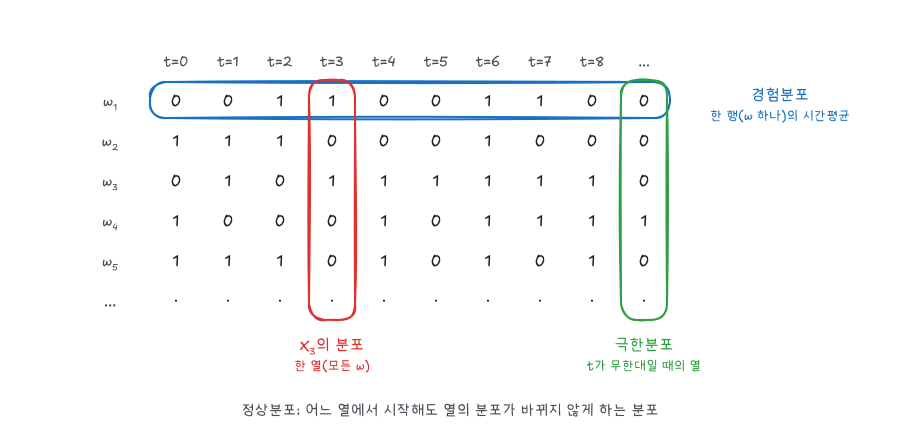
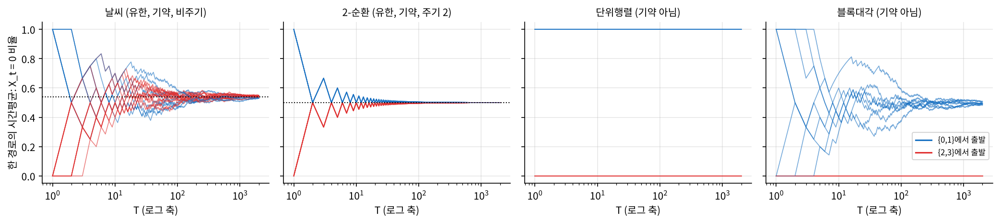
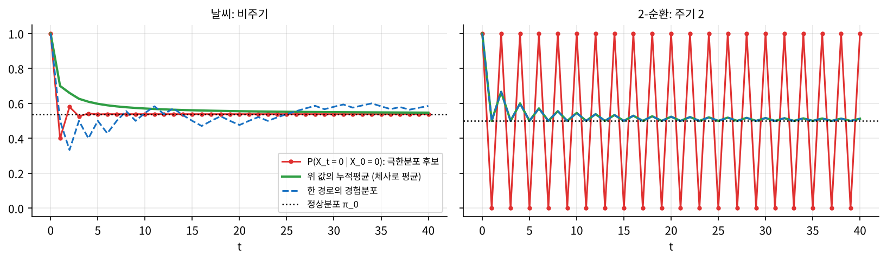
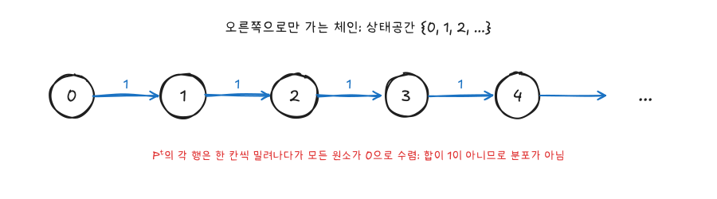

지금까지 "분포"라는 말이 세 가지 의미로 섞여 쓰였다. 한 경로에서 각 상태를 방문한 비율, $\boldsymbol\pi^\top\mathbf P = \boldsymbol\pi^\top$을 만족하는 벡터, 그리고 $\mathbf P^t$의 극한이다. 날씨 모형에서는 세 값이 모두 0.4615로 같았기 때문에 구분할 필요가 없었지만, 체인을 조금만 바꾸면 셋이 서로 달라진다. 이 글은 세 개념을 나란히 놓고 각각을 보장하는 정리와 그 조건을 비교한다.

## 1. 세 가지 분포

[3편](/posts/sp-03-stochastic-process)에서 쓴 그림을 다시 떠올리자. 행은 표본점 $\omega$(하나의 경로), 열은 시점 $t$다.



| | 경험분포 $\bar{\boldsymbol\pi}$ | 정상분포 $\boldsymbol\pi$ | 극한분포 $\mathbf p_\star$ |
|---|---|---|---|
| 정의 | $\bar\pi_j = \frac1T\sum_{t=0}^{T-1} I(X_t = j)$ | $\boldsymbol\pi^\top\mathbf P = \boldsymbol\pi^\top$을 만족하는 확률벡터 | $\lim_t \mathbf P^t$의 모든 행이 같을 때 그 행 |
| 읽는 방향 | 한 행 (시간평균) | 열의 분포가 변하지 않게 하는 분포 | $t \to \infty$의 열 |
| $\omega$와의 관계 | $\omega$ 하나로 계산. $\omega$마다 값이 다름 | 모든 $\omega$를 고려한 이론값 | $\omega$와 무관하게 행렬만으로 계산 |
| 데이터로 계산 | 가능 | 불가능 | 불가능 |
| 극한 개념 | $T \to \infty$ | 없음 | $t \to \infty$ |
| 적용 범위 | 모든 확률과정 | 마코프체인 | 마코프체인 |
| 직관 | 데이터로 계산한 평균 | 이론적인 기대값 | 이론적인 수렴값 |

통계학 관점에서 가장 중요한 것은 **경험분포만 데이터로 계산할 수 있다**는 점이다. 나머지 둘은 전이행렬을 알아야 한다. 따라서 "경험분포가 정상분포로 수렴하는가"는 곧 "경로 하나로 체인의 장기 행동을 추정할 수 있는가"라는 질문이다.

## 2. 시간평균의 에르고딕 정리: 큰 수의 법칙의 확장

iid 확률변수열에는 큰 수의 법칙이 있다.

$$
X_0, X_1, \dots \overset{iid}{\sim} \pi,\ E|X_0| < \infty \quad\Longrightarrow\quad \frac1T\sum_{t=0}^{T-1} X_t \to E_\pi[X_0]
$$

마코프체인은 독립도 아니고 동일분포도 아니다. 그런데도 같은 결론이 성립한다.

> **정리 (에르고딕 정리).** $\{X_t\}$가 유한 상태 기약 HMC이고 $\boldsymbol\pi$가 그 유일한 정상분포라면, 임의의 함수 $f: E \to \mathbb R$와 임의의 초기분포에 대하여 확률 1로
> $$\frac1T\sum_{t=0}^{T-1} f(X_t) \ \longrightarrow\ E_{\boldsymbol\pi}[f(X_0)].$$

$f(i) = I(i = j)$로 두면 좌변은 상태 $j$의 방문 비율 $\bar\pi_j$, 우변은 $\pi_j$가 된다. 즉 **경험분포가 정상분포로 수렴한다.**

| | 큰 수의 법칙 | 에르고딕 정리 |
|---|---|---|
| 대상 | iid 확률변수열 | 유한 상태 기약 마코프체인 |
| 독립성 | 필요 | 불필요 |
| 동일분포 | 필요 | 불필요 ($X_t$의 분포가 매 시점 달라도 됨) |
| 비주기성 | 해당 없음 | **불필요** |
| 결론 | 시간평균 → 기대값 | 시간평균 → 정상분포에서의 기대값 |

조건 칸에 비주기성이 없다는 점이 중요하다. 앞 글의 수렴 정리는 특정 시점의 분포가 수렴하는 것($\mathbf P^t \to \boldsymbol\pi^\top$)을 보장하므로 비주기성이 필요하지만, 에르고딕 정리는 한 경로의 **시간평균**이 수렴하는 것을 보장하므로 비주기성이 필요 없다. MCMC에서 체인을 길게 돌려 표본평균으로 기댓값을 추정할 때 정당성을 주는 핵심 근거가 바로 이 에르고딕 정리다.

### 모의실험: 네 체인에서 20개 경로의 시간평균

네 체인에서 경로를 20개씩, 길이 2,000으로 생성하고 각 경로에서 상태 0의 방문 비율이 $T$에 따라 어떻게 변하는지 그렸다. 파란 선은 앞쪽 상태에서, 빨간 선은 뒤쪽 상태에서 출발한 경로다.



```python
def sim(P, x0, T):
    cum = P.cumsum(axis=1); x = np.empty(T, int); x[0] = x0
    for t in range(1, T):
        x[t] = np.searchsorted(cum[x[t-1]], rng.random())
    return x

x = sim(P, x0, 2000)
run = np.cumsum(x == 0) / np.arange(1, 2001)    # 시간평균의 궤적
```

| 체인 | 유한 | 기약 | 비주기 | 20개 경로의 최종 시간평균 | 에르고딕 정리 |
|---|---|---|---|---|---|
| 날씨 | O | O | O | 0.528 ~ 0.550 ($\pi_0 = 0.538$) | 성립 |
| 2-순환 | O | O | X | 모두 0.500 ($\pi_0 = 0.5$) | **성립** |
| 단위행렬 | O | X | O | 0 또는 1 | 불성립 |
| 블록대각 | O | X | O | 약 0.5 또는 0 | 불성립 |

- **2-순환은 주기가 있는데도 시간평균이 정확히 1/2로 간다.** 0, 1, 0, 1, ...을 반복하므로 방문 비율은 당연히 반반이다. $\mathbf P^t$는 진동하지만 시간평균은 그 진동을 평균해 없앤다.
- **기약이 아닌 체인은 경로마다 다른 값으로 간다.** 블록대각 체인에서 $\{0,1\}$에서 출발한 경로는 상태 0의 비율이 1/2로, $\{2,3\}$에서 출발한 경로는 0으로 간다. 수렴은 하지만 그 극한이 $\omega$(정확히는 출발한 덩어리)에 의존하는 **확률변수**다. 경로 하나로는 체인 전체의 정상분포를 알 수 없다.

## 3. 극한분포

> **정의.** 유한 상태 HMC에서 $\lim_{t\to\infty}\mathbf P^t = \mathbf P^\star$가 존재하고 $\mathbf P^\star$의 모든 행이 같으면, 그 행 $\mathbf p_\star^\top$를 **극한분포**라고 한다.

극한분포는 정의상 많아야 하나다. 그리고 존재한다면 정상분포다. $\mathbf P^{t+1} = \mathbf P^t\mathbf P$의 양변에 극한을 취하면 $\mathbf P^\star = \mathbf P^\star\mathbf P$이고, 한 행만 읽으면 $\mathbf p_\star^\top\mathbf P = \mathbf p_\star^\top$이기 때문이다. 그래서 $\mathbf P^t$가 같은 행을 갖는 행렬로 수렴하는 것을 확인했다면 아무 행이나 정상분포로 써도 된다. 앞 글에서 거듭제곱으로 정상분포를 구한 방법의 근거가 이것이다.

> **정리.** 유한 상태 HMC가 기약이고 비주기이면 극한분포가 존재하고, 정상분포와 같다.

에르고딕 정리와 비교하면 **비주기성이 추가로 필요하다.** 왜 그런지 세 값을 같은 그림에 그려 보면 분명해진다.



- **날씨 모형:** 빨간 선($P(X_t = 0 \mid X_0 = 0)$, 극한분포의 후보)이 몇 단계 만에 $\pi_0$에 붙는다. 파란 점선(한 경로의 경험분포)은 흔들리면서 천천히 다가간다. 극한분포는 이론값이라 빠르고 깨끗하게, 경험분포는 데이터라 느리고 잡음이 있게 수렴한다.
- **2-순환:** 빨간 선이 1과 0을 영원히 오가므로 극한분포는 **존재하지 않는다.** 하지만 빨간 선의 누적평균(초록, 체사로 평균)과 경험분포(파란 점선, 여기서는 경로가 결정적이라 초록과 겹친다)는 1/2로 간다. 시간평균 쪽 정리는 비주기성 없이도 성립하고, 극한 쪽 정리는 그렇지 않다는 차이가 그대로 보인다.

극한분포가 존재한다는 것은 **초기분포를 잊는다**는 뜻이다. $\boldsymbol\mu_0^\top\mathbf P^t \to \boldsymbol\mu_0^\top\mathbf P^\star = \mathbf p_\star^\top$이 어떤 $\boldsymbol\mu_0$에 대해서도 성립하기 때문이다. 경험분포로 정상분포를 추정하는 것만이 목적이라면 기약성으로 충분하다. 반면 충분히 오래 돌린 뒤의 $X_t$ **하나**를 정상분포에서 뽑은 표본으로 쓰려면 비주기성까지 필요하다. MCMC가 앞부분을 버리는(burn-in) 이유가 이것이다.

## 4. 유한 HMC의 경우 분류

| 경우 | 대표 예시 | 기약 | 비주기 | $\mathbf P^t$ 수렴 | 극한분포 | 정상분포 존재 | 정상분포 유일 | 시간평균 정리 | 극한분포 정리 |
|---|---|---|---|---|---|---|---|---|---|
| 1 | 2-순환 두 개의 블록대각 | X | X | X | X | O | X | X | X |
| 2 | 단위행렬, 블록대각 | X | O | O | X | O | X | X | X |
| 3 | 2-순환, 3-순환 | O | X | X | X | O | O | **O** | X |
| 4 | 날씨 모형 | O | O | O | O | O | O | O | O |

경우 2는 $\mathbf P^t$가 수렴하지만 행이 달라서 극한분포가 아니다. 경우 3은 극한분포는 없어도 시간평균은 잘 동작한다. 강의에서 강조된 이야기의 흐름은 다음과 같다.

1. 유한 HMC는 정상분포가 항상 존재한다. 다만 유일하지 않을 수 있다.
2. 기약이 아닌 체인은 기약인 덩어리들의 조합으로 보면 되므로, 기약이라고 가정해도 잃는 것이 별로 없다.
3. 유한 + 기약이면 정상분포가 유일하고, 에르고딕 정리로 **경로 하나의 시간평균으로 추정할 수 있다.**
4. 여기에 비주기가 더해지면 초기분포에 대한 기억까지 사라진다.

## 5. 무한 상태공간에서 깨지는 것: 오른쪽으로만 가는 체인

지금까지의 정리에는 모두 "유한"이 붙어 있었다. 이 조건을 빼면 어떻게 되는지 극단적인 예로 확인한다.



$$
\mathbf P = \begin{pmatrix} 0 & 1 & 0 & 0 & \cdots \\ 0 & 0 & 1 & 0 & \cdots \\ 0 & 0 & 0 & 1 & \cdots \\ \vdots & & & & \ddots \end{pmatrix}, \qquad p_{i,i+1} = 1
$$

- **정상분포가 없다.** $\boldsymbol\pi^\top\mathbf P = \boldsymbol\pi^\top$을 풀면 $\pi_0 = 0$, $\pi_{n+1} = \pi_n$이므로 모든 원소가 0이다. 합이 1이 될 수 없다. 유한이었다면 존재 정리가 이를 막아 주었다.
- **$\mathbf P^t$는 모든 행이 같은 행렬로 수렴하지만 그 행은 분포가 아니다.** $\mathbf P^t$의 $i$행은 $i + t$번째 원소만 1이므로 각 원소는 결국 0이 되어, 극한은 영행렬이다. 행은 모두 같지만(0벡터) 합이 0이라 확률분포의 정의를 만족하지 못한다. "극한이 존재하면 정상분포다"라는 3절의 논증이 무한 상태공간에서는 깨진다.
- **기약도 아니다.** $i \to j$는 $j \ge i$일 때만 가능하므로 모든 상태가 각자의 통신류를 이룬다.

질량이 무한히 멀리 흘러가 버리는 이 현상은 "체인이 같은 곳으로 다시 돌아오는가"라는 질문으로 이어진다. 다음 글의 **재귀성**이 그 질문을 다룬다.

## 정리

| 질문 | 답 | 필요한 조건 |
|---|---|---|
| 정상분포가 존재하는가 | 존재 | 유한 |
| 하나뿐인가 | 유일 | 유한 + 기약 |
| 경로 하나의 시간평균으로 추정할 수 있는가 | 에르고딕 정리 | 유한 + 기약 |
| 초기분포를 잊는가 ($\mathbf P^t$의 모든 행이 같아지는가) | 극한분포 = 정상분포 | 유한 + 기약 + 비주기 |
| 상태공간이 무한하면 | 위 결론들이 모두 깨질 수 있음 | 재귀성이 추가로 필요 |

## 참고자료

- 최규빈, 「확률과정론」 강의노트 (2023), <https://guebin.github.io/SP2023/>
- Levin, D. A. and Peres, Y. (2017). *Markov Chains and Mixing Times* (2nd ed.), Chapter 4. American Mathematical Society.
