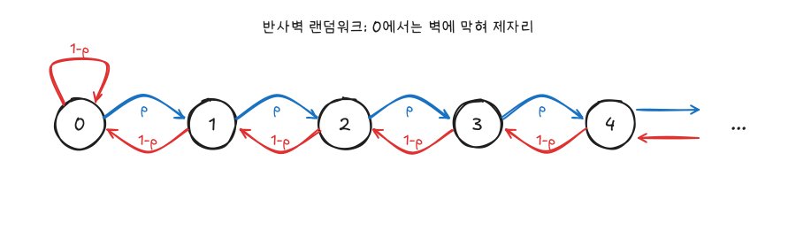
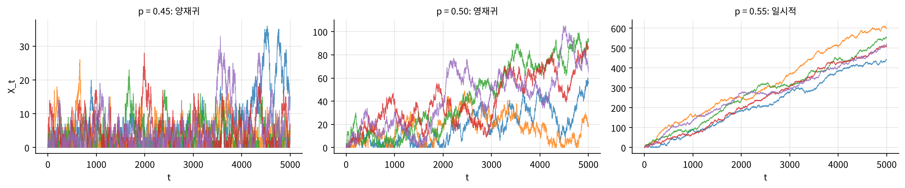
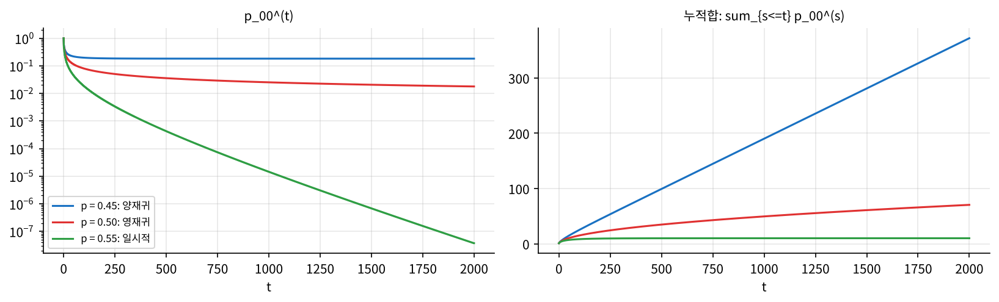
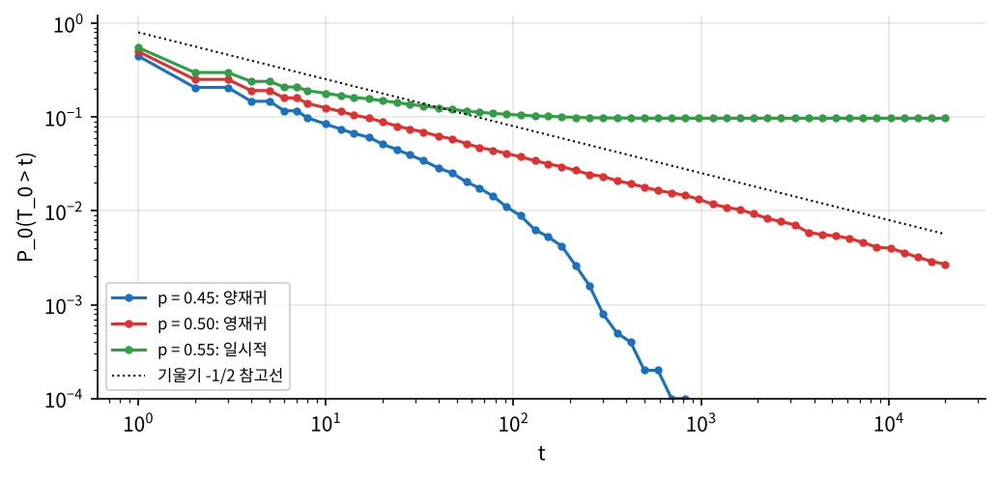
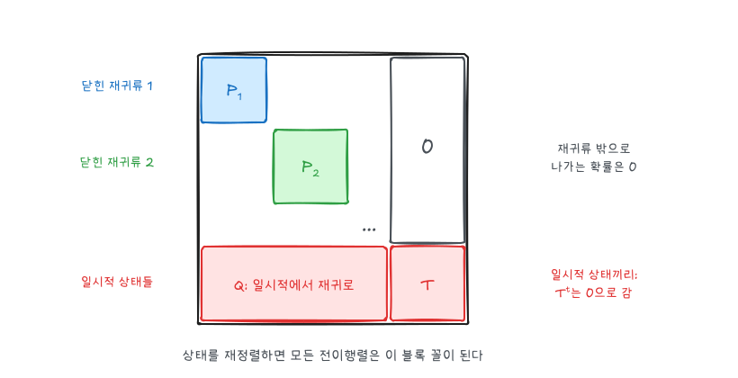

[앞 글](/posts/sp-06-limit-distributions)의 정리들에는 모두 "유한"이라는 조건이 붙어 있었다. 오른쪽으로만 가는 체인은 상태공간이 무한하자 정상분포가 사라졌다. 이 체인은 기약도 아니었으니 기약성이 없어서 실패했다고 볼 수도 있다. 하지만 오른쪽으로 갈 확률을 0.99, 왼쪽을 0.01로 바꾸면 기약이 되는데도 체인은 여전히 오른쪽으로 흘러가 버린다. 문제는 기약성이 아니다. 이 글은 무한 상태공간에서 진짜로 필요한 조건이 **같은 상태로 반복해서 돌아오는가**, 즉 재귀성이라는 것을 정리한다.

## 1. 나그네와 정착민

강의에서는 박목월의 시 「나그네」를 빌려 이 개념을 설명했다. 나그네는 마을을 지나가기는 하지만 정착하지 않는다. 어떤 마을에 한두 번 들를 수는 있어도 결국 떠나서 다시 오지 않는다. 상태공간을 마을의 집합, $X_t = i$를 "$t$시점에 마을 $i$에 있음"으로 읽으면, 나그네 같은 체인은 어떤 상태에도 장기적으로 질량을 남기지 않는다.

시간평균이 정상분포로 수렴한다는 에르고딕 정리를 떠올려 보자. 상태 $j$의 방문 비율 $\bar\pi_j$가 양수로 수렴하려면 체인이 $j$를 **무한히 자주** 방문해야 한다. 유한 상태공간에서는 기약이기만 하면 이것이 자동으로 보장되었다. 무한 상태공간에서는 그렇지 않다. 기약성은 생각보다 대단한 조건이 아니었고(기약이 아니면 덩어리로 나누어 보면 된다), 그 뒤에 숨어 있던 **반복 방문**이라는 조건이 핵심이었다.

## 2. 복귀시간과 세 가지 상태

상태 $y$로의 **복귀시간**(return time)을 시점 0을 제외하고 처음으로 $y$에 있는 시점으로 정의한다.

$$
T_y = \min\{t \ge 1 : X_t = y\}, \qquad \min\emptyset = \infty
$$

$y$에 한 번도 오지 않으면 $T_y = \infty$다. 이후 $P_i(\cdot)$, $E_i(\cdot)$는 $X_0 = i$에서 출발했을 때의 확률과 기댓값을 뜻한다.

| 상태 $i$의 종류 | 정의 | 나그네 비유 |
|---|---|---|
| 일시적(transient) | $P_i(T_i < \infty) < 1$ | 떠나서 영영 돌아오지 않을 가능성이 있음 |
| 영재귀(null recurrent) | $P_i(T_i < \infty) = 1$, $E_i[T_i] = \infty$ | 반드시 돌아오지만 평균적으로 무한히 오래 걸림 |
| 양재귀(positive recurrent) | $P_i(T_i < \infty) = 1$, $E_i[T_i] < \infty$ | 반드시, 그리고 유한한 평균 시간 안에 돌아옴 |

### 같은 기준을 행렬로 쓰기

$N_i = \sum_{t \ge 0} I(X_t = i)$를 상태 $i$의 총 방문 횟수라고 하자. 기댓값을 취하면

$$
E_i[N_i] = \sum_{t=0}^{\infty} p_{ii}^{(t)}.
$$

한편 마코프 성질 때문에 $i$에 돌아올 때마다 "다시 돌아올지"가 처음과 똑같은 확률 $f_i = P_i(T_i < \infty)$로 새로 결정된다. 따라서 방문 횟수는 성공확률 $1 - f_i$인 기하분포를 따르고

$$
E_i[N_i] = \frac{1}{1 - f_i}.
$$

두 식을 합치면 재귀의 판정 기준을 얻는다.

$$
i \text{가 재귀} \iff f_i = 1 \iff \sum_{t=0}^{\infty} p_{ii}^{(t)} = \infty
$$

복귀시간이라는 확률적 개념이 전이행렬 거듭제곱의 급수라는 계산 가능한 양으로 바뀐다. 다만 주의할 점이 있다. $p_{ii}^{(t)} \to 0$이라고 해서 급수가 수렴하는 것은 아니다. $\sum 1/2^n$은 수렴하지만 $\sum 1/n$은 발산하듯이, 0으로 가는 **속도**가 판정을 가른다.

### 양재귀와 정상분포: 카츠 공식

양재귀 상태에서는 다음 관계가 성립한다.

$$
\pi_i = \frac{1}{E_i[T_i]}
$$

평균 5단계마다 돌아온다면 장기적으로 시간의 1/5을 그 상태에서 보낸다는 뜻으로, 직관적으로 당연한 식이다. 이 식을 거꾸로 읽으면 영재귀 상태는 $E_i[T_i] = \infty$이므로 $\pi_i = 0$이다. 반드시 돌아오기는 하지만 너무 드물게 돌아와서 방문 비율이 0으로 간다.

## 3. 반사벽 랜덤워크로 세 경우 비교

상태공간 $\{0, 1, 2, \dots\}$ 위에서 확률 $p$로 오른쪽, $1-p$로 왼쪽으로 가되, 0에서 왼쪽으로 가려고 하면 벽에 막혀 제자리에 머무는 체인을 생각한다.



모든 상태가 서로 오갈 수 있으므로 $0 < p < 1$이면 기약이다. 기약 체인에서는 모든 상태가 같은 종류(일시적, 영재귀, 양재귀 중 하나)이므로 상태 0만 조사하면 된다. $p = 0.45, 0.5, 0.55$를 비교한다.

### 비교 1: 경로



- $p = 0.45$: 0 근처에 머물며 수시로 바닥을 친다. 가끔 30 정도까지 올라가도 금방 돌아온다.
- $p = 0.5$: 바닥으로 돌아오기는 하지만 그 사이에 점점 더 멀리, 더 오래 나갔다 온다.
- $p = 0.55$: 오른쪽으로 꾸준히 흘러간다. 기울기는 대략 $2p - 1 = 0.1$이다.

### 비교 2: $p_{00}^{(t)}$와 그 누적합

전이행렬을 상태 3,000개에서 잘라 $\mathbf P^t$의 $(0,0)$ 원소를 $t = 2{,}000$까지 계산했다. 상태 3,000에 닿으려면 3,000단계가 필요하므로 이 범위에서는 잘라낸 영향이 없다.



```python
def p00(p, T, N=3000):
    v = np.zeros(N); v[0] = 1; out = [1.0]
    for _ in range(T):                    # v^T <- v^T P (행렬을 만들지 않고 이동만 계산)
        w = np.zeros(N)
        w[0] = (1 - p) * (v[0] + v[1])
        w[1:-1] += p * v[:-2] + (1 - p) * v[2:]
        v = w; out.append(v[0])
    return np.array(out)
```

| | $p_{00}^{(100)}$ | $p_{00}^{(1000)}$ | $p_{00}^{(2000)}$ | $\sum_{t \le 2000} p_{00}^{(t)}$ | 판정 |
|---|---|---|---|---|---|
| $p = 0.45$ | 0.197 | 0.1818 | 0.1818 | 372 (직선으로 증가) | 양재귀 |
| $p = 0.50$ | 0.080 | 0.025 | 0.018 | 70 (느리게 증가) | 영재귀 |
| $p = 0.55$ | 0.018 | $< 10^{-6}$ | $< 10^{-7}$ | **10.0** (수평) | 일시적 |

- $p = 0.45$는 $p_{00}^{(t)}$가 양수 0.1818로 수렴하므로 누적합이 직선으로 발산한다. 이 값이 바로 정상분포 $\pi_0$다.
- $p = 0.5$는 $p_{00}^{(t)}$가 0으로 가지만 $1/\sqrt t$ 정도로 느리게 가서 누적합이 $\sqrt t$처럼 계속 커진다. **0으로 가는데도 급수는 발산하는** 경우다.
- $p = 0.55$는 지수적으로 빠르게 0으로 가서 누적합이 10에 멈춘다. 2절의 공식으로 검산할 수 있다. 0에서 출발하면 확률 $1-p$로 바로 제자리에 머물고, 확률 $p$로 1로 간 뒤 0으로 돌아올 확률은 $(1-p)/p$다. 따라서
$$f_0 = (1-p) + p \cdot \frac{1-p}{p} = 2(1-p) = 0.9, \qquad E_0[N_0] = \frac{1}{1 - 0.9} = 10.$$
수치 계산의 10.0과 정확히 맞는다.

### 비교 3: 복귀시간의 꼬리분포

0에서 출발해 처음 0으로 돌아오는 시간 $T_0$를 경우마다 10,000번 모의실험해 $P_0(T_0 > t)$를 로그-로그 축에 그렸다(최대 20,000단계까지 관찰).



| | $P_0(T_0 > 100)$ | $P_0(T_0 > 10^4)$ | 꼬리 모양 | $E_0[T_0]$ |
|---|---|---|---|---|
| $p = 0.45$ | 0.010 | 0 | 지수적으로 급감 | 유한: 이론값 5.5, 모의실험 5.37 |
| $p = 0.50$ | 0.039 | 0.004 | $t^{-1/2}$의 직선 | **무한** |
| $p = 0.55$ | 0.106 | 0.097 | 0.1에서 수평 | 정의되지 않음 (10%는 돌아오지 않음) |

세 경우가 꼬리 모양으로 확실히 구분된다.

- **일시적**($p = 0.55$): 꼬리가 0으로 가지 않고 $1 - f_0 = 0.1$에 멈춘다. 영영 돌아오지 않는 경로가 10% 있다는 뜻이다.
- **영재귀**($p = 0.5$): 꼬리는 결국 0으로 가므로 반드시 돌아온다. 하지만 $P(T_0 > t) \approx c\,t^{-1/2}$로 느리게 줄어서 $E[T_0] = \sum_t P(T_0 > t)$가 발산한다. 그래서 모의실험의 복귀시간 평균은 관찰 시간을 늘릴수록 끝없이 커진다(관찰 한계 10만 단계에서 3,000번 실험하면 평균 160, 최댓값 77,948).
- **양재귀**($p = 0.45$): 꼬리가 지수적으로 사라지고 평균이 유한하다. 카츠 공식으로 $\pi_0 = 1/5.5 = 0.1818$이 되어 비교 2의 극한값과 일치한다.

## 4. 불변측도와 정상분포

정상분포의 정의에서 "합이 1"이라는 조건을 빼면 **불변측도**(invariant measure)가 된다.

$$
\tilde{\boldsymbol\pi}^\top\mathbf P = \tilde{\boldsymbol\pi}^\top, \qquad \tilde\pi_i \ge 0, \quad \tilde{\boldsymbol\pi} \ne \mathbf 0
$$

불변측도의 합이 유한하면 그 합으로 나누어 정상분포를 만들 수 있다. 합이 무한하면 정상분포가 없다. 반사벽 랜덤워크에서 이웃한 두 상태 사이의 흐름이 같다는 식 $\tilde\pi_i\,p = \tilde\pi_{i+1}(1-p)$를 풀면

$$
\tilde\pi_i = \rho^i, \qquad \rho = \frac{p}{1-p}
$$

이다.

| | $\rho$ | 불변측도 $\rho^i$ | 합 | 정상분포 |
|---|---|---|---|---|
| $p = 0.45$ | 0.818 | 기하적으로 감소 | 유한 | $\pi_i = (1-\rho)\rho^i$, $\pi_0 = 0.1818$ |
| $p = 0.50$ | 1 | $(1, 1, 1, \dots)$ | 무한 | 없음 |
| $p = 0.55$ | 1.222 | 기하적으로 증가 | 무한 | 없음 |

오른쪽으로만 가는 체인도 $(1, 1, 1, \dots)$이 불변측도였다. 불변측도는 존재하지만 확률분포로 만들 수 없는 것이 무한 상태공간에서 정상분포가 사라지는 방식이다.

> **정리.** 기약 HMC에서 다음은 동치다.
> 1. 양재귀다.
> 2. 정상분포가 존재한다.
> 3. 정상분포가 유일하게 존재한다.
>
> 이때 $\pi_i = 1/E_i[T_i] > 0$이다.

## 5. 유한 조건을 양재귀로 바꾸기

이제 6편의 정리들을 무한 상태공간으로 옮길 수 있다. 유한하고 기약인 체인은 자동으로 양재귀이므로, 지금까지 쓰던 "유한"이라는 조건은 사실 "양재귀"를 보장하는 수단이었다.

> **정리 (에르고딕 정리, 일반형).** 기약이고 양재귀인 HMC와 $\sum_i |f(i)|\pi_i < \infty$인 $f$에 대하여 확률 1로
> $$\frac1T\sum_{t=0}^{T-1} f(X_t) \to E_{\boldsymbol\pi}[f(X_0)].$$

유한일 때와 비교하면 "유한"이 "양재귀"로 바뀌었고, 상태가 무한하므로 $f$의 기댓값이 유한해야 한다는 조건이 새로 붙었다.

### 주기는 재귀 상태에서만 정의한다

흡수 체인 $\begin{pmatrix}1&0\\0.05&0.95\end{pmatrix}$에서 상태 1의 주기는 무엇인가? 상태 1은 일시적이라 결국 떠나고 돌아오지 않으므로 이 질문은 의미가 없다. 주기는 **재귀 상태**에서만 정의하고, 기약이고 재귀인 체인에서는 모든 상태의 주기가 같다.

### 전이행렬의 분해

일반적인 체인은 상태를 다시 정렬하면 다음 블록 구조로 쓸 수 있다.



닫힌 재귀류는 각각 하나의 기약 재귀 체인이고, 밖으로 나가는 확률이 0이다. 일시적 상태들은 재귀류로 흘러 들어가기만 하고 돌아오지 않으며, 일시적 상태끼리의 블록 $\mathbf T$는 거듭제곱하면 0으로 간다. 그래서 장기적인 행동은 각 재귀류 안에서 결정되고, "기약이라고 가정해도 잃는 것이 없다"는 말이 정당화된다.

## 정리: 에르고딕 마코프체인의 조건

우리가 원한 결론은 다음 한 줄이었다.

$$
\bar{\boldsymbol\pi} \ \longrightarrow\ \boldsymbol\pi \ =\ \mathbf p_\star
$$

경로 하나의 경험분포가 정상분포로 수렴하고, 그것이 초기분포와 무관한 극한분포와도 같다는 것이다.

| 기약 | 상태의 종류 | 주기 | 정상분포 | $\bar{\boldsymbol\pi} \to \boldsymbol\pi$ | 극한분포 $\mathbf p_\star$ | 실패 이유 |
|---|---|---|---|---|---|---|
| O | 양재귀 | 비주기 | 유일 | O | O, $= \boldsymbol\pi$ | |
| O | 양재귀 | 주기 있음 | 유일 | O | X | $\mathbf P^t$가 진동 |
| O | 영재귀 | 상관없음 | 없음 | X | X ($\mathbf P^t \to \mathbf 0$) | 수렴할 정상분포가 없음 |
| O | 일시적 | 정의 안 됨 | 없음 | X | X ($\mathbf P^t \to \mathbf 0$) | 수렴할 정상분포가 없음 |

**기약 + 양재귀 + 비주기**인 체인을 에르고딕 마코프체인이라고 한다. 유한 상태공간에서는 양재귀가 기약성으로부터 자동으로 따라오므로 앞 글의 조건 "유한 + 기약 + 비주기"와 일치한다.

통계학의 관점에서 정리하면 이렇다. 우리가 가진 것은 길이 $T$인 경로 **하나**이고, 그것을 잘게 쪼개 $T$개의 표본처럼 쓰려고 한다. 표본들이 독립도 동일분포도 아니므로 큰 수의 법칙은 이를 정당화하지 못한다. 시간평균이 앙상블평균을 근사한다는 것을 정당화하는 것은 에르고딕 정리(기약, 양재귀)이고, 마지막 시점의 값 하나를 정상분포의 표본으로 쓰는 것까지 정당화하려면 비주기성이 필요하다. 다음 글부터 다룰 MCMC는 이 논리를 거꾸로 이용한다. 원하는 분포를 정상분포로 갖는 에르고딕 체인을 **설계**하고, 그 체인의 경로를 표본으로 쓰는 것이다.

## 참고자료

- 최규빈, 「확률과정론」 강의노트 (2023), <https://guebin.github.io/SP2023/>
- Durrett, R. (2019). *Probability: Theory and Examples* (5th ed.), Section 5.3. Cambridge University Press.
- Brémaud, P. (2020). *Markov Chains: Gibbs Fields, Monte Carlo Simulation and Queues* (2nd ed.). Springer.
