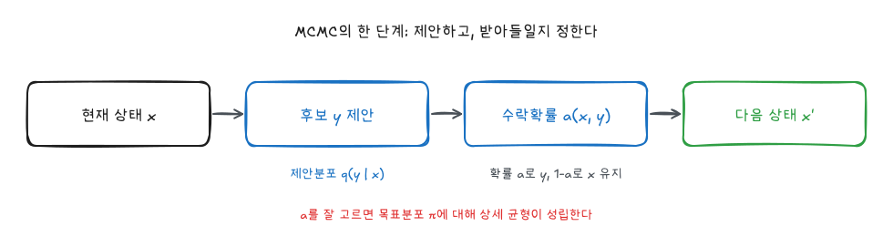
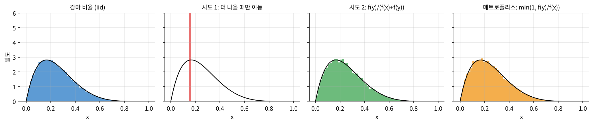
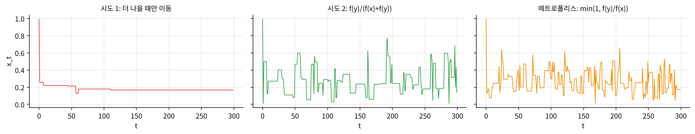
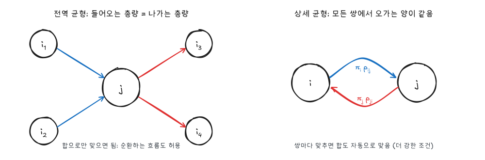
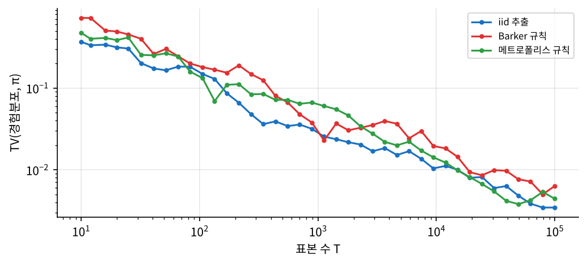

[앞 글](/posts/sp-07-recurrence)까지는 전이행렬이 주어지면 정상분포가 무엇인지, 그리고 체인의 경로가 정상분포를 따르는지를 물었다. MCMC(Markov chain Monte Carlo)는 이 질문을 뒤집는다. **원하는 분포 $\boldsymbol\pi$가 먼저 주어지고**, 그것을 정상분포로 갖는 에르고딕 체인을 설계한다. 그 체인을 오래 돌리면 경로가 $\boldsymbol\pi$의 표본이 된다. 이 글은 베타분포 하나를 여러 방법으로 뽑아 보며 이 아이디어가 왜 작동하는지 정리한다.

## 1. 왜 샘플링인가

확률모형에서 관심 있는 양(평균, 분위수, 어떤 사건의 확률)을 구하는 방법은 크게 세 가지다.

| 방법 | 내용 | 한계 |
|---|---|---|
| 이론적 계산 | 확률공간을 명시하고 적분을 풀어 구함 | 대부분의 모형에서 닫힌 해가 없음 |
| 모의실험 | $\omega$를 반복해서 뽑아 실현값을 관찰하고 평균 | 원하는 분포에서 **뽑을 수 있어야** 함 |
| 통계적 추정 | 독립적으로 관찰된 표본으로 추정 | 데이터가 필요 |

모의실험은 강력하지만 "그 분포에서 뽑을 수 있다"는 전제가 필요하다. 균등분포에서 뽑을 수 있다고 가정하면, 전통적으로는 분포 사이의 관계를 하나하나 이어서 다른 분포를 만든다.

| 목표 | 전통적 방법 |
|---|---|
| 베르누이 | $I(U < p)$ |
| 이항 | 베르누이의 합 |
| 지수 | 역누적분포함수: $-\log U$ |
| 정규 | 박스-뮬러 변환 |
| 감마 $\mathcal G(k, 1)$ | (정수 $k$에 대해) 지수분포 $k$개의 합 |
| 베타 $\mathcal B(\alpha, \beta)$ | $\dfrac{\mathcal G(\alpha,1)}{\mathcal G(\alpha,1) + \mathcal G(\beta,1)}$ (독립인 두 감마의 비 $X/(X+Y)$) |

이 방법은 정확하고 표본이 서로 독립이다. 문제는 분포마다 이런 관계를 **따로 알아야** 한다는 점이다. 베이즈 사후분포처럼 밀도함수의 식만 있고 이름이 붙은 분포와의 관계가 알려지지 않은 경우에는 쓸 수 없다. 그래서 다음 질문이 나온다. **밀도함수만 넣으면 알아서 샘플링되는 방법은 없을까?**

## 2. 실험: 밀도함수만으로 베타분포 뽑기

목표는 $\mathcal B(2, 6)$이다. 밀도함수는

$$
f(x) = \frac{\Gamma(8)}{\Gamma(2)\Gamma(6)}\,x(1-x)^5 = 42\,x(1-x)^5, \qquad 0 < x < 1
$$

이고, 평균 0.25, 분산 0.0208이다. 다음 절차를 반복한다.

1. 현재 값 $x$에서 출발한다.
2. 후보 $y$를 균등분포 $\mathcal U(0,1)$에서 뽑는다.
3. $x$와 $y$ 중 어느 쪽이 "그럴듯한지" $f$로 비교해 다음 값 $x'$을 정한다.



3단계의 규칙만 다르게 하여 세 가지를 비교한다.

| 규칙 | $y$를 받아들일 확률 $a(x, y)$ |
|---|---|
| 시도 1: 더 나을 때만 이동 | $f(y) > f(x)$이면 1, 아니면 0 |
| 시도 2: Barker 규칙 | $\dfrac{f(y)}{f(x) + f(y)}$ |
| 메트로폴리스 규칙 | $\min\left(1, \dfrac{f(y)}{f(x)}\right)$ |

```python
f = lambda x: 42 * x * (1 - x)**5

def chain(rule, T=100_000, x0=0.99):
    x = [x0]
    for _ in range(T):
        y = np.random.rand()
        fx, fy = f(x[-1]), f(y)
        if rule == 'greedy':   a = 1.0 if fy > fx else 0.0
        elif rule == 'barker': a = fy / (fx + fy)
        else:                  a = min(1, fy / fx)       # metropolis
        x.append(y if np.random.rand() < a else x[-1])
    return np.array(x)
```

시작값은 일부러 꼬리 끝인 0.99로 두었고, 앞의 500개를 버렸다(burn-in).





| | 수락률 | 표본평균 | 표본분산 | 1시차 자기상관 | 유효표본수 | KS 통계량 |
|---|---|---|---|---|---|---|
| 참값 | | 0.2500 | 0.0208 | | | |
| 감마 비율 (iid) | | 0.2493 | 0.0207 | $-0.006$ | 100,000 | 0.004 |
| 시도 1 | 0.0001 | 0.1667 | 0.0000 | — | — | 0.670 |
| 시도 2 (Barker) | 0.27 | 0.2491 | 0.0207 | 0.661 | 18,522 | 0.009 |
| 메트로폴리스 | 0.43 | 0.2502 | 0.0208 | 0.539 | 28,959 | 0.004 |

유효표본수는 자기상관을 반영해 "독립 표본 몇 개만큼의 정보인가"를 나타낸 값이다($n / (1 + 2\sum_k \rho_k)$).

- **시도 1은 실패한다.** 더 나은 후보만 받아들이면 체인이 점점 최빈값 $1/6 \approx 0.167$으로 올라가서 거기에 멈춘다. 샘플링이 아니라 최적화를 한 셈이다. 분포를 재현하려면 **덜 그럴듯한 쪽으로도 가끔 이동해야** 한다.
- **시도 2와 메트로폴리스는 성공한다.** 히스토그램이 참 밀도와 겹치고 평균과 분산이 참값과 맞는다.
- **대가는 자기상관이다.** iid 표본은 10만 개가 10만 개의 정보지만, MCMC 표본은 이웃끼리 상관되어 있어 Barker 규칙은 약 1만 9천 개, 메트로폴리스는 약 2만 9천 개 분량의 정보만 갖는다. 경로 그림에서 수평으로 머무는 구간(후보를 거절한 구간)이 자기상관의 원인이다.
- **메트로폴리스가 Barker보다 낫다.** 같은 상황에서 수락확률이 항상 더 크다. $f(y) \ge f(x)$이면 메트로폴리스는 무조건 받아들이지만 Barker는 많아야 1보다 작은 확률로 받아들인다. 덜 머무르니 자기상관이 작고 유효표본수가 크다.

## 3. 왜 되는가: 상세 균형 조건

시도 2와 메트로폴리스가 성공한 이유를 마코프체인의 언어로 설명한다. 정상분포의 정의 $\boldsymbol\pi^\top\mathbf P = \boldsymbol\pi^\top$은 각 상태 $j$에서 **들어오는 확률 흐름의 합과 나가는 확률 흐름의 합이 같다**는 전역 균형이다. 이보다 강한 조건이 있다.

> **정리 (상세 균형 조건).** 확률분포 $\boldsymbol\mu$가 모든 $i, j$에 대하여
> $$\mu_i\,p_{ij} = \mu_j\,p_{ji}$$
> 를 만족하면 $\boldsymbol\mu$는 $\mathbf P$의 정상분포다.

증명은 양변을 $i$에 대해 더하는 것으로 끝난다. $\sum_i \mu_i p_{ij} = \mu_j\sum_i p_{ji} = \mu_j$이고, 이것이 $\boldsymbol\mu^\top\mathbf P = \boldsymbol\mu^\top$의 $j$번째 성분이다.



| | 전역 균형 | 상세 균형 |
|---|---|---|
| 식 | $\sum_i \pi_i p_{ij} = \pi_j$ | $\pi_i p_{ij} = \pi_j p_{ji}$ |
| 의미 | 상태마다 총 유입 = 총 유출 | 쌍마다 $i \to j$ 흐름 = $j \to i$ 흐름 |
| 관계 | 정상분포의 정의 | 충분조건 (더 강함) |
| 확인 | 연립방정식을 풀어야 함 | 쌍별로 확인하면 끝 |
| 예 | 3-순환은 만족 | 3-순환은 불만족 (한 방향으로만 흐름) |

상세 균형을 만족하는 체인을 **가역**(reversible) 체인이라고 한다. 정상 상태에서 경로를 거꾸로 돌려도 확률법칙이 같기 때문이다.

MCMC 설계에서 상세 균형이 쓸모 있는 이유는 **확인이 쉽기 때문**이다. 상태가 10개든 무한개든, 임의의 두 상태 $x, x'$에 대해 식 하나만 확인하면 된다.

### 세 규칙 확인

후보를 균등하게 제안하므로 $x \ne x'$일 때 $p_{xx'} = q \cdot a(x, x')$이다($q$는 제안확률로 상수). 상세 균형은 $\pi_x\,a(x, x') = \pi_{x'}\,a(x', x)$와 같다.

| 규칙 | $\pi_x\,a(x,x')$ | $\pi_{x'}\,a(x',x)$ | 상세 균형 |
|---|---|---|---|
| Barker | $\dfrac{\pi_x\pi_{x'}}{\pi_x + \pi_{x'}}$ | $\dfrac{\pi_{x'}\pi_x}{\pi_x + \pi_{x'}}$ | O |
| 메트로폴리스 | $\min(\pi_x, \pi_{x'})$ | $\min(\pi_{x'}, \pi_x)$ | O |
| 더 나을 때만 | $\pi_{x'} > \pi_x$이면 $\pi_x$, 아니면 0 | $\pi_x > \pi_{x'}$이면 $\pi_{x'}$, 아니면 0 | X |

메트로폴리스의 경우 $\pi_x \min(1, \pi_{x'}/\pi_x) = \min(\pi_x, \pi_{x'})$로 정리되어 $x, x'$에 대해 대칭이다. "더 나을 때만" 규칙은 아래로 가는 흐름이 0이라서 대칭이 깨진다.

### 정상분포에서 에르고딕까지

상세 균형만으로는 정상분포가 **존재**한다는 것만 안다. 지금까지의 정리들을 이어 붙이면 나머지가 따라온다.

1. 상세 균형이 성립하므로 $\boldsymbol\pi$는 정상분포다.
2. 제안분포가 모든 상태를 양의 확률로 제안하고 수락확률이 양수이므로 체인은 **기약**이다.
3. 기약 체인에서 정상분포가 존재하면 유일하고, 체인은 **양재귀**다([앞 글](/posts/sp-07-recurrence)의 정리).
4. 거절되면 제자리에 머무르므로 자기 루프가 있어 **비주기**다.
5. 따라서 에르고딕이고, 어디서 출발하든 $\bar{\boldsymbol\pi} \to \boldsymbol\pi = \mathbf p_\star$가 성립한다.

이것이 MCMC 정당화의 전형적인 순서다. **상세 균형으로 정상분포를 확보하고, 기약성과 비주기성을 확인한다.** 주기는 게으른 체인처럼 쉽게 없앨 수 있으므로 사실상 상세 균형을 보이는 것이 핵심이다.

## 4. 이산형으로 다시 확인

상세 균형 논증은 원래 이산 상태공간의 이야기다. 상태 10개인 임의의 분포 $\boldsymbol\pi$를 만들고 세 방법의 경험분포가 $\boldsymbol\pi$에 다가가는 속도를 총변동거리로 비교했다.



| | 수락률 | $T = 10^5$에서 TV 거리 |
|---|---|---|
| iid 추출 | | 0.0035 |
| Barker 규칙 | 0.44 | 0.0063 |
| 메트로폴리스 규칙 | 0.74 | 0.0044 |

세 방법 모두 기울기 $-1/2$의 직선으로 내려간다. 즉 $1/\sqrt T$ 속도로 수렴한다. MCMC는 같은 정확도에 표본이 조금 더 필요할 뿐 수렴 속도의 차수는 iid와 같다. 다시 한번 메트로폴리스가 Barker보다 iid에 가깝다.

### 연속형으로의 확장

베타분포 실험에서 상태공간은 $[0, 1]$로, 셀 수 없는 집합이다. 그런데 지금까지의 마코프체인 이론은 셀 수 있는 상태공간에서 전이행렬을 정의하며 전개했다. 또 $f(x)$는 확률이 아니라 밀도다. 그런데도 결과가 맞았다.

엄밀히는 전이행렬 대신 **전이핵**(transition kernel) $P(x, A) = P(X_{t+1} \in A \mid X_t = x)$를 정의해야 한다. 이 조건부확률이 잘 정의되려면 상태공간에 약간의 구조가 필요한데, 완비 가분 거리공간(폴란드 공간)이면 충분하고 $\mathbb R^d$는 여기에 속한다. 그 위에서 상세 균형은 $f(x)\,p(x, x') = f(x')\,p(x', x)$라는 밀도의 식으로 바뀌고, 이산형과 같은 논리가 성립한다. 실용적으로는 **연속형도 이산형처럼 생각하고 논리를 전개해도 된다.**

## 정리

| | 전통적 방법 | MCMC |
|---|---|---|
| 필요한 정보 | 분포 사이의 관계 (감마의 비율 등) | 밀도함수 $f$ (정규화 상수는 몰라도 됨, 다음 글) |
| 표본의 독립성 | 독립 | 자기상관 있음 |
| 초기값 | 무관 | 영향 있음, burn-in으로 제거 |
| 정당화 | 분포의 변환 공식 | 상세 균형 → 정상분포, 기약·비주기 → 에르고딕 |
| 일반성 | 분포마다 따로 유도 | 거의 모든 분포에 같은 알고리즘 |

핵심은 수락 규칙에 있다. 더 나은 쪽으로만 가면 최적화가 되고, 덜 그럴듯한 쪽으로도 **정확한 비율로** 가야 샘플링이 된다. 그 정확한 비율이 상세 균형 조건이다. 다음 글은 제안분포를 균등분포에서 일반 분포로 넓힌 메트로폴리스-헤이스팅스 알고리즘과, 고차원에서 한 좌표씩 갱신하는 깁스 샘플링을 다룬다.

## 참고자료

- 최규빈, 「확률과정론」 강의노트 (2023), <https://guebin.github.io/SP2023/>
- Metropolis, N., Rosenbluth, A. W., Rosenbluth, M. N., Teller, A. H. and Teller, E. (1953). Equation of state calculations by fast computing machines. *The Journal of Chemical Physics*, 21(6), 1087–1092.
- Barker, A. A. (1965). Monte Carlo calculations of the radial distribution functions for a proton-electron plasma. *Australian Journal of Physics*, 18(2), 119–134.
- Robert, C. P. and Casella, G. (2004). *Monte Carlo Statistical Methods* (2nd ed.). Springer.
