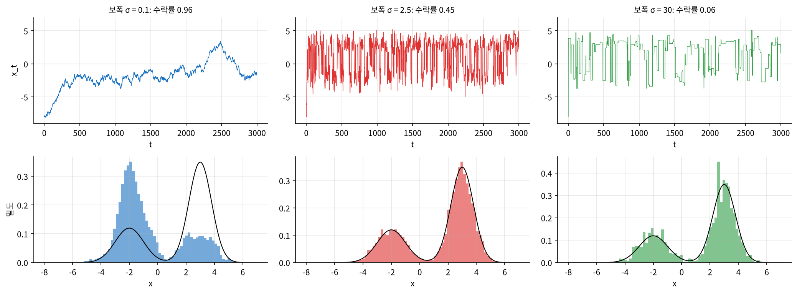
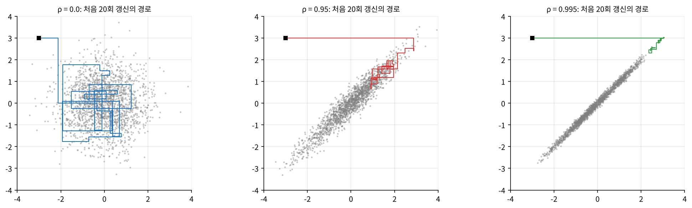
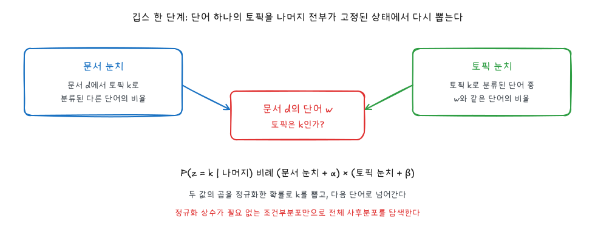
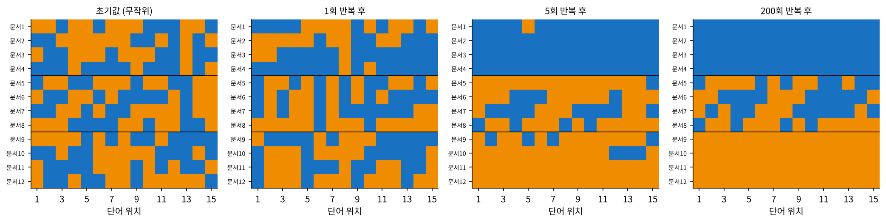

[앞 글](/posts/sp-08-mcmc-intro)에서는 후보를 균등분포에서 뽑고 메트로폴리스 규칙 $\min(1, f(y)/f(x))$로 받아들이면 상세 균형이 성립해 목표분포를 샘플링할 수 있음을 보였다. 이 글은 두 방향으로 일반화한다. 하나는 후보를 **아무 분포에서나** 제안할 수 있게 하는 메트로폴리스-헤이스팅스이고, 다른 하나는 고차원에서 **한 좌표씩** 조건부분포로 갱신하는 깁스 샘플링이다.

## 1. 메트로폴리스-헤이스팅스

### 제안분포가 비대칭일 때

균등분포 제안은 상태공간이 넓거나 무한하면 쓸 수 없다. 현실적으로는 현재 위치 근처에서 후보를 뽑는 편이 낫다. 일반적인 제안분포 $q(y \mid x)$를 쓰면 전이확률은 $p_{xy} = q(y \mid x)\,a(x, y)$이고, 상세 균형 $\pi_x p_{xy} = \pi_y p_{yx}$는 다음이 된다.

$$
\pi_x\,q(y \mid x)\,a(x, y) = \pi_y\,q(x \mid y)\,a(y, x)
$$

이를 만족하는 가장 큰 수락확률이 **메트로폴리스-헤이스팅스**(MH) 규칙이다.

$$
a(x, y) = \min\left(1,\ \frac{\pi_y\,q(x \mid y)}{\pi_x\,q(y \mid x)}\right)
$$

확인은 앞 글과 같다. $\pi_x q(y \mid x) a(x,y) = \min\big(\pi_x q(y \mid x),\ \pi_y q(x \mid y)\big)$가 $x, y$에 대해 대칭이다. 비율의 $q(x\mid y)/q(y\mid x)$는 "가기 쉬운 쪽"으로 치우친 제안을 보정하는 항이다. 제안이 대칭이면($q(y \mid x) = q(x \mid y)$) 이 항이 사라져 메트로폴리스 규칙으로 돌아간다.

| 알고리즘 | 제안분포 | 수락확률 |
|---|---|---|
| 메트로폴리스 (앞 글) | 균등 $\mathcal U(0,1)$ | $\min(1, \pi_y / \pi_x)$ |
| 랜덤워크 메트로폴리스 | $y = x + \sigma Z$, $Z \sim N(0,1)$ (대칭) | $\min(1, \pi_y / \pi_x)$ |
| 독립 MH | $q(y)$, 현재 위치와 무관 | $\min\left(1, \dfrac{\pi_y\,q(x)}{\pi_x\,q(y)}\right)$ |
| 일반 MH | 임의의 $q(y \mid x)$ | $\min\left(1, \dfrac{\pi_y\,q(x\mid y)}{\pi_x\,q(y\mid x)}\right)$ |

### 정규화 상수가 필요 없다

수락확률에는 $\pi$의 **비율**만 들어간다. 따라서 $\pi(x) = \tilde\pi(x)/Z$에서 $Z$를 몰라도 $\tilde\pi$만 계산할 수 있으면 된다. 베이즈 사후분포 $p(\theta \mid \text{data}) \propto p(\text{data} \mid \theta)\,p(\theta)$는 분모의 적분 $Z = \int p(\text{data}\mid\theta)p(\theta)\,d\theta$가 대개 계산 불가능하다. MCMC가 베이즈 통계의 표준 도구가 된 이유가 이것이다.

### 실험: 보폭 비교

정규화 상수를 쓰지 않은 이봉분포를 목표로 한다.

$$
\tilde\pi(x) = 0.3\,e^{-(x+2)^2/2} + \frac{0.7}{0.8}\,e^{-(x-3)^2/(2\cdot0.8^2)}
$$

참 평균은 $0.3 \times (-2) + 0.7 \times 3 = 1.5$다. 랜덤워크 메트로폴리스를 시작값 $-8$에서 20,000단계 돌리고 앞 1,000개를 버렸다. 보폭 $\sigma$만 바꾼다.

```python
logp = lambda x: np.logaddexp(np.log(0.3) - 0.5*(x + 2)**2,
                              np.log(0.7) - 0.5*((x - 3)/0.8)**2 - np.log(0.8))

def rwmh(step, T=20_000, x0=-8.0):
    x = [x0]
    for _ in range(T):
        y = x[-1] + step * np.random.randn()
        if np.log(np.random.rand()) < logp(y) - logp(x[-1]):   # 로그 스케일에서 비교
            x.append(y)
        else:
            x.append(x[-1])
    return np.array(x)
```



| 보폭 $\sigma$ | 수락률 | 표본평균 (참값 1.5) | $x > 0.5$ 비율 (참값 0.7) | 유효표본수 |
|---|---|---|---|---|
| 0.1 | 0.96 | $-0.56$ | 0.27 | 8 |
| 2.5 | 0.45 | 1.42 | 0.69 | 1,334 |
| 30 | 0.06 | 1.37 | 0.68 | 436 |

- **보폭이 너무 작으면** 거의 모든 후보를 받아들이지만 한 걸음이 짧아 천천히 기어간다. 출발점 $-8$에서 왼쪽 봉우리까지 오는 데 수백 단계가 걸리고, 두 봉우리 사이의 골짜기를 거의 건너지 못한다. 수락률 0.96은 좋은 신호가 아니다. 유효표본수 8은 2만 개의 표본이 사실상 독립 표본 8개라는 뜻이고, 표본평균이 참값과 크게 다르다.
- **보폭이 너무 크면** 후보가 대부분 밀도가 낮은 먼 곳에 떨어져 거절된다. 경로에 긴 수평 구간이 생긴다. 두 봉우리 사이를 오가기는 하므로 대략 맞지만 유효표본수가 작다.
- **적당한 보폭**에서 수락률이 중간쯤이고 유효표본수가 가장 크다. 일차원 정규분포 목표에서 이론적인 최적 수락률은 약 0.44, 고차원에서는 약 0.234로 알려져 있다.

수락률이 높다고 좋은 것도, 낮다고 좋은 것도 아니다. **이동 거리와 수락확률의 곱**이 탐색 효율을 정한다. 보폭은 앞 글의 이론으로는 정해지지 않는 실무적인 조율 변수다. 어떤 보폭이든 이론적으로는 수렴하지만(에르고딕), 유한한 시간 안에 쓸 만한 표본을 주는지는 별개의 문제다.

## 2. 깁스 샘플링

### 아이디어

고차원 벡터 $\boldsymbol\theta = (\theta_1, \dots, \theta_d)$에서 한꺼번에 좋은 후보를 제안하기는 어렵다. 깁스 샘플링은 **한 좌표씩**, 나머지를 고정한 조건부분포에서 직접 뽑는다.

$$
\theta_j^{(t+1)} \sim \pi\big(\theta_j \mid \theta_1^{(t+1)}, \dots, \theta_{j-1}^{(t+1)}, \theta_{j+1}^{(t)}, \dots, \theta_d^{(t)}\big), \qquad j = 1, \dots, d
$$

이것은 제안분포를 **조건부분포 자체**로 잡은 MH의 특수한 경우다. 그러면 MH 비율이 정확히 1이 되어 모든 후보를 받아들인다. 결합분포 $\pi(\boldsymbol\theta)$를 직접 다루지 않고 일차원 조건부분포만 알면 되는 것이 장점이다.

| | 랜덤워크 MH | 깁스 |
|---|---|---|
| 제안 | 현재 위치 + 잡음 | 좌표별 완전 조건부분포 |
| 수락률 | 1 미만, 조율 필요 | 항상 1 |
| 필요한 것 | $\tilde\pi$의 계산 | 조건부분포에서 뽑는 방법 |
| 조율 변수 | 보폭 | 없음 |
| 약점 | 보폭 선택 | 좌표 사이 상관이 크면 느림 |

### 실험: 상관계수 비교

표준 이변량 정규분포에서 조건부분포는 $\theta_1 \mid \theta_2 \sim N(\rho\theta_2,\ 1-\rho^2)$이다. 시작점 $(-3, 3)$에서 $\rho$만 바꾸어 2,000회 반복했다.

```python
def gibbs(rho, T=2000):
    a, b = -3.0, 3.0; sd = np.sqrt(1 - rho**2); out = []
    for _ in range(T):
        a = rho * b + sd * np.random.randn()     # θ1 | θ2
        b = rho * a + sd * np.random.randn()     # θ2 | θ1
        out.append((a, b))
    return np.array(out)
```



| $\rho$ | $\theta_1$의 1시차 자기상관 | 유효표본수 (2,000개 중) |
|---|---|---|
| 0 | 0.00 | 1,901 |
| 0.95 | 0.91 | 85 |
| 0.995 | 0.99 | 6 |

깁스 샘플러는 좌표축에 평행하게만 움직인다. 상관이 없으면 한 번의 갱신으로 분포 전체 어디로든 갈 수 있어 사실상 독립 표본이다. 상관이 강하면 분포가 대각선 방향의 좁은 띠가 되어, 축에 평행한 한 걸음은 띠의 폭만큼밖에 못 간다. $\rho = 0.995$에서는 첫 갱신에서 대각선 위 $(3, 3)$ 근처로 곧장 이동한 뒤, 20회 동안 그 근처에서 계단을 조금 내려온 것이 전부다. 실제로 $\theta_1$의 자기상관은 $\rho^2$이므로 $\rho \to 1$에서 체인이 멈춘 것처럼 된다. 상관이 큰 변수들을 묶어서 함께 뽑거나(블록 깁스) 변수를 재모수화하는 것이 일반적인 대응이다.

## 3. 응용: 토픽 모형의 깁스 샘플러

### 문제

문서 여러 개가 있고, 각 단어가 어떤 토픽에서 나왔는지 모른다고 하자. 강의에서는 축구 기사와 통계 기사가 섞인 상황을 예로 들었다. 여기서는 직접 만든 자료를 쓴다. 문서 12개, 문서당 단어 15개이고, 축구 단어 10종과 통계 단어 10종에서 뽑았다.

| 문서 | 축구 단어의 비율 (생성 시 설정) |
|---|---|
| 1–4 | 100% |
| 5–8 | 50% |
| 9–12 | 0% |

알고 싶은 것은 각 단어의 토픽 $z_{d,i} \in \{0, 1\}$이다. 그런데 하나의 정답이 아니라, "골"은 거의 확실히 축구 토픽이지만 "데이터"는 축구 기사에도 가끔 나올 수 있다는 **불확실성까지** 알고 싶다. 즉 $\mathbf z$의 사후분포에서 표본을 뽑고 싶다. $\mathbf z$는 길이 180의 이산 벡터라 가능한 값이 $2^{180}$개이고, 결합분포를 직접 다루는 것은 불가능하다.

### 단어 하나의 조건부분포

깁스 샘플링은 단어 하나의 토픽만 나머지를 고정한 채 다시 뽑는다. 이 조건부분포는 두 가지 단서의 곱으로 주어진다(사전분포를 디리클레로 둔 LDA를 적분해서 얻는 식이다).

$$
P(z_{d,i} = k \mid \mathbf z_{-(d,i)}, \text{단어들}) \ \propto\ \big(n_{d,k} + \alpha\big) \times \frac{n_{k,w} + \beta}{n_k + V\beta}
$$

- $n_{d,k}$: 문서 $d$에서 토픽 $k$로 분류된 **다른** 단어 수 (문서 눈치: 같은 문서의 단어들은 비슷한 토픽일 것)
- $n_{k,w}$: 토픽 $k$로 분류된 단어 중 지금 단어 $w$와 같은 단어 수 (토픽 눈치: 같은 단어는 같은 토픽일 것)
- $\alpha, \beta$: 0이 되는 것을 막는 작은 양수(여기서는 0.1), $V$: 어휘 수



```python
# n_dk: 문서별 토픽 수, n_kw: 토픽별 단어 수, n_k: 토픽별 총 단어 수
for it in range(200):
    for d, words in enumerate(W):
        for i, w in enumerate(words):
            k = z[d][i]
            n_dk[d, k] -= 1; n_kw[k, w] -= 1; n_k[k] -= 1          # 자기 자신은 빼고
            p = (n_dk[d] + a) * (n_kw[:, w] + b) / (n_k + b * V)
            k = np.random.choice(K, p=p / p.sum())                    # 다시 뽑기
            z[d][i] = k
            n_dk[d, k] += 1; n_kw[k, w] += 1; n_k[k] += 1
```

강의 코드는 매번 자료를 깊은 복사한 뒤 해당 단어를 지우고 세는 방식이었는데, 여기서는 개수 행렬에서 1을 빼고 더하는 방식으로 바꾸었다. 계산 결과는 같고 훨씬 빠르다.



- **초기값**은 무작위다.
- **1회 반복 후** 이미 1–4번 문서가 파랑 쪽으로 기울기 시작한다.
- **5회 반복 후** 순수 축구 문서(1–4)와 순수 통계 문서(9–12)가 거의 정리된다.
- **200회 반복 후** 혼합 문서(5–8)는 단어마다 다른 토픽을 갖는다. 이것이 정답이다. 혼합 문서는 하나의 토픽으로 정리되면 안 된다.

| | 상위 단어 |
|---|---|
| 토픽 0 | 골, 페널티킥, 수비수, 슈팅, 감독, 리그 |
| 토픽 1 | 베이즈, 추정, 데이터, 회귀, 분산, 검정 |

| 문서 | 1–4 | 5 | 6 | 7 | 8 | 9–12 |
|---|---|---|---|---|---|---|
| 추정된 축구 토픽 비중 | 0.99 | 0.47 | 0.60 | 0.60 | 0.27 | 0.01 |

토픽에 이름을 붙여 준 적이 없는데도 두 토픽이 축구와 통계로 갈라졌다. 혼합 문서의 비중은 설정값 50% 근처에서 흩어지는데, 문서당 단어가 15개뿐이라 실제로 뽑힌 축구 단어 수가 문서마다 다르기 때문이다. 이 체인은 각 단어의 토픽을 "결정"하는 것이 아니라 계속 다시 뽑는다. 충분히 돌린 뒤 여러 시점의 배정을 모으면, 예를 들어 "골"이 축구 토픽에 배정된 비율이 그 단어의 사후확률이 된다. 하나의 점추정이 아니라 **분포**를 얻는다는 것이 이 접근의 요점이다.

## 정리

| | 메트로폴리스 | 메트로폴리스-헤이스팅스 | 깁스 |
|---|---|---|---|
| 제안 | 대칭 | 임의의 $q(y\mid x)$ | 좌표별 완전 조건부분포 |
| 수락확률 | $\min(1, \pi_y/\pi_x)$ | $\min\left(1, \frac{\pi_y q(x\mid y)}{\pi_x q(y\mid x)}\right)$ | 1 |
| 필요한 정보 | $\tilde\pi$ (정규화 상수 불필요) | $\tilde\pi$, $q$ | 조건부분포에서 뽑는 방법 |
| 조율 | 보폭 | 제안분포 | 없음 (블록 구성) |
| 실패하는 경우 | 보폭이 극단적, 봉우리가 여럿 | 제안이 목표와 동떨어짐 | 좌표 사이 상관이 강함 |
| 정당화 | 상세 균형 | 상세 균형 | MH의 특수한 경우 |

세 알고리즘 모두 정당화의 핵심은 같다. 각 단계별 전이가 상세 균형(깁스는 각 좌표별 갱신이 상세 균형을 만족)을 만족하여 목표분포를 정상분포로 보존하고, 기약성과 비주기성으로 에르고딕을 보장한다. 차이는 **얼마나 빨리 섞이는가**이고, 이것은 이론보다 실험으로 확인하는 영역이다. 경로 그림, 수락률, 자기상관, 유효표본수가 그 진단 도구다.

이로써 마코프체인과 MCMC 부분을 마친다. 다음 글부터는 마코프체인에 **행동과 보상**을 더한 강화학습을 다룬다.

## 참고자료

- 최규빈, 「확률과정론」 강의노트 (2023), <https://guebin.github.io/SP2023/>
- Hastings, W. K. (1970). Monte Carlo sampling methods using Markov chains and their applications. *Biometrika*, 57(1), 97–109.
- Geman, S. and Geman, D. (1984). Stochastic relaxation, Gibbs distributions, and the Bayesian restoration of images. *IEEE Transactions on Pattern Analysis and Machine Intelligence*, 6, 721–741.
- Griffiths, T. L. and Steyvers, M. (2004). Finding scientific topics. *Proceedings of the National Academy of Sciences*, 101(suppl 1), 5228–5235.
- Roberts, G. O., Gelman, A. and Gilks, W. R. (1997). Weak convergence and optimal scaling of random walk Metropolis algorithms. *The Annals of Applied Probability*, 7(1), 110–120.
