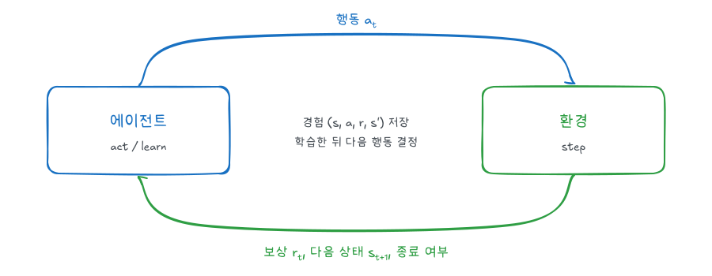
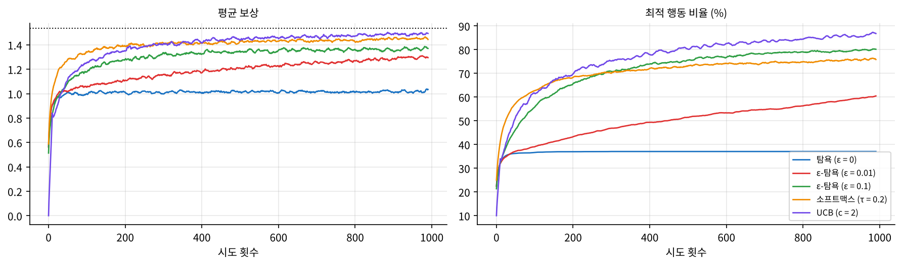

[앞 글](/posts/sp-09-metropolis-gibbs)까지의 마코프체인은 전이확률이 주어지고 체인은 그냥 흘러갔다. 강화학습은 여기에 **행동**을 넣는다. 에이전트가 행동을 고르면 환경이 보상과 다음 상태를 돌려주고, 에이전트는 보상을 많이 받는 행동을 **경험으로부터** 배운다. 강의는 이 부분을 학기 뒤 보충 강의로 다루었고, 버튼 두 개짜리 게임에서 시작해 격자 세계, 달 착륙선으로 확장했다. 이 글은 첫 단계인 밴딧 문제를 다룬다. 상태가 하나뿐이라 "다음 상태"를 생각할 필요가 없고, 행동 규칙의 차이만 깨끗하게 비교할 수 있다.

## 1. 에이전트와 환경

강화학습 코드는 거의 항상 같은 뼈대를 갖는다.



| 구성요소 | 역할 | 밴딧에서 |
|---|---|---|
| 환경 `env.step(a)` | 행동을 받아 보상(과 다음 상태)을 돌려줌 | 버튼에 따른 보상 |
| 에이전트 `agent.act()` | 현재까지의 지식으로 행동을 고름 | 어느 버튼을 누를지 |
| 경험 저장 `save_experience()` | $(a, r)$ 기록 | 누른 버튼과 받은 보상 |
| 학습 `agent.learn()` | 경험으로 지식을 갱신 | 버튼별 평균 보상 $q(a)$ 추정 |

```python
class Bandit:
    def step(self, action):
        return 1 if action == 0 else 100       # 버튼 0: 1점, 버튼 1: 100점

for t in range(T):
    agent.act()                                 # 1. 에이전트 → 환경
    agent.reward = env.step(agent.action)       # 2. 환경 → 에이전트
    agent.save_experience()
    agent.learn()                               # 3. 학습
```

강의에서 강조한 점은 "버튼 1을 누르면 된다"는 것을 **사람이 알아내서** 코드에 `action = 1`로 써 넣으면 게임은 깨지만 학습한 것은 아니라는 점이다. 강화학습은 "환경을 이해한다 → 행동을 결정한다"의 화살표 부분을 데이터로 자동화하는 것이다.

### 행동가치

행동 $a$의 **행동가치**(action value)는 그 행동을 했을 때의 기대 보상이다.

$$
q(a) = E[R \mid A = a]
$$

진짜 $q(a)$는 모르므로 경험으로 추정한다. 가장 자연스러운 추정량은 표본평균이다.

$$
\hat q_t(a) = \frac{\sum_{s < t} R_s\,I(A_s = a)}{\sum_{s < t} I(A_s = a)}
$$

이것을 새 보상이 들어올 때마다 갱신하는 형태로 쓰면

$$
\hat q \leftarrow \hat q + \frac{1}{n}\big(r - \hat q\big)
$$

이다. "새 추정 = 옛 추정 + 학습률 × (관측 − 옛 추정)"이라는 이 형태는 다음 글의 Q-학습에서 그대로 다시 나온다.

## 2. 행동 규칙

$\hat q$를 알면 어떻게 행동할 것인가. 여기에 **탐색-활용 딜레마**가 있다. 지금까지 가장 좋아 보이는 행동을 하면(활용) 당장의 보상은 크지만, 덜 시도해 본 행동이 사실 더 좋을 가능성을 확인하지 못한다. 반대로 이것저것 시도하면(탐색) 정보는 늘지만 보상을 잃는다.

| 규칙 | 행동 선택 | 탐색 방식 |
|---|---|---|
| 무작위 | 균등하게 선택 | 탐색만 |
| 비례 선택 (강의) | $P(a) = \hat q(a) / \sum_b \hat q(b)$ | $\hat q$가 비슷하면 많이 탐색 |
| 탐욕 | $\arg\max_a \hat q(a)$ | 탐색 없음 |
| ε-탐욕 | 확률 $\varepsilon$로 무작위, 나머지는 탐욕 | 일정 비율로 무작위 탐색 |
| 소프트맥스 | $P(a) \propto \exp(\hat q(a)/\tau)$ | 좋아 보이는 쪽을 더 자주 탐색 |
| UCB | $\arg\max_a \left[\hat q(a) + c\sqrt{\log t / n(a)}\right]$ | 덜 시도한 행동에 가산점 |

강의의 비례 선택은 처음 30번 무작위로 누른 뒤 $\hat q$에 비례하는 확률로 누르는 방식이었다. UCB(upper confidence bound)의 가산점은 신뢰구간의 폭과 같은 모양이다. 적게 시도한 행동일수록 추정이 불확실하니 "좋을 수도 있다"는 쪽으로 낙관적으로 평가한다.

## 3. 비교 1: 결정적 보상

강의의 설정 그대로, 버튼 0은 항상 1점, 버튼 1은 항상 100점이다. 최근 20번의 보상 합이 1,900점 이상(20번 중 19번 이상 정답)이면 "클리어"로 정했다. 각 규칙으로 200번 게임을 하고 2,000번 안에 클리어한 비율을 셌다. 학습하는 규칙들은 처음 30번을 무작위로 누른다.

| 보상 (버튼 0, 버튼 1) | 규칙 | 클리어 비율 | 클리어까지 시도 횟수 (중앙값) | 30회 이후 버튼 1 비율 |
|---|---|---|---|---|
| (1, 100) | 무작위 | 0.01 | 648 | 0.50 |
| | 비례 선택 | 1.00 | 48 | 0.993 |
| | 탐욕 | 1.00 | 47 | 1.000 |
| | ε-탐욕 (0.1) | 1.00 | 49 | 0.960 |
| (1, 1.1) | 무작위 | 0.04 | 1,361 | 0.50 |
| | 비례 선택 | **0.03** | 947 | **0.524** |
| | 탐욕 | 1.00 | 48 | 1.000 |
| | ε-탐욕 (0.1) | 1.00 | 49 | 0.961 |

- **무작위는 거의 클리어하지 못한다.** 20번 중 19번 이상 버튼 1이 나올 확률은 $21/2^{20} \approx 2 \times 10^{-5}$이다.
- **보상이 결정적이면 탐욕이 최선이다.** 한 번씩만 눌러 봐도 $\hat q$가 정확하므로 더 탐색할 이유가 없다. ε-탐욕은 쓸데없이 10%를 낭비한다.
- **비례 선택은 보상의 크기에 의존한다.** 보상이 1과 100이면 버튼 1을 $100/101$의 확률로 눌러 잘 동작하지만, 1과 1.1이면 $1.1/2.1 = 0.524$의 확률로만 눌러 사실상 무작위가 된다. 보상이 음수이면 확률로 쓸 수조차 없다. 행동 규칙은 보상의 **순서**에 반응해야지 **크기의 비율**에 반응하면 안 된다.

## 4. 비교 2: 확률적 보상

현실의 보상은 잡음이 있다. 버튼 10개의 평균 보상 $\mu_k$를 $N(0, 1)$에서 뽑고, 버튼 $k$를 누르면 $N(\mu_k, 1)$의 보상을 주는 환경을 2,000개 만들었다(Sutton과 Barto의 10-armed testbed). 각 환경에서 1,000번 시도하고 평균을 냈다.

```python
mu = rng.normal(size=(2000, 10))                 # 환경 2,000개 × 버튼 10개
for t in range(1000):
    a = rule(Q, N, t)                            # 각 환경에서 행동 선택 (벡터화)
    r = mu[idx, a] + rng.normal(size=2000)       # 잡음이 섞인 보상
    N[idx, a] += 1
    Q[idx, a] += (r - Q[idx, a]) / N[idx, a]     # 표본평균의 점진적 갱신
```



| 규칙 | 마지막 100회 평균 보상 | 마지막 100회 최적 행동 비율 | 1,000회 누적 보상 |
|---|---|---|---|
| 탐욕 ($\varepsilon = 0$) | 1.02 | 37% | 1,007 |
| ε-탐욕 ($\varepsilon = 0.01$) | 1.30 | 60% | 1,184 |
| ε-탐욕 ($\varepsilon = 0.1$) | 1.37 | 80% | 1,299 |
| 소프트맥스 ($\tau = 0.2$) | 1.45 | 76% | **1,396** |
| UCB ($c = 2$) | **1.49** | **86%** | 1,387 |

결정적 환경과 결론이 정반대다.

- **탐욕은 초반의 운에 갇힌다.** 잡음 때문에 첫 몇 번의 보상으로 버튼을 잘못 평가하면, 그 버튼만 계속 누르고 다른 버튼은 다시 확인하지 않는다. 최적 행동 비율이 37%에서 멈춘다.
- **ε이 클수록 빨리 배우지만 영원히 낭비한다.** $\varepsilon = 0.1$은 빨리 좋아지지만 끝까지 10%는 무작위로 누른다. $\varepsilon = 0.01$은 낭비가 적지만 1,000번 안에는 충분히 배우지 못한다.
- **똑똑한 탐색이 낫다.** 소프트맥스는 형편없어 보이는 버튼은 거의 누르지 않고 애매한 버튼 위주로 탐색한다. UCB는 불확실한 버튼을 우선 확인한다. 둘 다 무작위 탐색보다 효율적이다.

| | 결정적 보상 | 확률적 보상 |
|---|---|---|
| 한 번의 관측으로 | $q(a)$를 정확히 앎 | $q(a)$의 잡음 섞인 추정만 얻음 |
| 탐욕 | 최선 | 초반 운에 갇힘 |
| 탐색의 가치 | 없음 | 큼 |
| 핵심 질문 | 무엇이 좋은가 | 얼마나 확신하는가 |

통계학의 언어로 바꾸면, 밴딧 문제는 **추정과 의사결정을 동시에** 하는 문제다. 데이터가 행동에 따라 수집되므로, 어떤 행동을 덜 하면 그 행동에 대한 표본 크기가 작아져 추정이 부정확해진다. UCB가 신뢰구간의 상한을 쓰는 것은 이 연결을 직접 반영한 것이다.

## 5. 밴딧에서 강화학습으로

밴딧에는 **상태**가 없다. 버튼을 누른 결과가 다음 판의 상황을 바꾸지 않는다. 일반적인 강화학습에서는 행동이 다음 상태를 바꾸고, 지금의 보상이 작아도 좋은 상태로 가는 행동이 더 가치 있을 수 있다.

| | 밴딧 | 일반 강화학습 |
|---|---|---|
| 상태 | 없음 (하나) | 여럿, 행동에 따라 전이 |
| 가치 | $q(a)$ | $q(s, a)$ |
| 목표 | 즉시 보상의 기대값 최대화 | 누적 할인 보상의 기대값 최대화 |
| 학습 목표값 | 관측한 보상 $r$ | $r + \gamma \max_{a'} q(s', a')$ |

다음 글은 상태가 16개인 격자 세계에서 이 확장을 다룬다. 행동에 따라 상태가 바뀌는 구조는 바로 마코프체인이다. 정책을 하나 고정하면 상태열 $S_0, S_1, \dots$는 마코프체인이 되고, 강화학습은 **어떤 마코프체인을 만들지**를 고르는 문제가 된다.

## 참고자료

- 최규빈, 「확률과정론」 강의노트 (2023), A1: 강화학습 (1) bandit, <https://guebin.github.io/SP2023/>
- Sutton, R. S. and Barto, A. G. (2018). *Reinforcement Learning: An Introduction* (2nd ed.), Chapter 2. MIT Press.
- Auer, P., Cesa-Bianchi, N. and Fischer, P. (2002). Finite-time analysis of the multiarmed bandit problem. *Machine Learning*, 47, 235–256.
