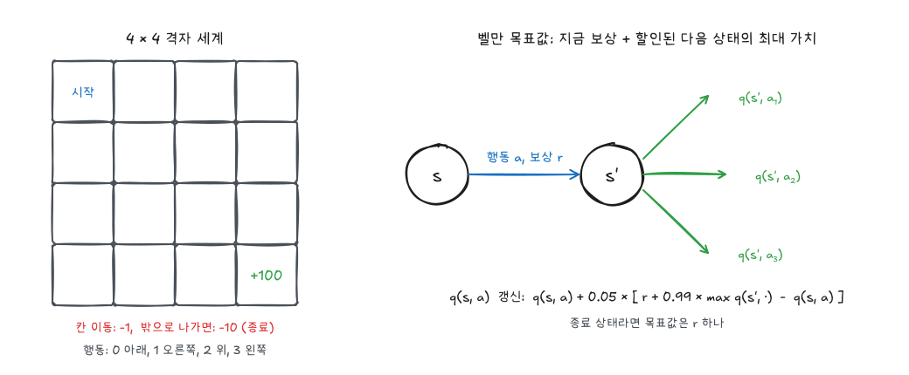
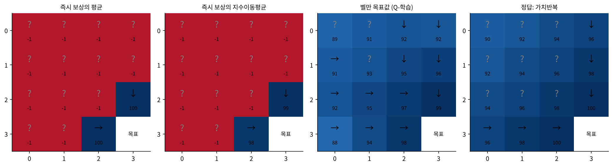
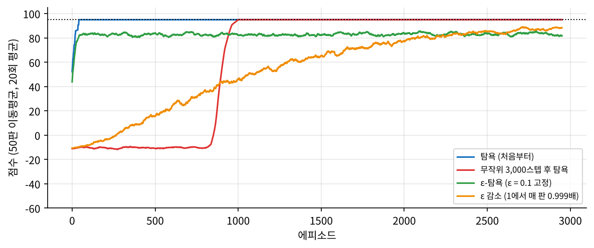

[앞 글](/posts/sp-10-rl-bandit)의 밴딧에는 상태가 없었다. 이 글은 상태가 16개인 격자 세계로 넘어간다. 이제 행동이 다음 상태를 바꾸므로, **지금 보상은 작아도 좋은 곳으로 데려가는 행동**의 가치를 계산해야 한다. 그 계산 규칙이 벨만 방정식이고, 그것을 경험으로부터 푸는 알고리즘이 Q-학습이다.

## 1. 환경



| 요소 | 설정 |
|---|---|
| 상태 | 격자 칸 $(x, y)$, $x$는 행(아래로 증가), $y$는 열(오른쪽으로 증가) |
| 시작 | $(0, 0)$ |
| 행동 | 0 아래, 1 오른쪽, 2 위, 3 왼쪽 |
| 보상 | 목표 $(3, 3)$ 도착 $+100$ (종료), 격자 밖으로 나가면 $-10$ (종료), 그 외 한 칸 이동마다 $-1$ |
| 최적 점수 | 6번 이동: $-1 \times 5 + 100 = 95$ |

```python
D = {0: (1, 0), 1: (0, 1), 2: (-1, 0), 3: (0, -1)}

def step(s, a):
    x, y = s[0] + D[a][0], s[1] + D[a][1]
    if not (0 <= x < 4 and 0 <= y < 4): return s, -10, True     # 밖으로 나감
    if (x, y) == (3, 3):                return (x, y), 100, True  # 목표
    return (x, y), -1, False
```

## 2. 행동가치를 어떻게 추정할 것인가

무작위로 움직이는 에이전트로 10,000판을 플레이해 경험 33,068개 $(s, a, r, s', \text{종료})$를 모았다. 같은 경험에서 $q(s, a)$를 세 가지 방법으로 추정해 비교한다.

| 방법 | 갱신 규칙 | 무엇을 추정하는가 |
|---|---|---|
| 즉시 보상의 평균 | $q(s,a) = $ 상태 $s$에서 $a$를 했을 때 받은 $r$의 평균 | 한 걸음 뒤의 보상 |
| 지수이동평균 | $q \leftarrow q + 0.05\,(r - q)$ | 같음 (최근 경험에 가중) |
| 벨만 목표값 | $q \leftarrow q + 0.05\,\big(r + 0.99\max_{a'} q(s', a') - q\big)$ | 지금부터 끝까지의 누적 보상 |

비교 기준으로 가치반복(value iteration)으로 구한 정답 $q^\star$도 함께 그렸다. 각 칸의 화살표는 $\arg\max_a q(s, a)$, 숫자는 $\max_a q(s, a)$다. 최댓값이 둘 이상이면 물음표로 표시했다.



- **즉시 보상만 보면 길을 찾을 수 없다.** 목표 바로 옆 두 칸을 빼면 모든 칸에서 "안쪽으로 한 칸"의 보상이 $-1$로 같다. 어느 방향이 목표에 가까워지는지 구분하지 못해 거의 모든 칸이 물음표다. 지수이동평균도 같은 양을 추정하므로 결과가 같다.
- **벨만 목표값은 목표의 가치를 거꾸로 전파한다.** 목표 옆 칸의 가치가 100 근처가 되면, 그 칸으로 가는 행동의 가치가 $-1 + 0.99 \times 100 \approx 98$이 되고, 다시 그 앞 칸으로 전파된다. 시작 칸의 가치 88.7은 정답 90.2에 가깝고, 화살표를 따라가면 6번 만에 목표에 도착한다.
- **정답에도 물음표가 많다.** 이 격자에서는 아래로 가든 오른쪽으로 가든 최단 경로라 두 행동의 가치가 똑같기 때문이다. Q-학습의 추정치는 잡음 때문에 이 동점 중 하나를 골랐을 뿐이다.

강의에서 든 비유가 이 차이를 잘 설명한다. 빈 종이에 0을 쓰면 0원, 1을 쓰면 10만 원을 받는다는 것을 알게 되었다면, 빈 종이의 가치는 5만 원(두 행동의 평균)이 아니라 10만 원이다. 가치는 **그 상태에서 최선으로 행동했을 때** 받을 보상으로 매겨야 한다. 이것이 목표값에 $\max_{a'}$가 들어가는 이유다.

### 벨만 최적 방정식

$q^\star(s, a)$를 "상태 $s$에서 $a$를 하고 이후 최적으로 행동할 때의 할인 누적 보상의 기대값"으로 정의하면 다음 방정식을 만족한다.

$$
q^\star(s, a) = E\Big[\, R + \gamma \max_{a'} q^\star(S', a') \ \Big|\ S = s, A = a \Big]
$$

종료 상태에서는 두 번째 항이 없다. $\gamma = 0.99$는 할인율로, 미래 보상을 현재 보상에 비해 얼마나 중시할지 정한다. Q-학습은 이 방정식의 우변을 관측된 경험 한 개로 근사한 값(목표값)에 좌변을 조금씩 끌어당긴다. "새 추정 = 옛 추정 + 학습률 × (목표값 − 옛 추정)"이라는 밴딧의 갱신식에서 목표값만 $r$에서 $r + \gamma\max q(s',\cdot)$로 바뀌었다.

| | 밴딧 | Q-학습 |
|---|---|---|
| 목표값 | $r$ | $r + \gamma \max_{a'} q(s', a')$ |
| 목표값의 성격 | 관측값 | 관측값 + **자기 자신의 추정치** |
| 추정하는 양 | 즉시 보상의 기대값 | 누적 할인 보상의 기대값 |

목표값 안에 자기 자신의 추정치가 들어가는 것(부트스트래핑)이 Q-학습의 특징이다. 처음에는 $q$가 엉터리라 목표값도 엉터리지만, 확실한 정보(목표 도착의 $+100$)가 들어오는 칸부터 정확해지고 그 정확함이 경험을 통해 퍼져 나간다.

## 3. 탐색 전략 비교

이번에는 미리 모아 둔 경험이 아니라 **플레이하면서** 학습한다. Q-학습 갱신은 같고 행동 규칙만 바꾸어 각 3,000판씩, 시드 20개로 반복했다.

| 규칙 | 행동 선택 |
|---|---|
| 탐욕 | 처음부터 항상 $\arg\max_a q(s, a)$ |
| 무작위 후 탐욕 (강의의 Agent2) | 처음 3,000스텝은 무작위, 이후 탐욕 |
| ε-탐욕 고정 | 확률 0.1로 무작위 |
| ε 감소 (강의의 Agent3) | $\varepsilon$을 1에서 시작해 매 판 0.999배 |



| 규칙 | 마지막 200판 평균 점수 | 마지막 200판 중 최적 점수 비율 | 최적 점수 90% 도달까지 (중앙값) |
|---|---|---|---|
| 탐욕 | 95.0 | 1.00 | 28판 |
| 무작위 후 탐욕 | 95.0 | 1.00 | 903판 |
| ε-탐욕 고정 (0.1) | 83.2 | 0.70 | 도달 못 함 |
| ε 감소 | 87.5 | 0.83 | 3,000판 안에 도달 못 함 |

밴딧의 확률적 환경에서는 탐욕이 가장 나빴는데 여기서는 가장 좋다. 이유가 두 가지 있다.

- **환경이 결정적이다.** 앞 글의 결론처럼 보상과 전이에 잡음이 없으면 한 번 확인한 사실을 다시 확인할 필요가 없다.
- **초기값이 낙관적이다.** $q$를 0으로 초기화했는데 실제 이동 보상은 $-1$이다. 한 번 해 본 행동은 가치가 0보다 낮아지므로, 탐욕 규칙은 자연스럽게 **아직 안 해 본 행동**을 고른다. 무작위 탐색 없이도 체계적으로 모든 행동을 시도하게 된다. 이것을 낙관적 초기값(optimistic initialization)이라 한다. 초기값을 $-100$으로 바꾸어 돌려 보면, 탐욕 에이전트는 처음 시도한 "아래로" 행동만 반복해 세 칸 내려간 뒤 격자 밖으로 떨어지고, 3,000판 내내 점수 $-13$에 갇힌다. 해 본 행동이 안 해 본 행동보다 항상 좋아 보이기 때문이다.

나머지 규칙의 특징도 그림에 그대로 드러난다.

- **무작위 후 탐욕**은 3,000스텝(약 900판) 동안 점수가 $-10$ 근처에 머물다가 탐욕으로 바뀌는 순간 최적 점수로 뛰어오른다. 무작위 경험만으로도 Q-학습은 정답을 배운다. 2절에서 본 그대로다.
- **ε 고정**은 빨리 배우지만 끝까지 10%의 확률로 무작위 행동을 하고, 가장자리에서의 무작위 행동은 $-10$으로 게임을 끝내므로 평균 점수가 83에서 멈춘다.
- **ε 감소**는 처음에는 무작위에 가깝고 점점 탐욕에 가까워진다. 3,000판 뒤에도 $\varepsilon = 0.999^{3000} \approx 0.05$라 아직 최적 점수에 이르지 못했다. 감소 속도가 문제의 크기에 비해 느리다.

탐색 전략의 우열은 환경에 따라 바뀐다. 결정적이고 작은 환경에서는 낙관적 초기값과 탐욕으로 충분하고, 잡음이 크거나 상태가 많으면 명시적인 탐색이 필요하다. 다음 글의 달 착륙선은 후자에 해당한다.

## 4. 강화학습과 마코프체인

정책 $\pi(a \mid s)$를 하나 고정하면 상태열 $S_0, S_1, \dots$는 전이확률

$$
P^\pi(s, s') = \sum_a \pi(a \mid s)\,P(s' \mid s, a)
$$

를 갖는 마코프체인이 된다. 무작위 정책은 상하좌우로 1/4씩 움직이는 체인이고, 학습된 탐욕 정책은 시작점에서 목표까지 결정적으로 가는 체인이다. 목표와 격자 밖은 흡수 상태다.

| 마코프체인 (1–9편) | 강화학습 |
|---|---|
| 전이행렬 $\mathbf P$가 주어짐 | 전이 $P(s' \mid s, a)$는 환경이 정하고, 정책 $\pi$는 에이전트가 고름 |
| 질문: 장기적으로 어디에 있는가 | 질문: 어떤 정책이 누적 보상을 최대로 하는가 |
| 정상분포 $\boldsymbol\pi^\top\mathbf P = \boldsymbol\pi^\top$ | 벨만 방정식 $q^\star(s,a) = r(s,a) + \gamma \sum_{s'} P(s'\mid s,a)\max_{a'} q^\star(s',a')$ |
| MCMC: 원하는 정상분포를 갖는 $\mathbf P$를 **설계** | 강화학습: 원하는 보상을 주는 $P^\pi$를 **학습** |

MCMC와 강화학습은 둘 다 "주어진 체인을 분석"하는 문제를 "목적에 맞는 체인을 만드는" 문제로 뒤집었다는 점에서 닮았다. 차이는 MCMC가 상세 균형이라는 설계도를 갖고 있는 반면 강화학습은 환경의 전이를 모른 채 경험으로 배워야 한다는 데 있다.

### 표의 한계

이 글의 $q$는 크기 $4 \times 4 \times 4 = 64$인 표였다. 상태가 연속이면 표를 만들 수 없다. 다음 글의 달 착륙선은 상태가 8차원 벡터(위치, 속도, 각도, 다리 접지 불리언 등 8개)이므로, $q$를 표 대신 **함수**로 근사해야 한다. 그 함수로 신경망을 쓰는 것이 DQN이다.

## 참고자료

- 최규빈, 「확률과정론」 강의노트 (2023), A2: 강화학습 (2) 4x4 grid, <https://guebin.github.io/SP2023/>
- Sutton, R. S. and Barto, A. G. (2018). *Reinforcement Learning: An Introduction* (2nd ed.), Chapters 3–6. MIT Press.
- Watkins, C. J. C. H. and Dayan, P. (1992). Q-learning. *Machine Learning*, 8, 279–292.
