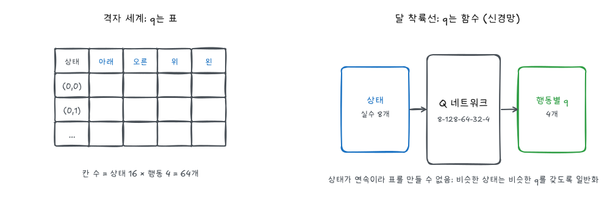
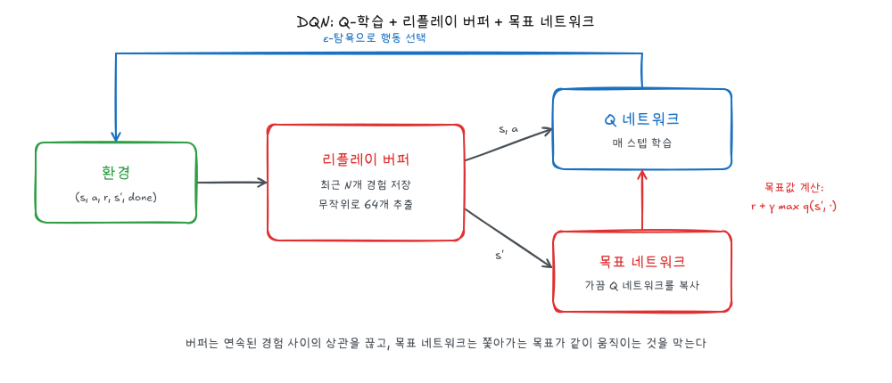
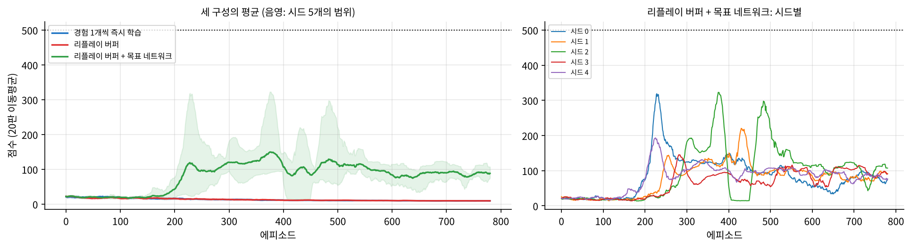

[앞 글](/posts/sp-11-rl-gridworld)의 격자 세계에서는 행동가치 $q(s, a)$를 $4 \times 4 \times 4$ 크기의 표로 저장했다. 강의의 마지막 예제인 달 착륙선은 상태가 실수 8개라서 표를 만들 수 없다. 이 글은 표를 신경망으로 바꾸는 DQN(deep Q-network)을 정리하고, 그 과정에서 새로 필요해지는 두 장치(리플레이 버퍼, 목표 네트워크)의 역할을 비교 실험으로 확인한다.

## 1. 환경: 달 착륙선

Gymnasium의 `LunarLander`는 착륙선을 두 깃발 사이의 착륙장에 부드럽게 내려놓는 게임이다.

| 요소 | 내용 |
|---|---|
| 상태 (8차원 실수) | 위치 $x, y$, 속도 $\dot x, \dot y$, 각도, 각속도, 왼쪽·오른쪽 다리의 접지 여부 |
| 행동 (4개) | 0 아무것도 안 함, 1 왼쪽 엔진, 2 주 엔진, 3 오른쪽 엔진 |
| 보상 | 착륙장에 가까워지고 느려질수록 +, 다리 접지 +, 엔진 분사마다 −, 추락 −100, 안착 +100 |
| 종료 | 추락, 화면 이탈, 착륙 후 정지, 또는 1000스텝 초과 (truncation) |
| 해결 기준 | 최근 100판 평균 200점 이상 |

```python
import gymnasium as gym
env = gym.make('LunarLander-v3', render_mode='rgb_array')    # v0.29 이전 버전은 'LunarLander-v2'
state, _ = env.reset()                                       # 길이 8의 실수 벡터
next_state, reward, terminated, truncated, _ = env.step(action) # 행동 0~3
done = terminated or truncated
```

## 2. 표에서 함수로



격자 세계의 표는 칸이 64개였다. 상태가 연속이면 칸이 무한히 많고, 같은 상태를 두 번 방문할 일도 거의 없다. 그래서 $q$를 **상태를 넣으면 행동별 가치 4개를 내놓는 함수**로 바꾸고, 그 함수를 신경망으로 근사한다.

```python
q_net = torch.nn.Sequential(
    torch.nn.Linear(8, 128), torch.nn.ReLU(),
    torch.nn.Linear(128, 64), torch.nn.ReLU(),
    torch.nn.Linear(64, 32), torch.nn.ReLU(),
    torch.nn.Linear(32, 4),
)
q_net(torch.tensor(state))          # 행동 4개의 q값
```

함수 근사의 장점은 **일반화**다. 표에서는 한 칸의 경험이 그 칸만 바꾸지만, 신경망에서는 비슷한 상태의 q값도 함께 바뀐다. 처음 보는 상태에서도 그럴듯한 값을 낼 수 있다. 대가는 한 상태의 갱신이 **다른 상태의 값까지 건드린다**는 것이고, 이것이 뒤에서 볼 불안정성의 원인이다.

### 격자 세계 코드와의 대응

강의는 격자 세계의 Q-학습 코드를 한 줄씩 DQN으로 옮기는 방식으로 설명했다.

| 단계 | 격자 세계 (표) | DQN (신경망) |
|---|---|---|
| $q$의 저장 | `q = np.zeros([4,4,4])` | `q_net = Sequential(...)` |
| 추정값 | `q[x, y, a]` | `q_net(s).gather(1, a)` |
| 목표값 | `r + 0.99 * q[xx, yy, :].max()` | `r + 0.99 * q_net(s_next).max(1, keepdim=True)[0] * (~done)` |
| 오차 | `diff = q_realistic - q_estimated` | `loss = mse(q_estimated, q_realistic)` |
| 갱신 | `q[x, y, a] += 0.05 * diff` | `loss.backward(); optimizer.step()` |
| 경험 사용 | 방금 경험 하나 | 버퍼에서 무작위 배치 |

"추정값을 목표값 쪽으로 조금 이동"이라는 핵심은 같다. 표에서는 한 칸의 값을 직접 옮기고, 신경망에서는 제곱오차를 줄이는 방향으로 가중치를 옮긴다. 표의 갱신식 $q \leftarrow q + \alpha(y - q)$ 자체가 제곱오차 $\frac12(y - q)^2$에 대한 경사하강법이므로 두 방식은 같은 원리다.

## 3. 리플레이 버퍼와 목표 네트워크



### 리플레이 버퍼

격자 세계에서는 경험이 생기는 대로 하나씩 학습했다. 신경망에서는 이 방식이 문제가 된다. 연속된 경험은 서로 매우 비슷하다(착륙선이 한 프레임 사이에 크게 움직이지 않는다). 비슷한 표본만 연달아 학습하면 신경망이 지금 근처의 상태에 과적합되고 다른 상태에서 배운 것을 잊는다.

리플레이 버퍼는 최근 $N$개의 경험을 저장해 두고 그중에서 **무작위로** 배치를 뽑아 학습한다. 강의에서는 `collections.deque(maxlen=N)`으로 구현했다. 길이가 차면 가장 오래된 경험이 자동으로 빠지는 큐다.

```python
buffer = collections.deque(maxlen=5000)
buffer.append((s, a, r, s_next, done))

idx = np.random.randint(0, len(buffer), size=64)       # 무작위 배치
```

통계학의 언어로 보면 MCMC의 고민과 같다. 마코프체인의 경로는 자기상관이 있어서 표본 하나하나가 독립이 아니다. 리플레이 버퍼는 시간 순서를 섞어 표본을 iid에 가깝게 만든다. 같은 경험을 여러 번 재사용하므로 데이터 효율도 좋아진다.

### 목표 네트워크

Q-학습의 목표값 $r + \gamma\max_{a'} q(s', a')$에는 학습 중인 $q$ 자신이 들어 있다. 표에서는 한 칸을 바꿔도 다른 칸의 값이 그대로라 큰 문제가 없었다. 신경망에서는 $q(s, a)$를 올리려고 가중치를 바꾸면 비슷한 상태 $s'$의 $q$도 같이 올라가서 **목표값도 따라 올라간다.** 쫓아가는 목표가 같이 도망가는 셈이고, 값이 끝없이 커질 수 있다.

목표 네트워크는 목표값 계산에 쓰는 신경망을 따로 두고 일정 스텝마다 복사해서 갱신한다. 그 사이에는 목표가 고정되어 일반적인 회귀 문제처럼 안정적으로 학습할 수 있다. 강의의 마지막 코드에는 이 장치가 없었고, 목표값을 같은 `q_net`에서 `detach()`해서 계산했다. 아래 실험은 이 차이가 얼마나 큰지 보여준다.

## 4. 실험: 세 가지 구성 비교

달 착륙선은 Box2D 물리 엔진이 필요하고 CPU에서 학습에 오랜 시간이 걸린다. 그래서 구조가 같은 DQN을 더 작은 고전 문제인 **막대 세우기**(CartPole)에 적용해 비교했다. 수레 위의 막대가 쓰러지지 않게 수레를 좌우로 미는 문제다. 상태는 실수 4개(수레 위치·속도, 막대 각도·각속도), 행동은 2개, 버틴 스텝마다 보상 1이며 최대 500점이다. 환경의 운동방정식과 신경망(4-64-64-2, Adam, Huber 손실)을 모두 numpy로 직접 구현했다.

| 구성 | 경험 사용 | 목표값 계산 |
|---|---|---|
| 즉시 학습 | 방금 경험 1개 | 같은 신경망 |
| 리플레이 버퍼 | 버퍼(1만 개)에서 무작위 64개 | 같은 신경망 |
| 리플레이 버퍼 + 목표 네트워크 | 버퍼에서 무작위 64개 | 1,000스텝마다 복사한 신경망 |

공통 설정: $\gamma = 0.99$, 학습률 $5 \times 10^{-4}$, $\varepsilon$은 1에서 1만 스텝에 걸쳐 0.05까지 선형 감소, 800판, 시드 5개.

```python
for each step:
    a = random if rand() < eps else q(s).argmax()
    s2, r, done = env.step(a)
    buffer.append((s, a, r, s2, done))
    S, A, R, S2, D = sample(buffer, 64)
    y = R + 0.99 * q_target(S2).max(axis=1) * (1 - D)     # 목표값
    q.update(S, A, y)                                     # Huber 손실로 한 걸음
    if step % 1000 == 0: q_target = copy(q)
```



| 구성 | 마지막 100판 평균 (시드별) | 20판 이동평균의 최고점 (시드별) | 학습 중 $\max\lvert q\rvert$ |
|---|---|---|---|
| 즉시 학습 | 9.5 ~ 9.8 | 23 ~ 26 | 측정하지 않음 |
| 리플레이 버퍼 | 9.6 ~ 9.8 | 22 ~ 26 | 발산 (수천 스텝 만에 $10^5$, 이후 $10^6$) |
| 리플레이 버퍼 + 목표 네트워크 | 80 ~ 99 | 146 ~ 323 | 40 이하로 유지 |

이 문제는 보상이 스텝마다 1이므로 $q$의 참값은 $\sum_t 0.99^t = 100$을 넘을 수 없다.

- **목표 네트워크가 없으면 두 구성 모두 무작위보다 못하다.** 무작위 행동의 평균 점수가 약 22인데, 두 구성은 처음에는 그 근처였다가 결국 9.5점으로 떨어진다. 한쪽으로만 계속 미는 정책이다. 리플레이 버퍼만 쓴 구성에서 $q$의 최댓값을 추적해 보면 참값의 상한 100을 훨씬 넘어 $10^6$까지 커진다. 목표값이 추정값을 따라 올라가는 발산이 실제로 일어났다.
- **목표 네트워크를 쓰면 학습이 된다.** $q$가 참값 범위 안에 머물고 점수가 200~300판 근처부터 올라간다.
- **그래도 불안정하다.** 오른쪽 그림처럼 시드마다 한때 300점 이상으로 올라갔다가 다시 100점 근처로 떨어진다. 잘하게 된 뒤에는 버퍼가 "잘 버티는" 경험으로만 채워지고, 넘어지는 상황을 잊어버리는 현상이 알려져 있다. 실전에서는 학습률 감소, 더 큰 버퍼, Double DQN 같은 추가 장치를 쓴다.

### 치명적 삼중주

이 실험의 결과는 Sutton과 Barto가 "치명적 삼중주"(deadly triad)라고 부른 현상의 예다. 다음 세 가지가 함께 있으면 학습이 발산할 수 있다.

| 요소 | 격자 세계 Q-학습 | DQN |
|---|---|---|
| 함수 근사 | 없음 (표) | 신경망 |
| 부트스트래핑 (목표값에 자기 추정치 사용) | 있음 | 있음 |
| 오프-폴리시 학습 (행동 정책과 학습 대상 정책이 다름) | 있음 | 있음 |
| 결과 | 수렴이 보장됨 | 발산 가능 |

격자 세계에서는 함수 근사가 없어서 문제가 없었다. DQN은 셋을 모두 갖고 있으므로, 리플레이 버퍼와 목표 네트워크는 성능을 높이는 장치이기 이전에 **발산을 막는 안전장치**다.

## 5. 강의 코드의 최종 형태

강의의 Agent 클래스를 목표 네트워크까지 넣어 정리하면 다음과 같다. 학습 부분만 옮긴다.

```python
class Agent:
    def __init__(self, env):
        self.q_net = make_net();  self.q_target = make_net()
        self.q_target.load_state_dict(self.q_net.state_dict())
        self.optimizer = torch.optim.Adam(self.q_net.parameters(), lr=1e-4)
        self.buffer = collections.deque(maxlen=5000)
        self.batch_size = 64
        self.eps, self.n_experiences = 1.0, 0

    def learn(self):
        self.n_experiences += 1
        if len(self.buffer) < self.batch_size: return
        S, A, R, S2, D = self.get_batch()
        q_estimated = self.q_net(S).gather(1, A)
        with torch.no_grad():
            q_future = self.q_target(S2).max(1, keepdim=True)[0]
        q_realistic = R + 0.99 * q_future * (1 - D)
        loss = torch.nn.functional.mse_loss(q_estimated, q_realistic)
        loss.backward(); self.optimizer.step(); self.optimizer.zero_grad()
        if self.n_experiences % 1000 == 0:
            self.q_target.load_state_dict(self.q_net.state_dict())
```

## 시리즈 정리

이 글로 확률과정론 시리즈를 마친다. 12편의 흐름을 한 표로 정리한다.

| 부분 | 편 | 핵심 질문 | 답 |
|---|---|---|---|
| 측도론 | 1–2 | 확률을 어떤 집합에 정의할 수 있는가 | 시그마필드, 확률변수는 가측함수 |
| 확률과정 | 3 | 경로 하나로 확률적 성질을 알 수 있는가 | 의존 구조에 따라 다름 |
| 마코프체인 | 4–7 | 언제 시간평균 = 앙상블평균 = 극한분포인가 | 기약 + 양재귀 + 비주기 (에르고딕) |
| MCMC | 8–9 | 원하는 분포를 정상분포로 갖는 체인을 만들 수 있는가 | 상세 균형으로 설계, 에르고딕 정리로 정당화 |
| 강화학습 | 10–12 | 보상을 최대로 하는 체인(정책)을 경험으로 찾을 수 있는가 | 벨만 방정식 + Q-학습, 함수 근사 시 안정화 장치 필요 |

처음의 질문이 "확률을 어디에 정의할 수 있는가"였다면, 마지막 질문은 "원하는 성질을 갖는 확률과정을 어떻게 만드는가"였다. 마코프체인을 분석하는 도구(정상분포, 에르고딕성)가 MCMC에서는 설계 원리가 되고, 강화학습에서는 학습의 목표가 된다.

## 참고자료

- 최규빈, 「확률과정론」 강의노트 (2023), A3: 강화학습 (3) LunarLander, <https://guebin.github.io/SP2023/>
- Mnih, V. et al. (2015). Human-level control through deep reinforcement learning. *Nature*, 518, 529–533.
- Sutton, R. S. and Barto, A. G. (2018). *Reinforcement Learning: An Introduction* (2nd ed.), Section 11.3 (The Deadly Triad). MIT Press.
- Barto, A. G., Sutton, R. S. and Anderson, C. W. (1983). Neuronlike adaptive elements that can solve difficult learning control problems. *IEEE Transactions on Systems, Man, and Cybernetics*, SMC-13(5), 834–846.
- Gymnasium documentation, <https://gymnasium.farama.org/>
