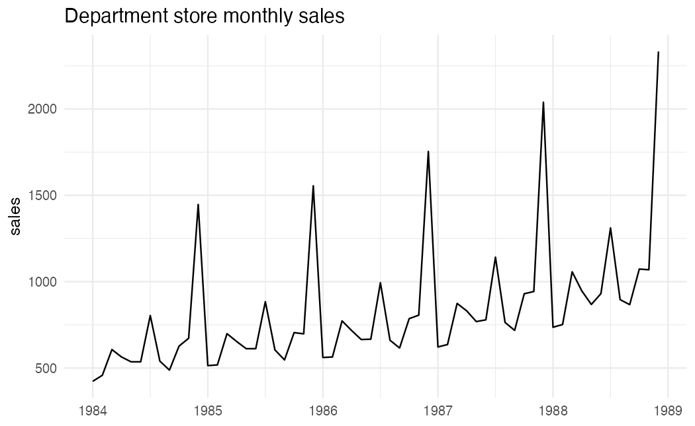
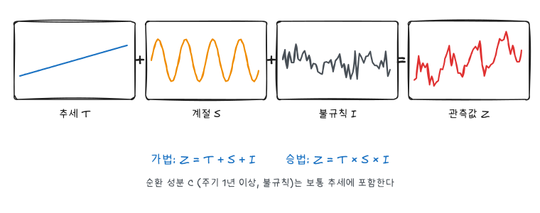
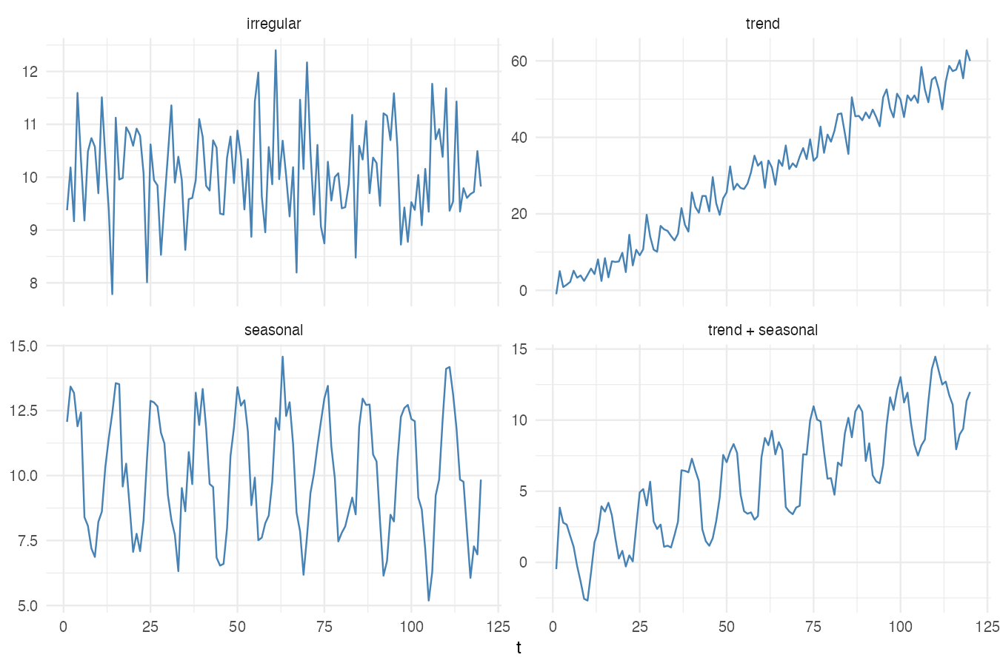
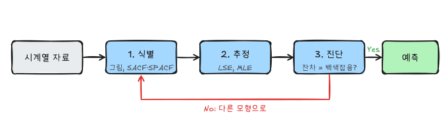

『SAS/ETS를 이용한 시계열분석』(조신섭·손영숙·성병찬)과 전북대학교 이영미 교수님 시계열분석 강의를 바탕으로 정리한 시리즈다. 수업은 R로 진행했고, 예제 데이터는 교재 예제 코드를 정리한 [GitHub 저장소](https://github.com/Bricoler/time-series-analysis)의 `timedata` 폴더에서 바로 읽는다.

## 시리즈 구성

| 편 | 강의 | 내용 |
|---|---|---|
| 1 | CH1 | 시계열 자료와 분석 목적 |
| 2 | CH2 | 추세분석: 회귀모형, 계절 추세 |
| 3 | CH3 | 평활법: 이동평균, 지수평활, Winters |
| 4 | CH4 | 분해법: 가법·승법 모형, 이동평균 |
| 5 | CH5 | 확률과정, 정상성, ACF·PACF |
| 6 | CH6 | AR, MA, ARMA 모형 |
| 7 | CH7 | 비정상 시계열과 ARIMA |
| 8 | CH8 | 모형 식별·추정·진단 |
| 9 | CH9 | 예측 |
| 10 | CH10 | 계절형 ARIMA |

1~4편은 시계열을 **결정적인 함수**(추세, 계절)와 **오차**로 나누는 전통적 방법이고, 5~10편은 시계열 자체를 **확률과정**으로 보고 관측값 사이의 상관 구조를 모델링하는 Box-Jenkins 방법이다.

```r title="환경 설정"
library(tidyverse)
library(forecast)
library(patchwork)
theme_set(theme_minimal(base_size = 12))

data_url <- "https://raw.githubusercontent.com/Bricoler/time-series-analysis/master/timedata/"
read_ts <- function(file, start, frequency = 12) {
  ts(scan(paste0(data_url, file), quiet = TRUE), start = start, frequency = frequency)
}
```

`forecast`는 `ts` 객체를 위한 `autoplot()`, `ggAcf()` 등을 제공한다. 이 시리즈의 모든 글은 이 설정 블록으로 시작한다.

## 시계열 자료

시간의 흐름에 따라 순서대로 관측된 자료를 시계열이라 하고 $\{Z_t : t = 1, 2, \dots\}$로 쓴다.

- **연속 시계열**: 시간에 따라 연속적으로 기록(심전도, 지진파). 실제로는 일정 간격으로 끊어 관측하므로 대부분 **이산 시계열**로 다룬다.
- **시차(lag)**: 두 관측 시점 사이의 간격. $Z_t$와 $Z_{t-k}$는 시차 $k$만큼 떨어져 있다.

회귀분석은 관측값들이 서로 독립이라고 가정한다. 시계열에서는 오늘 값이 어제 값의 영향을 받으므로 이 가정이 깨진다. 시계열 분석은 이 **시간 의존성**을 이용하거나 제거하는 방법들의 모음이다.

| 분야 | 예 |
|---|---|
| 경제 | 국민총생산, 물가지수, 수출액, 주가지수 |
| 물리 | 일별 강수량, 기온, 대기 오염도 |
| 경영 | 월별 판매량, 재고량, 광고비 |
| 인구 | 출생아 수, 인구증가율 |

## 시계열 그림

분석은 항상 시계열 그림(가로축 시간, 세로축 관측값)에서 시작한다.

```r
depart <- read_ts("depart.txt", start = c(1984, 1))
autoplot(depart) + labs(x = NULL, y = "sales", title = "Department store monthly sales")
```



1984~1988년 백화점 월별 매출액이다. 한눈에 세 가지가 보인다.

- 해마다 증가하는 **추세**
- 매년 12월에 튀는 **계절성**
- 계절 진폭이 수준과 함께 커진다(분산이 일정하지 않음). 7편에서 로그 변환으로 다룬다.

## 시계열의 성분



| 성분 | 기호 | 뜻 |
|---|---|---|
| 불규칙 성분 | $I_t$ | 규칙 없이 우연히 생기는 변동 |
| 추세 성분 | $T_t$ | 장기적으로 증가하거나 감소하는 경향 |
| 계절 성분 | $S_t$ | 1년 이내의 일정한 주기로 반복(월별, 분기별, 요일별) |
| 순환 성분 | $C_t$ | 주기가 1년보다 길고 일정하지 않은 변동(경기순환) |

불규칙 성분을 뺀 나머지를 **체계적 성분**이라 한다. 성분별 모양을 시뮬레이션으로 확인한다.

```r w=9 h=6
set.seed(1)
t <- 1:120
sim <- tibble(
  t = t,
  irregular = 10 + rnorm(120, sd = 1),
  trend = 0.5 * t + rnorm(120, sd = 3),
  seasonal = 10 + 3 * sin(2 * pi * t / 12) + rnorm(120, sd = 0.8),
  `trend + seasonal` = 0.1 * t + 3 * sin(2 * pi * t / 12) + rnorm(120, sd = 0.8)
)

sim |>
  pivot_longer(-t) |>
  mutate(name = fct_inorder(name)) |>
  ggplot(aes(t, value)) +
  geom_line(color = "steelblue") +
  facet_wrap(~name, scales = "free_y") +
  labs(x = "t", y = NULL)
```



## 분석 목적

| 목적 | 내용 | 방법 |
|---|---|---|
| 예측 | 과거 패턴이 이어진다고 보고 미래 값을 추정 | 추세분석, 평활법, 분해법, ARIMA |
| 설명 | 시계열이 생성되는 구조를 이해 | 성분 분해, 상관 구조 |
| 제어 | 목표값에 가깝게 유지하도록 입력 조정 | 전이함수 모형 |
| 개입 분석 | 정책·사건의 효과 측정 | 개입 모형 |

이 시리즈는 예측에 집중한다.

## 모형 적합의 3단계



1. **식별**: 시계열 그림, 표본 ACF·PACF로 잠정 모형을 고른다.
2. **추정**: 최소제곱이나 최대가능도로 모수를 추정한다.
3. **진단**: 잔차가 백색잡음인지 검토한다. 적합하지 않으면 1단계로 돌아간다.

진단을 통과하면 예측하고, 새 자료가 들어오면 모형을 다시 점검한다.

## 예측력을 판단하는 척도

시점 $n$에서 $l$시차 후 예측값을 $\hat Z_n(l)$, 예측오차를 $e_n(l) = Z_{n+l} - \hat Z_n(l)$이라 하자. 새 자료 $m$개에 대한 1시차 예측오차로 모형을 비교한다.

$$
MSE = \frac{1}{m} \sum_{l=1}^{m} e_{n+l-1}(1)^2, \qquad
MAE = \frac{1}{m} \sum_{l=1}^{m} |e_{n+l-1}(1)|, \qquad
MAPE = \frac{100}{m} \sum_{l=1}^{m} \left| \frac{e_{n+l-1}(1)}{Z_{n+l}} \right|
$$

MAPE는 단위가 없어 서로 다른 시계열의 예측력을 비교할 수 있다. 다만 값이 0에 가까우면 불안정하다. `forecast::accuracy()`가 이 척도들을 한 번에 계산한다.

예측 방법을 고를 때는 예측 기간(단기·장기), 필요한 정확도, 자료의 양과 함께 **간결성의 원칙**(같은 성능이면 모수가 적은 모형)을 고려한다.

## 요약

| 개념 | 핵심 |
|---|---|
| 시계열 | 시간 순서로 관측된 의존적인 자료 |
| 성분 | 불규칙 $I_t$, 추세 $T_t$, 계절 $S_t$, 순환 $C_t$ |
| 첫 단계 | 시계열 그림으로 추세, 계절성, 분산 변화, 이상점 확인 |
| 모형 적합 | 식별 → 추정 → 진단 → 예측 |
| 예측력 | MSE, MAE, MAPE |
