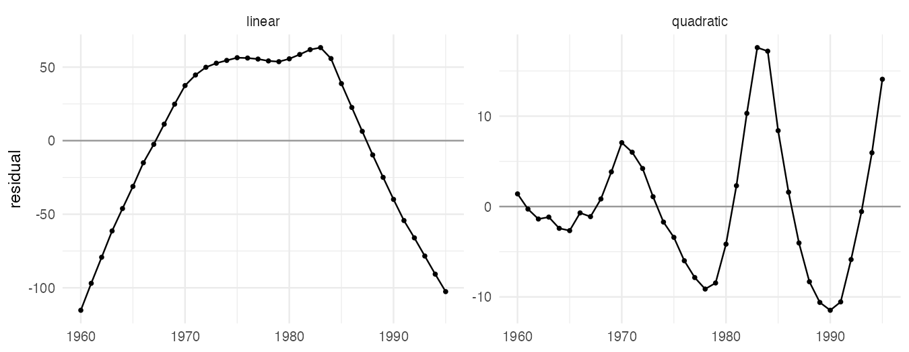
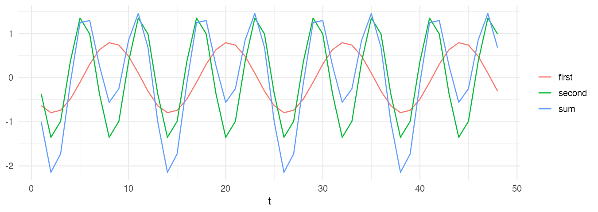
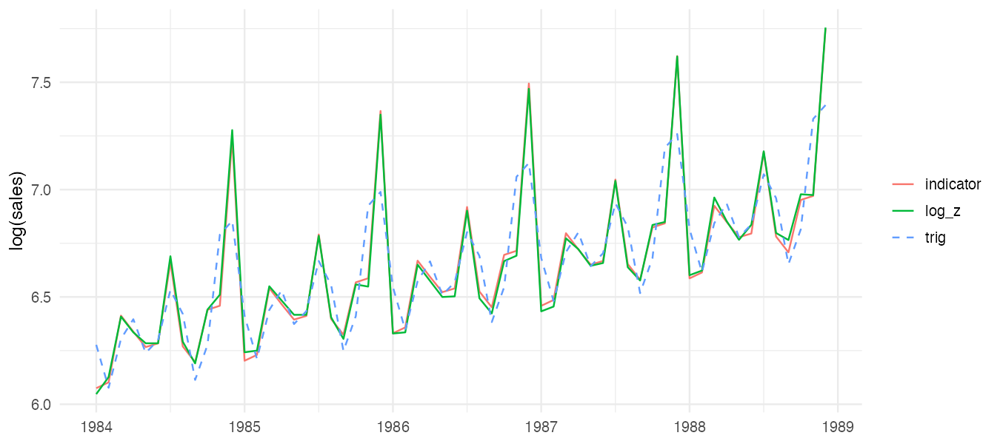
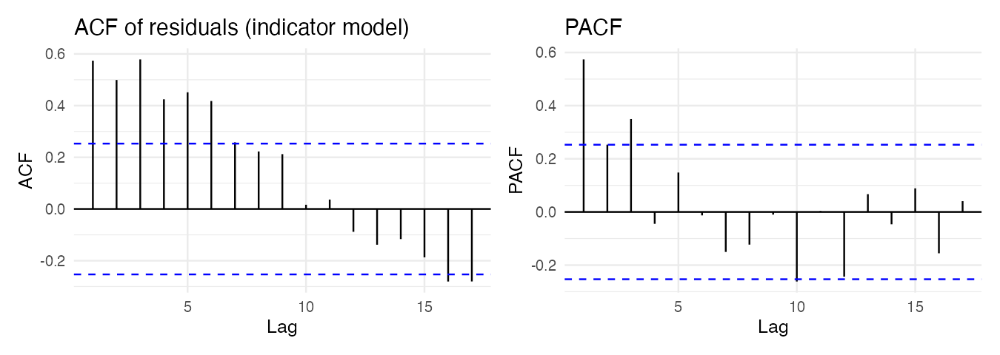

『SAS/ETS를 이용한 시계열분석』(조신섭·손영숙·성병찬)과 전북대학교 이영미 교수님 강의의 2장을 정리했다. 추세분석은 관측값 $Z_t$를 **시간 $t$의 함수**와 오차로 나타낸다.

$$
Z_t = f(t) + \epsilon_t, \qquad \epsilon_t \overset{iid}{\sim} N(0, \sigma^2)
$$

$f(t)$가 정해지면 이것은 $t$를 설명변수로 하는 회귀모형이다.

```r title="환경 설정"
library(tidyverse)
library(forecast)
library(patchwork)
theme_set(theme_minimal(base_size = 12))

data_url <- "https://raw.githubusercontent.com/Bricoler/time-series-analysis/master/timedata/"
read_ts <- function(file, start, frequency = 12) {
  ts(scan(paste0(data_url, file), quiet = TRUE), start = start, frequency = frequency)
}
```

## 1. 추세모형의 종류

| 모형 | 식 | 쓰임 |
|---|---|---|
| 상수평균 | $Z_t = \beta_0 + \epsilon_t$ | 수준이 일정 |
| 선형 추세 | $Z_t = \beta_0 + \beta_1 t + \epsilon_t$ | 일정한 속도로 증가 |
| 2차 추세 | $Z_t = \beta_0 + \beta_1 t + \beta_2 t^2 + \epsilon_t$ | 증가 속도가 변함 |
| $p$차 다항 | $Z_t = \beta_0 + \beta_1 t + \cdots + \beta_p t^p + \epsilon_t$ | 차수를 높이면 과적합 위험 |
| 성장곡선 | $Z_t = \exp(\beta_0 + \beta_1 t)\, e^{\epsilon_t}$ 등 | 기하급수적 성장, 로그 변환으로 선형화 |
| 로지스틱 | $Z_t = \dfrac{K}{1 + \exp(\beta_0 + \beta_1 t)}$ | 포화 수준 $K$가 있는 확산(보급률) |

다항 추세모형은 모두 다중회귀모형 $Z = X\beta + \epsilon$의 특수한 경우다.

## 2. 회귀분석 복습

최소제곱 추정량과 분산은 다음과 같다.

$$
\hat\beta = (X^T X)^{-1} X^T Z, \qquad Cov(\hat\beta) = \sigma^2 (X^T X)^{-1}, \qquad \hat\sigma^2 = MSE = \frac{SSE}{n - p - 1}
$$

| 검정 | 가설 | 통계량 |
|---|---|---|
| 모형 유의성 | $H_0: \beta_1 = \cdots = \beta_p = 0$ | $F = MSR / MSE$ |
| 개별 계수 | $H_0: \beta_j = 0$ | $t = \hat\beta_j / SE(\hat\beta_j) \sim t_{n-p-1}$ |
| 모수 집합 | 축소모형(RM) 대 완전모형(FM) | $F = \dfrac{(SSE_{RM} - SSE_{FM})/q}{SSE_{FM}/(n-p-1)}$ |

### 상수평균모형의 예측과 갱신

$Z_t = \beta_0 + \epsilon_t$에서 $\hat\beta_0 = \bar Z$이므로 모든 미래 시점의 예측값은 표본평균이다. 새 관측값 $Z_{n+1}$이 들어오면 다시 계산할 필요 없이 갱신할 수 있다.

$$
\hat Z_{n+1}(l) = \frac{n}{n+1} \hat Z_n(l) + \frac{1}{n+1} Z_{n+1} = \hat Z_n(l) + \frac{1}{n+1}\left( Z_{n+1} - \hat Z_n(l) \right)
$$

새 예측 = 이전 예측 + (가중치) × 예측오차. 이 구조가 3편 지수평활법의 출발점이다. 상수평균모형은 모든 과거 관측값에 같은 가중치 $1/n$을 주지만, 지수평활은 최근 값에 더 큰 가중치를 준다.

## 3. 예제: 국내 인구 (선형·2차 추세)

1960년부터의 연도별 국내 인구(만 명)다.

```r
pop <- read_ts("population.txt", start = 1960, frequency = 1) / 10000
t <- seq_along(pop)

fit1 <- lm(pop ~ t)
fit2 <- lm(pop ~ t + I(t^2))
summary(fit2)$coefficients
c(R2_linear = summary(fit1)$r.squared, R2_quad = summary(fit2)$r.squared)
```

```r w=9 h=3.5
resid_df <- tibble(year = as.numeric(time(pop)), linear = resid(fit1), quadratic = resid(fit2)) |>
  pivot_longer(-year)

ggplot(resid_df, aes(year, value)) +
  geom_hline(yintercept = 0, color = "grey60") +
  geom_line() + geom_point(size = 1) +
  facet_wrap(~name, scales = "free_y") +
  labs(x = NULL, y = "residual")
```



$R^2$만 보면 선형 추세도 매우 높지만, 잔차가 아치 모양으로 체계적인 패턴을 보인다. 2차항을 넣어도 잔차가 파도처럼 오르내린다. 잔차끼리 상관이 있다는 신호다.

## 4. 잔차분석과 Durbin-Watson 검정

회귀모형의 오차 가정(선형성, 등분산성, 정규성, **독립성**)은 잔차로 확인한다. 시계열에서 가장 자주 깨지는 것은 독립성이다. 1차 자기상관 $\rho_1 = Corr(\epsilon_t, \epsilon_{t-1})$을 검정하는 것이 Durbin-Watson 검정이다.

$$
D = \frac{\sum_{t=2}^{n} (e_t - e_{t-1})^2}{\sum_{t=1}^{n} e_t^2} \approx 2(1 - \hat\rho_1)
$$

| $D$ 값 | 의미 |
|---|---|
| 2 근처 | 자기상관 없음 |
| 0에 가까움 | 양의 자기상관 (잔차가 천천히 오르내림) |
| 4에 가까움 | 음의 자기상관 (잔차가 부호를 번갈아 바꿈) |

판정은 표에서 하한 $d_L$, 상한 $d_U$를 찾아 $D < d_L$이면 양의 자기상관, $D > d_U$이면 자기상관 없음, 그 사이면 결론을 유보한다.

```r
dw <- function(fit) {
  e <- resid(fit)
  sum(diff(e)^2) / sum(e^2)
}
c(linear = dw(fit1), quadratic = dw(fit2))
```

선형 0.04, 2차 0.30으로 둘 다 2보다 훨씬 작다. 잔차에 강한 양의 자기상관이 남아 있으므로 회귀 추론($t$검정, 신뢰구간)은 믿기 어렵다. 이 잔차를 AR 모형으로 다시 모델링하는 방법은 6~8편에서 다룬다.

## 5. 계절 추세모형

### 지시함수

주기가 $s$인 계절성을 계절마다 다른 절편으로 표현한다.

$$
Z_t = \beta_0 + \beta_1 t + \sum_{i=1}^{s} \delta_i IND_{it} + \epsilon_t, \qquad IND_{it} = \begin{cases} 1 & t \text{가 } i \text{번째 계절} \\ 0 & \text{그 외} \end{cases}
$$

$IND_1 + \cdots + IND_s = 1$이라 절편과 완전한 공선성이 생긴다. 절편을 빼거나(`+ 0`), 계절 하나를 기준으로 빼거나, $\sum \delta_i = 0$ 제약을 둔다.

### 삼각함수

계절 패턴이 매끄러우면 사인·코사인 몇 개로 충분하다.

$$
Z_t = \beta_0 + \beta_1 t + \sum_{i=1}^{m} \left[ \beta_{1i} \sin\left( \frac{2\pi i t}{s} \right) + \beta_{2i} \cos\left( \frac{2\pi i t}{s} \right) \right] + \epsilon_t
$$

$\sin(2\pi i t / s)$는 주기 $s/i$, 진동수 $i$인 파동이다. $m = s/2$까지 모두 넣으면 지시함수 모형과 같은 적합값이 되고, 일부만 넣으면 모수를 아낄 수 있다.

```r w=9 h=3.2
t <- 1:120
waves <- tibble(
  t = t,
  first = -0.8 * sin(pi * t / 6 + pi / 8),
  second = 1.4 * sin(pi * t / 3 + 3 * pi / 4)
) |>
  mutate(sum = first + second) |>
  pivot_longer(-t)

ggplot(filter(waves, t <= 48), aes(t, value, color = name)) +
  geom_line() +
  labs(x = "t", y = NULL, color = NULL)
```



주기 12인 파동과 주기 6인 파동을 더하면 복잡해 보이는 계절 패턴도 만들 수 있다.

## 6. 예제: 백화점 월별 매출액

계절 진폭이 수준과 함께 커지므로 로그를 취해 승법 구조를 가법으로 바꾼다.

$$
\log Z_t = \beta_0 + \beta_1 t + \sum_{i=1}^{12} \delta_i IND_{it} + \epsilon_t
$$

```r
depart <- read_ts("depart.txt", start = c(1984, 1))
dept <- tibble(
  date = as.numeric(time(depart)),
  log_z = log(as.numeric(depart)),
  t = seq_along(depart),
  month = factor(cycle(depart))
)

fit_ind <- lm(log_z ~ 0 + t + month, data = dept)
fit_trig <- lm(log_z ~ t + sin(2*pi*t/12) + cos(2*pi*t/12) + sin(4*pi*t/12) + cos(4*pi*t/12) +
                 sin(6*pi*t/12) + cos(6*pi*t/12), data = dept)

coef(fit_ind)
c(sigma_indicator = sigma(fit_ind), sigma_trig = sigma(fit_trig))
c(dw_indicator = dw(fit_ind), dw_trig = dw(fit_trig))
```

`month`를 factor로 넣고 `0 +`로 절편을 빼면 12개 월별 절편이 바로 나온다. 절편을 뺀 모형의 $R^2$는 평균 대신 0을 기준으로 계산되어 0.9999처럼 부풀려 나오므로 비교에 쓰지 않는다. 대신 잔차 표준오차 `sigma()`를 비교한다. 지시함수 모형의 잔차 표준오차가 삼각함수 모형보다 훨씬 작다. `month12` 계수가 다른 달보다 크게 나오는 것이 12월 효과다. 추세 계수는 로그 척도이므로 $e^{\hat\beta_1} - 1$이 월평균 증가율이다.

```r w=9 h=4
dept |>
  mutate(indicator = fitted(fit_ind), trig = fitted(fit_trig)) |>
  pivot_longer(c(log_z, indicator, trig)) |>
  ggplot(aes(date, value, color = name, linetype = name)) +
  geom_line() +
  scale_linetype_manual(values = c(indicator = "solid", log_z = "solid", trig = "dashed")) +
  labs(x = NULL, y = "log(sales)", color = NULL, linetype = NULL)
```



삼각함수 6개(주기 12, 6, 4)는 12월의 뾰족한 봉우리를 다 따라가지 못한다. 12월처럼 한 달만 튀는 계절성은 지시함수가 더 잘 맞는다.

```r w=9 h=3.2
ggAcf(resid(fit_ind)) + labs(title = "ACF of residuals (indicator model)") |
  ggPacf(resid(fit_ind)) + labs(title = "PACF")
```



잔차 ACF가 천천히 줄어들고 PACF가 몇 개 시차에서 끊기면, 잔차에 AR 구조가 남아 있다는 뜻이다. 교재는 이 잔차에 AR(3)을 적합해 백색잡음으로 만든다. 추세·계절은 회귀로, 남은 상관 구조는 ARMA로 모델링하는 이 방식은 8편에서 다시 나온다.

## 7. 추세모형으로 예측하기

```r
h <- 12
new <- tibble(t = max(dept$t) + 1:h, month = factor(rep(1:12, length.out = h)))
pred <- predict(fit_ind, new, interval = "prediction")
exp(pred)[1:3, ]
```

로그 척도에서 구한 예측값과 예측구간을 `exp()`로 되돌린다. 예측구간의 폭은 회귀의 예측구간 공식 그대로라서, 오차가 자기상관을 가지면 실제보다 좁게 나온다.

추세모형은 해석이 쉽지만 **전체 기간에 같은 추세가 이어진다**고 가정한다. 추세가 시간에 따라 서서히 바뀌면 최근 관측값에 더 큰 가중치를 주는 평활법(3편)이 낫다.

## 요약

| 단계 | 내용 | R |
|---|---|---|
| 추세 | 다항, 성장곡선(로그), 로지스틱 | `lm(z ~ t + I(t^2))` |
| 계절 | 지시함수 또는 삼각함수 | `factor(cycle(z))`, `sin(2*pi*t/s)` |
| 분산 안정화 | 계절 진폭이 수준에 비례하면 로그 | `log(z)` |
| 진단 | 잔차 그림, DW 통계량, 잔차 ACF | `resid()`, `ggAcf()` |
| 한계 | 전체 기간 고정된 추세, 오차 독립 가정 | 평활법, ARIMA로 보완 |
