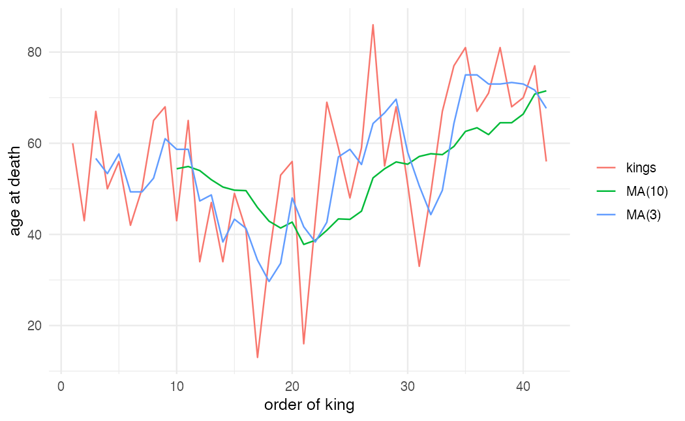
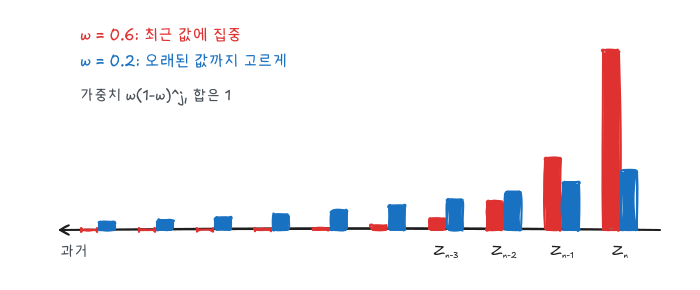
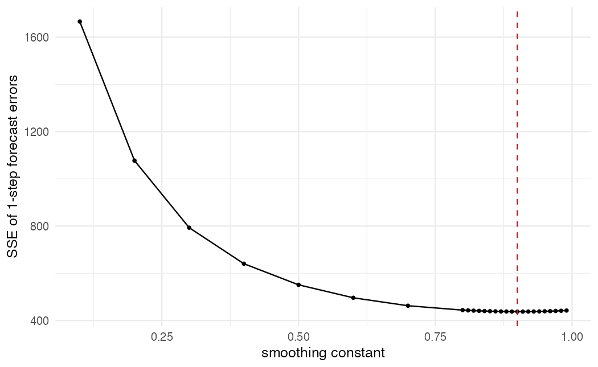
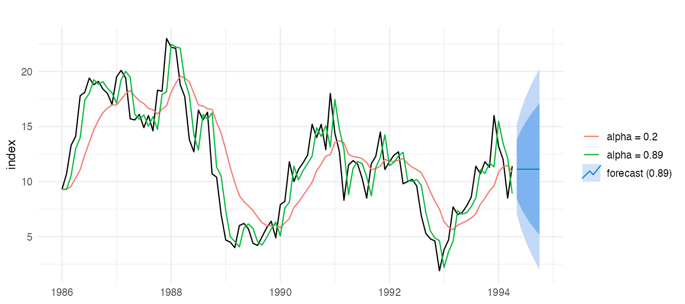
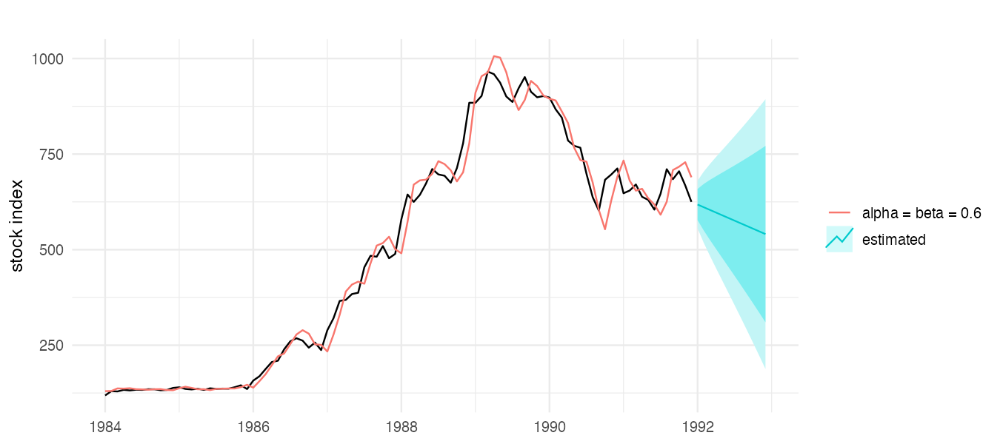
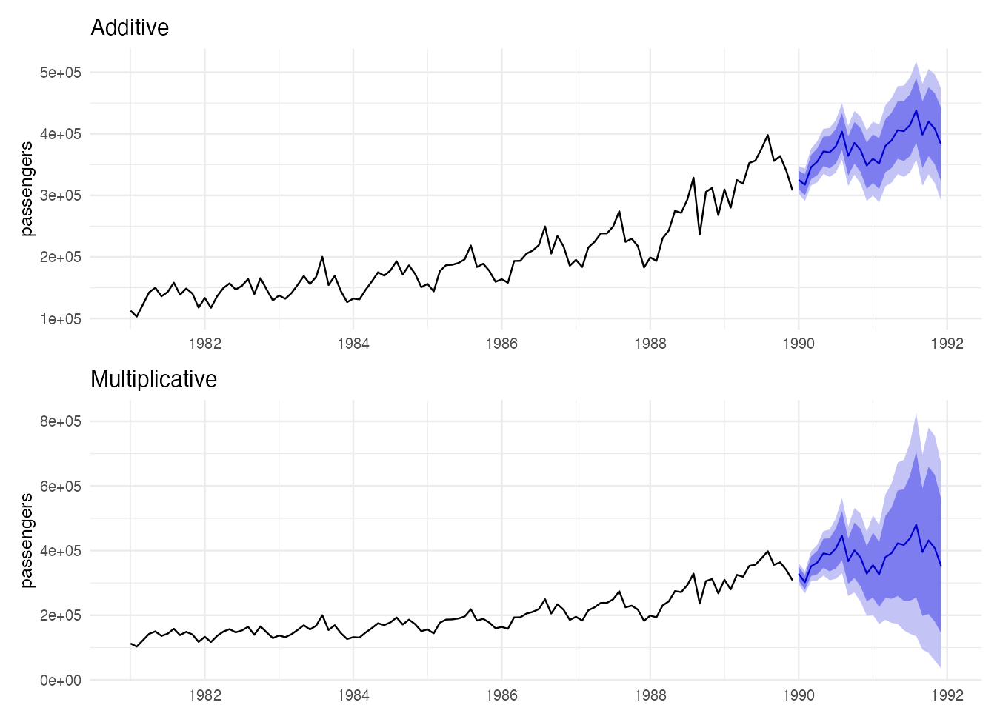
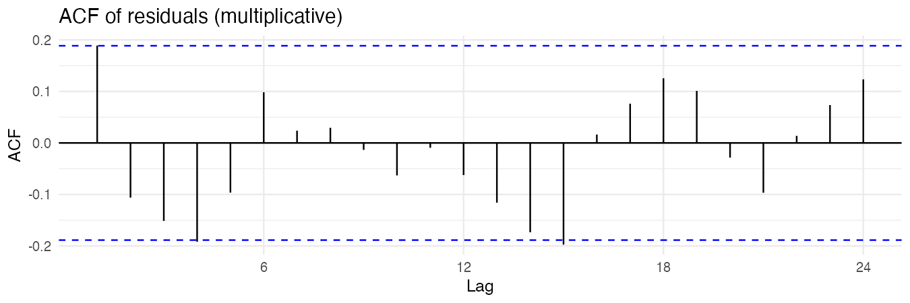

『SAS/ETS를 이용한 시계열분석』(조신섭·손영숙·성병찬)과 전북대학교 이영미 교수님 강의의 3장을 정리했다. 평활법은 과거 관측값의 **가중평균**으로 현재 수준을 추정하고, 그것을 예측값으로 쓴다. 추세모형과 달리 모수가 시간에 따라 천천히 변하는 상황(국지적 수준)을 다룰 수 있다.

```r title="환경 설정"
library(tidyverse)
library(forecast)
library(patchwork)
theme_set(theme_minimal(base_size = 12))

data_url <- "https://raw.githubusercontent.com/Bricoler/time-series-analysis/master/timedata/"
read_ts <- function(file, start, frequency = 12) {
  ts(scan(paste0(data_url, file), quiet = TRUE), start = start, frequency = frequency)
}
```

## 1. 이동평균

상수평균모형 $Z_t = \beta_0 + \epsilon_t$의 예측값 $\bar Z$는 모든 과거 값에 $1/n$씩 같은 가중치를 준다. 수준이 천천히 변한다면 오래된 관측값은 덜 믿어야 한다. 가장 단순한 방법은 최근 $m$개만 평균내는 것이다.

$$
M_t = \frac{1}{m}(Z_t + Z_{t-1} + \cdots + Z_{t-m+1}), \qquad \hat Z_t(l) = M_t
$$

$M_t = M_{t-1} + \frac{1}{m}(Z_t - Z_{t-m})$로 갱신할 수 있다. $m$이 크면 매끄럽지만 변화에 늦게 반응하고, 작으면 빠르게 반응하지만 불규칙 변동까지 따라간다.

```r
kings <- ts(scan("https://robjhyndman.com/tsdldata/misc/kings.dat", skip = 3, quiet = TRUE))

tibble(t = seq_along(kings), kings = as.numeric(kings),
       `MA(3)` = stats::filter(kings, rep(1/3, 3), sides = 1),
       `MA(10)` = stats::filter(kings, rep(1/10, 10), sides = 1)) |>
  pivot_longer(-t) |>
  ggplot(aes(t, value, color = name)) +
  geom_line(na.rm = TRUE) +
  labs(x = "order of king", y = "age at death", color = NULL)
```



`stats::filter(..., sides = 1)`은 현재와 과거 값만 쓰는 후행 이동평균이다. 처음 $m - 1$개는 계산할 수 없어 `NA`가 된다. 이동평균은 예측보다 4편 분해법에서 추세를 뽑아내는 데 더 많이 쓰인다.

## 2. 단순지수평활법

### 원리

모든 과거 값을 쓰되 가중치를 **지수적으로** 줄인다.

$$
S_n = \omega Z_n + \omega(1-\omega) Z_{n-1} + \omega(1-\omega)^2 Z_{n-2} + \cdots, \qquad 0 < \omega < 1
$$



가중치의 합은 $\omega \sum_{j \ge 0} (1-\omega)^j = 1$이다. 이 식을 정리하면 갱신식이 된다.

$$
S_n = \omega Z_n + (1 - \omega) S_{n-1} = S_{n-1} + \omega (Z_n - S_{n-1})
$$

$\hat Z_n(l) = S_n$이므로 "새 예측 = 이전 예측 + $\omega$ × 1시차 예측오차"다. 2편 상수평균모형의 갱신식에서 $1/(n+1)$을 상수 $\omega$로 바꾼 것과 같다.

| 평활상수 $\omega$ | 반응 | 쓰임 |
|---|---|---|
| 작다 (0.05~0.3) | 평활 효과 큼, 변화에 둔감 | 수준이 거의 일정 |
| 크다 (0.7 이상) | 최근 값에 민감 | 수준이 빠르게 변함 |

### 초기값과 평활상수

- 초기 평활값 $S_0$: 표본평균 $\bar Z$, 첫 관측값 $Z_1$, 또는 처음 몇 개의 평균. $n$이 크면 영향이 작다.
- $\omega$: 1시차 예측오차의 제곱합 $SSE(\omega) = \sum_t (Z_t - S_{t-1})^2$이 최소가 되는 값을 고른다. Brown은 0.05~0.3을, 다른 문헌은 자료로 추정할 것을 권한다.

### 예제: 중간재 출하지수

```r
mindex <- read_ts("mindex.txt", start = c(1986, 1))

w <- c(seq(0.1, 0.8, 0.1), seq(0.81, 0.99, 0.01))
sse <- map_dbl(w, \(a) sum(residuals(ses(mindex, alpha = a, initial = "simple"))^2))

tibble(w, sse) |>
  ggplot(aes(w, sse)) +
  geom_line() + geom_point(size = 1) +
  geom_vline(xintercept = w[which.min(sse)], linetype = "dashed", color = "firebrick") +
  labs(x = "smoothing constant", y = "SSE of 1-step forecast errors")
w[which.min(sse)]
```



SSE는 0.9 근처에서 가장 작다(교재는 0.89). 평활상수가 1에 가깝다는 것은 "바로 전 값이 가장 좋은 예측"이라는 뜻이고, 이 시계열이 확률보행에 가깝다는 신호다(7편).

```r w=9 h=4
fit_02 <- ses(mindex, alpha = 0.2, initial = "simple", h = 6)
fit_89 <- ses(mindex, alpha = 0.89, initial = "simple", h = 6)

autoplot(mindex) +
  autolayer(fitted(fit_02), series = "alpha = 0.2") +
  autolayer(fitted(fit_89), series = "alpha = 0.89") +
  autolayer(fit_89, series = "forecast (0.89)", PI = TRUE) +
  labs(x = NULL, y = "index", color = NULL)
```



$\omega = 0.2$는 변화를 늦게 따라가고, 0.89는 거의 원계열을 한 칸 늦게 따라간다. 단순지수평활의 예측은 모든 미래 시점에서 같은 값($S_n$)이라 평평한 직선이다. `ses()`에서 `alpha`를 빼면 최대가능도로 추정한다.

### 장단점

- 계산이 쉽고 새 관측값으로 바로 갱신된다. 이상점에 비교적 강건하다.
- 평활상수를 정하는 이론적 근거가 약하고, 확률모형이 아니라서 예측구간을 구하기 어렵다(`forecast`는 대응하는 상태공간 모형으로 구간을 계산한다).
- 수학적으로는 ARIMA(0,1,1)의 예측과 같다(7편).

## 3. 이중지수평활법

선형 추세가 있으면 단순지수평활은 계속 한 박자 늦는다. 평활을 한 번 더 한다.

$$
S_n^{(1)} = \omega Z_n + (1-\omega) S_{n-1}^{(1)}, \qquad S_n^{(2)} = \omega S_n^{(1)} + (1-\omega) S_{n-1}^{(2)}
$$

선형 추세 $Z_t = \beta_0 + \beta_1 t + \epsilon_t$에서 $E(S_n^{(1)}) = \beta_{0} + \beta_1 n - \frac{1-\omega}{\omega}\beta_1$로 늦게 따라가는 편향이 생기고, 두 평활값의 차이로 이를 보정해 수준과 기울기를 추정한다.

$$
\hat\beta_{1,n} = \frac{\omega}{1-\omega}\left( S_n^{(1)} - S_n^{(2)} \right), \qquad \hat Z_n(l) = \left( 2 + \frac{\omega l}{1-\omega} \right) S_n^{(1)} - \left( 1 + \frac{\omega l}{1-\omega} \right) S_n^{(2)}
$$

### Holt의 방법

수준과 기울기에 서로 다른 평활상수를 쓴다.

$$
\begin{aligned}
L_n &= \alpha Z_n + (1-\alpha)(L_{n-1} + b_{n-1}) \\
b_n &= \beta (L_n - L_{n-1}) + (1-\beta) b_{n-1} \\
\hat Z_n(l) &= L_n + l\, b_n
\end{aligned}
$$

### 예제: 월별 주가지수

```r w=9 h=4
stock <- read_ts("stock.txt", start = c(1984, 1))

fit_holt <- holt(stock, alpha = 0.6, beta = 0.6, initial = "simple", h = 12)
fit_holt_est <- holt(stock, h = 12)
round(fit_holt_est$model$par, 3)

autoplot(stock) +
  autolayer(fitted(fit_holt), series = "alpha = beta = 0.6") +
  autolayer(fit_holt_est, series = "estimated", PI = TRUE) +
  labs(x = NULL, y = "stock index", color = NULL)
```



추정된 $\alpha$가 1에 가까워 수준은 거의 마지막 관측값을 그대로 따르고, 기울기만 천천히 갱신된다. Holt 예측은 마지막 기울기로 직선을 그어 나간다. 주가처럼 추세가 자주 바뀌는 자료는 장기 예측구간이 빠르게 넓어진다.

## 4. Winters의 계절지수평활법

수준, 기울기, 계절 세 성분을 각각 평활한다. 계절 주기를 $s$라 하자.

| | 가법 모형 | 승법 모형 |
|---|---|---|
| 구조 | $Z_t = T_t + S_t + I_t$ | $Z_t = T_t \times S_t \times I_t$ |
| 쓰임 | 계절 진폭이 일정 | 계절 진폭이 수준에 비례 |
| 수준 갱신 | $L_n = \alpha(Z_n - S_{n-s}) + (1-\alpha)(L_{n-1} + b_{n-1})$ | $L_n = \alpha \dfrac{Z_n}{S_{n-s}} + (1-\alpha)(L_{n-1} + b_{n-1})$ |
| 계절 갱신 | $S_n = \gamma(Z_n - L_n) + (1-\gamma) S_{n-s}$ | $S_n = \gamma \dfrac{Z_n}{L_n} + (1-\gamma) S_{n-s}$ |
| 예측 | $L_n + l b_n + S_{n+l-s}$ | $(L_n + l b_n) S_{n+l-s}$ |

기울기 갱신은 Holt와 같다.

### 예제: 국내 항공 승객 수

```r
pass <- read_ts("koreapass.txt", start = c(1981, 1))

fit_add <- hw(pass, seasonal = "additive", h = 24)
fit_mult <- hw(pass, seasonal = "multiplicative", h = 24)

rbind(additive = accuracy(fit_add)[, c("RMSE", "MAE", "MAPE")],
      multiplicative = accuracy(fit_mult)[, c("RMSE", "MAE", "MAPE")])
```

```r w=9 h=6.5
p1 <- autoplot(pass) + autolayer(fit_add, PI = TRUE) +
  labs(title = "Additive", x = NULL, y = "passengers")
p2 <- autoplot(pass) + autolayer(fit_mult, PI = TRUE) +
  labs(title = "Multiplicative", x = NULL, y = "passengers")
p1 / p2
```



승객 수가 늘면서 계절 진폭도 커지는 자료라 승법 모형이 더 자연스럽다. `accuracy()`의 적합 오차도 비교 근거가 된다. 정확한 비교는 마지막 1~2년을 떼어 두고 예측오차를 보는 것이다.

```r w=9 h=3
checkresiduals(fit_mult, plot = FALSE)
ggAcf(residuals(fit_mult)) + labs(title = "ACF of residuals (multiplicative)")
```



`checkresiduals()`는 잔차의 Ljung-Box 검정을 출력한다(8편). 잔차에 상관이 남아 있으면 평활법이 잡지 못한 구조가 있다는 뜻이다.

## 요약

| 방법 | 성분 | 평활상수 | R |
|---|---|---|---|
| 이동평균 | 수준 | 창 크기 $m$ | `stats::filter`, `ma` |
| 단순지수평활 | 수준 | $\omega$ (또는 $\alpha$) | `ses()` |
| 이중지수평활 / Holt | 수준 + 기울기 | $\alpha$, $\beta$ | `holt()` |
| Winters 가법 | 수준 + 기울기 + 계절 (진폭 일정) | $\alpha$, $\beta$, $\gamma$ | `hw(seasonal = "additive")` |
| Winters 승법 | 계절 진폭이 수준에 비례 | $\alpha$, $\beta$, $\gamma$ | `hw(seasonal = "multiplicative")` |
| 평활상수 선택 | 1시차 예측오차 제곱합 최소 | | 생략하면 자동 추정 |
