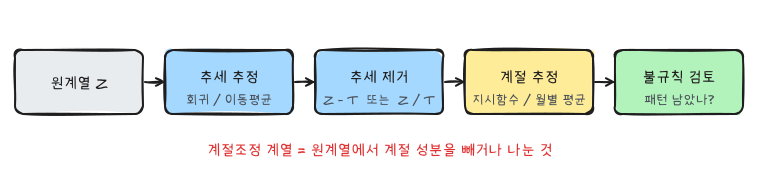
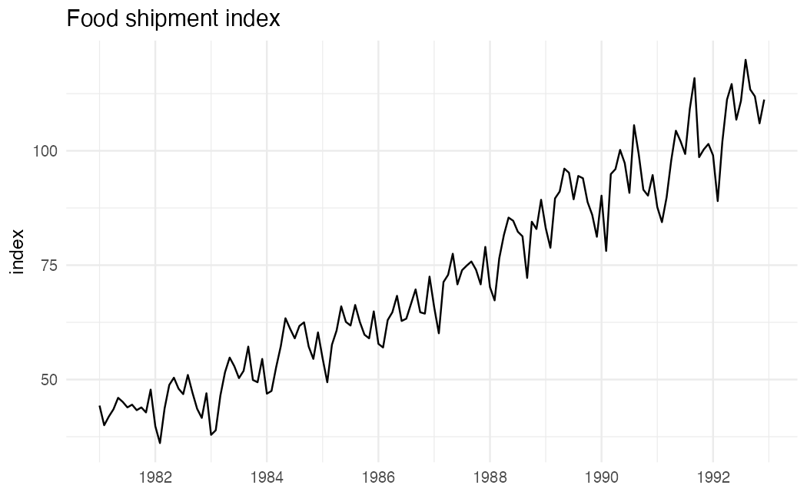
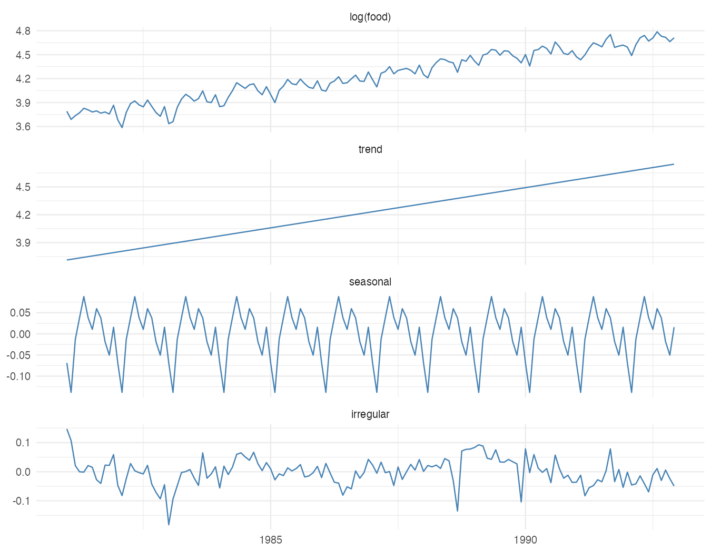
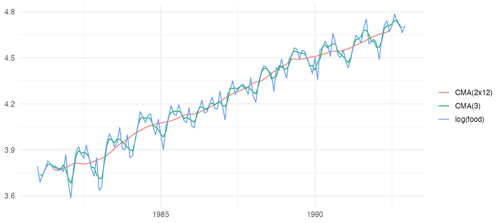
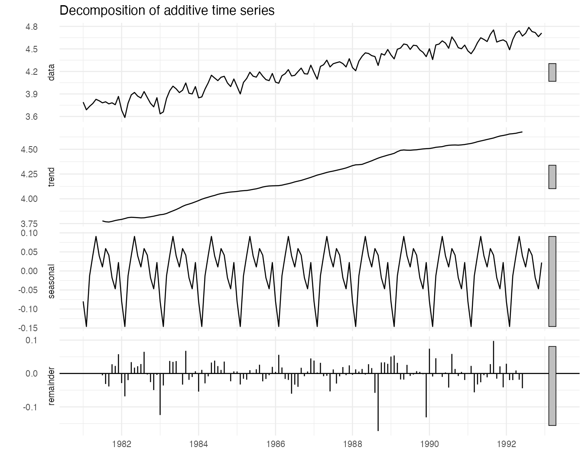
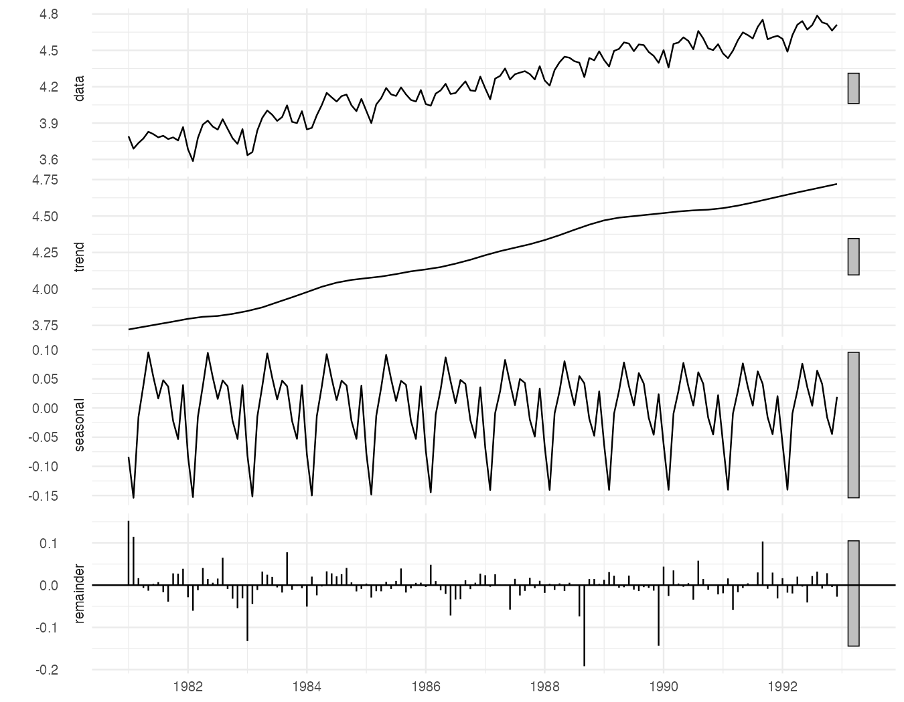
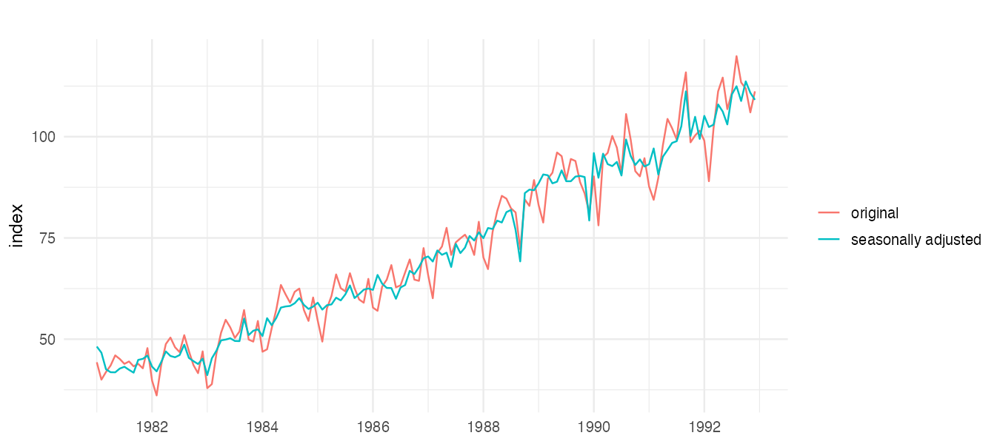

『SAS/ETS를 이용한 시계열분석』(조신섭·손영숙·성병찬)과 전북대학교 이영미 교수님 강의의 4장을 정리했다. 분해법은 시계열을 추세, 계절, 불규칙 성분으로 **분리해서 각각 추정**하는 방법이다. 20세기 초 경제학자들이 경기변동을 예측하려고 시작한 오래된 방법이지만, 지금도 공식 통계의 **계절조정**에 표준으로 쓰인다.

```r title="환경 설정"
library(tidyverse)
library(forecast)
library(patchwork)
theme_set(theme_minimal(base_size = 12))

data_url <- "https://raw.githubusercontent.com/Bricoler/time-series-analysis/master/timedata/"
read_ts <- function(file, start, frequency = 12) {
  ts(scan(paste0(data_url, file), quiet = TRUE), start = start, frequency = frequency)
}
```

## 1. 평활법과 분해법

| | 평활법 | 분해법 |
|---|---|---|
| 목적 | 불규칙 변동을 걸러 미래 예측 | 각 성분을 따로 보고 해석 |
| 성분 | 구분하지 않고 함께 평활 | 추세·계절·불규칙을 분리 |
| 주 용도 | 예측 | 계절조정, 경기 판단 |

## 2. 분해 모형

| 모형 | 식 | 언제 |
|---|---|---|
| 가법 | $Z_t = T_t + S_t + C_t + I_t$ | 계절 진폭이 수준과 무관하게 일정 |
| 승법 | $Z_t = T_t \times S_t \times C_t \times I_t$ | 계절 진폭이 수준에 비례 |

승법 모형에 로그를 취하면 가법 모형이 된다: $\log Z_t = \log T_t + \log S_t + \log C_t + \log I_t$. 순환 성분 $C_t$는 주기를 찾기 어려워 보통 추세에 포함시켜 $T_t$로 함께 다룬다.



## 3. 추세모형에 의한 분해

추세는 다항식, 계절은 지시함수로 둔다.

$$
T_t = \beta_0 + \beta_1 t + \cdots + \beta_k t^k, \qquad S_t = \sum_{i=1}^{s} \delta_i IND_{it}
$$

**가법 모형의 단계**

1. 추세 추정: $Z_t$에 추세모형을 적합해 $\hat T_t$를 구한다.
2. 계절 추정: 추세를 뺀 $Z_t - \hat T_t$에 지시함수 모형을 적합해 $\hat S_t$를 구한다.
3. 불규칙 성분 검토: $\hat I_t = Z_t - \hat T_t - \hat S_t$에 체계적인 패턴이 남았는지 본다.

승법 모형은 2단계에서 $Z_t / \hat T_t$에, 3단계에서 $Z_t / (\hat T_t \hat S_t)$로 바꾸면 된다.

### 예제: 식료품 출하지수

```r
food <- read_ts("food.txt", start = c(1981, 1))
autoplot(food) + labs(x = NULL, y = "index", title = "Food shipment index")
```



증가 추세가 있고, 계절 진폭이 수준과 함께 조금씩 커진다. 로그를 취해 가법 분해를 해 본다.

```r
log_food <- log(food)
d <- tibble(
  date = as.numeric(time(food)),
  z = as.numeric(log_food),
  t = seq_along(food),
  month = factor(cycle(food))
)

trend_fit <- lm(z ~ t, data = d)
d <- d |> mutate(trend = fitted(trend_fit), adj_trend = z - trend)

season_fit <- lm(adj_trend ~ 0 + month, data = d)
d <- d |> mutate(seasonal = fitted(season_fit), irregular = z - trend - seasonal)

round(coef(season_fit), 3)
```

계절 계수는 로그 척도에서 추세를 기준으로 한 월별 편차다. $e^{\hat\delta_i}$로 바꾸면 "그 달은 추세보다 몇 배인가"라는 계절지수가 된다.

```r w=9 h=7
d |>
  select(date, `log(food)` = z, trend, seasonal, irregular) |>
  pivot_longer(-date) |>
  mutate(name = fct_inorder(name)) |>
  ggplot(aes(date, value)) +
  geom_line(color = "steelblue") +
  facet_wrap(~name, ncol = 1, scales = "free_y") +
  labs(x = NULL, y = NULL)
```



불규칙 성분에 아직 굴곡이 보이면 추세를 1차식으로 둔 것이 부족했거나 순환 성분이 남아 있다는 뜻이다.

### 단점

- 추세와 계절을 따로따로 추정하지만, 두 성분은 서로 독립이 아니므로 단계별 추정은 최적이 아니다. 한 번에 $Z_t = \beta_0 + \beta_1 t + \sum \delta_i IND_{it} + \epsilon_t$로 적합하는 것과 결과가 다를 수 있다.
- 추세·계절의 모수가 전체 기간 동안 고정되어 있다고 가정한다. 시간에 따라 변하면 이동평균에 의한 분해를 쓴다.

## 4. 이동평균

### 단순이동평균

$$
M_t = \frac{1}{m}(Z_t + Z_{t-1} + \cdots + Z_{t-m+1})
$$

3편의 이동평균과 같다. 과거 값만 쓰므로 추세가 있으면 $(m-1)/2$시점만큼 늦게 따라간다.

### 중심이동평균

추세를 뽑을 때는 앞뒤를 대칭으로 쓴다.

$$
M_t = \frac{1}{2l + 1} \sum_{j=-l}^{l} Z_{t+j}
$$

| $t$ | 1 | 2 | 3 | 4 | 5 | 6 |
|---|---|---|---|---|---|---|
| $Z_t$ | 10 | 12 | 8 | 12 | 7 | 5 |
| 단순 MA(3) | | | 10.0 | 10.7 | 9.0 | 8.0 |
| 중심 MA(3) | | 10.0 | 10.7 | 9.0 | 8.0 | |

같은 숫자지만 중심이동평균은 가운데 시점에 붙는다. 주기가 짝수(월별 12)이면 $2 \times 12$ 이동평균(12항 이동평균을 다시 2항 평균)을 써서 중심을 맞춘다.

$$
M_t = \frac{1}{24} Z_{t-6} + \frac{1}{12}\left( Z_{t-5} + \cdots + Z_{t+5} \right) + \frac{1}{24} Z_{t+6}
$$

창 크기를 계절 주기와 같게 하면 계절 성분이 평균에서 상쇄되어 **추세만 남는다**.

```r w=9 h=4
tibble(date = as.numeric(time(log_food)), `log(food)` = as.numeric(log_food),
       `CMA(3)` = as.numeric(ma(log_food, 3)),
       `CMA(2x12)` = as.numeric(ma(log_food, 12))) |>
  pivot_longer(-date) |>
  ggplot(aes(date, value, color = name)) +
  geom_line(na.rm = TRUE) +
  labs(x = NULL, y = NULL, color = NULL)
```



`forecast::ma(x, order)`는 중심이동평균이고, 짝수 차수는 자동으로 $2 \times m$ 이동평균을 한다. 3항 이동평균은 계절 변동을 거의 그대로 따라가고, 12항 이동평균은 매끄러운 추세만 남긴다.

## 5. 이동평균을 이용한 분해

**고전적 분해(가법)**

1. $\hat T_t$ = 계절 주기에 맞춘 중심이동평균
2. $Z_t - \hat T_t$를 월별로 평균내 계절 성분을 구하고, 12개 값의 합이 0이 되도록 조정
3. $\hat I_t = Z_t - \hat T_t - \hat S_t$

```r w=9 h=7
dec <- decompose(log_food, type = "additive")
autoplot(dec) + labs(x = NULL)
```



양 끝 6개월은 이동평균을 계산할 수 없어 추세와 불규칙 성분이 비어 있다. 계절 성분은 해마다 똑같다.

### STL

STL(Seasonal and Trend decomposition using Loess)은 국소회귀(loess)로 추세와 계절을 반복 추정한다. 계절 패턴이 해마다 조금씩 변하는 것을 허용하고, 이상점에 강건하게(`robust = TRUE`) 만들 수 있다.

```r w=9 h=7
fit_stl <- stl(log_food, s.window = 13, robust = TRUE)
autoplot(fit_stl) + labs(x = NULL)
```



`s.window`는 계절 성분을 평활하는 창의 크기다. 작을수록 계절 패턴이 해마다 많이 변할 수 있고, `"periodic"`으로 두면 매년 같은 계절 패턴이 된다.

## 6. 계절조정

공식 통계에서 "계절조정 계열"이라고 부르는 것은 원계열에서 계절 성분을 뺀(승법이면 나눈) 값이다.

$$
Z_t^{SA} = Z_t - \hat S_t \;\; \text{(가법)}, \qquad Z_t^{SA} = Z_t / \hat S_t \;\; \text{(승법)}
$$

```r w=9 h=4
sa <- exp(seasadj(fit_stl))
autoplot(food, series = "original") +
  autolayer(sa, series = "seasonally adjusted") +
  labs(x = NULL, y = "index", color = NULL)
```



계절조정을 하면 "이번 달 출하가 지난달보다 줄었다"가 계절 때문인지 실제 경기 때문인지 판단할 수 있다. 통계청과 한국은행은 이동평균을 여러 번 반복하는 X-13ARIMA-SEATS를 쓴다. R에서는 `seasonal` 패키지가 이를 감싸 준다.

## 요약

| 단계 | 추세모형 분해 | 이동평균 분해 |
|---|---|---|
| 추세 | 다항식 회귀 | 중심이동평균, loess |
| 계절 | 추세 제거 후 지시함수 회귀 | 추세 제거 후 월별 평균 |
| 성분의 시간 변화 | 고정 | 허용 (STL) |
| R | `lm()` | `decompose()`, `stl()` |
| 계절조정 | $Z_t - \hat S_t$ 또는 $Z_t / \hat S_t$ | `seasadj()` |
