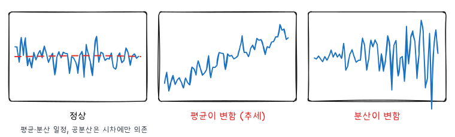
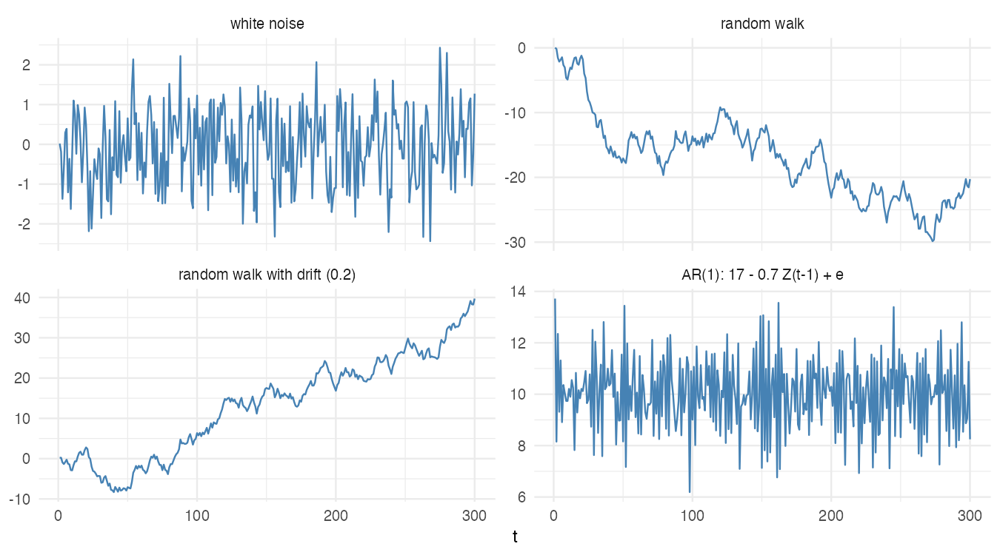
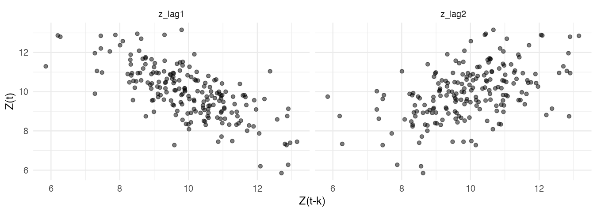
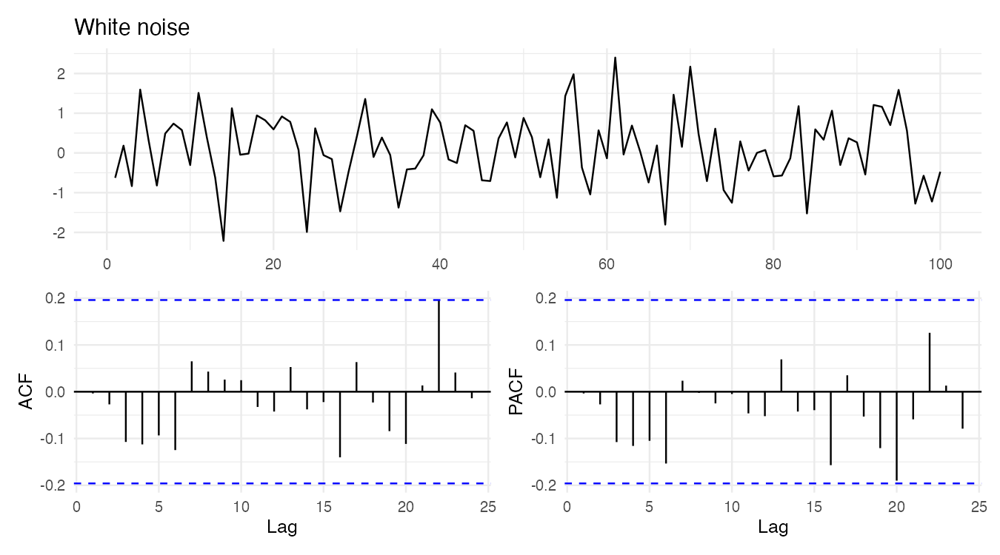
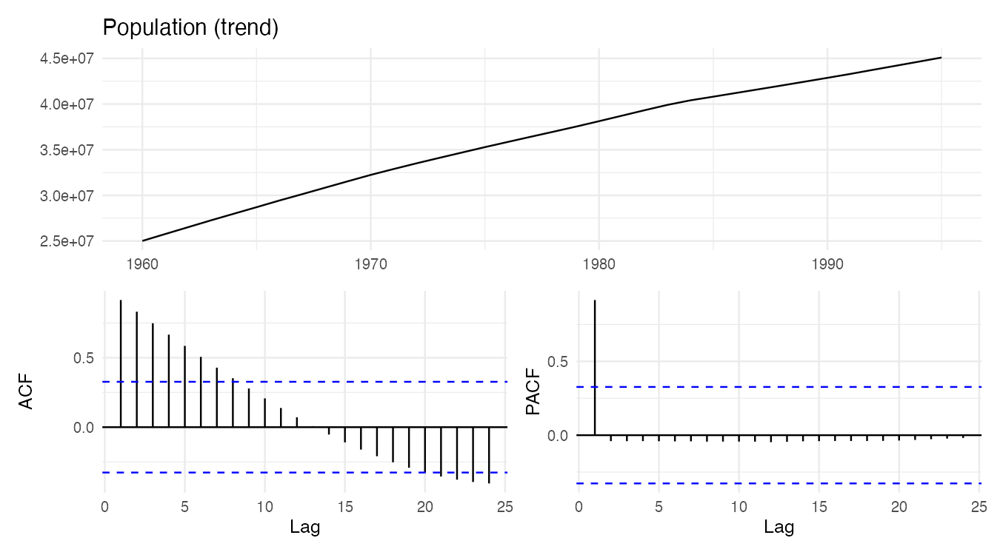
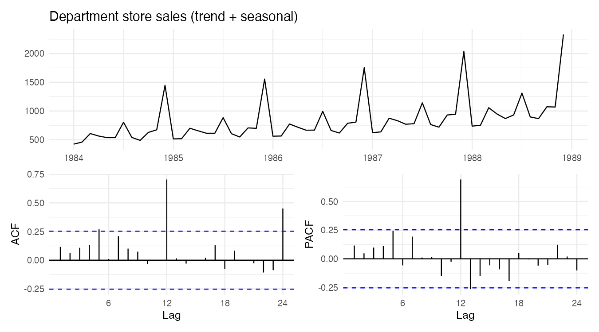
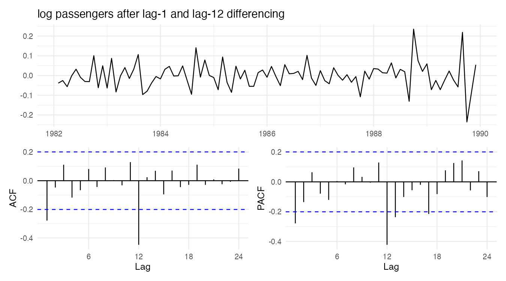

『SAS/ETS를 이용한 시계열분석』(조신섭·손영숙·성병찬)과 전북대학교 이영미 교수님 강의의 5장을 정리했다. 4편까지는 시계열을 "결정적인 함수 + 독립 오차"로 보았다. 5편부터는 시계열 전체를 하나의 **확률과정**으로 보고, 관측값들 사이의 상관 구조 자체를 모형으로 만든다.

```r title="환경 설정"
library(tidyverse)
library(forecast)
library(patchwork)
theme_set(theme_minimal(base_size = 12))

data_url <- "https://raw.githubusercontent.com/Bricoler/time-series-analysis/master/timedata/"
read_ts <- function(file, start, frequency = 12) {
  ts(scan(paste0(data_url, file), quiet = TRUE), start = start, frequency = frequency)
}
```

## 1. 확률과정

시간 $t$로 색인된 확률변수들의 모임 $\{Z_t, t \in T\}$를 확률과정이라 한다. 우리가 가진 시계열 $z_1, \dots, z_n$은 이 확률과정에서 나온 **하나의 실현값**(표본경로)이다.

통상적인 통계에서는 같은 분포에서 독립 표본을 여러 개 얻어 평균과 분산을 추정한다. 시계열은 각 시점마다 관측값이 **딱 하나**뿐이다. 1990년 1월의 출하지수를 다시 관측할 방법은 없다. 그래서 "시간이 지나도 확률적 성질이 변하지 않는다"는 가정이 있어야 서로 다른 시점의 관측값을 모아 모수를 추정할 수 있다. 이것이 정상성이다.

## 2. 정상성

**강정상성**: 임의의 시점 $t_1, \dots, t_k$와 이동 $h$에 대해 결합분포가 같다.

$$
(Z_{t_1}, \dots, Z_{t_k}) \overset{d}{=} (Z_{t_1 + h}, \dots, Z_{t_k + h})
$$

결합분포 전체를 확인하는 것은 불가능에 가깝다. 실제로는 1차·2차 적률만 요구하는 약정상성을 쓴다.

**약정상성**(공분산 정상성): $E(Z_t^2) < \infty$이고

1. $E(Z_t) = \mu$ (평균이 일정)
2. $Var(Z_t) = \sigma^2$ (분산이 일정)
3. $Cov(Z_t, Z_{t+k}) = \gamma_k$ (공분산이 시점 $t$와 무관하고 시차 $k$에만 의존)

| 관계 | |
|---|---|
| 강정상 + 2차 적률 존재 | ⇒ 약정상 |
| 약정상 + 정규과정 | ⇒ 강정상 (정규분포는 평균과 공분산으로 결정) |

이 시리즈에서 "정상"은 약정상성을 뜻한다.



| 비정상의 원인 | 시계열 그림에서 보이는 것 | 대처 (7편) |
|---|---|---|
| 평균이 변함 | 추세, 수준 이동 | 차분, 추세 제거 |
| 분산이 변함 | 진폭이 점점 커짐 | 로그, Box-Cox 변환 |
| 계절성 | 주기적 반복 | 계절 차분 |

## 3. 백색잡음과 확률보행

### 백색잡음

$$
\epsilon_t \sim WN(0, \sigma^2): \quad E(\epsilon_t) = 0, \quad Var(\epsilon_t) = \sigma^2, \quad Cov(\epsilon_t, \epsilon_s) = 0 \;\; (t \ne s)
$$

서로 상관이 없는 확률변수의 열이다. 정규분포까지 따르면 iid 정규 백색잡음이다. 모든 ARMA 모형의 재료이고, 모형 적합 후 잔차가 백색잡음이어야 한다.

### 확률보행

$$
Z_t = Z_{t-1} + \epsilon_t = \epsilon_1 + \epsilon_2 + \cdots + \epsilon_t, \qquad Z_0 = 0
$$

$$
E(Z_t) = 0, \qquad Var(Z_t) = t\sigma^2, \qquad Cov(Z_t, Z_{t+k}) = t\sigma^2
$$

평균은 0으로 일정하지만 분산과 공분산이 $t$에 따라 커지므로 **비정상**이다. 절편(표류항) $\delta$가 있으면 $E(Z_t) = \delta t$로 평균까지 시간에 따라 변한다.

```r w=9 h=5
set.seed(10)
n <- 300
e <- rnorm(n)
sim <- tibble(
  t = 1:n,
  `white noise` = e,
  `random walk` = cumsum(e),
  `random walk with drift (0.2)` = cumsum(0.2 + e),
  `AR(1): 17 - 0.7 Z(t-1) + e` = as.numeric(arima.sim(list(ar = -0.7), n = n) + 10)
)

sim |>
  pivot_longer(-t) |>
  mutate(name = fct_inorder(name)) |>
  ggplot(aes(t, value)) +
  geom_line(color = "steelblue") +
  facet_wrap(~name, scales = "free_y") +
  labs(x = "t", y = NULL)
```



정상 AR(1)은 평균 $17 / (1 + 0.7) = 10$ 주위를 오르내린다. 확률보행은 평균으로 돌아오려는 힘이 없어 어디로든 흘러간다.

## 4. 선형과정과 Wold 분해

**후진연산자** $B$: $B Z_t = Z_{t-1}$, $B^k Z_t = Z_{t-k}$.

**선형과정**: 백색잡음의 무한 가중합으로 표현되는 과정이다.

$$
Z_t = \mu + \epsilon_t + \psi_1 \epsilon_{t-1} + \psi_2 \epsilon_{t-2} + \cdots = \mu + \Psi(B)\epsilon_t, \qquad \Psi(B) = 1 + \psi_1 B + \psi_2 B^2 + \cdots
$$

$$
E(Z_t) = \mu, \qquad \gamma_k = \sigma^2 \sum_{j=0}^{\infty} \psi_j \psi_{j+k} \;\; (\psi_0 = 1)
$$

$\sum \psi_j^2 < \infty$이면 분산이 유한하고 정상이다.

**Wold 분해 정리(1938)**: 결정적 성분이 없는 모든 약정상 과정은 이런 선형과정으로 표현된다. 즉 정상 시계열을 모델링한다는 것은 $\psi_j$들을 찾는 일이다. 무한히 많은 $\psi_j$를 소수의 모수로 근사하는 것이 6편의 ARMA 모형이다.

## 5. 자기상관함수(ACF)

$$
\rho_k = Corr(Z_t, Z_{t+k}) = \frac{\gamma_k}{\gamma_0}, \qquad \rho_0 = 1, \quad |\rho_k| \le 1, \quad \rho_{-k} = \rho_k
$$

### 표본 자기상관함수(SACF)

$$
\hat\rho_k = r_k = \frac{\sum_{t=1}^{n-k} (Z_t - \bar Z)(Z_{t+k} - \bar Z)}{\sum_{t=1}^{n} (Z_t - \bar Z)^2}
$$

백색잡음이면 $\hat\rho_k \;\dot\sim\; N(0, 1/n)$이다. 그래서 ACF 그림의 파란 점선 $\pm 2/\sqrt n$ 밖으로 나가는 막대가 있으면 "시차 $k$에 자기상관이 있다"고 본다. 시차를 20개 그리면 백색잡음에서도 1개 정도는 우연히 점선을 넘으므로 하나만 보고 판단하지 않는다.

```r w=9 h=3.2
z <- as.numeric(arima.sim(list(ar = -0.7), n = 200)) + 10
tibble(z = z, z_lag1 = lag(z), z_lag2 = lag(z, 2)) |>
  pivot_longer(-z, names_to = "lag") |>
  ggplot(aes(value, z)) +
  geom_point(alpha = 0.5, na.rm = TRUE) +
  facet_wrap(~lag) +
  labs(x = "Z(t-k)", y = "Z(t)")
```



$\phi = -0.7$이면 시차 1 산점도는 음의 기울기, 시차 2는 $(-0.7)^2 = 0.49$의 양의 기울기를 보인다. ACF는 이 산점도들의 상관계수를 시차별로 늘어놓은 것이다.

## 6. 부분자기상관함수(PACF)

$Z_t$와 $Z_{t+k}$ 사이의 상관 중 **중간 시점 $Z_{t+1}, \dots, Z_{t+k-1}$의 영향을 제거한** 상관이다.

$$
\phi_{kk} = Corr(Z_t - \hat Z_t, \; Z_{t+k} - \hat Z_{t+k})
$$

$\hat Z_t$, $\hat Z_{t+k}$는 중간 값들로 회귀한 예측값이다. 다른 표현으로, $Z_{t}$를 $Z_{t-1}, \dots, Z_{t-k}$로 회귀했을 때 마지막 계수가 $\phi_{kk}$다.

$$
Z_t = \phi_{k1} Z_{t-1} + \phi_{k2} Z_{t-2} + \cdots + \phi_{kk} Z_{t-k} + e_t
$$

양변에 $Z_{t-j}$를 곱해 기댓값을 취하면 Yule-Walker 방정식이 나온다.

$$
\rho_j = \phi_{k1} \rho_{j-1} + \phi_{k2} \rho_{j-2} + \cdots + \phi_{kk} \rho_{j-k}, \qquad j = 1, \dots, k
$$

$k = 1$이면 $\phi_{11} = \rho_1$, $k = 2$이면 $\phi_{22} = \dfrac{\rho_2 - \rho_1^2}{1 - \rho_1^2}$이다. 표본에서는 $\rho_j$ 대신 $r_j$를 넣어 SPACF를 구한다. AR($p$)이면 $k > p$에서 $\phi_{kk} = 0$이 되므로, PACF는 AR 모형의 차수를 정하는 데 쓰인다(6편).

## 7. 실제 시계열의 SACF·SPACF

```r
acf_pair <- function(x, title) {
  (autoplot(x) + labs(title = title, x = NULL, y = NULL)) /
    (ggAcf(x, lag.max = 24) + labs(title = NULL) | ggPacf(x, lag.max = 24) + labs(title = NULL))
}
```

```r w=9 h=5
set.seed(1)
acf_pair(ts(rnorm(100)), "White noise")
```



```r w=9 h=5
acf_pair(read_ts("population.txt", start = 1960, frequency = 1), "Population (trend)")
```



```r w=9 h=5
acf_pair(read_ts("depart.txt", start = c(1984, 1)), "Department store sales (trend + seasonal)")
```



```r w=9 h=5
pass <- read_ts("koreapass.txt", start = c(1981, 1))
acf_pair(diff(diff(log(pass), 12)), "log passengers after lag-1 and lag-12 differencing")
```



| SACF 모양 | 의미 |
|---|---|
| 모든 시차에서 점선 안 | 백색잡음 |
| 매우 천천히 선형으로 감소 | 추세(비정상) → 차분 필요 |
| 시차 12, 24에서 큰 값이 반복 | 월별 계절성 → 계절 차분 |
| 빠르게 0으로 감소 | 정상 시계열 → ARMA로 모델링 |

## 요약

| 개념 | 핵심 |
|---|---|
| 확률과정 | 시계열은 하나의 실현값 |
| 약정상성 | 평균·분산 일정, 공분산은 시차에만 의존 |
| 백색잡음 | 서로 상관없는 오차, 모형의 재료이자 잔차의 목표 |
| 확률보행 | $Var(Z_t) = t\sigma^2$, 비정상 |
| Wold 분해 | 정상 과정 = 백색잡음의 선형결합 |
| ACF | $\rho_k = \gamma_k / \gamma_0$, 백색잡음 기준선 $\pm 2/\sqrt n$ |
| PACF | 중간 시점을 통제한 상관, Yule-Walker 방정식 |
