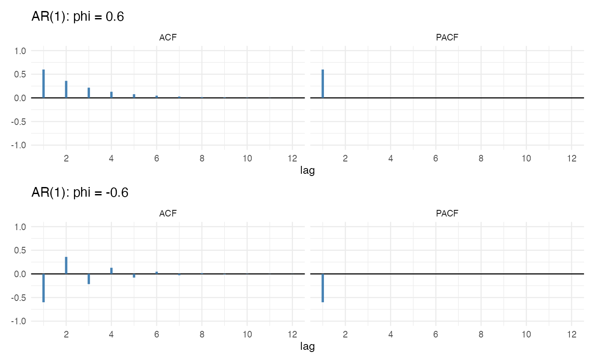
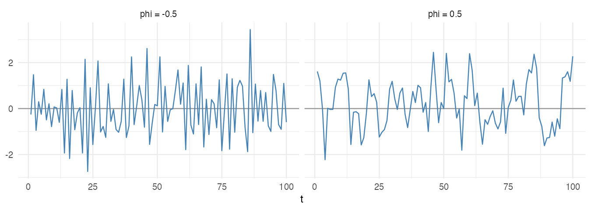
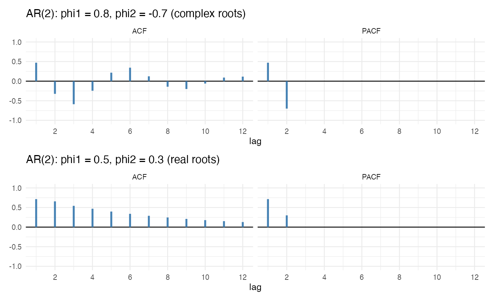
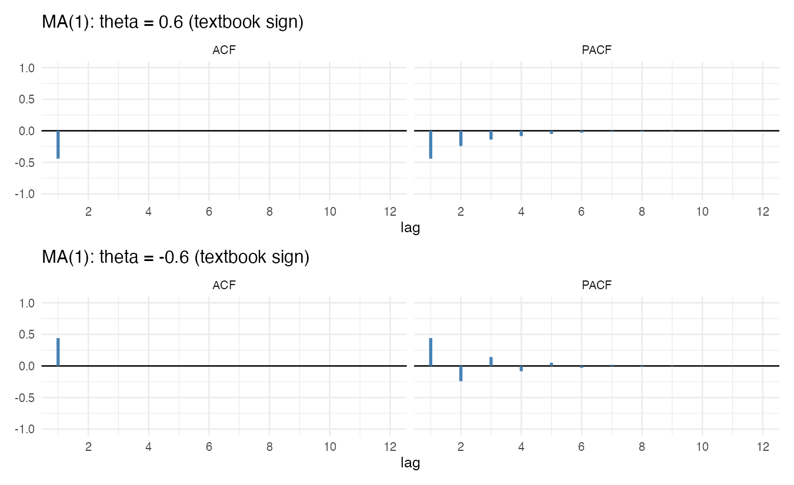
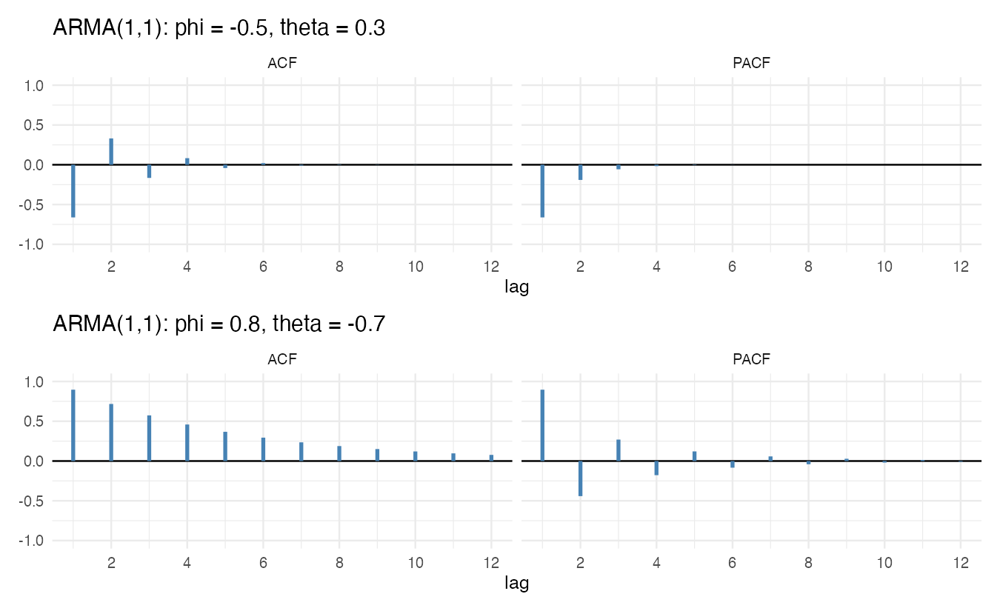
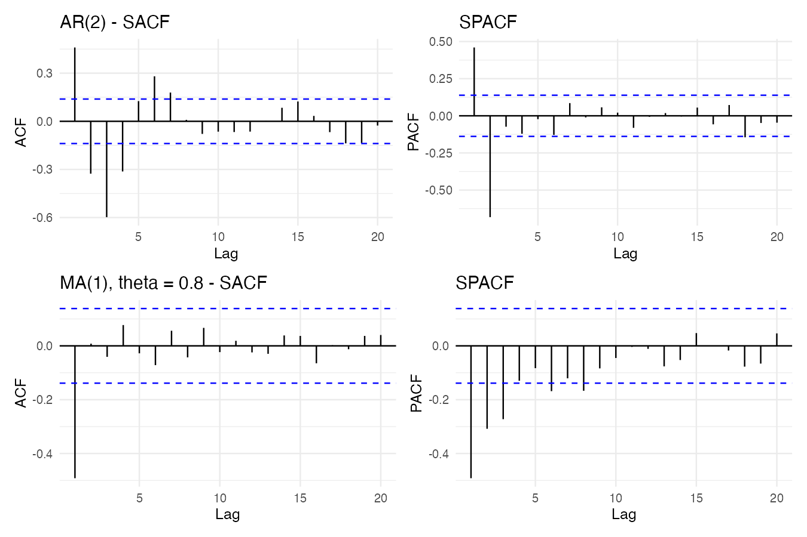

『SAS/ETS를 이용한 시계열분석』(조신섭·손영숙·성병찬)과 전북대학교 이영미 교수님 강의의 6장을 정리했다. 5편에서 정상 과정은 백색잡음의 무한 가중합(선형과정)이라고 했다. ARMA 모형은 이 무한한 가중치를 **적은 수의 모수**로 표현한다.

```r title="환경 설정"
library(tidyverse)
library(forecast)
library(patchwork)
theme_set(theme_minimal(base_size = 12))

# 이론적 ACF·PACF를 막대그래프로 그리는 함수
theory_plot <- function(ar = numeric(), ma = numeric(), lag.max = 12, title = "") {
  acf <- ARMAacf(ar = ar, ma = ma, lag.max = lag.max)[-1]
  pacf <- ARMAacf(ar = ar, ma = ma, lag.max = lag.max, pacf = TRUE)
  tibble(lag = rep(1:lag.max, 2), value = c(acf, pacf),
         type = rep(c("ACF", "PACF"), each = lag.max)) |>
    ggplot(aes(lag, value)) +
    geom_hline(yintercept = 0) +
    geom_segment(aes(xend = lag, yend = 0), linewidth = 1.2, color = "steelblue") +
    facet_wrap(~type) +
    scale_x_continuous(breaks = seq(0, lag.max, 2)) +
    coord_cartesian(ylim = c(-1, 1)) +
    labs(title = title, x = "lag", y = NULL)
}
```

`ARMAacf()`는 모수만으로 이론적인 ACF·PACF를 계산한다. 표본에서 나온 SACF·SPACF를 이 이론적 모양과 비교하는 것이 8편 모형 식별의 핵심이다.

## 부호 표기에 대한 주의

교재와 강의는 MA 항을 **빼는** 형태로 쓴다.

$$
Z_t - \mu = \epsilon_t - \theta_1 \epsilon_{t-1} - \cdots - \theta_q \epsilon_{t-q}
$$

R의 `arima()`, `Arima()`, `arima.sim()`, `ARMAacf()`는 **더하는** 형태 $\epsilon_t + \theta_1 \epsilon_{t-1} + \cdots$를 쓴다. 그래서 교재의 $\theta$를 R에 넣을 때는 부호를 바꿔야 한다(`ma = -theta`). AR 항은 양쪽 모두 $\phi_1 Z_{t-1}$을 더하는 형태로 같다.

## 1. 자기회귀모형 AR(p)

현재 값을 과거 $p$개 값의 선형결합과 백색잡음으로 나타낸다.

$$
Z_t - \mu = \phi_1 (Z_{t-1} - \mu) + \cdots + \phi_p (Z_{t-p} - \mu) + \epsilon_t, \qquad \epsilon_t \sim WN(0, \sigma^2)
$$

후진연산자로 쓰면 $\Phi(B)(Z_t - \mu) = \epsilon_t$, $\Phi(B) = 1 - \phi_1 B - \cdots - \phi_p B^p$이다. 상수항으로 쓰면 $Z_t = \delta + \phi_1 Z_{t-1} + \cdots + \epsilon_t$이고 $\delta = (1 - \phi_1 - \cdots - \phi_p)\mu$다.

### AR(1)

$$
Z_t - \mu = \phi (Z_{t-1} - \mu) + \epsilon_t
$$

과거로 계속 대입하면 선형과정이 된다.

$$
Z_t - \mu = \epsilon_t + \phi \epsilon_{t-1} + \phi^2 \epsilon_{t-2} + \cdots = \sum_{j=0}^{\infty} \phi^j \epsilon_{t-j}
$$

- **정상성 조건**: $\sum \phi^{2j} < \infty \iff |\phi| < 1$. 특성방정식 $1 - \phi B = 0$의 근 $B = 1/\phi$의 절댓값이 1보다 크다는 것과 같다.
- 분산: $\gamma_0 = \dfrac{\sigma^2}{1 - \phi^2}$
- ACF: $\gamma_k = \phi \gamma_{k-1}$이므로 $\rho_k = \phi^k$. 지수적으로 감소한다. $\phi < 0$이면 부호를 번갈아 바꾸며 감소한다.
- PACF: $\phi_{11} = \phi$, $\phi_{kk} = 0 \;(k \ge 2)$. **시차 1 이후 절단**된다.

```r w=9 h=5.5
theory_plot(ar = 0.6, title = "AR(1): phi = 0.6") / theory_plot(ar = -0.6, title = "AR(1): phi = -0.6")
```



```r w=9 h=3.2
set.seed(1)
tibble(t = 1:100,
       `phi = 0.5` = as.numeric(arima.sim(list(ar = 0.5), n = 100)),
       `phi = -0.5` = as.numeric(arima.sim(list(ar = -0.5), n = 100))) |>
  pivot_longer(-t) |>
  ggplot(aes(t, value)) +
  geom_hline(yintercept = 0, color = "grey60") +
  geom_line(color = "steelblue") +
  facet_wrap(~name) +
  labs(x = "t", y = NULL)
```



$\phi > 0$이면 비슷한 값이 이어져 천천히 오르내리고, $\phi < 0$이면 위아래로 번갈아 튄다.

### AR(2)

$$
Z_t - \mu = \phi_1 (Z_{t-1} - \mu) + \phi_2 (Z_{t-2} - \mu) + \epsilon_t
$$

- **정상성 조건**: $1 - \phi_1 B - \phi_2 B^2 = 0$의 두 근의 절댓값이 모두 1보다 크다. 이는 다음과 같다.

$$
\phi_1 + \phi_2 < 1, \qquad \phi_2 - \phi_1 < 1, \qquad -1 < \phi_2 < 1
$$

- ACF: $\rho_k = \phi_1 \rho_{k-1} + \phi_2 \rho_{k-2}$ (Yule-Walker), $\rho_1 = \dfrac{\phi_1}{1 - \phi_2}$. 특성근이 실수면 지수적으로, 복소수면 **감쇠하는 사인 곡선** 모양으로 줄어든다.
- PACF: 시차 2 이후 절단, $\phi_{22} = \phi_2$.

```r w=9 h=5.5
theory_plot(ar = c(0.8, -0.7), title = "AR(2): phi1 = 0.8, phi2 = -0.7 (complex roots)") /
  theory_plot(ar = c(0.5, 0.3), title = "AR(2): phi1 = 0.5, phi2 = 0.3 (real roots)")
```



### AR(p)

정상성 조건은 $\Phi(B) = 0$의 모든 근이 단위원 밖에 있는 것이다. ACF는 지수적 감소나 감쇠 사인 곡선이 섞인 모양으로 서서히 줄고, **PACF는 시차 $p$ 이후 절단**된다.

## 2. 이동평균모형 MA(q)

$$
Z_t - \mu = \epsilon_t - \theta_1 \epsilon_{t-1} - \cdots - \theta_q \epsilon_{t-q} = \Theta(B) \epsilon_t
$$

유한한 선형과정이므로 모수 값과 상관없이 **항상 정상**이다.

### MA(1)

$$
Z_t - \mu = \epsilon_t - \theta \epsilon_{t-1}
$$

- 분산: $\gamma_0 = (1 + \theta^2)\sigma^2$
- ACF: $\gamma_1 = Cov(\epsilon_t - \theta\epsilon_{t-1}, \epsilon_{t+1} - \theta\epsilon_t) = -\theta\sigma^2$이므로

$$
\rho_1 = \frac{-\theta}{1 + \theta^2}, \qquad \rho_k = 0 \;\; (k \ge 2)
$$

**시차 1 이후 절단**된다. $|\rho_1| \le 0.5$이다.

- PACF: $\phi_{kk} = \dfrac{-\theta^k (1 - \theta^2)}{1 - \theta^{2(k+1)}}$. 지수적으로 감소한다.

### 가역성

$\theta$와 $1/\theta$는 같은 $\rho_1$을 준다($\theta = 0.5$와 $2$ 모두 $\rho_1 = -0.4$). 하나의 ACF에 모형이 둘 대응하므로 하나를 골라야 한다. $|\theta| < 1$이면 MA(1)을 과거 관측값의 무한 AR로 바꿔 쓸 수 있다.

$$
\epsilon_t = Z_t + \theta Z_{t-1} + \theta^2 Z_{t-2} + \cdots \quad (\mu = 0)
$$

이것을 **가역성**이라 한다. 관측할 수 없는 오차 $\epsilon_t$를 관측값으로 복원할 수 있어야 잔차를 계산하고 예측할 수 있으므로, MA 모형은 가역 조건 $\Theta(B) = 0$의 근이 단위원 밖에 있도록 한다.

```r w=9 h=5.5
# 교재의 theta = 0.6, -0.6 → R에서는 ma = -0.6, 0.6
theory_plot(ma = -0.6, title = "MA(1): theta = 0.6 (textbook sign)") /
  theory_plot(ma = 0.6, title = "MA(1): theta = -0.6 (textbook sign)")
```



### MA(2)와 MA(q)

$$
\rho_1 = \frac{-\theta_1 + \theta_1\theta_2}{1 + \theta_1^2 + \theta_2^2}, \qquad \rho_2 = \frac{-\theta_2}{1 + \theta_1^2 + \theta_2^2}, \qquad \rho_k = 0 \;(k \ge 3)
$$

가역 조건은 AR(2) 정상 조건과 같은 꼴이다: $\theta_1 + \theta_2 < 1$, $\theta_2 - \theta_1 < 1$, $-1 < \theta_2 < 1$. MA($q$)의 **ACF는 시차 $q$ 이후 절단**, PACF는 서서히 감소한다.

## 3. AR과 MA의 쌍대성

| | AR($p$) | MA($q$) |
|---|---|---|
| 다른 표현 | 정상이면 MA($\infty$) | 가역이면 AR($\infty$) |
| ACF | 서서히 감소 | 시차 $q$ 이후 절단 |
| PACF | 시차 $p$ 이후 절단 | 서서히 감소 |
| 조건 | 정상성 필요, 가역성은 항상 만족 | 가역성 필요, 정상성은 항상 만족 |

## 4. ARMA(p, q)

AR과 MA를 함께 쓰면 적은 모수로 더 다양한 ACF를 만들 수 있다.

$$
\Phi(B)(Z_t - \mu) = \Theta(B)\epsilon_t
$$

- 정상성: $\Phi(B) = 0$의 근이 단위원 밖, 가역성: $\Theta(B) = 0$의 근이 단위원 밖
- $\Phi(B)$와 $\Theta(B)$가 공통 인수를 가지면 약분되어 더 작은 모형이 된다. 공통 인수가 없어야 한다.
- 평균: $\mu = \dfrac{\delta}{1 - \phi_1 - \cdots - \phi_p}$

| 모형 | ACF | PACF |
|---|---|---|
| AR($p$) | 지수적 감소 또는 감쇠 사인 곡선 | 시차 $p$ 이후 절단 |
| MA($q$) | 시차 $q$ 이후 절단 | 지수적 감소 또는 감쇠 사인 곡선 |
| ARMA($p$, $q$) | 시차 $q - p$ 이후 지수적 감소 또는 감쇠 사인 곡선 | 시차 $p - q$ 이후 지수적 감소 또는 감쇠 사인 곡선 |

### ARMA(1, 1)

$$
Z_t - \mu = \phi (Z_{t-1} - \mu) + \epsilon_t - \theta \epsilon_{t-1}
$$

$$
\gamma_0 = \frac{1 + \theta^2 - 2\phi\theta}{1 - \phi^2}\sigma^2, \qquad
\rho_1 = \frac{(\phi - \theta)(1 - \phi\theta)}{1 + \theta^2 - 2\phi\theta}, \qquad
\rho_k = \phi \rho_{k-1} \;\; (k \ge 2)
$$

시차 1의 값은 $\phi$와 $\theta$가 함께 정하고, 그 뒤로는 AR(1)처럼 $\phi$배씩 줄어든다. ACF와 PACF 모두 절단되지 않으므로 표본 그림만으로 ARMA(1,1)을 AR(2)나 MA(2)와 구별하기 어렵다. 이때는 8편의 AIC·BIC로 비교한다.

```r w=9 h=5.5
# 교재 표기 (phi, theta) = (-0.5, 0.3)과 (0.8, -0.7) → R의 ma는 부호 반대
theory_plot(ar = -0.5, ma = -0.3, title = "ARMA(1,1): phi = -0.5, theta = 0.3") /
  theory_plot(ar = 0.8, ma = 0.7, title = "ARMA(1,1): phi = 0.8, theta = -0.7")
```



## 5. 시뮬레이션 자료의 SACF·SPACF

```r w=9 h=6
set.seed(123)
sim_acf <- function(model, n = 200, title) {
  z <- arima.sim(model, n = n)
  (ggAcf(z, lag.max = 20) + labs(title = paste(title, "- SACF"))) |
    (ggPacf(z, lag.max = 20) + labs(title = "SPACF"))
}
sim_acf(list(ar = c(0.8, -0.7)), title = "AR(2)") /
  sim_acf(list(ma = -0.8), title = "MA(1), theta = 0.8")
```



표본에서는 이론처럼 깔끔하게 절단되지 않는다. 점선($\pm 2/\sqrt n$)을 기준으로 "어디서 끊기는가", "서서히 줄어드는가"를 대략 읽는다.

## 요약

| 모형 | 식 (교재 표기) | 조건 | ACF | PACF |
|---|---|---|---|---|
| AR(1) | $Z_t = \phi Z_{t-1} + \epsilon_t$ | $\lvert \phi \rvert < 1$ | $\phi^k$ | 시차 1 이후 0 |
| AR(2) | $+ \phi_2 Z_{t-2}$ | 삼각형 영역 | 지수·사인 감소 | 시차 2 이후 0 |
| MA(1) | $Z_t = \epsilon_t - \theta\epsilon_{t-1}$ | $\lvert \theta \rvert < 1$ (가역) | 시차 1 이후 0 | 지수 감소 |
| MA(2) | $- \theta_2 \epsilon_{t-2}$ | 삼각형 영역 | 시차 2 이후 0 | 지수·사인 감소 |
| ARMA(1,1) | 둘 다 | 둘 다 | 시차 1 이후 $\phi$배 감소 | 감소 |
| R 주의 | MA 부호가 반대 | | | `ma = -theta` |
