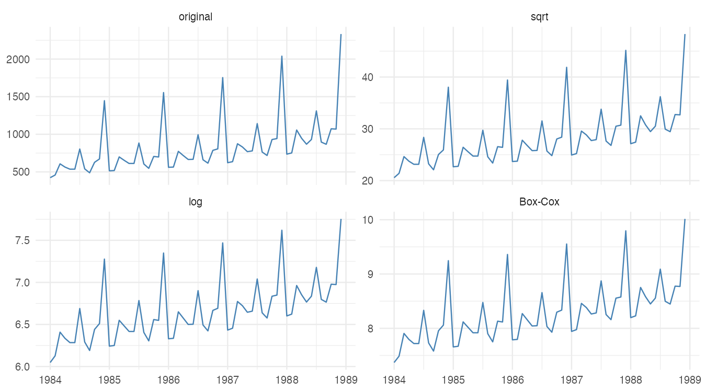
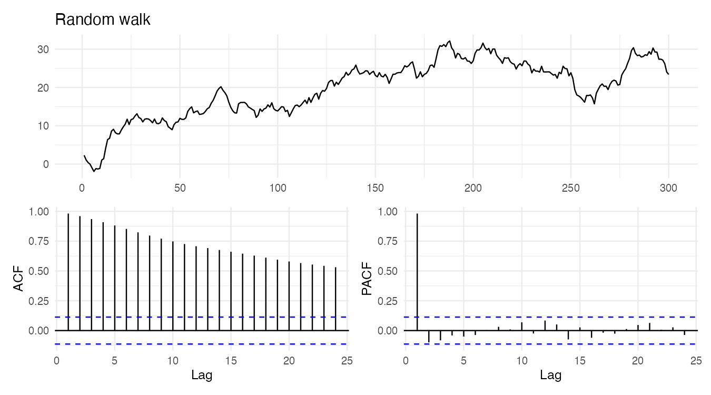
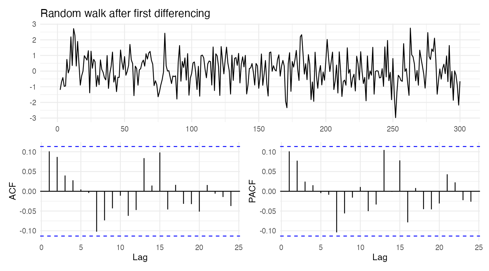
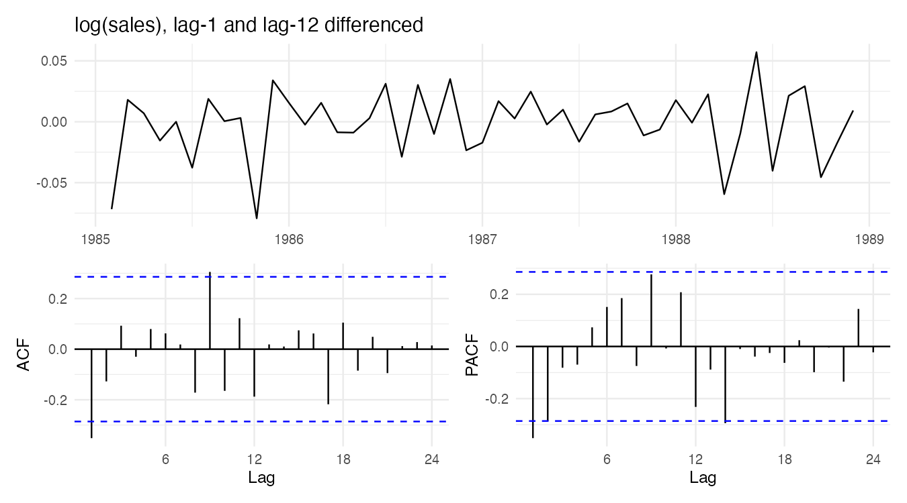
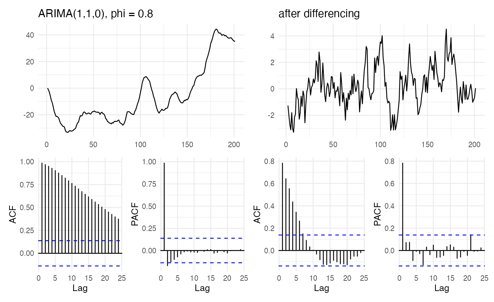

『SAS/ETS를 이용한 시계열분석』(조신섭·손영숙·성병찬)과 전북대학교 이영미 교수님 강의의 7장과 8장 부록(단위근 검정)을 정리했다. 6편의 ARMA 모형은 정상 시계열에만 쓸 수 있다. 실제 시계열은 대부분 추세나 계절성, 변하는 분산 때문에 비정상이다. 이 글은 비정상 시계열을 **정상으로 바꾸는 방법**을 다룬다.

```r title="환경 설정"
library(tidyverse)
library(forecast)
library(tseries)
library(patchwork)
theme_set(theme_minimal(base_size = 12))

data_url <- "https://raw.githubusercontent.com/Bricoler/time-series-analysis/master/timedata/"
read_ts <- function(file, start, frequency = 12) {
  ts(scan(paste0(data_url, file), quiet = TRUE), start = start, frequency = frequency)
}
acf_pair <- function(x, title) {
  (autoplot(x) + labs(title = title, x = NULL, y = NULL)) /
    (ggAcf(x, lag.max = 24) + labs(title = NULL) | ggPacf(x, lag.max = 24) + labs(title = NULL))
}
```

## 1. 비정상 시계열의 종류

| 비정상의 원인 | 신호 | 대처 |
|---|---|---|
| 분산이 시간에 따라 변함 | 수준이 커질수록 변동 폭도 커짐 | 분산 안정화 변환(로그, Box-Cox) |
| 수준이 결정적으로 변함 | 매끄러운 추세 | 추세 회귀 후 잔차를 ARMA로 |
| 수준이 확률적으로 변함 | 정해진 방향 없이 흘러감, SACF가 아주 천천히 감소 | 차분 |
| 계절성 | 주기적 반복, SACF가 시차 $s$, $2s$에서 큼 | 계절 차분 |

분산 안정화를 **먼저** 하고 차분은 그다음에 한다. 차분한 뒤에는 음수가 생겨 로그를 취할 수 없기 때문이다.

## 2. 분산 안정화 변환

$Var(Z_t)$가 수준 $\mu_t$의 함수이면 적절한 변환으로 분산을 일정하게 만들 수 있다. 표준편차가 수준에 비례하면($\sigma_t \propto \mu_t$) 로그 변환이 맞다. 일반적으로는 Box-Cox 변환을 쓴다.

$$
f_\lambda(Z_t) = \begin{cases} \dfrac{Z_t^\lambda - 1}{\lambda}, & \lambda \ne 0 \\[2mm] \log Z_t, & \lambda = 0 \end{cases}, \qquad Z_t > 0
$$

| $\lambda$ | 변환 |
|---|---|
| 1 | 변환 없음 |
| 0.5 | 제곱근 |
| 0 | 로그 |
| -1 | 역수 |

```r w=9 h=5
depart <- read_ts("depart.txt", start = c(1984, 1))
lambda <- BoxCox.lambda(depart)
lambda

tibble(date = as.numeric(time(depart)),
       original = as.numeric(depart),
       sqrt = sqrt(as.numeric(depart)),
       log = log(as.numeric(depart)),
       `Box-Cox` = as.numeric(BoxCox(depart, lambda))) |>
  pivot_longer(-date) |>
  mutate(name = fct_inorder(name)) |>
  ggplot(aes(date, value)) +
  geom_line(color = "steelblue") +
  facet_wrap(~name, scales = "free_y") +
  labs(x = NULL, y = NULL)
```



`BoxCox.lambda()`는 변환 후 분산이 가장 안정되는 $\lambda$를 추정한다. 해석이 쉬운 로그($\lambda = 0$)와 큰 차이가 없으면 로그를 쓴다. 로그를 취하면 12월의 봉우리 높이가 해마다 비슷해진다.

## 3. 결정적 추세와 확률적 추세

| | 결정적 추세 | 확률적 추세 |
|---|---|---|
| 모형 | $Z_t = \beta_0 + \beta_1 t + \epsilon_t$ | $Z_t = \delta + Z_{t-1} + \epsilon_t$ (확률보행) |
| 충격의 효과 | 일시적: 추세선으로 돌아옴 | 영구적: 이후 수준이 계속 바뀜 |
| 정상화 | 추세 제거(회귀) | 차분 |
| 장기 예측구간 | 일정한 폭 | 시간에 따라 계속 넓어짐 |

경제 자료는 강한 양의 상관 때문에 추세가 있는 것처럼 보이지만 실제로는 확률적으로 변하는 경우가 많다. 그림만으로 둘을 구별하기 어려우므로 단위근 검정(6절)을 쓴다.

## 4. 차분

차분 연산자 $\nabla = 1 - B$:

$$
\nabla Z_t = Z_t - Z_{t-1}, \qquad \nabla^2 Z_t = (1 - B)^2 Z_t = Z_t - 2Z_{t-1} + Z_{t-2}
$$

- 확률보행 $Z_t = Z_{t-1} + \epsilon_t$를 1차 차분하면 $\nabla Z_t = \epsilon_t$, 백색잡음이 된다.
- 결정적 선형 추세 $Z_t = \beta_0 + \beta_1 t + \epsilon_t$를 차분하면 $\nabla Z_t = \beta_1 + \epsilon_t - \epsilon_{t-1}$, 정상이지만 가역이 아닌 MA(1)이 된다. $p$차 다항 추세는 $p$번 차분하면 제거된다. 그러나 결정적 추세는 차분보다 회귀(분해법)로 제거하는 편이 모형이 간단하다.

```r w=9 h=5
set.seed(7)
rw <- ts(cumsum(rnorm(300)))
acf_pair(rw, "Random walk") 
```



```r w=9 h=5
acf_pair(diff(rw), "Random walk after first differencing")
```



확률보행의 SACF는 1에 가까운 값에서 아주 천천히 줄어든다. 비정상의 전형적인 신호다. 차분하면 모든 시차가 점선 안으로 들어온다.

### 과대차분

이미 정상인 시계열을 또 차분하면 오히려 문제가 생긴다. 백색잡음 $\epsilon_t$를 차분하면 $\nabla\epsilon_t = \epsilon_t - \epsilon_{t-1}$, $\theta = 1$인 가역이 아닌 MA(1)이 되고, 분산도 $2\sigma^2$으로 커진다. 차분 후 SACF의 시차 1 값이 $-0.5$에 가깝게 나오면 과대차분을 의심한다. 차분 차수는 보통 0, 1, 2 중 하나면 충분하다.

```r
set.seed(3)
x <- arima.sim(list(ar = 0.8), n = 300)    # 이미 정상
c(var_original = var(x), var_diff1 = var(diff(x)), var_diff2 = var(diff(x, differences = 2)))
c(acf_lag1_diff2 = acf(diff(x, differences = 2), plot = FALSE)$acf[2])
```

$\phi = 0.8$처럼 1에 가까운 정상 과정은 1차 차분에서 오히려 분산이 줄어든다($Var(\nabla Z_t) = 2\gamma_0(1 - \rho_1)$). 그래서 단위근인지 아닌지 그림만으로 헷갈리기 쉽다. 그러나 2차 차분을 하면 분산이 다시 원래 수준으로 커지고, 시차 1 자기상관이 약 $-0.55$로 과대차분의 전형적인 신호가 나타난다.

## 5. 계절 차분과 ARIMA

계절 주기가 $s$이면 계절 차분 $\nabla_s = 1 - B^s$를 쓴다.

$$
\nabla_{12} Z_t = Z_t - Z_{t-12}
$$

결정적 계절성(매년 똑같은 패턴)은 지시함수로, 확률적 계절성(패턴이 해마다 조금씩 바뀜)은 계절 차분으로 제거한다.

```r w=9 h=5
acf_pair(diff(diff(log(depart)), 12), "log(sales), lag-1 and lag-12 differenced")
```



로그 → 1차 차분 → 계절 차분을 거치면 추세와 계절성이 모두 사라진다. 남은 SACF와 SPACF로 ARMA 차수를 정하는 것이 8편과 10편의 내용이다.

### ARIMA(p, d, q)

$d$번 차분한 $\nabla^d Z_t$가 정상 ARMA($p$, $q$)를 따르면 $Z_t$를 ARIMA($p$, $d$, $q$)라 한다.

$$
\Phi(B)(1 - B)^d Z_t = \delta + \Theta(B)\epsilon_t
$$

| 모형 | 다른 이름 |
|---|---|
| ARIMA(0, 1, 0) | 확률보행 |
| ARIMA(0, 1, 1) | 단순지수평활과 같은 예측 |
| ARIMA(0, 2, 2) | Holt 이중지수평활과 같은 예측 |
| ARIMA($p$, 0, $q$) | 정상 ARMA($p$, $q$) |

$d \ge 1$이면 $\Phi(B)(1 - B)^d$는 단위근 $B = 1$을 가지므로 비정상이다. $d$번 차분하면 다항식 추세가 제거되고, $\delta \ne 0$이면 $d$차 다항 추세가 남는다.

```r w=9 h=5.5
set.seed(11)
z1 <- arima.sim(list(order = c(1, 1, 0), ar = 0.8), n = 200)

(acf_pair(z1, "ARIMA(1,1,0), phi = 0.8") | acf_pair(diff(z1), "after differencing"))
```



차분하기 전 SACF는 천천히 감소하고, 차분한 뒤에는 AR(1)의 전형적인 모양(ACF 지수 감소, PACF 시차 1 절단)이 드러난다.

## 6. 단위근 검정

AR(1) $Z_t = \phi Z_{t-1} + \epsilon_t$에서 $\phi = 1$이면 확률보행(단위근), $|\phi| < 1$이면 정상이다.

$$
H_0: \phi = 1 \;\; (\text{단위근, 차분 필요}), \qquad H_1: |\phi| < 1 \;\; (\text{정상})
$$

양변에서 $Z_{t-1}$을 빼면 $\nabla Z_t = (\phi - 1) Z_{t-1} + \epsilon_t$이고, $\phi - 1 = 0$을 검정한다. 검정통계량 $t = (\hat\phi - 1)/SE(\hat\phi)$은 $H_0$에서 $t$분포를 따르지 않고 왼쪽으로 치우친 **Dickey-Fuller 분포**를 따른다. 그래서 별도의 임계값을 쓴다.

| 경우 | 적합 모형 | 대립가설의 모습 |
|---|---|---|
| 1 | $Z_t = \phi Z_{t-1} + \epsilon_t$ | 평균 0인 정상 |
| 2 | $Z_t = \delta + \phi Z_{t-1} + \epsilon_t$ | 평균이 0이 아닌 정상 |
| 3 | $Z_t = \delta + \beta t + \phi Z_{t-1} + \epsilon_t$ | 추세 주위의 정상 (추세 정상) |

오차의 자기상관을 흡수하려고 $\nabla Z_{t-j}$ 항을 추가한 것이 ADF(augmented Dickey-Fuller) 검정이다.

```r
adf.test(rw)
adf.test(diff(rw))
ndiffs(log(depart))
nsdiffs(log(depart))
```

- `tseries::adf.test()`는 경우 3(상수와 추세 포함)으로 검정한다. 확률보행은 $H_0$를 기각하지 못하고, 차분한 계열은 기각한다.
- `forecast::ndiffs()`, `nsdiffs()`는 단위근 검정을 반복해 필요한 일반 차분과 계절 차분 횟수를 알려 준다.
- 단위근 검정은 검정력이 낮아 $\phi = 0.95$ 같은 정상 과정도 단위근으로 판정하기 쉽다. SACF 모양과 함께 판단한다.

## 요약

| 단계 | 확인 | 조치 | R |
|---|---|---|---|
| 1 | 분산이 수준에 비례 | 로그·Box-Cox | `log()`, `BoxCox.lambda()` |
| 2 | SACF가 아주 천천히 감소 | 1차 차분 | `diff(x)` |
| 3 | 시차 $s$, $2s$의 SACF가 큼 | 계절 차분 | `diff(x, lag = 12)` |
| 4 | 단위근 여부 | ADF 검정 | `adf.test()`, `ndiffs()` |
| 주의 | 차분 후 시차 1 SACF가 $-0.5$ 근처 | 과대차분 의심 | |
| 결과 | $\nabla^d Z_t$가 정상 ARMA | ARIMA($p$, $d$, $q$) | `Arima(order = c(p, d, q))` |
