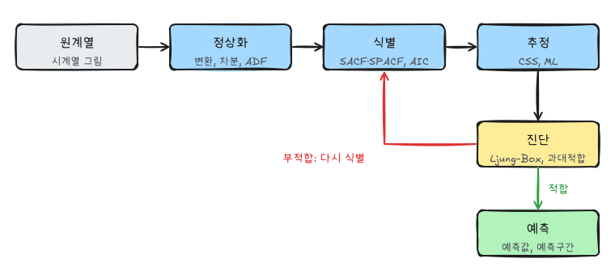
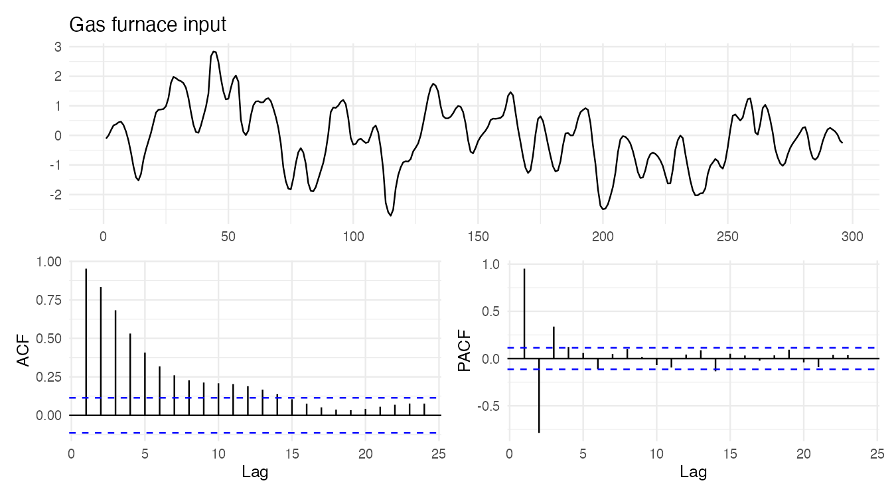
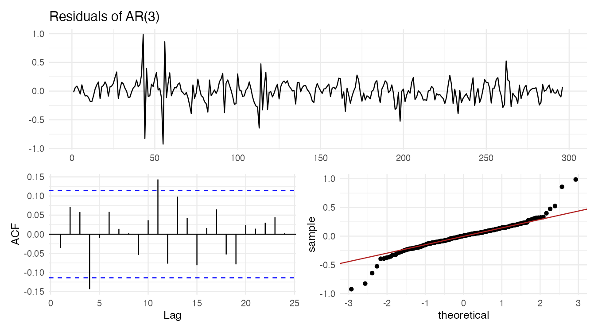
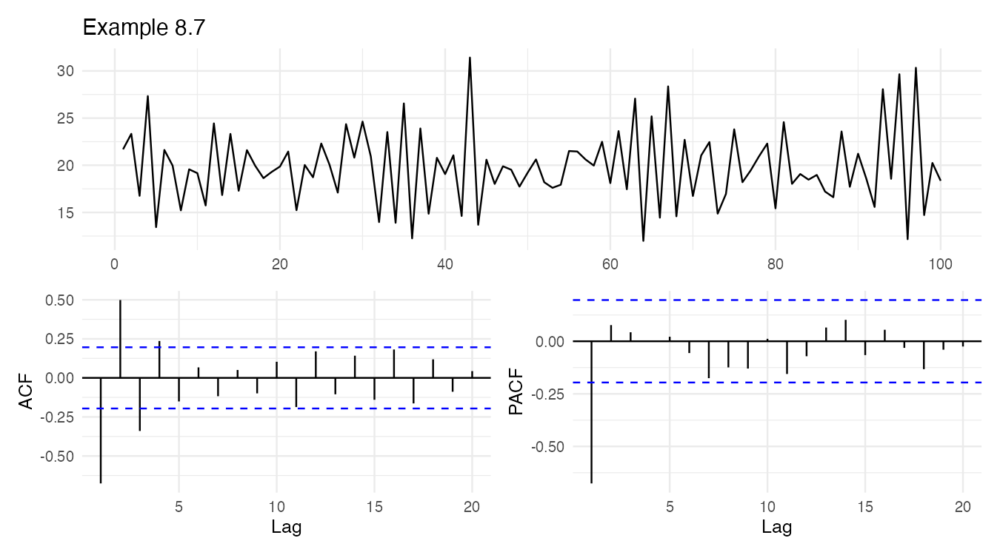
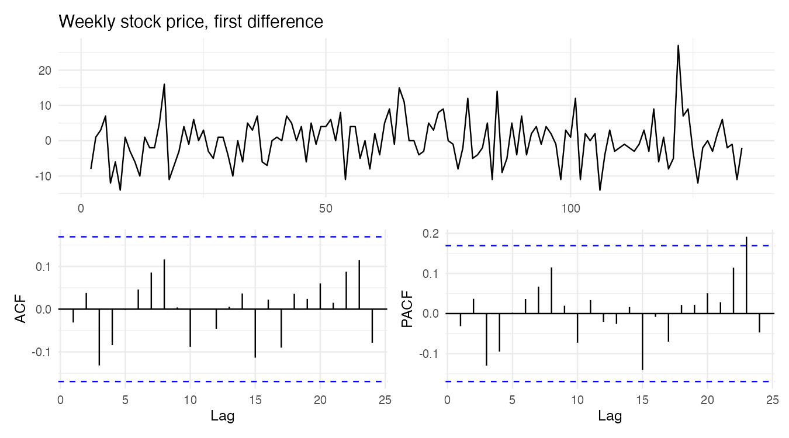

『SAS/ETS를 이용한 시계열분석』(조신섭·손영숙·성병찬)과 전북대학교 이영미 교수님 강의의 8장을 정리했다. 6편에서 모형의 성질을, 7편에서 정상화를 다뤘다. 이 글은 실제 자료에 ARMA 모형을 **고르고, 추정하고, 검증하는** 전체 절차다.

```r title="환경 설정"
library(tidyverse)
library(forecast)
library(tseries)
library(patchwork)
theme_set(theme_minimal(base_size = 12))

data_url <- "https://raw.githubusercontent.com/Bricoler/time-series-analysis/master/timedata/"
read_ts <- function(file, start = 1, frequency = 1) {
  ts(scan(paste0(data_url, file), quiet = TRUE), start = start, frequency = frequency)
}
acf_pair <- function(x, title, lag.max = 24) {
  (autoplot(x) + labs(title = title, x = NULL, y = NULL)) /
    (ggAcf(x, lag.max = lag.max) + labs(title = NULL) | ggPacf(x, lag.max = lag.max) + labs(title = NULL))
}
coef_test <- function(fit) {
  est <- coef(fit); se <- sqrt(diag(fit$var.coef))
  tibble(term = names(est), estimate = est, se = se, z = est / se, p = 2 * pnorm(-abs(est / se)))
}
```

`coef_test()`는 추정값을 표준오차로 나눈 $z$ 통계량과 $p$값을 표로 만든다.

## 1. Box-Jenkins 절차



## 2. 모형 식별

### Step 1: 정상화

시계열 그림과 SACF로 비정상 여부를 판단하고 7편의 방법으로 정상화한다.

- 분산이 변하면 로그·Box-Cox 변환
- SACF가 천천히 감소하면 차분. 단위근 검정 결과도 참고한다.
- 차분된 계열의 분산이 이전 단계보다 커지면 과대차분이다.
- 비계절 자료는 대부분 $d = 0, 1, 2$로 충분하다.

### Step 2: ARMA 차수 결정

| | SACF | SPACF |
|---|---|---|
| AR($p$) | 지수적으로 감소하거나 소멸하는 사인 곡선 | 시차 $p$ 이후 절단 |
| MA($q$) | 시차 $q$ 이후 절단 | 지수적으로 감소하거나 소멸하는 사인 곡선 |
| ARMA($p$, $q$) | 시차 $q - p$ 이후 감소 | 시차 $p - q$ 이후 감소 |

"절단"을 판단하는 기준은 다음과 같다.

- **AR($p$)의 SPACF**: $k > p$이면 $\hat\phi_{kk} \;\dot\sim\; N(0, 1/n)$. $|\hat\phi_{kk}| > 2/\sqrt n$이면 0이 아니다.
- **MA($q$)의 SACF**: $k > q$이면 Bartlett 근사로 $Var(r_k) \approx \frac{1}{n}(1 + 2r_1^2 + \cdots + 2r_q^2)$. $|r_k| > 2\, SE(r_k)$이면 0이 아니다.

`ggAcf()`가 그리는 점선은 백색잡음 기준($\pm 2/\sqrt n$)이라 MA 차수를 볼 때는 조금 좁다.

**예.** $n = 100$인 시계열의 SACF가 $r_1 = 0.61$, $r_2 = 0.37$, $r_3 = -0.05$, 그 뒤로 작다면, MA(2)의 경우 $SE(r_3) \approx \sqrt{(1 + 2(0.61^2 + 0.37^2))/100} \approx 0.14$이고 $|r_3| < 0.28$이므로 시차 2 이후 절단된 것으로 본다.

### 정보 기준

SACF·SPACF로 후보를 몇 개 고른 뒤 정보 기준으로 비교한다($k = p + q$ + 상수항 여부).

$$
AIC = n \log \hat\sigma^2 + 2k, \qquad BIC(SBC) = n \log \hat\sigma^2 + k \log n
$$

작을수록 좋다. BIC는 모수에 더 큰 벌점을 주어 작은 모형을 고른다.

### Step 3: 상수항

차분한 계열 $W_t = \nabla^d Z_t$의 평균이 0인지 검정한다.

$$
t = \frac{\bar W}{s_{\bar W}}, \qquad s_{\bar W} \approx \sqrt{\frac{\hat\gamma_0}{n}(1 + 2r_1 + 2r_2 + \cdots + 2r_k)}
$$

자기상관이 있으면 표본평균의 분산이 $\gamma_0/n$보다 커지므로 보정한다. 유의하지 않으면 상수항을 뺀다(`include.mean = FALSE`).

## 3. 모수 추정

| 방법 | 원리 | 특징 |
|---|---|---|
| 적률추정(MME) | 이론 적률과 표본 적률을 같게 놓음. AR은 Yule-Walker 방정식 | 간단하지만 MA가 있으면 비효율적, 초기값으로 사용 |
| 조건부 최소제곱(CLS) | 관측 안 된 초기값을 0이나 평균으로 놓고 잔차제곱합 최소화 | `method = "CSS"` |
| 비조건부 최소제곱(ULS) | 초기값을 후진예측으로 추정 | 초기값 영향을 줄임 |
| 최대가능도(MLE) | 정규 가정 아래 정확한 가능도 최대화 | 효율적, `method = "ML"` |

### 적률추정의 예

- **AR(1)**: $\rho_1 = \phi$이므로 $\hat\phi = r_1$, $\hat\mu = \bar Z$, $\hat\sigma^2 = \hat\gamma_0 (1 - \hat\phi^2)$
- **MA(1)**: $\rho_1 = -\theta/(1 + \theta^2)$에서 $r_1\theta^2 + \theta + r_1 = 0$을 풀면

$$
\hat\theta = \frac{-1 \pm \sqrt{1 - 4 r_1^2}}{2 r_1}
$$

두 근 중 가역 조건 $|\hat\theta| < 1$을 만족하는 근을 고른다. $|r_1| > 0.5$이면 실근이 없어 적률추정량이 존재하지 않는다. MA 모형에는 적률추정이 적합하지 않은 이유다.

### 최대가능도와 점근분포

AR($p$)의 MLE는 다음 점근분포를 따른다.

$$
\sqrt n (\hat\phi - \phi) \;\xrightarrow{d}\; N(0, \sigma^2 \Gamma_p^{-1}), \qquad \Gamma_p = [\gamma_{i-j}]_{i,j=1}^{p}
$$

AR(1)이면 $\sqrt n(\hat\phi - \phi) \to N(0, 1 - \phi^2)$이다. R의 `Arima()`는 CSS로 초기값을 구한 뒤 ML로 추정한다(`method = "CSS-ML"`, 기본값).

## 4. 모형 진단

### 잔차분석

모형이 맞으면 잔차 $\hat\epsilon_t = Z_t - \hat Z_{t-1}(1)$은 백색잡음이어야 한다.

- 잔차 그림: 패턴, 이상점, 분산 변화
- 잔차 SACF·SPACF: 점선 밖 막대가 없어야 한다.
- **포트맨토 검정**: 여러 시차의 자기상관을 한꺼번에 검정한다.

$$
H_0: \rho_1 = \cdots = \rho_K = 0, \qquad Q^* = n(n + 2) \sum_{k=1}^{K} \frac{r_k^2}{n - k} \;\dot\sim\; \chi^2_{K - p - q}
$$

Ljung-Box 통계량 $Q^*$은 Box-Pierce 통계량 $Q = n\sum r_k^2$을 소표본에서 보정한 것이다. ARMA($p$, $q$)의 잔차면 자유도에서 추정한 모수 수를 뺀다(`fitdf = p + q`).

- 정규성: Jarque-Bera 검정 $JB = \frac{n}{6}\left(\hat S^2 + \frac{(\hat K - 3)^2}{4}\right) \;\dot\sim\; \chi^2_2$ ($\hat S$: 왜도, $\hat K$: 첨도)

### 과대적합 진단

잠정 모형보다 모수를 하나 더 넣은 모형을 적합해 본다. 예를 들어 AR(1)이 잠정 모형이면 AR(2)와 ARMA(1,1)을 적합한다.

- 추가한 모수가 유의하지 않고
- 원래 모수의 추정값이 크게 바뀌지 않고
- 잔차 분산이 거의 줄지 않으면

잠정 모형이 적절하다. AR과 MA를 동시에 늘리면 공통 인수가 생겨 추정이 불안정해지므로 한 번에 한 쪽씩만 늘린다.

## 5. 예제 1: 가스로 입력 가스 비율

Box & Jenkins의 가스로(gas furnace) 자료에서 입력 가스 비율 296개다. 파일에 (입력, 출력) 쌍이 번갈아 들어 있어 홀수 번째 값만 쓴다.

```r w=9 h=5
gas_all <- scan(paste0(data_url, "gas.txt"), quiet = TRUE)
gas <- ts(gas_all[seq(1, length(gas_all), by = 2)])
acf_pair(gas, "Gas furnace input")
Box.test(gas, lag = 12, type = "Ljung-Box")
```



원계열의 Ljung-Box 검정은 강하게 유의해 자기상관이 있다. SACF는 소멸하는 사인 곡선이고 SPACF는 시차 3 이후 절단되므로 AR(3)을 잠정 모형으로 고른다.

```r
fit_ar3 <- Arima(gas, order = c(3, 0, 0), include.mean = FALSE, method = "ML")
coef_test(fit_ar3)
c(AIC = fit_ar3$aic, BIC = fit_ar3$bic)
```

입력 가스 비율은 평균을 0으로 맞춘 자료라 상수항을 뺐다.

```r w=9 h=5
checkresiduals(fit_ar3, lag = 24, plot = FALSE)
jarque.bera.test(residuals(fit_ar3))

res <- residuals(fit_ar3)
(autoplot(res) + labs(title = "Residuals of AR(3)", x = NULL, y = NULL)) /
  (ggAcf(res, lag.max = 24) + labs(title = NULL) |
     ggplot(tibble(r = as.numeric(res)), aes(sample = r)) + stat_qq() + stat_qq_line(color = "firebrick") + labs(x = "theoretical", y = "sample"))
```



`checkresiduals()`는 자유도를 자동으로 조정한 Ljung-Box 검정을 출력한다. 시차 24까지의 $Q^* \approx 30.9$, $p \approx 0.08$로 5% 수준에서 잔차가 백색잡음이라는 가정을 기각하지 않는다. 반면 Jarque-Bera 검정은 정규성을 강하게 기각한다. Q-Q 그림의 양 끝이 직선에서 벗어나는 두꺼운 꼬리 때문이다. 계수 추정은 그대로 쓸 수 있지만, 정규분포를 가정한 예측구간은 실제보다 좁을 수 있다.

## 6. 예제 2: 모형 후보 비교와 과대적합 진단

교재 예제 8.7의 시뮬레이션 자료 100개다.

```r w=9 h=5
z <- read_ts("eg8_7.txt")
acf_pair(z, "Example 8.7", lag.max = 20)
```



SACF는 부호를 바꾸며 감소하고 SPACF는 시차 1에서만 크다. AR(1)이 잠정 모형이다.

```r
fits <- list(
  `AR(1)`     = Arima(z, order = c(1, 0, 0)),
  `AR(2)`     = Arima(z, order = c(2, 0, 0)),
  `ARMA(1,1)` = Arima(z, order = c(1, 0, 1)),
  `MA(1)`     = Arima(z, order = c(0, 0, 1))
)

map_dfr(fits, \(f) tibble(sigma2 = f$sigma2, AIC = f$aic, BIC = f$bic), .id = "model")
coef_test(fits$`AR(2)`)
coef_test(fits$`ARMA(1,1)`)
```

AR(2)의 `ar2`($p \approx 0.48$)와 ARMA(1,1)의 `ma1`($p \approx 0.51$)이 유의하지 않고, 잔차 분산도 8.92에서 줄지 않는다. AIC·BIC도 AR(1)이 가장 작으므로 AR(1)로 충분하다. 추정된 $\hat\phi \approx -0.62$라 SACF가 부호를 바꾸며 줄어든 것과 맞는다.

## 7. 예제 3: 차분이 필요한 경우

주간 주가 자료(`elecstock`)는 수준이 정해진 방향 없이 움직인다.

```r w=9 h=5
stock <- read_ts("elecstock.txt")
adf.test(stock)
acf_pair(diff(stock), "Weekly stock price, first difference")
Box.test(diff(stock), lag = 12, type = "Ljung-Box")
```



원계열은 단위근 가설을 기각하지 못하고, 차분한 계열은 백색잡음과 구별되지 않는다. 그렇다면 모형은 $\nabla Z_t = \delta + \epsilon_t$, 즉 ARIMA(0,1,0)(표류항이 있는 확률보행)이다. 차분 계열의 평균이 0인지 $t$검정으로 확인해 표류항 포함 여부를 정한다.

```r
t.test(diff(stock))
```

평균이 0과 다르지 않으므로($p \approx 0.88$) 표류항이 없는 확률보행 $Z_t = Z_{t-1} + \epsilon_t$로 본다. 주가의 최선의 예측은 마지막 관측값이라는 뜻이다.

## 8. 자동 선택과 그 한계

```r
auto.arima(gas, stepwise = FALSE, approximation = FALSE)
```

`auto.arima()`는 단위근 검정으로 $d$를 정하고 AICc로 $p$, $q$를 고른다. 가스로 자료에서는 ARIMA(3,1,1)을 고르는데, `ma1` $\approx -0.99$로 $(1 - B)$와 거의 약분된다. 즉 차분과 MA(1)이 서로 상쇄된 것이라 사실상 앞에서 고른 정상 AR(3)과 같은 모형이고, 불필요한 차분(과대차분)의 흔적이다. 빠른 출발점이지만, 식별 그림과 잔차 진단 없이 결과를 그대로 쓰면 안 된다. 자동 선택이 고른 모형과 SACF·SPACF로 고른 모형이 다르면 두 모형을 모두 진단해 비교한다.

## 요약

| 단계 | 할 일 | R |
|---|---|---|
| 정상화 | 변환, 차분, 단위근 검정 | `log()`, `diff()`, `adf.test()` |
| 식별 | SACF·SPACF의 절단과 감소 패턴 | `ggAcf()`, `ggPacf()` |
| 비교 | AIC, BIC | `fit$aic`, `fit$bic` |
| 추정 | CSS, ML | `Arima(method = )` |
| 계수 검정 | $\hat\beta / SE$ | `fit$var.coef` |
| 잔차 진단 | Ljung-Box, 정규성 | `checkresiduals()`, `jarque.bera.test()` |
| 과대적합 | 모수 하나 추가 후 유의성, 추정값 변화 | 후보 모형 비교 |
