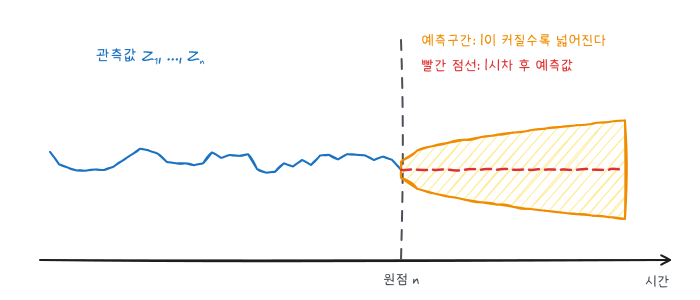
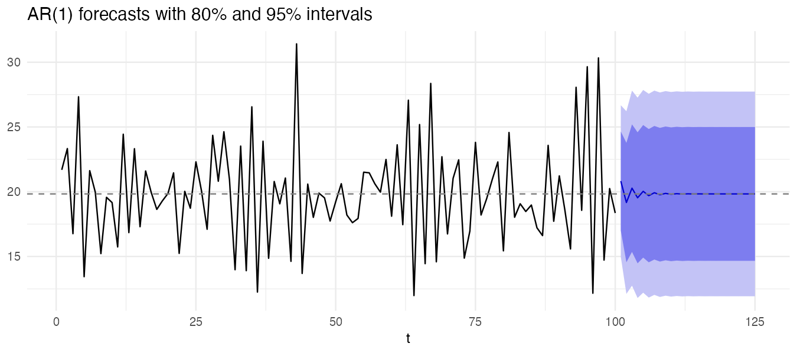
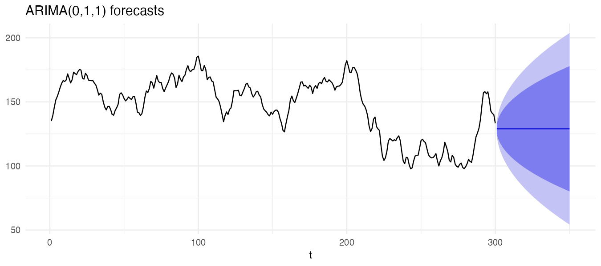

『SAS/ETS를 이용한 시계열분석』(조신섭·손영숙·성병찬)과 전북대학교 이영미 교수님 강의의 9장을 정리했다. 8편까지 모형을 골라 추정했다면, 이제 그 모형으로 미래 값과 그 불확실성을 구한다.

```r title="환경 설정"
library(tidyverse)
library(forecast)
library(patchwork)
theme_set(theme_minimal(base_size = 12))

data_url <- "https://raw.githubusercontent.com/Bricoler/time-series-analysis/master/timedata/"
read_ts <- function(file, start = 1, frequency = 1) {
  ts(scan(paste0(data_url, file), quiet = TRUE), start = start, frequency = frequency)
}
```

## 1. 최소평균제곱오차 예측

확률변수 $Y$를 $X$의 함수 $g(X)$로 예측할 때 평균제곱오차 $E[(Y - g(X))^2]$을 최소로 하는 것은 조건부 기대값이다.

$$
\hat Y = \arg\min_{g} E\left[ (Y - g(X))^2 \right] = E(Y \mid X)
$$

시계열에서 시점 $n$(예측 원점)까지 관측한 뒤 $l$시차 후(선행시차)를 예측하면 다음과 같다.

$$
\hat Z_n(l) = E(Z_{n+l} \mid Z_n, Z_{n-1}, \dots), \qquad e_n(l) = Z_{n+l} - \hat Z_n(l)
$$



계산할 때 쓰는 규칙은 두 가지다.

- 이미 관측된 값의 조건부 기대값은 그 값 자체: $E(Z_{n-j} \mid \cdots) = Z_{n-j}$, $E(\epsilon_{n-j} \mid \cdots) = \epsilon_{n-j}$ ($j \ge 0$)
- 미래 오차의 조건부 기대값은 0: $E(\epsilon_{n+j} \mid \cdots) = 0$ ($j \ge 1$)

## 2. AR(1)의 예측

$Z_t - \mu = \phi(Z_{t-1} - \mu) + \epsilon_t$에서

$$
\hat Z_n(1) = \mu + \phi(Z_n - \mu), \qquad \hat Z_n(l) = \mu + \phi^l (Z_n - \mu)
$$

예측값은 마지막 관측값에서 출발해 평균 $\mu$로 지수적으로 수렴한다. 예측오차는 다음과 같다.

$$
e_n(l) = \epsilon_{n+l} + \phi\epsilon_{n+l-1} + \cdots + \phi^{l-1}\epsilon_{n+1}, \qquad
Var(e_n(l)) = \frac{1 - \phi^{2l}}{1 - \phi^2}\sigma^2 \;\xrightarrow{l \to \infty}\; \frac{\sigma^2}{1 - \phi^2} = Var(Z_t)
$$

먼 미래를 예측할수록 예측값은 평균으로, 예측오차 분산은 시계열 자체의 분산으로 간다. 정상 시계열에서는 먼 미래에 대해 "평균"보다 나은 예측을 할 수 없다는 뜻이다.

## 3. MA(1)의 예측

$Z_t - \mu = \epsilon_t - \theta\epsilon_{t-1}$에서

$$
\hat Z_n(l) = \begin{cases} \mu - \theta\epsilon_n, & l = 1 \\ \mu, & l > 1 \end{cases}, \qquad
Var(e_n(l)) = \begin{cases} \sigma^2, & l = 1 \\ (1 + \theta^2)\sigma^2, & l > 1 \end{cases}
$$

MA(1)은 기억이 1시차뿐이라 2시차부터는 평균밖에 예측할 수 없다. $\epsilon_n$은 관측되지 않으므로 가역성을 이용해 과거 관측값으로 복원한다(8편).

## 4. 일반 ARMA와 예측구간

정상 ARMA를 선형과정 $Z_t - \mu = \sum_{j \ge 0} \psi_j \epsilon_{t-j}$로 쓰면

$$
e_n(l) = \sum_{j=0}^{l-1} \psi_j \epsilon_{n+l-j}, \qquad E(e_n(l)) = 0, \qquad Var(e_n(l)) = \sigma^2 \sum_{j=0}^{l-1} \psi_j^2
$$

1시차 예측오차는 $e_n(1) = \epsilon_{n+1}$, 즉 백색잡음이다. 모형이 맞으면 1시차 예측오차(잔차)에 자기상관이 없어야 하는 이유다. 오차가 정규분포를 따르면 $100(1 - \alpha)\%$ 예측구간은 다음과 같다.

$$
\hat Z_n(l) \pm z_{\alpha/2} \sqrt{Var(e_n(l))}
$$

실제로는 모수를 추정값으로 바꾼다. 모수 추정의 불확실성은 무시하므로 표본이 작으면 구간이 실제보다 좁다.

```r
psi <- ARMAtoMA(ar = 0.7, ma = numeric(), lag.max = 10)
round(c(1, psi), 3)
round(sqrt(cumsum(c(1, psi^2))), 3)    # sigma = 1일 때 l = 1, 2, ...의 예측 표준오차
```

`ARMAtoMA()`가 $\psi_j$를 계산한다. 출력의 둘째 줄처럼 표준오차가 1, 1.22, 1.32, ...로 늘다가 1.40에서 멈춘다. AR(1), $\phi = 0.7$이면 $\psi_j = 0.7^j$이고, 예측 표준오차는 $1/\sqrt{1 - 0.49} \approx 1.40$으로 수렴한다.

## 5. 예제: AR(1) 예측

8편 예제 2에서 AR(1)로 결정한 자료다.

```r w=9 h=4
z <- read_ts("eg8_7.txt")
fit <- Arima(z, order = c(1, 0, 0))
fc <- forecast(fit, h = 25, level = c(80, 95))

autoplot(fc) +
  geom_hline(yintercept = coef(fit)["intercept"], linetype = "dashed", color = "grey50") +
  labs(x = "t", y = NULL, title = "AR(1) forecasts with 80% and 95% intervals")
head(as.data.frame(fc), 5)
```



`Arima()`의 `intercept`는 상수항 $\delta$가 아니라 평균 $\mu$다. 예측값이 점선(추정된 평균)으로 빠르게 수렴하고, 예측구간 폭은 몇 시차 지나면 더 이상 넓어지지 않는다.

## 6. 비정상 ARIMA의 예측

ARIMA(0,1,1) $Z_t = Z_{t-1} + \epsilon_t - \theta\epsilon_{t-1}$에서

$$
\hat Z_n(1) = Z_n - \theta\epsilon_n, \qquad \hat Z_n(l) = \hat Z_n(1) \;\; (l \ge 2)
$$

$\epsilon_n = Z_n - \hat Z_{n-1}(1)$을 넣으면

$$
\hat Z_n(1) = (1 - \theta) Z_n + \theta \hat Z_{n-1}(1)
$$

평활상수 $\omega = 1 - \theta$인 **단순지수평활**과 같다(3편). 차이는 ARIMA는 확률모형이라 예측구간을 계산할 수 있다는 것이다. $\psi$ 가중치가 $\psi_j = 1 - \theta$로 줄어들지 않으므로 예측오차 분산은 $l$에 비례해 끝없이 커진다.

$$
Var(e_n(l)) = \sigma^2 \left[ 1 + (l - 1)(1 - \theta)^2 \right]
$$

```r w=9 h=4
z2 <- read_ts("eg9_5.txt")
fit2 <- Arima(z2, order = c(0, 1, 1))
coef(fit2)     # R은 + 표기: 교재의 theta = -ma1
autoplot(forecast(fit2, h = 50)) + labs(x = "t", y = NULL, title = "ARIMA(0,1,1) forecasts")
```



R의 `ma1` $\approx 0.76$이므로 교재 표기로는 $\hat\theta \approx -0.76$이다. 대응하는 평활상수 $\omega = 1 - \theta \approx 1.76$이 1보다 커서, 이 자료는 단순지수평활의 범위(0~1)로는 표현되지 않는다. ARIMA 표현이 평활법보다 넓은 경우를 포함한다는 예다.

| | 정상 ARMA | 비정상 ARIMA ($d \ge 1$) |
|---|---|---|
| 장기 예측값 | 평균 $\mu$로 수렴 | 마지막 수준(또는 추세선)을 유지 |
| 예측오차 분산 | $Var(Z_t)$로 수렴 | 선행시차에 따라 계속 증가 |
| $\psi_j$ | 0으로 수렴 | 0으로 가지 않음 |

## 7. 예측의 갱신

새 관측값 $Z_{n+1}$이 들어오면 모형을 다시 추정하지 않고 예측을 갱신할 수 있다.

$$
\hat Z_{n+1}(l) = \hat Z_n(l + 1) + \psi_l \left[ Z_{n+1} - \hat Z_n(1) \right]
$$

"새 예측 = 이전 예측 + $\psi_l$ × 1시차 예측오차"다. 2편 상수평균모형, 3편 지수평활의 갱신식과 같은 구조다.

## 8. 예측력 비교

여러 모형 중 하나를 고를 때는 마지막 일부를 떼어 두고 예측오차로 비교한다(1편의 MSE, MAE, MAPE).

```r
train <- window(z, end = 80)
test <- window(z, start = 81)

cands <- list(
  `AR(1)` = Arima(train, order = c(1, 0, 0)),
  `AR(2)` = Arima(train, order = c(2, 0, 0)),
  `MA(1)` = Arima(train, order = c(0, 0, 1))
)
map_dfr(cands, \(f) as_tibble(accuracy(forecast(f, h = length(test)), test)["Test set", c("RMSE", "MAE", "MAPE"), drop = FALSE]),
        .id = "model")
```

AR(1)과 AR(2)의 시험 구간 오차가 거의 같고 MA(1)이 조금 크다. 같은 성능이면 모수가 적은 AR(1)을 고른다. `accuracy(forecast, test)`는 학습 구간과 시험 구간의 오차를 함께 준다. 여러 시점에서 원점을 옮겨 가며 1시차 예측오차를 모으는 것이 더 안정적인 비교다(`tsCV()`).

## 요약

| 모형 | $\hat Z_n(l)$ | $Var(e_n(l))$ |
|---|---|---|
| AR(1) | $\mu + \phi^l(Z_n - \mu)$ | $\sigma^2 (1 - \phi^{2l}) / (1 - \phi^2)$ |
| MA(1) | $\mu - \theta\epsilon_n$ ($l = 1$), $\mu$ ($l > 1$) | $\sigma^2$, $(1 + \theta^2)\sigma^2$ |
| ARMA | 조건부 기대값을 재귀적으로 계산 | $\sigma^2 \sum_{j<l} \psi_j^2$ |
| ARIMA(0,1,1) | 단순지수평활, $\omega = 1 - \theta$ | $\sigma^2[1 + (l - 1)(1 - \theta)^2]$ |
| 예측구간 | $\hat Z_n(l) \pm z_{\alpha/2} \sqrt{\widehat{Var}(e_n(l))}$ | `forecast(fit, h, level)` |
