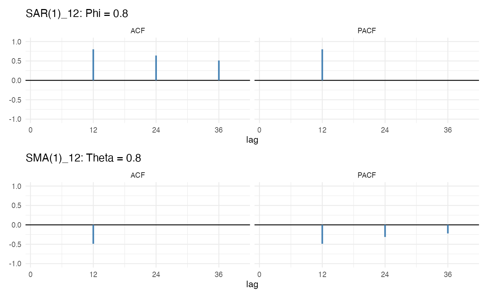
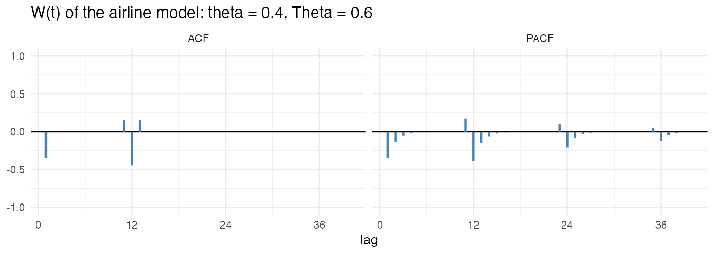
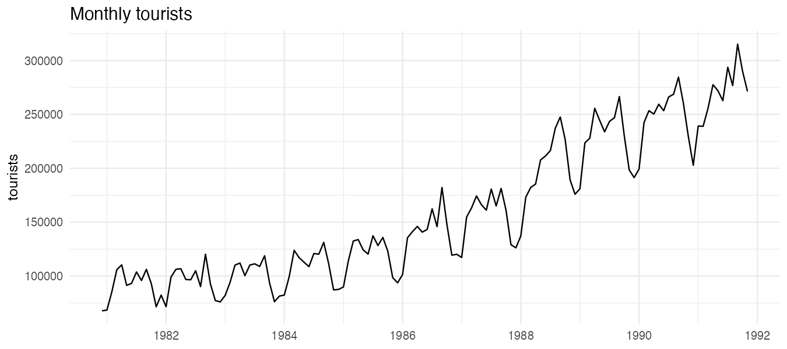
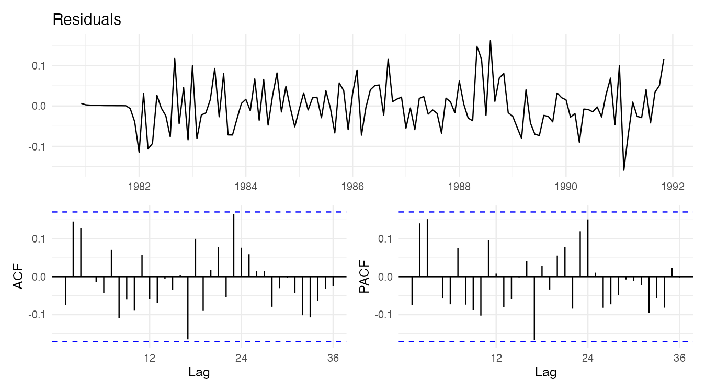
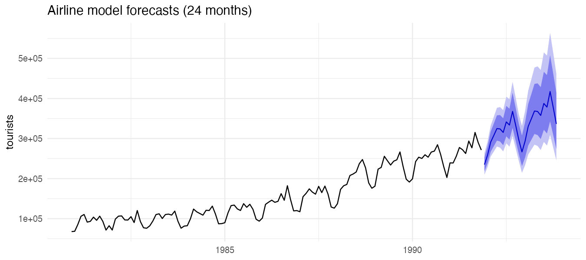

『SAS/ETS를 이용한 시계열분석』(조신섭·손영숙·성병찬)과 전북대학교 이영미 교수님 강의의 10장을 정리했다. 시리즈의 마지막 글로, 지금까지의 도구(변환, 차분, 식별, 추정, 진단, 예측)를 계절 시계열에 모두 적용한다.

```r title="환경 설정"
library(tidyverse)
library(forecast)
library(patchwork)
theme_set(theme_minimal(base_size = 12))

data_url <- "https://raw.githubusercontent.com/Bricoler/time-series-analysis/master/timedata/"
read_ts <- function(file, start, frequency = 12) {
  ts(scan(paste0(data_url, file), quiet = TRUE), start = start, frequency = frequency)
}
acf_pair <- function(x, title, lag.max = 36) {
  (autoplot(x) + labs(title = title, x = NULL, y = NULL)) /
    (ggAcf(x, lag.max = lag.max) + labs(title = NULL) | ggPacf(x, lag.max = lag.max) + labs(title = NULL))
}
theory_plot <- function(ar = numeric(), ma = numeric(), lag.max = 40, title = "") {
  acf <- ARMAacf(ar = ar, ma = ma, lag.max = lag.max)[-1]
  pacf <- ARMAacf(ar = ar, ma = ma, lag.max = lag.max, pacf = TRUE)
  tibble(lag = rep(1:lag.max, 2), value = c(acf, pacf), type = rep(c("ACF", "PACF"), each = lag.max)) |>
    ggplot(aes(lag, value)) +
    geom_hline(yintercept = 0) +
    geom_segment(aes(xend = lag, yend = 0), linewidth = 1, color = "steelblue") +
    facet_wrap(~type) +
    scale_x_continuous(breaks = seq(0, lag.max, 12)) +
    coord_cartesian(ylim = c(-1, 1)) +
    labs(title = title, x = "lag", y = NULL)
}
```

## 1. 결정적 계절성과 확률적 계절성

계절 시계열을 $Z_t = S_t + N_t$(계절 성분 + 비계절 성분)로 보자.

| | 결정적 계절성 | 확률적 계절성 |
|---|---|---|
| 계절 성분 | 매년 똑같은 패턴 | 패턴이 해마다 조금씩 변함 |
| 모델링 | 지시함수·삼각함수 회귀(2편) + $N_t$는 ARMA | 계절 차분, 계절 ARMA |
| 예 | $S_t = \beta_1 \sin(2\pi t/s) + \beta_2\cos(2\pi t/s)$ | $Z_t = Z_{t-s} + \epsilon_t$ |

경제 시계열은 대부분 계절 패턴이 서서히 변하므로 확률적 계절성으로 다룬다. 이때 "작년 같은 달"과의 상관을 직접 모델링한다.

## 2. 순수 계절형 ARMA

주기 $s$ 간격으로만 작동하는 ARMA다. 계절 후진연산자 $B^s$를 쓴다.

| 모형 | 식 (교재 표기) | ACF | PACF |
|---|---|---|---|
| SAR(1) | $(1 - \Phi B^{12}) Z_t = \epsilon_t$ | 시차 12, 24, 36에서 $\Phi, \Phi^2, \Phi^3$, 나머지 0 | 시차 12에서만 $\Phi$ |
| SMA(1) | $Z_t = (1 - \Theta B^{12})\epsilon_t$ | 시차 12에서만 $-\Theta/(1 + \Theta^2)$ | 시차 12, 24, 36에서 감소 |
| SAR(2), SMA(2) | 위의 계절 버전 | 시차 $12k$에서 AR(2), MA(2)와 같은 모양 | |

비계절 ARMA의 ACF·PACF 모양을 시차 $s$의 배수로 늘려 놓은 것과 같다.

```r w=9 h=5.5
sar1 <- c(rep(0, 11), 0.8)            # Phi = 0.8
sma1 <- c(rep(0, 11), -0.8)           # 교재 Theta = 0.8 → R 부호 반대
theory_plot(ar = sar1, title = "SAR(1)_12: Phi = 0.8") / theory_plot(ma = sma1, title = "SMA(1)_12: Theta = 0.8")
```



## 3. 승법 계절형 ARIMA

비계절 부분과 계절 부분을 **곱해서** 결합한다.

$$
\phi_p(B)\, \Phi_P(B^s)\, (1 - B)^d (1 - B^s)^D Z_t = \delta + \theta_q(B)\, \Theta_Q(B^s)\, \epsilon_t
$$

이것을 ARIMA$(p, d, q)(P, D, Q)_s$라 쓴다.

- $\phi_p(B) = 1 - \phi_1 B - \cdots - \phi_p B^p$, $\theta_q(B) = 1 - \theta_1 B - \cdots - \theta_q B^q$: 인접한 달 사이의 관계
- $\Phi_P(B^s) = 1 - \Phi_1 B^s - \cdots - \Phi_P B^{Ps}$, $\Theta_Q(B^s) = 1 - \Theta_1 B^s - \cdots$: 같은 달끼리의 관계
- $D$: 계절 차분 횟수. 보통 0 또는 1이다.

### 항공 모형: ARIMA(0,1,1)(0,1,1)₁₂

Box & Jenkins가 국제 항공 승객 자료에 적합한 모형으로, 월별 경제 자료에서 가장 자주 쓰인다.

$$
(1 - B)(1 - B^{12}) Z_t = (1 - \theta B)(1 - \Theta B^{12})\epsilon_t
$$

오른쪽을 전개하면 $\epsilon_t - \theta\epsilon_{t-1} - \Theta\epsilon_{t-12} + \theta\Theta\epsilon_{t-13}$, 시차 13에 곱해서 생긴 항이 있다. 차분한 계열 $W_t = \nabla\nabla_{12} Z_t$의 ACF는 시차 1, 11, 12, 13에서만 0이 아니다.

$$
\rho_1 = \frac{-\theta}{1 + \theta^2}, \qquad \rho_{12} = \frac{-\Theta}{1 + \Theta^2}, \qquad \rho_{11} = \rho_{13} = \rho_1 \rho_{12}
$$

```r w=9 h=3.2
# 교재 theta = 0.4, Theta = 0.6 → R: (1 - 0.4B)(1 - 0.6B^12) 전개 후 부호 반대
ma_mult <- numeric(13); ma_mult[1] <- -0.4; ma_mult[12] <- -0.6; ma_mult[13] <- 0.4 * 0.6
theory_plot(ma = ma_mult, title = "W(t) of the airline model: theta = 0.4, Theta = 0.6")
```



시차 11과 13에 작은 "곁가지" 막대가 보이는 것이 승법 모형의 특징이다. 표본 SACF에서 이 모양이 보이면 승법 계절 MA를 의심한다.

## 4. 예제: 월별 관광객 수

교재 예제 10.5의 월별 관광객 자료 132개월이다. 시작 시점은 교재 예제 코드 저장소와 같이 1980년 12월로 둔다.

```r w=9 h=4
tour <- read_ts("tourist.txt", start = c(1980, 12))
autoplot(tour) + labs(x = NULL, y = "tourists", title = "Monthly tourists")
```



증가 추세와 계절성이 있고, 계절 진폭이 수준과 함께 커진다.

### 식별

```r w=9 h=8
lt <- log(tour)
(acf_pair(lt, "log") / acf_pair(diff(lt, lag = 12), "log, seasonal difference") /
   acf_pair(diff(diff(lt, lag = 12)), "log, seasonal + first difference")) +
  plot_layout(heights = c(1, 1, 1))
c(ndiffs = ndiffs(lt), nsdiffs = nsdiffs(lt))
```


1. 로그를 취해 분산을 안정화한다.
2. 로그 계열의 SACF는 천천히 감소하고 시차 12, 24에서 크다. 계절 차분이 필요하다.
3. 계절 차분 후에도 SACF가 천천히 줄면 1차 차분을 추가한다.
4. 두 번 차분한 계열의 SACF가 시차 1과 12에서 크고 나머지는 작으면 항공 모형 ARIMA(0,1,1)(0,1,1)₁₂를 잠정 모형으로 고른다.

### 추정과 진단

```r
fit_air <- Arima(tour, order = c(0, 1, 1), seasonal = c(0, 1, 1), lambda = 0)
fit_air
coef_tab <- tibble(term = names(coef(fit_air)), estimate = coef(fit_air),
                   se = sqrt(diag(fit_air$var.coef))) |> mutate(z = estimate / se)
coef_tab
checkresiduals(fit_air, lag = 36, plot = FALSE)
```

`lambda = 0`은 로그 변환을 모형 안에서 처리한다. 예측할 때 자동으로 원래 단위로 되돌려 준다. R의 `ma1`, `sma1`은 부호가 교재와 반대이므로 교재의 $\hat\theta = -$`ma1`, $\hat\Theta = -$`sma1`이다.

```r w=9 h=5
res <- residuals(fit_air)
(autoplot(res) + labs(title = "Residuals", x = NULL, y = NULL)) /
  (ggAcf(res, lag.max = 36) + labs(title = NULL) | ggPacf(res, lag.max = 36) + labs(title = NULL))
```



잔차 SACF에 시차 12, 24의 큰 막대가 남지 않고 Ljung-Box 검정이 유의하지 않으면 모형을 받아들인다. 과대적합 진단으로 `order = c(1,1,1)`이나 `seasonal = c(1,1,1)`을 적합해 추가 모수가 유의한지 본다.

```r
cands <- list(
  `(0,1,1)(0,1,1)` = fit_air,
  `(1,1,1)(0,1,1)` = Arima(tour, order = c(1, 1, 1), seasonal = c(0, 1, 1), lambda = 0),
  `(0,1,1)(1,1,1)` = Arima(tour, order = c(0, 1, 1), seasonal = c(1, 1, 1), lambda = 0),
  `(1,1,0)(0,1,1)` = Arima(tour, order = c(1, 1, 0), seasonal = c(0, 1, 1), lambda = 0)
)
map_dfr(cands, \(f) tibble(AIC = f$aic, BIC = f$bic, sigma2 = f$sigma2), .id = "model")
```

### 예측

```r w=9 h=4
fc <- forecast(fit_air, h = 24)
autoplot(fc) + labs(x = NULL, y = "tourists", title = "Airline model forecasts (24 months)")
```



로그 척도에서는 예측구간이 대칭이지만, 원래 단위로 되돌리면 위쪽으로 더 넓은 비대칭 구간이 된다. 계절 패턴과 추세가 그대로 이어지고, 차분이 두 번 들어간 비정상 모형이라 구간이 시간에 따라 계속 넓어진다(9편).

## 5. 회귀 + ARMA 오차와의 비교

결정적 계절성으로 보면 2편처럼 추세와 지시함수로 회귀하고 오차를 ARMA로 둘 수도 있다.

```r
fit_reg <- Arima(tour, order = c(1, 0, 0), xreg = cbind(t = seq_along(tour), seasonaldummy(tour)),
                 lambda = 0)
c(airline_AICc = fit_air$aicc, regression_AR1_AICc = fit_reg$aicc)
```

두 모형은 차분 여부가 달라 반응변수가 같지 않으므로 AIC를 직접 비교하는 것은 엄밀하지 않다. 마지막 1~2년을 떼어 두고 예측오차(9편)로 비교하는 것이 공정하다. 결정적 모형은 계절 패턴이 바뀌지 않는다고 가정하므로, 패턴이 서서히 변하는 자료에서는 장기 예측이 빗나가기 쉽다.

## 시리즈 정리

| 편 | 방법 | 핵심 가정 | R |
|---|---|---|---|
| 2 | 추세 회귀 | 추세·계절이 고정, 오차 독립 | `lm()` |
| 3 | 지수평활 | 수준·기울기·계절이 서서히 변함 | `ses()`, `holt()`, `hw()` |
| 4 | 분해 | 성분을 따로 추정 | `decompose()`, `stl()` |
| 5~6 | 정상 ARMA | 약정상성 | `ARMAacf()`, `arima.sim()` |
| 7 | 차분, ARIMA | 확률적 추세 | `diff()`, `adf.test()` |
| 8 | 식별·추정·진단 | 잔차가 백색잡음 | `Arima()`, `checkresiduals()` |
| 9 | 예측 | 조건부 기대값 | `forecast()` |
| 10 | SARIMA | 확률적 계절성 | `Arima(seasonal = )` |
