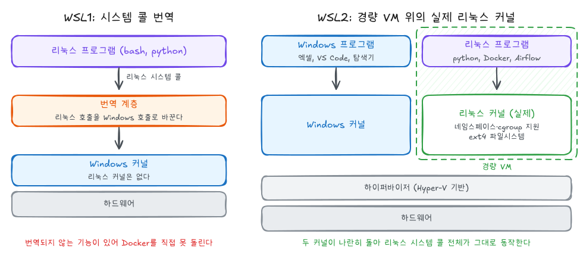

Airflow, Spark, Kafka 같은 데이터 도구는 Windows를 공식 지원하지 않거나 지원이 제한적이다. 예전에는 VMware, VirtualBox로 가상 머신을 띄우거나 듀얼 부팅을 했지만, 지금은 Microsoft가 제공하는 **WSL2(Windows Subsystem for Linux 2)**로 Windows 안에서 리눅스를 쓴다. 리눅스와 격리 환경의 기본 개념은 [앞 글](/posts/linux-for-data-analysts)에 있다.

## 1. WSL2란

WSL2는 Windows 안에서 **실제 리눅스 커널을 경량 가상 머신으로 구동**하는 기능이다. 하이퍼바이저 위에서 Windows 커널과 리눅스 커널이 나란히 돌아간다. 그래서 리눅스용 프로그램과 Docker 컨테이너를 그대로 실행할 수 있다.

초기 버전인 WSL1은 리눅스 커널 없이 리눅스 시스템 콜을 Windows 커널 호출로 번역하는 방식이었다.

| 구분 | WSL1 | WSL2 |
| :--- | :--- | :--- |
| 구동 방식 | 시스템 콜 번역 계층 | 경량 VM 위에서 실제 리눅스 커널 구동 |
| 호환성 | 일부 시스템 기능 미지원 | 리눅스 시스템 콜 전체 호환 |
| Docker | 직접 실행할 수 없다 | 직접 실행할 수 있다 |
| 리눅스 내부 파일 I/O | 느리다 | 리눅스 파일시스템(`ext4`)을 써서 빠르다 |
| Windows 경로(`/mnt/c`) I/O | 상대적으로 빠르다 | 느리다 (아래 3절) |



지금은 WSL2가 기본값이다.

## 2. 데이터 분석에서 쓰는 이유

- **Docker와 Airflow**: Docker는 리눅스 커널 기능(네임스페이스, cgroup)으로 동작한다. Docker Desktop의 백엔드로 WSL2를 쓰면, 리눅스 서버와 같은 컨테이너 환경을 로컬 PC에 만들 수 있다.
- **일반 VM보다 가볍다**: 일반 VM은 부팅이 길고 설정한 메모리를 통째로 점유한다. WSL2는 몇 초 안에 시작하고, 작업량에 따라 메모리를 늘렸다 줄인다.
- **Windows 도구와 연결된다**
  - Ubuntu 터미널에서 `code .`를 입력하면 Windows의 VS Code가 리눅스 폴더에 연결된 채로 열린다(WSL 확장 필요).
  - Windows 파일 탐색기 왼쪽의 `Linux` 항목에서 리눅스 폴더의 파일을 끌어 옮길 수 있다.
  - Windows에 설치한 NVIDIA 드라이버를 WSL2 안에서 그대로 써서 GPU로 딥러닝 모델을 학습할 수 있다.

## 3. 설치와 설정

### 설치

PowerShell을 **관리자 권한**으로 열고 다음을 실행한 뒤 재부팅하면 기본 Ubuntu 배포판까지 설치된다.

```powershell
wsl --install
```

### 작업 위치는 리눅스 내부 경로

가장 흔한 실수는 Windows 경로(`/mnt/c/Users/...`)에 데이터를 두고 WSL2에서 분석 코드를 돌리는 것이다. 이 경로는 두 파일시스템 사이의 변환을 거치므로 파일을 많이 읽고 쓰면 크게 느려진다. 프로젝트와 큰 CSV, Parquet 파일은 리눅스 내부 경로(`/home/사용자명/...`)에 둔다.

| 파일 위치 | 어디서 다루는가 |
|---|---|
| `/home/사용자명/...` | WSL2 안의 도구(Python, Docker)로 처리할 데이터와 코드 |
| `C:\...` (`/mnt/c/...`) | Windows 프로그램(엑셀 등)으로 열 결과물 |



### 메모리 상한 설정 (`.wslconfig`)

WSL2는 큰 데이터를 처리한 뒤 사용한 메모리를 Windows에 바로 돌려주지 않을 때가 있다. 리눅스가 남는 메모리를 파일 캐시로 잡아 두기 때문이다. PC 전체가 느려지지 않게 하려면 `C:\Users\사용자명\.wslconfig`에 상한을 적는다.

```ini
[wsl2]
# 최대 사용 메모리. PC 메모리의 절반 이하를 권장한다
memory=8GB
# 최대 사용 CPU 코어 수
processors=4
```

저장한 뒤 PowerShell에서 `wsl --shutdown`을 실행하고 다시 시작해야 적용된다.

## 정리

- WSL2는 시스템 콜 번역(WSL1)이 아니라 실제 리눅스 커널을 경량 VM으로 띄운다. 그래서 Docker가 그대로 돈다.
- 데이터와 코드는 `/home` 아래 리눅스 경로에 둔다. `/mnt/c`에서 돌리면 느리다.
- 메모리를 많이 쓰는 작업을 한다면 `.wslconfig`로 상한을 정하고 `wsl --shutdown`으로 적용한다.
